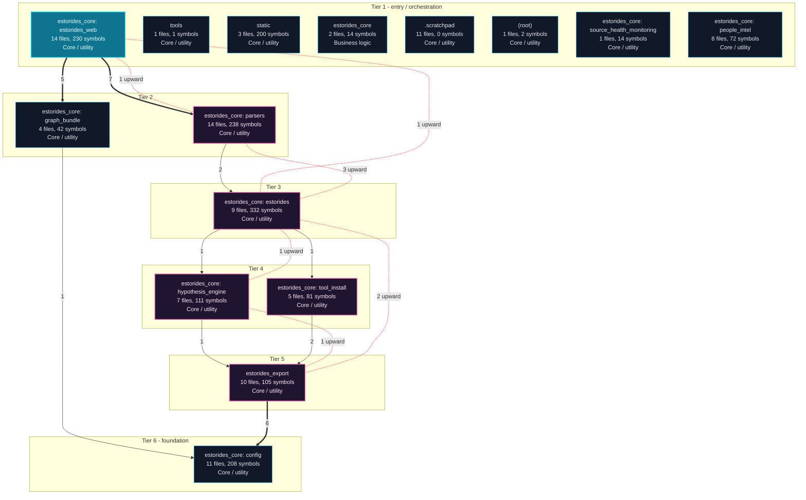
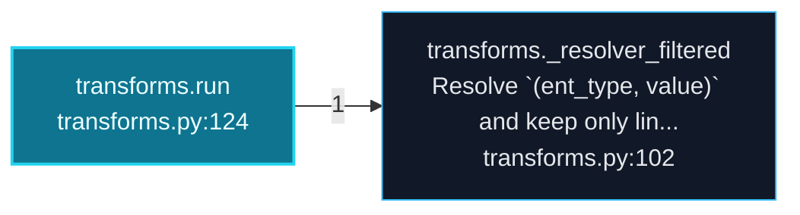
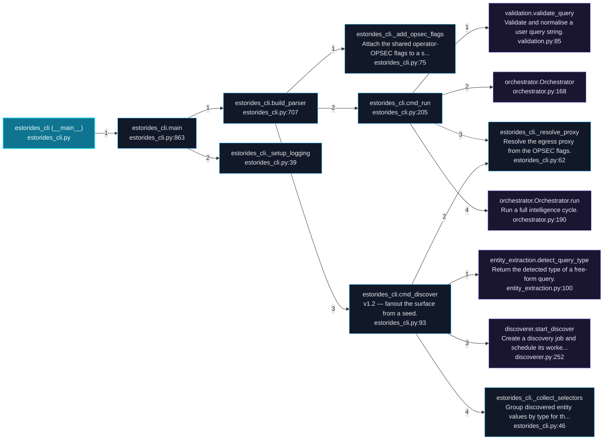
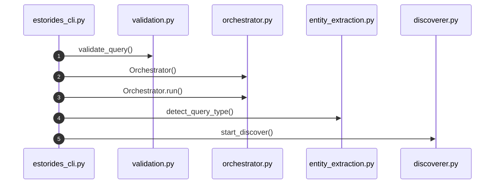
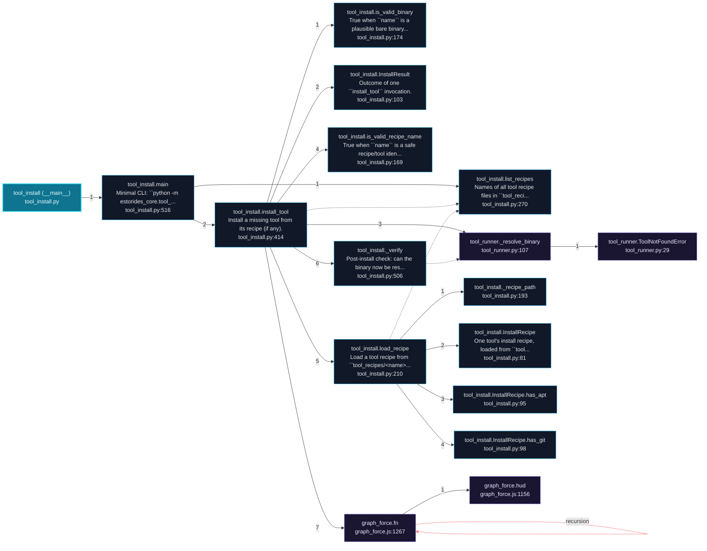
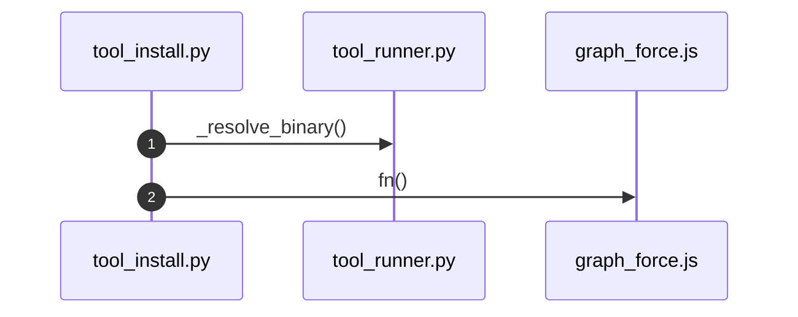

# estorides Architecture and Execution Flows

[Back to index](index.md)

## Architecture Overview

15 components stacked in 6 dependency tiers (weighted Eades-Lin-Smyth ordering: arrows point from dependent to dependency, top to bottom). Labels are import counts, thick arrows the top quartile; 13 transitively implied edges are omitted. Dashed red arrows are upward dependencies: the smallest set of imports that closes every cycle and breaks the layering. Cyan components hold entry points. Interactive version: `readmenator-apidocs/index.html#/flows`.

Upward dependencies to fix first: `estorides_core: estorides` -> `estorides_core: parsers` (3 imports); `estorides_export` -> `estorides_core: estorides` (2 imports); `estorides_core: parsers` -> `estorides_core: estorides_web` (1 imports); `estorides_core: hypothesis_engine` -> `estorides_core: estorides` (1 imports); `estorides_core: estorides` -> `estorides_core: estorides_web` (1 imports); `estorides_export` -> `estorides_core: hypothesis_engine` (1 imports)

---

## Execution Flows

Entry points are scored from `__main__` guards, `main` functions, entry-style names and files, and call-graph sources. Each flow walks resolved calls in call-site order (depth <= 4, <= 40 steps); numbers give the call order, dashed arrows revisit an already expanded callee, red arrows are recursion. Interactive version with zoom and per-node docs: `readmenator-apidocs/index.html#/flows`.

### `transforms.run`

`estorides_core/transforms.py:124`, score 9: entry-style name `run`.

Call tree:

### `estorides_cli (__main__)`

`estorides_cli.py:870`, score 8: `if __name__ == "__main__"` guard.

Call tree:

Cross-file sequence:

### `tool_install (__main__)`

`estorides_core/tool_install.py:541`, score 8: `if __name__ == "__main__"` guard.

Call tree:

Cross-file sequence:

---
