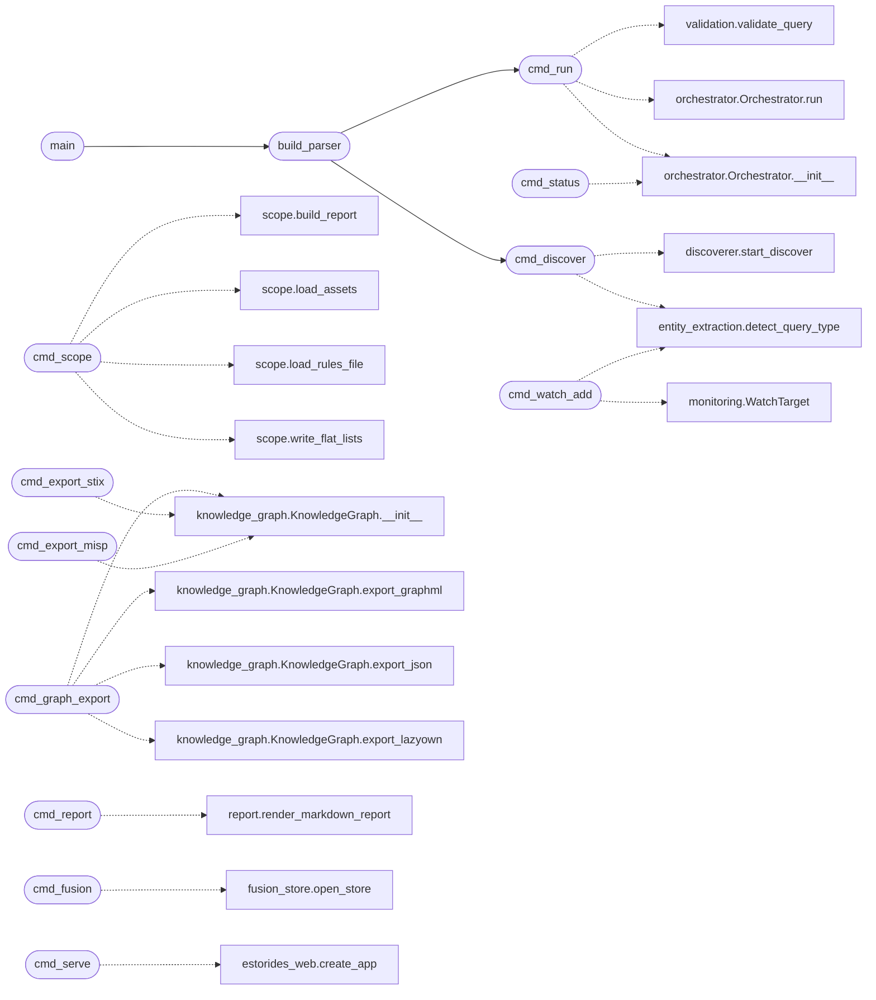

# `estorides_cli`

> Source: [estorides_cli.py:1](../../estorides_cli.py#L1) | language `py` | coverage 36.0% | [API index](../index.md)

estorides CLI.

Usage:
  estorides "example.com"
  estorides "8.8.8.8" --include-paid
  estorides "user@example.com" --only-sources shodan_internetdb,ipapi_free
  estorides graph --export graphml
  estorides report --query "example.com" --out report.md
  estorides stix --out bundle.json
  estorides serve --port 5050

## Contents

- **Functions:** [`cmd_discover`](#cmd_discover), [`cmd_run`](#cmd_run), [`cmd_scope`](#cmd_scope), [`cmd_graph_export`](#cmd_graph_export), [`cmd_export_stix`](#cmd_export_stix), [`cmd_export_misp`](#cmd_export_misp), [`cmd_report`](#cmd_report), [`cmd_diff`](#cmd_diff), [`cmd_status`](#cmd_status), [`cmd_fusion`](#cmd_fusion), [`cmd_watch_add`](#cmd_watch_add), [`cmd_watch_list`](#cmd_watch_list), [`cmd_watch_remove`](#cmd_watch_remove), [`cmd_watch_enable`](#cmd_watch_enable), [`cmd_watch_disable`](#cmd_watch_disable), [`cmd_watch_history`](#cmd_watch_history), [`cmd_alerts_test`](#cmd_alerts_test), [`cmd_alerts_channels`](#cmd_alerts_channels), [`cmd_scheduler_start`](#cmd_scheduler_start), [`cmd_scheduler_stop`](#cmd_scheduler_stop), [`cmd_scheduler_status`](#cmd_scheduler_status), [`cmd_serve`](#cmd_serve), [`build_parser`](#build_parser), [`main`](#main)
- **Constants:** [`TOR_DEFAULT_PROXY`](#tor_default_proxy)

## Call Graph

Solid arrows stay in this module, dashed arrows leave it.



## Functions

<a id="cmd_discover"></a>

### `cmd_discover`

`function` `async` | [estorides_cli.py:93](../../estorides_cli.py#L93)

```python
async def cmd_discover(args: argparse.Namespace) -> int
```

v1.2 — fanout the surface from a seed.

Mirrors the /api/discover/start endpoint but as a CLI subcommand
so an operator can drop a seed in a terminal and walk away.
Streams progress to stdout. The final case is dumped to
--out-json if provided.

**Parameters**

| Name | Type | Default | Description |
|---|---|---|---|
| `args` | `argparse.Namespace` |  |  |

**Returns:** `int`

*Calls:* [`start_discover`](estorides_core.discoverer.py.md#start_discover), [`detect_query_type`](estorides_core.entity_extraction.py.md#detect_query_type)

*Called by:* [`build_parser`](#build_parser)

---

<a id="cmd_run"></a>

### `cmd_run`

`function` `async` | [estorides_cli.py:205](../../estorides_cli.py#L205)

```python
async def cmd_run(args: argparse.Namespace) -> int
```

**Parameters**

| Name | Type | Default | Description |
|---|---|---|---|
| `args` | `argparse.Namespace` |  |  |

**Returns:** `int`

*Calls:* [`Orchestrator.__init__`](estorides_core.orchestrator.py.md#orchestrator-__init__), [`Orchestrator.run`](estorides_core.orchestrator.py.md#orchestrator-run), [`validate_query`](estorides_core.validation.py.md#validate_query)

*Called by:* [`build_parser`](#build_parser)

---

<a id="cmd_scope"></a>

### `cmd_scope`

`function` | [estorides_cli.py:282](../../estorides_cli.py#L282)

```python
def cmd_scope(args: argparse.Namespace) -> int
```

Classify discovered assets against a program's scope rules.

Reads assets (a `discover --out-json` surface or a flat host list),
applies the in/out-of-scope rules, and emits the in-scope host/IP
lists an operator pipes into the active phase. Out-of-scope assets are
surfaced explicitly so they are never targeted by accident.

**Parameters**

| Name | Type | Default | Description |
|---|---|---|---|
| `args` | `argparse.Namespace` |  |  |

**Returns:** `int`

*Calls:* [`build_report`](estorides_core.scope.py.md#build_report), [`load_assets`](estorides_core.scope.py.md#load_assets), [`load_rules_file`](estorides_core.scope.py.md#load_rules_file), [`write_flat_lists`](estorides_core.scope.py.md#write_flat_lists)

---

<a id="cmd_graph_export"></a>

### `cmd_graph_export`

`function` | [estorides_cli.py:328](../../estorides_cli.py#L328)

```python
def cmd_graph_export(args: argparse.Namespace) -> int
```

**Parameters**

| Name | Type | Default | Description |
|---|---|---|---|
| `args` | `argparse.Namespace` |  |  |

**Returns:** `int`

*Calls:* [`KnowledgeGraph.__init__`](estorides_core.knowledge_graph.py.md#knowledgegraph-__init__), [`KnowledgeGraph.export_graphml`](estorides_core.knowledge_graph.py.md#knowledgegraph-export_graphml), [`KnowledgeGraph.export_json`](estorides_core.knowledge_graph.py.md#knowledgegraph-export_json), [`KnowledgeGraph.export_lazyown`](estorides_core.knowledge_graph.py.md#knowledgegraph-export_lazyown)

---

<a id="cmd_export_stix"></a>

### `cmd_export_stix`

`function` | [estorides_cli.py:357](../../estorides_cli.py#L357)

```python
def cmd_export_stix(args: argparse.Namespace) -> int
```

**Parameters**

| Name | Type | Default | Description |
|---|---|---|---|
| `args` | `argparse.Namespace` |  |  |

**Returns:** `int`

*Calls:* [`KnowledgeGraph.__init__`](estorides_core.knowledge_graph.py.md#knowledgegraph-__init__)

---

<a id="cmd_export_misp"></a>

### `cmd_export_misp`

`function` | [estorides_cli.py:367](../../estorides_cli.py#L367)

```python
def cmd_export_misp(args: argparse.Namespace) -> int
```

**Parameters**

| Name | Type | Default | Description |
|---|---|---|---|
| `args` | `argparse.Namespace` |  |  |

**Returns:** `int`

*Calls:* [`KnowledgeGraph.__init__`](estorides_core.knowledge_graph.py.md#knowledgegraph-__init__)

---

<a id="cmd_report"></a>

### `cmd_report`

`function` | [estorides_cli.py:377](../../estorides_cli.py#L377)

```python
def cmd_report(args: argparse.Namespace) -> int
```

Render a Markdown report for a case.

Reads from the case store (so the report reflects what was persisted,
not the volatile in-memory graph). When `--diff <other_id>` is given,
the report also includes a "what's new" section vs the other case.

**Parameters**

| Name | Type | Default | Description |
|---|---|---|---|
| `args` | `argparse.Namespace` |  |  |

**Returns:** `int`

*Calls:* [`render_markdown_report`](estorides_export.report.py.md#render_markdown_report)

---

<a id="cmd_diff"></a>

### `cmd_diff`

`function` | [estorides_cli.py:418](../../estorides_cli.py#L418)

```python
def cmd_diff(args: argparse.Namespace) -> int
```

Diff two cases.

CLI twin of /api/cases/diff.

**Parameters**

| Name | Type | Default | Description |
|---|---|---|---|
| `args` | `argparse.Namespace` |  |  |

**Returns:** `int`

---

<a id="cmd_status"></a>

### `cmd_status`

`function` | [estorides_cli.py:446](../../estorides_cli.py#L446)

```python
def cmd_status(_: argparse.Namespace) -> int
```

**Parameters**

| Name | Type | Default | Description |
|---|---|---|---|
| `_` | `argparse.Namespace` |  |  |

**Returns:** `int`

*Calls:* [`Orchestrator.__init__`](estorides_core.orchestrator.py.md#orchestrator-__init__)

---

<a id="cmd_fusion"></a>

### `cmd_fusion`

`function` | [estorides_cli.py:453](../../estorides_cli.py#L453)

```python
def cmd_fusion(args: argparse.Namespace) -> int
```

Query the cross-run fusion datastore.

Subactions:
  stats              size of the fused fact base
  sources            YAML catalogue with fetch/ok counters
  entities [TERM]    search fused entities (``--type``, ``--min-sources``)
  entity ID          full fused view of one entity (provenance + props)

**Parameters**

| Name | Type | Default | Description |
|---|---|---|---|
| `args` | `argparse.Namespace` |  |  |

**Returns:** `int`

*Calls:* [`open_store`](estorides_core.fusion_store.py.md#open_store)

---

<a id="cmd_watch_add"></a>

### `cmd_watch_add`

`function` | [estorides_cli.py:496](../../estorides_cli.py#L496)

```python
def cmd_watch_add(args: argparse.Namespace) -> int
```

Add a new recurring watch target.

**Parameters**

| Name | Type | Default | Description |
|---|---|---|---|
| `args` | `argparse.Namespace` |  |  |

**Returns:** `int`

*Calls:* [`detect_query_type`](estorides_core.entity_extraction.py.md#detect_query_type), [`WatchTarget`](estorides_core.monitoring.py.md#watchtarget)

---

<a id="cmd_watch_list"></a>

### `cmd_watch_list`

`function` | [estorides_cli.py:560](../../estorides_cli.py#L560)

```python
def cmd_watch_list(args: argparse.Namespace) -> int
```

List all watch targets.

**Parameters**

| Name | Type | Default | Description |
|---|---|---|---|
| `args` | `argparse.Namespace` |  |  |

**Returns:** `int`

---

<a id="cmd_watch_remove"></a>

### `cmd_watch_remove`

`function` | [estorides_cli.py:580](../../estorides_cli.py#L580)

```python
def cmd_watch_remove(args: argparse.Namespace) -> int
```

Delete a watch target.

**Parameters**

| Name | Type | Default | Description |
|---|---|---|---|
| `args` | `argparse.Namespace` |  |  |

**Returns:** `int`

---

<a id="cmd_watch_enable"></a>

### `cmd_watch_enable`

`function` | [estorides_cli.py:592](../../estorides_cli.py#L592)

```python
def cmd_watch_enable(args: argparse.Namespace) -> int
```

**Parameters**

| Name | Type | Default | Description |
|---|---|---|---|
| `args` | `argparse.Namespace` |  |  |

**Returns:** `int`

---

<a id="cmd_watch_disable"></a>

### `cmd_watch_disable`

`function` | [estorides_cli.py:605](../../estorides_cli.py#L605)

```python
def cmd_watch_disable(args: argparse.Namespace) -> int
```

**Parameters**

| Name | Type | Default | Description |
|---|---|---|---|
| `args` | `argparse.Namespace` |  |  |

**Returns:** `int`

---

<a id="cmd_watch_history"></a>

### `cmd_watch_history`

`function` | [estorides_cli.py:617](../../estorides_cli.py#L617)

```python
def cmd_watch_history(args: argparse.Namespace) -> int
```

**Parameters**

| Name | Type | Default | Description |
|---|---|---|---|
| `args` | `argparse.Namespace` |  |  |

**Returns:** `int`

---

<a id="cmd_alerts_test"></a>

### `cmd_alerts_test`

`function` | [estorides_cli.py:638](../../estorides_cli.py#L638)

```python
def cmd_alerts_test(args: argparse.Namespace) -> int
```

**Parameters**

| Name | Type | Default | Description |
|---|---|---|---|
| `args` | `argparse.Namespace` |  |  |

**Returns:** `int`

---

<a id="cmd_alerts_channels"></a>

### `cmd_alerts_channels`

`function` | [estorides_cli.py:650](../../estorides_cli.py#L650)

```python
def cmd_alerts_channels(args: argparse.Namespace) -> int
```

**Parameters**

| Name | Type | Default | Description |
|---|---|---|---|
| `args` | `argparse.Namespace` |  |  |

**Returns:** `int`

---

<a id="cmd_scheduler_start"></a>

### `cmd_scheduler_start`

`function` | [estorides_cli.py:662](../../estorides_cli.py#L662)

```python
def cmd_scheduler_start(args: argparse.Namespace) -> int
```

**Parameters**

| Name | Type | Default | Description |
|---|---|---|---|
| `args` | `argparse.Namespace` |  |  |

**Returns:** `int`

---

<a id="cmd_scheduler_stop"></a>

### `cmd_scheduler_stop`

`function` | [estorides_cli.py:672](../../estorides_cli.py#L672)

```python
def cmd_scheduler_stop(args: argparse.Namespace) -> int
```

**Parameters**

| Name | Type | Default | Description |
|---|---|---|---|
| `args` | `argparse.Namespace` |  |  |

**Returns:** `int`

---

<a id="cmd_scheduler_status"></a>

### `cmd_scheduler_status`

`function` | [estorides_cli.py:682](../../estorides_cli.py#L682)

```python
def cmd_scheduler_status(args: argparse.Namespace) -> int
```

**Parameters**

| Name | Type | Default | Description |
|---|---|---|---|
| `args` | `argparse.Namespace` |  |  |

**Returns:** `int`

---

<a id="cmd_serve"></a>

### `cmd_serve`

`function` | [estorides_cli.py:690](../../estorides_cli.py#L690)

```python
def cmd_serve(args: argparse.Namespace) -> int
```

**Parameters**

| Name | Type | Default | Description |
|---|---|---|---|
| `args` | `argparse.Namespace` |  |  |

**Returns:** `int`

*Calls:* [`create_app`](estorides_web.py.md#create_app)

---

<a id="build_parser"></a>

### `build_parser`

`function` | [estorides_cli.py:707](../../estorides_cli.py#L707)

```python
def build_parser() -> argparse.ArgumentParser
```

**Returns:** `argparse.ArgumentParser`

*Calls:* [`cmd_discover`](#cmd_discover), [`cmd_run`](#cmd_run)

*Called by:* [`main`](#main)

---

<a id="main"></a>

### `main`

`function` | [estorides_cli.py:863](../../estorides_cli.py#L863)

```python
def main(argv: list[str] | None = None) -> int
```

**Parameters**

| Name | Type | Default | Description |
|---|---|---|---|
| `argv` | `list[str] \| None` | `None` |  |

**Returns:** `int`

*Calls:* [`build_parser`](#build_parser)

---

## Constants

<a id="tor_default_proxy"></a>

### `TOR_DEFAULT_PROXY`

`constant` | [estorides_cli.py:36](../../estorides_cli.py#L36)

```python
TOR_DEFAULT_PROXY = 'socks5://127.0.0.1:9050'
```

---
