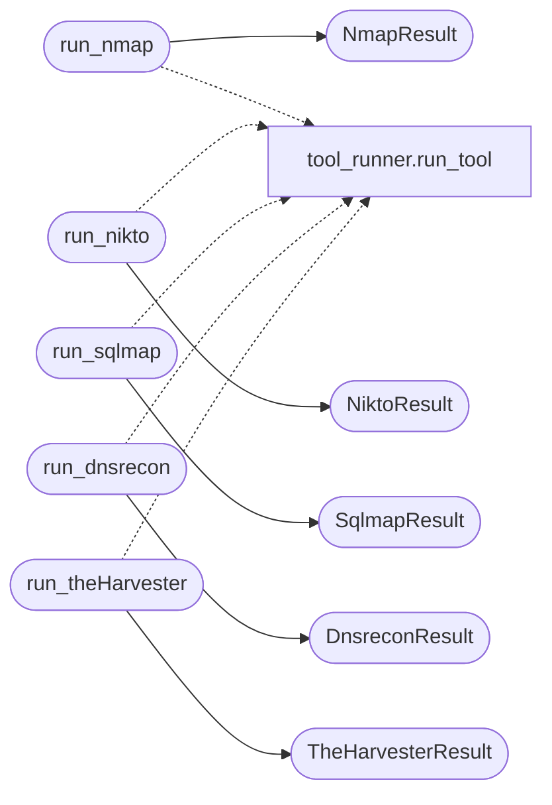

# `estorides_core.active_recon`

> Source: [estorides_core/active_recon.py:1](../../estorides_core/active_recon.py#L1) | language `py` | coverage 0.0% | [API index](../index.md)

## Contents

- **Classes:** [`NmapResult`](#nmapresult), [`NiktoResult`](#niktoresult), [`SqlmapResult`](#sqlmapresult), [`DnsreconResult`](#dnsreconresult), [`TheHarvesterResult`](#theharvesterresult)
- **Functions:** [`run_nmap`](#run_nmap), [`run_nikto`](#run_nikto), [`run_sqlmap`](#run_sqlmap), [`run_dnsrecon`](#run_dnsrecon), [`run_theHarvester`](#run_theharvester)
- **Constants:** [`TOOL_MAP`](#tool_map)

## Type Diagram

```mermaid
classDiagram
    direction LR
    class NmapResult
    NmapResult : bool success
    NmapResult : int exit_code
    NmapResult : list[dict[str, Any]] hosts
    NmapResult : list[dict[str, Any]] open_ports
    NmapResult : list[dict[str, Any]] services
    NmapResult : list[dict[str, Any]] entities
    NmapResult : str raw_output
    NmapResult : float confidence
    NmapResult : str  None error
    NmapResult : to_dict()
    NmapResult : to_entities()
    class NiktoResult
    NiktoResult : bool success
    NiktoResult : int exit_code
    NiktoResult : list[dict[str, Any]] findings
    NiktoResult : list[dict[str, Any]] entities
    NiktoResult : str raw_output
    NiktoResult : float confidence
    NiktoResult : str  None error
    NiktoResult : to_dict()
    NiktoResult : to_entities()
    class SqlmapResult
    SqlmapResult : bool success
    SqlmapResult : int exit_code
    SqlmapResult : list[dict[str, Any]] vulnerabilities
    SqlmapResult : list[dict[str, Any]] entities
    SqlmapResult : str raw_output
    SqlmapResult : float confidence
    SqlmapResult : str  None error
    SqlmapResult : to_dict()
    SqlmapResult : to_entities()
    class DnsreconResult
    DnsreconResult : bool success
    DnsreconResult : int exit_code
    DnsreconResult : list[dict[str, Any]] subdomains
    DnsreconResult : list[dict[str, Any]] mx_records
    DnsreconResult : list[dict[str, Any]] ns_records
    DnsreconResult : list[dict[str, Any]] entities
    DnsreconResult : str raw_output
    DnsreconResult : float confidence
    DnsreconResult : str  None error
    DnsreconResult : to_dict()
    DnsreconResult : to_entities()
    class TheHarvesterResult
    TheHarvesterResult : bool success
    TheHarvesterResult : int exit_code
    TheHarvesterResult : list[dict[str, Any]] emails
    TheHarvesterResult : list[dict[str, Any]] hosts
    TheHarvesterResult : list[dict[str, Any]] entities
    TheHarvesterResult : str raw_output
    TheHarvesterResult : float confidence
    TheHarvesterResult : str  None error
    TheHarvesterResult : to_dict()
    TheHarvesterResult : to_entities()
```



## Call Graph

Solid arrows stay in this module, dashed arrows leave it.



## Classes

<a id="nmapresult"></a>

### `NmapResult`

`class` `dataclass` | [estorides_core/active_recon.py:13](../../estorides_core/active_recon.py#L13)

Decorators: `@dataclass`

```python
class NmapResult
```

**Attributes**

| Name | Type | Default | Description |
|---|---|---|---|
| [`success`](#nmapresult-success) | `bool` |  |  |
| [`exit_code`](#nmapresult-exit_code) | `int` |  |  |
| [`hosts`](#nmapresult-hosts) | `list[dict[str, Any]]` |  |  |
| [`open_ports`](#nmapresult-open_ports) | `list[dict[str, Any]]` |  |  |
| [`services`](#nmapresult-services) | `list[dict[str, Any]]` |  |  |
| [`entities`](#nmapresult-entities) | `list[dict[str, Any]]` |  |  |
| [`raw_output`](#nmapresult-raw_output) | `str` |  |  |
| [`confidence`](#nmapresult-confidence) | `float` |  |  |
| [`error`](#nmapresult-error) | `str \| None` |  |  |

**Members**

| Member | Kind | Summary |
|---|---|---|
| [`to_dict`](#nmapresult-to_dict) | method |  |
| [`to_entities`](#nmapresult-to_entities) | method |  |

<a id="nmapresult-to_dict"></a>

#### `NmapResult.to_dict`

`method` | [estorides_core/active_recon.py:24](../../estorides_core/active_recon.py#L24)

```python
def to_dict(self) -> dict[str, Any]
```

**Returns:** `dict[str, Any]`

<a id="nmapresult-to_entities"></a>

#### `NmapResult.to_entities`

`method` | [estorides_core/active_recon.py:27](../../estorides_core/active_recon.py#L27)

```python
def to_entities(self) -> list[dict[str, Any]]
```

**Returns:** `list[dict[str, Any]]`

---

<a id="niktoresult"></a>

### `NiktoResult`

`class` `dataclass` | [estorides_core/active_recon.py:32](../../estorides_core/active_recon.py#L32)

Decorators: `@dataclass`

```python
class NiktoResult
```

**Attributes**

| Name | Type | Default | Description |
|---|---|---|---|
| [`success`](#niktoresult-success) | `bool` |  |  |
| [`exit_code`](#niktoresult-exit_code) | `int` |  |  |
| [`findings`](#niktoresult-findings) | `list[dict[str, Any]]` |  |  |
| [`entities`](#niktoresult-entities) | `list[dict[str, Any]]` |  |  |
| [`raw_output`](#niktoresult-raw_output) | `str` |  |  |
| [`confidence`](#niktoresult-confidence) | `float` |  |  |
| [`error`](#niktoresult-error) | `str \| None` |  |  |

**Members**

| Member | Kind | Summary |
|---|---|---|
| [`to_dict`](#niktoresult-to_dict) | method |  |
| [`to_entities`](#niktoresult-to_entities) | method |  |

<a id="niktoresult-to_dict"></a>

#### `NiktoResult.to_dict`

`method` | [estorides_core/active_recon.py:41](../../estorides_core/active_recon.py#L41)

```python
def to_dict(self) -> dict[str, Any]
```

**Returns:** `dict[str, Any]`

<a id="niktoresult-to_entities"></a>

#### `NiktoResult.to_entities`

`method` | [estorides_core/active_recon.py:44](../../estorides_core/active_recon.py#L44)

```python
def to_entities(self) -> list[dict[str, Any]]
```

**Returns:** `list[dict[str, Any]]`

---

<a id="sqlmapresult"></a>

### `SqlmapResult`

`class` `dataclass` | [estorides_core/active_recon.py:49](../../estorides_core/active_recon.py#L49)

Decorators: `@dataclass`

```python
class SqlmapResult
```

**Attributes**

| Name | Type | Default | Description |
|---|---|---|---|
| [`success`](#sqlmapresult-success) | `bool` |  |  |
| [`exit_code`](#sqlmapresult-exit_code) | `int` |  |  |
| [`vulnerabilities`](#sqlmapresult-vulnerabilities) | `list[dict[str, Any]]` |  |  |
| [`entities`](#sqlmapresult-entities) | `list[dict[str, Any]]` |  |  |
| [`raw_output`](#sqlmapresult-raw_output) | `str` |  |  |
| [`confidence`](#sqlmapresult-confidence) | `float` |  |  |
| [`error`](#sqlmapresult-error) | `str \| None` |  |  |

**Members**

| Member | Kind | Summary |
|---|---|---|
| [`to_dict`](#sqlmapresult-to_dict) | method |  |
| [`to_entities`](#sqlmapresult-to_entities) | method |  |

<a id="sqlmapresult-to_dict"></a>

#### `SqlmapResult.to_dict`

`method` | [estorides_core/active_recon.py:58](../../estorides_core/active_recon.py#L58)

```python
def to_dict(self) -> dict[str, Any]
```

**Returns:** `dict[str, Any]`

<a id="sqlmapresult-to_entities"></a>

#### `SqlmapResult.to_entities`

`method` | [estorides_core/active_recon.py:61](../../estorides_core/active_recon.py#L61)

```python
def to_entities(self) -> list[dict[str, Any]]
```

**Returns:** `list[dict[str, Any]]`

---

<a id="dnsreconresult"></a>

### `DnsreconResult`

`class` `dataclass` | [estorides_core/active_recon.py:66](../../estorides_core/active_recon.py#L66)

Decorators: `@dataclass`

```python
class DnsreconResult
```

**Attributes**

| Name | Type | Default | Description |
|---|---|---|---|
| [`success`](#dnsreconresult-success) | `bool` |  |  |
| [`exit_code`](#dnsreconresult-exit_code) | `int` |  |  |
| [`subdomains`](#dnsreconresult-subdomains) | `list[dict[str, Any]]` |  |  |
| [`mx_records`](#dnsreconresult-mx_records) | `list[dict[str, Any]]` |  |  |
| [`ns_records`](#dnsreconresult-ns_records) | `list[dict[str, Any]]` |  |  |
| [`entities`](#dnsreconresult-entities) | `list[dict[str, Any]]` |  |  |
| [`raw_output`](#dnsreconresult-raw_output) | `str` |  |  |
| [`confidence`](#dnsreconresult-confidence) | `float` |  |  |
| [`error`](#dnsreconresult-error) | `str \| None` |  |  |

**Members**

| Member | Kind | Summary |
|---|---|---|
| [`to_dict`](#dnsreconresult-to_dict) | method |  |
| [`to_entities`](#dnsreconresult-to_entities) | method |  |

<a id="dnsreconresult-to_dict"></a>

#### `DnsreconResult.to_dict`

`method` | [estorides_core/active_recon.py:77](../../estorides_core/active_recon.py#L77)

```python
def to_dict(self) -> dict[str, Any]
```

**Returns:** `dict[str, Any]`

<a id="dnsreconresult-to_entities"></a>

#### `DnsreconResult.to_entities`

`method` | [estorides_core/active_recon.py:80](../../estorides_core/active_recon.py#L80)

```python
def to_entities(self) -> list[dict[str, Any]]
```

**Returns:** `list[dict[str, Any]]`

---

<a id="theharvesterresult"></a>

### `TheHarvesterResult`

`class` `dataclass` | [estorides_core/active_recon.py:85](../../estorides_core/active_recon.py#L85)

Decorators: `@dataclass`

```python
class TheHarvesterResult
```

**Attributes**

| Name | Type | Default | Description |
|---|---|---|---|
| [`success`](#theharvesterresult-success) | `bool` |  |  |
| [`exit_code`](#theharvesterresult-exit_code) | `int` |  |  |
| [`emails`](#theharvesterresult-emails) | `list[dict[str, Any]]` |  |  |
| [`hosts`](#theharvesterresult-hosts) | `list[dict[str, Any]]` |  |  |
| [`entities`](#theharvesterresult-entities) | `list[dict[str, Any]]` |  |  |
| [`raw_output`](#theharvesterresult-raw_output) | `str` |  |  |
| [`confidence`](#theharvesterresult-confidence) | `float` |  |  |
| [`error`](#theharvesterresult-error) | `str \| None` |  |  |

**Members**

| Member | Kind | Summary |
|---|---|---|
| [`to_dict`](#theharvesterresult-to_dict) | method |  |
| [`to_entities`](#theharvesterresult-to_entities) | method |  |

<a id="theharvesterresult-to_dict"></a>

#### `TheHarvesterResult.to_dict`

`method` | [estorides_core/active_recon.py:95](../../estorides_core/active_recon.py#L95)

```python
def to_dict(self) -> dict[str, Any]
```

**Returns:** `dict[str, Any]`

<a id="theharvesterresult-to_entities"></a>

#### `TheHarvesterResult.to_entities`

`method` | [estorides_core/active_recon.py:98](../../estorides_core/active_recon.py#L98)

```python
def to_entities(self) -> list[dict[str, Any]]
```

**Returns:** `list[dict[str, Any]]`

---

## Functions

<a id="run_nmap"></a>

### `run_nmap`

`function` | [estorides_core/active_recon.py:213](../../estorides_core/active_recon.py#L213)

```python
def run_nmap(target: str, args: list[str] | None = None) -> NmapResult | ToolErrorResult
```

**Parameters**

| Name | Type | Default | Description |
|---|---|---|---|
| `target` | `str` |  |  |
| `args` | `list[str] \| None` | `None` |  |

**Returns:** `NmapResult | ToolErrorResult`

*Calls:* [`NmapResult`](#nmapresult), [`run_tool`](estorides_core.tool_runner.py.md#run_tool)

---

<a id="run_nikto"></a>

### `run_nikto`

`function` | [estorides_core/active_recon.py:243](../../estorides_core/active_recon.py#L243)

```python
def run_nikto(target: str, args: list[str] | None = None) -> NiktoResult | ToolErrorResult
```

**Parameters**

| Name | Type | Default | Description |
|---|---|---|---|
| `target` | `str` |  |  |
| `args` | `list[str] \| None` | `None` |  |

**Returns:** `NiktoResult | ToolErrorResult`

*Calls:* [`NiktoResult`](#niktoresult), [`run_tool`](estorides_core.tool_runner.py.md#run_tool)

---

<a id="run_sqlmap"></a>

### `run_sqlmap`

`function` | [estorides_core/active_recon.py:269](../../estorides_core/active_recon.py#L269)

```python
def run_sqlmap(target: str, args: list[str] | None = None) -> SqlmapResult | ToolErrorResult
```

**Parameters**

| Name | Type | Default | Description |
|---|---|---|---|
| `target` | `str` |  |  |
| `args` | `list[str] \| None` | `None` |  |

**Returns:** `SqlmapResult | ToolErrorResult`

*Calls:* [`SqlmapResult`](#sqlmapresult), [`run_tool`](estorides_core.tool_runner.py.md#run_tool)

---

<a id="run_dnsrecon"></a>

### `run_dnsrecon`

`function` | [estorides_core/active_recon.py:295](../../estorides_core/active_recon.py#L295)

```python
def run_dnsrecon(target: str, args: list[str] | None = None) -> DnsreconResult | ToolErrorResult
```

**Parameters**

| Name | Type | Default | Description |
|---|---|---|---|
| `target` | `str` |  |  |
| `args` | `list[str] \| None` | `None` |  |

**Returns:** `DnsreconResult | ToolErrorResult`

*Calls:* [`DnsreconResult`](#dnsreconresult), [`run_tool`](estorides_core.tool_runner.py.md#run_tool)

---

<a id="run_theharvester"></a>

### `run_theHarvester`

`function` | [estorides_core/active_recon.py:325](../../estorides_core/active_recon.py#L325)

```python
def run_theHarvester(target: str, args: list[str] | None = None) -> TheHarvesterResult | ToolErrorResult
```

**Parameters**

| Name | Type | Default | Description |
|---|---|---|---|
| `target` | `str` |  |  |
| `args` | `list[str] \| None` | `None` |  |

**Returns:** `TheHarvesterResult | ToolErrorResult`

*Calls:* [`TheHarvesterResult`](#theharvesterresult), [`run_tool`](estorides_core.tool_runner.py.md#run_tool)

---

## Constants

<a id="tool_map"></a>

### `TOOL_MAP`

`constant` | [estorides_core/active_recon.py:353](../../estorides_core/active_recon.py#L353)

```python
TOOL_MAP: dict[str, Any]
```

---
