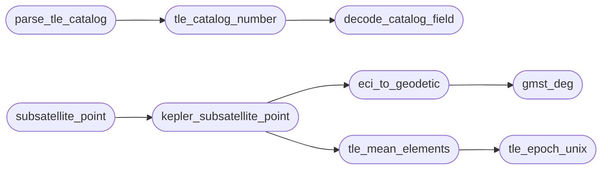

# `estorides_core.aerospace`

> Source: [estorides_core/aerospace.py:1](../../estorides_core/aerospace.py#L1) | language `py` | coverage 100.0% | [API index](../index.md)

estorides_core.aerospace ======================== Pure normalisers and orbital helpers for the free air-and-space intelligence layer set.

Everything in this module is deterministic and side-effect free: no
network, no filesystem, no environment. The feeds in
[`estorides_core.feeds`](estorides_core.feeds.py.md) own the transport; this module owns the
math and the mapping from upstream payloads to Estorides records.

Upstreams supported (all keyless):

  * CelesTrak GP (TLE catalog)
  * OpenSky Network state vectors and tracks
  * adsb.lol v2 aircraft snapshots
  * adsbdb aircraft / callsign enrichment
  * Launch Library 2 launches

Branding: Estorides, developed by Lazy Own Red Team.

## Contents

- **Functions:** [`celestrak_group_url`](#celestrak_group_url), [`decode_catalog_field`](#decode_catalog_field), [`tle_catalog_number`](#tle_catalog_number), [`parse_tle_catalog`](#parse_tle_catalog), [`tle_epoch_unix`](#tle_epoch_unix), [`tle_mean_elements`](#tle_mean_elements), [`gmst_deg`](#gmst_deg), [`eci_to_geodetic`](#eci_to_geodetic), [`kepler_subsatellite_point`](#kepler_subsatellite_point), [`subsatellite_point`](#subsatellite_point), [`normalize_opensky_states`](#normalize_opensky_states), [`normalize_adsblol_aircraft`](#normalize_adsblol_aircraft), [`normalize_opensky_track`](#normalize_opensky_track), [`normalize_adsbdb`](#normalize_adsbdb), [`normalize_launch_library`](#normalize_launch_library), [`cap_records`](#cap_records)
- **Constants:** [`EARTH_RADIUS_KM`](#earth_radius_km), [`EARTH_MU_KM3_S2`](#earth_mu_km3_s2), [`KNOT_TO_MPS`](#knot_to_mps), [`FOOT_TO_M`](#foot_to_m), [`FPM_TO_MPS`](#fpm_to_mps), [`DEFAULT_SATELLITE_GROUPS`](#default_satellite_groups)

## Call Graph

Solid arrows stay in this module, dashed arrows leave it.



## Functions

<a id="celestrak_group_url"></a>

### `celestrak_group_url`

`function` | [estorides_core/aerospace.py:55](../../estorides_core/aerospace.py#L55)

```python
def celestrak_group_url(group: str) -> str
```

Return the CelesTrak TLE URL for one catalog group.

**Parameters**

| Name | Type | Default | Description |
|---|---|---|---|
| `group` | `str` |  |  |

**Returns:** `str`

---

<a id="decode_catalog_field"></a>

### `decode_catalog_field`

`function` | [estorides_core/aerospace.py:109](../../estorides_core/aerospace.py#L109)

```python
def decode_catalog_field(field: Any) -> int | None
```

Decode a TLE catalog field, including the Alpha-5 spelling.

Plain digits decode directly. Alpha-5 uses one letter for the
ten-thousands digit (A=10 .. Z=33, skipping I and O) followed by
exactly four digits, so ``A0000`` is 100000 and ``Z9999`` is
339999. Anything else is ``None``.

**Parameters**

| Name | Type | Default | Description |
|---|---|---|---|
| `field` | `Any` |  |  |

**Returns:** `int | None`

*Called by:* [`tle_catalog_number`](#tle_catalog_number)

---

<a id="tle_catalog_number"></a>

### `tle_catalog_number`

`function` | [estorides_core/aerospace.py:133](../../estorides_core/aerospace.py#L133)

```python
def tle_catalog_number(line: Any) -> int | None
```

Return the NORAD catalog number from TLE line 1 or line 2.

**Parameters**

| Name | Type | Default | Description |
|---|---|---|---|
| `line` | `Any` |  |  |

**Returns:** `int | None`

*Calls:* [`decode_catalog_field`](#decode_catalog_field)

*Called by:* [`parse_tle_catalog`](#parse_tle_catalog)

---

<a id="parse_tle_catalog"></a>

### `parse_tle_catalog`

`function` | [estorides_core/aerospace.py:149](../../estorides_core/aerospace.py#L149)

```python
def parse_tle_catalog(payload: Any) -> list[dict[str, Any]]
```

Parse three-line TLE text into ``{name, norad_id, line1, line2}``.

Malformed sets are skipped without dropping the valid sets that
follow them. Duplicate NORAD ids keep the first entry so a
satellite that appears in several CelesTrak groups is propagated
once.

**Parameters**

| Name | Type | Default | Description |
|---|---|---|---|
| `payload` | `Any` |  |  |

**Returns:** `list[dict[str, Any]]`

*Calls:* [`tle_catalog_number`](#tle_catalog_number)

*Called by:* [`parse_celestrak_tle`](estorides_core.parsers.py.md#parse_celestrak_tle)

---

<a id="tle_epoch_unix"></a>

### `tle_epoch_unix`

`function` | [estorides_core/aerospace.py:192](../../estorides_core/aerospace.py#L192)

```python
def tle_epoch_unix(line1: Any) -> float | None
```

Return the TLE epoch as Unix seconds, or ``None``.

**Parameters**

| Name | Type | Default | Description |
|---|---|---|---|
| `line1` | `Any` |  |  |

**Returns:** `float | None`

*Called by:* [`tle_mean_elements`](#tle_mean_elements)

---

<a id="tle_mean_elements"></a>

### `tle_mean_elements`

`function` | [estorides_core/aerospace.py:212](../../estorides_core/aerospace.py#L212)

```python
def tle_mean_elements(line1: Any, line2: Any) -> dict[str, float] | None
```

Extract the mean orbital elements needed for propagation.

**Parameters**

| Name | Type | Default | Description |
|---|---|---|---|
| `line1` | `Any` |  |  |
| `line2` | `Any` |  |  |

**Returns:** `dict[str, float] | None`

*Calls:* [`tle_epoch_unix`](#tle_epoch_unix)

*Called by:* [`kepler_subsatellite_point`](#kepler_subsatellite_point)

---

<a id="gmst_deg"></a>

### `gmst_deg`

`function` | [estorides_core/aerospace.py:245](../../estorides_core/aerospace.py#L245)

```python
def gmst_deg(when_unix: float) -> float
```

Greenwich mean sidereal time in degrees for a Unix instant.

**Parameters**

| Name | Type | Default | Description |
|---|---|---|---|
| `when_unix` | `float` |  |  |

**Returns:** `float`

*Called by:* [`eci_to_geodetic`](#eci_to_geodetic)

---

<a id="eci_to_geodetic"></a>

### `eci_to_geodetic`

`function` | [estorides_core/aerospace.py:259](../../estorides_core/aerospace.py#L259)

```python
def eci_to_geodetic(position_km: Any, when_unix: Any) -> dict[str, float] | None
```

Convert an ECI/TEME position in km to latitude, longitude, altitude.

The altitude uses a spherical Earth; it is a map-display value, not
a geodetic height above the WGS84 ellipsoid.

**Parameters**

| Name | Type | Default | Description |
|---|---|---|---|
| `position_km` | `Any` |  |  |
| `when_unix` | `Any` |  |  |

**Returns:** `dict[str, float] | None`

*Calls:* [`gmst_deg`](#gmst_deg)

*Called by:* [`kepler_subsatellite_point`](#kepler_subsatellite_point)

---

<a id="kepler_subsatellite_point"></a>

### `kepler_subsatellite_point`

`function` | [estorides_core/aerospace.py:285](../../estorides_core/aerospace.py#L285)

```python
def kepler_subsatellite_point(line1: Any, line2: Any, when_unix: Any) -> dict[str, Any] | None
```

Two-body sub-satellite point from TLE mean elements.

This ignores J2 and drag; it exists so the feature works without the
optional ``sgp4`` package. Near the TLE epoch it is accurate enough
for a 2D map marker.

**Parameters**

| Name | Type | Default | Description |
|---|---|---|---|
| `line1` | `Any` |  |  |
| `line2` | `Any` |  |  |
| `when_unix` | `Any` |  |  |

**Returns:** `dict[str, Any] | None`

*Calls:* [`eci_to_geodetic`](#eci_to_geodetic), [`tle_mean_elements`](#tle_mean_elements)

*Called by:* [`subsatellite_point`](#subsatellite_point)

---

<a id="subsatellite_point"></a>

### `subsatellite_point`

`function` | [estorides_core/aerospace.py:379](../../estorides_core/aerospace.py#L379)

```python
def subsatellite_point(line1: Any, line2: Any, when_unix: Any) -> dict[str, Any] | None
```

Sub-satellite point using SGP4 when available, Kepler otherwise.

**Parameters**

| Name | Type | Default | Description |
|---|---|---|---|
| `line1` | `Any` |  |  |
| `line2` | `Any` |  |  |
| `when_unix` | `Any` |  |  |

**Returns:** `dict[str, Any] | None`

*Calls:* [`kepler_subsatellite_point`](#kepler_subsatellite_point)

---

<a id="normalize_opensky_states"></a>

### `normalize_opensky_states`

`function` | [estorides_core/aerospace.py:488](../../estorides_core/aerospace.py#L488)

```python
def normalize_opensky_states(payload: Any) -> list[dict[str, Any]]
```

Normalise an OpenSky ``/api/states/all`` response.

Invalid rows are dropped individually. Duplicate ICAO addresses keep
the first valid vector. Units stay SI: metres, m/s, degrees.

**Parameters**

| Name | Type | Default | Description |
|---|---|---|---|
| `payload` | `Any` |  |  |

**Returns:** `list[dict[str, Any]]`

*Called by:* [`parse_opensky_states`](estorides_core.parsers.py.md#parse_opensky_states)

---

<a id="normalize_adsblol_aircraft"></a>

### `normalize_adsblol_aircraft`

`function` | [estorides_core/aerospace.py:540](../../estorides_core/aerospace.py#L540)

```python
def normalize_adsblol_aircraft(payload: Any) -> list[dict[str, Any]]
```

Normalise an adsb.lol v2 ``/v2/...`` aircraft response.

adsb.lol reports feet, knots and feet per minute; the common record
is SI. ``alt_baro: "ground"`` marks the aircraft as on the ground.

**Parameters**

| Name | Type | Default | Description |
|---|---|---|---|
| `payload` | `Any` |  |  |

**Returns:** `list[dict[str, Any]]`

*Called by:* [`parse_adsblol_aircraft`](estorides_core.parsers.py.md#parse_adsblol_aircraft)

---

<a id="normalize_opensky_track"></a>

### `normalize_opensky_track`

`function` | [estorides_core/aerospace.py:604](../../estorides_core/aerospace.py#L604)

```python
def normalize_opensky_track(payload: Any) -> dict[str, Any]
```

Normalise an OpenSky ``/api/tracks/all`` response.

**Parameters**

| Name | Type | Default | Description |
|---|---|---|---|
| `payload` | `Any` |  |  |

**Returns:** `dict[str, Any]`

*Called by:* [`parse_opensky_track`](estorides_core.parsers.py.md#parse_opensky_track)

---

<a id="normalize_adsbdb"></a>

### `normalize_adsbdb`

`function` | [estorides_core/aerospace.py:635](../../estorides_core/aerospace.py#L635)

```python
def normalize_adsbdb(payload: Any) -> dict[str, Any]
```

Normalise an adsbdb aircraft or callsign flight-route response.

**Parameters**

| Name | Type | Default | Description |
|---|---|---|---|
| `payload` | `Any` |  |  |

**Returns:** `dict[str, Any]`

*Called by:* [`parse_adsbdb`](estorides_core.parsers.py.md#parse_adsbdb)

---

<a id="normalize_launch_library"></a>

### `normalize_launch_library`

`function` | [estorides_core/aerospace.py:677](../../estorides_core/aerospace.py#L677)

```python
def normalize_launch_library(payload: Any) -> list[dict[str, Any]]
```

Normalise a Launch Library 2 ``/launches/`` response.

Launches without pad coordinates are still returned (the operator
may want the schedule), but only located launches become map
points in the feed.

**Parameters**

| Name | Type | Default | Description |
|---|---|---|---|
| `payload` | `Any` |  |  |

**Returns:** `list[dict[str, Any]]`

*Called by:* [`parse_launch_library`](estorides_core.parsers.py.md#parse_launch_library)

---

<a id="cap_records"></a>

### `cap_records`

`function` | [estorides_core/aerospace.py:723](../../estorides_core/aerospace.py#L723)

```python
def cap_records(records: Any, limit: Any) -> list[dict[str, Any]]
```

Return at most ``limit`` records.

A non-positive limit yields [].

**Parameters**

| Name | Type | Default | Description |
|---|---|---|---|
| `records` | `Any` |  |  |
| `limit` | `Any` |  |  |

**Returns:** `list[dict[str, Any]]`

---

## Constants

<a id="earth_radius_km"></a>

### `EARTH_RADIUS_KM`

`constant` | [estorides_core/aerospace.py:35](../../estorides_core/aerospace.py#L35)

```python
EARTH_RADIUS_KM = 6378.137
```

---

<a id="earth_mu_km3_s2"></a>

### `EARTH_MU_KM3_S2`

`constant` | [estorides_core/aerospace.py:36](../../estorides_core/aerospace.py#L36)

```python
EARTH_MU_KM3_S2 = 398600.4418
```

---

<a id="knot_to_mps"></a>

### `KNOT_TO_MPS`

`constant` | [estorides_core/aerospace.py:37](../../estorides_core/aerospace.py#L37)

```python
KNOT_TO_MPS = 0.514444
```

---

<a id="foot_to_m"></a>

### `FOOT_TO_M`

`constant` | [estorides_core/aerospace.py:38](../../estorides_core/aerospace.py#L38)

```python
FOOT_TO_M = 0.3048
```

---

<a id="fpm_to_mps"></a>

### `FPM_TO_MPS`

`constant` | [estorides_core/aerospace.py:39](../../estorides_core/aerospace.py#L39)

```python
FPM_TO_MPS = 0.00508
```

---

<a id="default_satellite_groups"></a>

### `DEFAULT_SATELLITE_GROUPS`

`constant` | [estorides_core/aerospace.py:43](../../estorides_core/aerospace.py#L43)

```python
DEFAULT_SATELLITE_GROUPS: tuple[str, ...] = ('stations', 'visual', 'gps-ops', 'glo-ops', 'galileo', 'geo')
```

---
