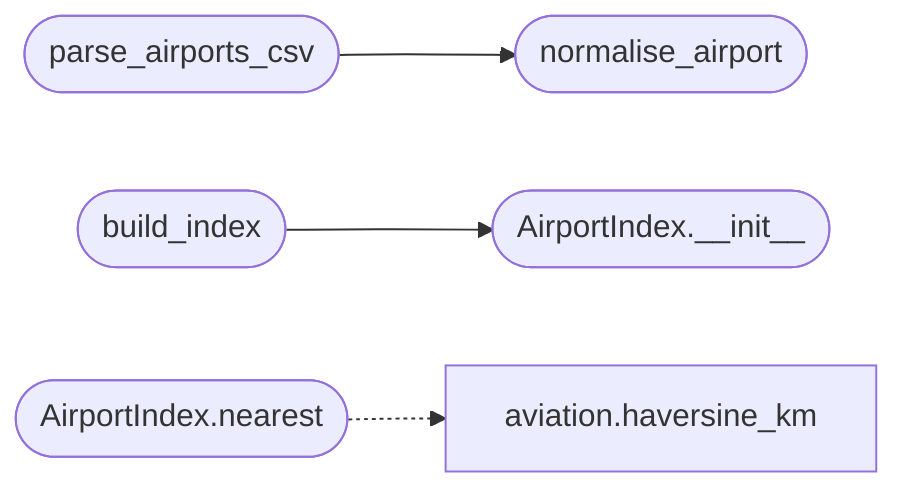

# `estorides_core.airports`

> Source: [estorides_core/airports.py:1](../../estorides_core/airports.py#L1) | language `py` | coverage 90.0% | [API index](../index.md)

estorides_core.airports ======================= Public-domain airport reference data and a nearest-airport index.

The dataset is OurAirports (public domain, no key): one CSV row per
aerodrome worldwide with an ICAO/IATA/local identifier, coordinates,
country, region and municipality. Estorides uses it for one question —
*given an aircraft position, which aerodrome is it near?* — which is the
difference between "an unknown contact at 3 000 ft" and "an unknown
contact on approach into Ramstein".

Everything here is deterministic and side-effect free: the download and
the on-disk cache live in [`estorides_core.feeds`](estorides_core.feeds.py.md). The module keeps
only the parse, the index and the distance maths.

Branding: Estorides, developed by Lazy Own Red Team.

## Contents

- **Classes:** [`AirportIndex`](#airportindex)
- **Functions:** [`normalise_airport`](#normalise_airport), [`parse_airports_csv`](#parse_airports_csv), [`build_index`](#build_index), [`airport_brief`](#airport_brief)
- **Constants:** [`DEFAULT_AIRPORT_TYPES`](#default_airport_types), [`KM_PER_DEGREE`](#km_per_degree)

## Call Graph

Solid arrows stay in this module, dashed arrows leave it.



## Classes

<a id="airportindex"></a>

### `AirportIndex`

`class` | [estorides_core/airports.py:126](../../estorides_core/airports.py#L126)

```python
class AirportIndex
```

Spatial index over normalised airports.

Buckets airports into one-degree cells so a nearest-airport query
touches a handful of cells instead of the whole catalogue: the map
layer asks this for every aircraft in a regional snapshot.

**Members**

| Member | Kind | Summary |
|---|---|---|
| [`__init__`](#airportindex-__init__) | constructor |  |
| [`by_code`](#airportindex-by_code) | method | Look an aerodrome up by ICAO, IATA, GPS or local identifier. |
| [`nearest`](#airportindex-nearest) | method | Closest airport within ``max_km``, annotated with ``distance_km``. |
| [`within_bbox`](#airportindex-within_bbox) | method | Airports inside ``(min_lon, min_lat, max_lon, max_lat)``. |

<a id="airportindex-__init__"></a>

#### `AirportIndex.__init__`

`constructor` | [estorides_core/airports.py:134](../../estorides_core/airports.py#L134)

```python
def __init__(self, airports: Iterable[dict[str, Any]]) -> None
```

**Parameters**

| Name | Type | Default | Description |
|---|---|---|---|
| `airports` | `Iterable[dict[str, Any]]` |  |  |

*Called by:* [`build_index`](#build_index)

<a id="airportindex-by_code"></a>

#### `AirportIndex.by_code`

`method` | [estorides_core/airports.py:155](../../estorides_core/airports.py#L155)

```python
def by_code(self, code: Any) -> dict[str, Any] | None
```

Look an aerodrome up by ICAO, IATA, GPS or local identifier.

**Parameters**

| Name | Type | Default | Description |
|---|---|---|---|
| `code` | `Any` |  |  |

**Returns:** `dict[str, Any] | None`

<a id="airportindex-nearest"></a>

#### `AirportIndex.nearest`

`method` | [estorides_core/airports.py:161](../../estorides_core/airports.py#L161)

```python
def nearest(self, latitude: Any, longitude: Any, max_km: float = 50.0) -> dict[str, Any] | None
```

Closest airport within ``max_km``, annotated with ``distance_km``.

**Parameters**

| Name | Type | Default | Description |
|---|---|---|---|
| `latitude` | `Any` |  |  |
| `longitude` | `Any` |  |  |
| `max_km` | `float` | `50.0` |  |

**Returns:** `dict[str, Any] | None`

*Calls:* [`haversine_km`](estorides_core.aviation.py.md#haversine_km)

<a id="airportindex-within_bbox"></a>

#### `AirportIndex.within_bbox`

`method` | [estorides_core/airports.py:201](../../estorides_core/airports.py#L201)

```python
def within_bbox(self, bbox: Any) -> list[dict[str, Any]]
```

Airports inside ``(min_lon, min_lat, max_lon, max_lat)``.

**Parameters**

| Name | Type | Default | Description |
|---|---|---|---|
| `bbox` | `Any` |  |  |

**Returns:** `list[dict[str, Any]]`

---

## Functions

<a id="normalise_airport"></a>

### `normalise_airport`

`function` | [estorides_core/airports.py:60](../../estorides_core/airports.py#L60)

```python
def normalise_airport(row: dict[str, Any]) -> dict[str, Any] | None
```

Normalise one OurAirports CSV row, or ``None`` when unusable.

**Parameters**

| Name | Type | Default | Description |
|---|---|---|---|
| `row` | `dict[str, Any]` |  |  |

**Returns:** `dict[str, Any] | None`

*Called by:* [`parse_airports_csv`](#parse_airports_csv)

---

<a id="parse_airports_csv"></a>

### `parse_airports_csv`

`function` | [estorides_core/airports.py:90](../../estorides_core/airports.py#L90)

```python
def parse_airports_csv(text: Any, *, types: Iterable[str] = DEFAULT_AIRPORT_TYPES, limit: int = 0) -> list[dict[str, Any]]
```

Parse an OurAirports CSV export into normalised airport dicts.

Rows with bad coordinates, a missing identifier and rows outside
``types`` are dropped. Duplicate identifiers keep the first row so a
re-export cannot double the index.

**Parameters**

| Name | Type | Default | Description |
|---|---|---|---|
| `text` | `Any` |  |  |
| `types` | `Iterable[str]` | `DEFAULT_AIRPORT_TYPES` |  |
| `limit` | `int` | `0` |  |

**Returns:** `list[dict[str, Any]]`

*Calls:* [`normalise_airport`](#normalise_airport)

---

<a id="build_index"></a>

### `build_index`

`function` | [estorides_core/airports.py:221](../../estorides_core/airports.py#L221)

```python
def build_index(airports: Iterable[dict[str, Any]]) -> AirportIndex
```

Convenience constructor: ``build_index(parse_airports_csv(text))``.

**Parameters**

| Name | Type | Default | Description |
|---|---|---|---|
| `airports` | `Iterable[dict[str, Any]]` |  |  |

**Returns:** `AirportIndex`

*Calls:* [`AirportIndex.__init__`](#airportindex-__init__)

---

<a id="airport_brief"></a>

### `airport_brief`

`function` | [estorides_core/airports.py:226](../../estorides_core/airports.py#L226)

```python
def airport_brief(airport: dict[str, Any] | None) -> dict[str, Any] | None
```

Compact airport view for feed payloads (popup-sized, not exhaustive).

**Parameters**

| Name | Type | Default | Description |
|---|---|---|---|
| `airport` | `dict[str, Any] \| None` |  |  |

**Returns:** `dict[str, Any] | None`

---

## Constants

<a id="default_airport_types"></a>

### `DEFAULT_AIRPORT_TYPES`

`constant` | [estorides_core/airports.py:32](../../estorides_core/airports.py#L32)

```python
DEFAULT_AIRPORT_TYPES: tuple[str, ...] = ('large_airport', 'medium_airport', 'small_airport')
```

---

<a id="km_per_degree"></a>

### `KM_PER_DEGREE`

`constant` | [estorides_core/airports.py:40](../../estorides_core/airports.py#L40)

```python
KM_PER_DEGREE = 111.32
```

---
