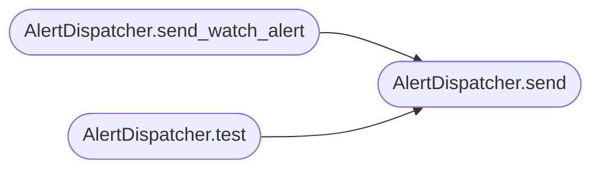

# `estorides_core.alerter`

> Source: [estorides_core/alerter.py:1](../../estorides_core/alerter.py#L1) | language `py` | coverage 100.0% | [API index](../index.md)

estorides_core.alerter ====================== Alert channel dispatcher for watch target notifications.

Supports:
  * Slack webhook
  * Discord webhook (embedded messages)
  * Telegram bot
  * Email (SMTP)
  * Generic webhook (HTTP POST)

Each channel reads its credentials from environment variables so they are
never stored in the database.

## Contents

- **Classes:** [`AlertDispatcher`](#alertdispatcher)

## Call Graph

Solid arrows stay in this module, dashed arrows leave it.



## Classes

<a id="alertdispatcher"></a>

### `AlertDispatcher`

`class` | [estorides_core/alerter.py:194](../../estorides_core/alerter.py#L194)

```python
class AlertDispatcher
```

Central alert dispatcher: routes alerts to configured channels.

Reads channel credentials from environment variables on each dispatch
so an operator can hot-configure without restarting.

**Members**

| Member | Kind | Summary |
|---|---|---|
| [`send`](#alertdispatcher-send) | method | Send an alert to a single channel. |
| [`send_watch_alert`](#alertdispatcher-send_watch_alert) | method | Send alerts for a completed watch run to all configured channels. |
| [`test`](#alertdispatcher-test) | method | Send a test alert to verify channel configuration. |
| [`available_channels`](#alertdispatcher-available_channels) | method | Return list of configured channels with their status. |

<a id="alertdispatcher-send"></a>

#### `AlertDispatcher.send`

`method` | [estorides_core/alerter.py:201](../../estorides_core/alerter.py#L201)

```python
def send(self, channel: str, title: str, body: str, severity: str = 'info') -> bool
```

Send an alert to a single channel.

Returns True on success.

**Parameters**

| Name | Type | Default | Description |
|---|---|---|---|
| `channel` | `str` |  |  |
| `title` | `str` |  |  |
| `body` | `str` |  |  |
| `severity` | `str` | `'info'` |  |

**Returns:** `bool`

*Called by:* [`AlertDispatcher.send_watch_alert`](#alertdispatcher-send_watch_alert), [`AlertDispatcher.test`](#alertdispatcher-test)

<a id="alertdispatcher-send_watch_alert"></a>

#### `AlertDispatcher.send_watch_alert`

`method` | [estorides_core/alerter.py:260](../../estorides_core/alerter.py#L260)

```python
def send_watch_alert(self, watch: Any, entity_count: int, obs_count: int, new_entities: int = 0) -> None
```

Send alerts for a completed watch run to all configured channels.

**Parameters**

| Name | Type | Default | Description |
|---|---|---|---|
| `watch` | `Any` |  |  |
| `entity_count` | `int` |  |  |
| `obs_count` | `int` |  |  |
| `new_entities` | `int` | `0` |  |

*Calls:* [`AlertDispatcher.send`](#alertdispatcher-send)

<a id="alertdispatcher-test"></a>

#### `AlertDispatcher.test`

`method` | [estorides_core/alerter.py:280](../../estorides_core/alerter.py#L280)

```python
def test(self, channel: str) -> bool
```

Send a test alert to verify channel configuration.

**Parameters**

| Name | Type | Default | Description |
|---|---|---|---|
| `channel` | `str` |  |  |

**Returns:** `bool`

*Calls:* [`AlertDispatcher.send`](#alertdispatcher-send)

<a id="alertdispatcher-available_channels"></a>

#### `AlertDispatcher.available_channels`

`method` | [estorides_core/alerter.py:290](../../estorides_core/alerter.py#L290)

```python
def available_channels(self) -> list[dict[str, Any]]
```

Return list of configured channels with their status.

**Returns:** `list[dict[str, Any]]`

---
