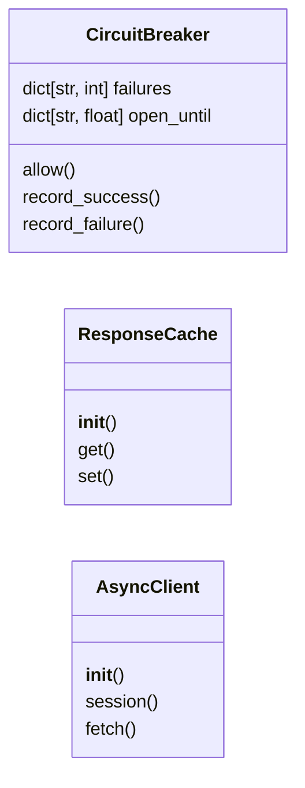
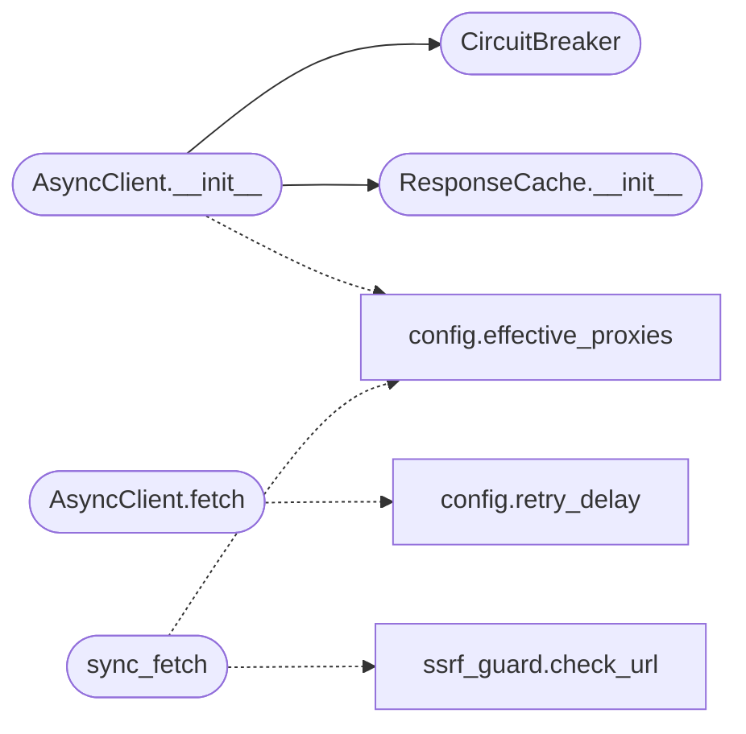

# `estorides_core.async_client`

> Source: [estorides_core/async_client.py:1](../../estorides_core/async_client.py#L1) | language `py` | coverage 35.7% | [API index](../index.md)

estorides_core.async_client =========================== Async HTTP client with: * per-host concurrency limits * exponential backoff * circuit breaker (per host) * disk-backed cache (SQLite) * automatic key-substitution from environment

Designed so a single query can fan out to 50+ sources in parallel
without DOSsing any of them.

## Contents

- **Classes:** [`CircuitBreaker`](#circuitbreaker), [`ResponseCache`](#responsecache), [`AsyncClient`](#asyncclient)
- **Functions:** [`sync_fetch`](#sync_fetch)

## Type Diagram



## Call Graph

Solid arrows stay in this module, dashed arrows leave it.



## Classes

<a id="circuitbreaker"></a>

### `CircuitBreaker`

`class` `dataclass` | [estorides_core/async_client.py:64](../../estorides_core/async_client.py#L64)

Decorators: `@dataclass`

```python
class CircuitBreaker
```

Per-host circuit breaker.

**Attributes**

| Name | Type | Default | Description |
|---|---|---|---|
| [`failures`](#circuitbreaker-failures) | `dict[str, int]` | `field(default_factory=dict)` |  |
| [`open_until`](#circuitbreaker-open_until) | `dict[str, float]` | `field(default_factory=dict)` |  |

**Members**

| Member | Kind | Summary |
|---|---|---|
| [`allow`](#circuitbreaker-allow) | method |  |
| [`record_success`](#circuitbreaker-record_success) | method |  |
| [`record_failure`](#circuitbreaker-record_failure) | method |  |

<a id="circuitbreaker-allow"></a>

#### `CircuitBreaker.allow`

`method` | [estorides_core/async_client.py:69](../../estorides_core/async_client.py#L69)

```python
def allow(self, host: str) -> bool
```

**Parameters**

| Name | Type | Default | Description |
|---|---|---|---|
| `host` | `str` |  |  |

**Returns:** `bool`

<a id="circuitbreaker-record_success"></a>

#### `CircuitBreaker.record_success`

`method` | [estorides_core/async_client.py:75](../../estorides_core/async_client.py#L75)

```python
def record_success(self, host: str) -> None
```

**Parameters**

| Name | Type | Default | Description |
|---|---|---|---|
| `host` | `str` |  |  |

<a id="circuitbreaker-record_failure"></a>

#### `CircuitBreaker.record_failure`

`method` | [estorides_core/async_client.py:79](../../estorides_core/async_client.py#L79)

```python
def record_failure(self, host: str) -> None
```

**Parameters**

| Name | Type | Default | Description |
|---|---|---|---|
| `host` | `str` |  |  |

---

<a id="responsecache"></a>

### `ResponseCache`

`class` | [estorides_core/async_client.py:86](../../estorides_core/async_client.py#L86)

```python
class ResponseCache
```

SQLite-backed response cache.

Key = (url + method + body hash).

Entries carry their write timestamp and are only served while younger
than [`ttl_seconds`](estorides_core.config.py.md#cacheconfig-ttl_seconds); a stale row is ignored (and lazily overwritten on
the next live fetch) so the cache can never pin down OSINT that has
since changed or been taken down.

**Members**

| Member | Kind | Summary |
|---|---|---|
| [`__init__`](#responsecache-__init__) | constructor |  |
| [`get`](#responsecache-get) | method |  |
| [`set`](#responsecache-set) | method |  |

<a id="responsecache-__init__"></a>

#### `ResponseCache.__init__`

`constructor` | [estorides_core/async_client.py:95](../../estorides_core/async_client.py#L95)

```python
def __init__(self, path: Path = CACHE_PATH, *, ttl_seconds: int = HTTP_CACHE.ttl_seconds, enabled: bool = HTTP_CACHE.enabled) -> None
```

**Parameters**

| Name | Type | Default | Description |
|---|---|---|---|
| `path` | `Path` | `CACHE_PATH` |  |
| `ttl_seconds` | `int` | `HTTP_CACHE.ttl_seconds` |  |
| `enabled` | `bool` | `HTTP_CACHE.enabled` |  |

*Called by:* [`AsyncClient.__init__`](#asyncclient-__init__)

<a id="responsecache-get"></a>

#### `ResponseCache.get`

`method` | [estorides_core/async_client.py:145](../../estorides_core/async_client.py#L145)

```python
def get(self, method: str, url: str, body: str | None) -> Any | None
```

**Parameters**

| Name | Type | Default | Description |
|---|---|---|---|
| `method` | `str` |  |  |
| `url` | `str` |  |  |
| `body` | `str \| None` |  |  |

**Returns:** `Any | None`

<a id="responsecache-set"></a>

#### `ResponseCache.set`

`method` | [estorides_core/async_client.py:161](../../estorides_core/async_client.py#L161)

```python
def set(self, method: str, url: str, body: str | None, value: Any) -> None
```

**Parameters**

| Name | Type | Default | Description |
|---|---|---|---|
| `method` | `str` |  |  |
| `url` | `str` |  |  |
| `body` | `str \| None` |  |  |
| `value` | `Any` |  |  |

---

<a id="asyncclient"></a>

### `AsyncClient`

`class` | [estorides_core/async_client.py:172](../../estorides_core/async_client.py#L172)

```python
class AsyncClient
```

Async HTTP client with retries, backoff, circuit breaker, cache.

**Members**

| Member | Kind | Summary |
|---|---|---|
| [`__init__`](#asyncclient-__init__) | constructor |  |
| [`session`](#asyncclient-session) | property |  |
| [`fetch`](#asyncclient-fetch) | method | Fetch a URL. |

<a id="asyncclient-__init__"></a>

#### `AsyncClient.__init__`

`constructor` | [estorides_core/async_client.py:175](../../estorides_core/async_client.py#L175)

```python
def __init__(self, *, timeout: float = HTTP_TIMEOUT, max_retries: int | None = None, user_agent: str = USER_AGENT, cache: ResponseCache | None = None, breaker: CircuitBreaker | None = None, max_parallel: int = 8, proxies: list[str] | None = None, proxy_remote_dns: bool = PROXY_REMOTE_DNS) -> None
```

**Parameters**

| Name | Type | Default | Description |
|---|---|---|---|
| `timeout` | `float` | `HTTP_TIMEOUT` |  |
| `max_retries` | `int \| None` | `None` |  |
| `user_agent` | `str` | `USER_AGENT` |  |
| `cache` | `ResponseCache \| None` | `None` |  |
| `breaker` | `CircuitBreaker \| None` | `None` |  |
| `max_parallel` | `int` | `8` |  |
| `proxies` | `list[str] \| None` | `None` |  |
| `proxy_remote_dns` | `bool` | `PROXY_REMOTE_DNS` |  |

*Calls:* [`CircuitBreaker`](#circuitbreaker), [`ResponseCache.__init__`](#responsecache-__init__), [`effective_proxies`](estorides_core.config.py.md#effective_proxies)

*Called by:* [`Orchestrator.run`](estorides_core.orchestrator.py.md#orchestrator-run)

<a id="asyncclient-session"></a>

#### `AsyncClient.session`

`property` | [estorides_core/async_client.py:264](../../estorides_core/async_client.py#L264)

Decorators: `@property`

```python
def session(self) -> aiohttp.ClientSession
```

**Returns:** `aiohttp.ClientSession`

**Raises**

- `RuntimeError`: (raised in the body, not documented)

<a id="asyncclient-fetch"></a>

#### `AsyncClient.fetch`

`method` `async` | [estorides_core/async_client.py:270](../../estorides_core/async_client.py#L270)

```python
async def fetch(self, method: str, url: str, *, headers: dict[str, str] | None = None, params: dict[str, Any] | None = None, body: Any | None = None, use_cache: bool = True) -> tuple[Any | None, dict[str, Any]]
```

Fetch a URL.

Returns (parsed_data, meta).

meta contains status, content_type, cached, attempts, error.
parsed_data is dict/list/str/None depending on content-type.

**Parameters**

| Name | Type | Default | Description |
|---|---|---|---|
| `method` | `str` |  |  |
| `url` | `str` |  |  |
| `headers` | `dict[str, str] \| None` | `None` |  |
| `params` | `dict[str, Any] \| None` | `None` |  |
| `body` | `Any \| None` | `None` |  |
| `use_cache` | `bool` | `True` |  |

**Returns:** `tuple[Any | None, dict[str, Any]]`

*Calls:* [`retry_delay`](estorides_core.config.py.md#retry_delay)

---

## Functions

<a id="sync_fetch"></a>

### `sync_fetch`

`function` | [estorides_core/async_client.py:400](../../estorides_core/async_client.py#L400)

```python
def sync_fetch(method: str, url: str, *, headers: dict[str, str] | None = None, params: dict[str, Any] | None = None, body: Any | None = None, timeout: float = HTTP_TIMEOUT, proxy: str | None = None, proxy_remote_dns: bool = PROXY_REMOTE_DNS) -> tuple[Any | None, dict[str, Any]]
```

**Parameters**

| Name | Type | Default | Description |
|---|---|---|---|
| `method` | `str` |  |  |
| `url` | `str` |  |  |
| `headers` | `dict[str, str] \| None` | `None` |  |
| `params` | `dict[str, Any] \| None` | `None` |  |
| `body` | `Any \| None` | `None` |  |
| `timeout` | `float` | `HTTP_TIMEOUT` |  |
| `proxy` | `str \| None` | `None` |  |
| `proxy_remote_dns` | `bool` | `PROXY_REMOTE_DNS` |  |

**Returns:** `tuple[Any | None, dict[str, Any]]`

*Calls:* [`effective_proxies`](estorides_core.config.py.md#effective_proxies), [`check_url`](estorides_core.ssrf_guard.py.md#check_url)

---
