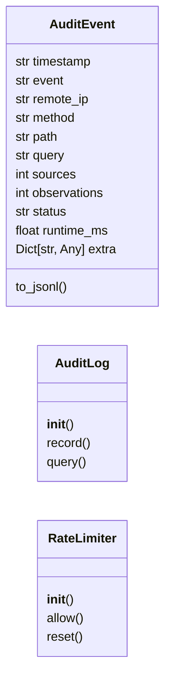
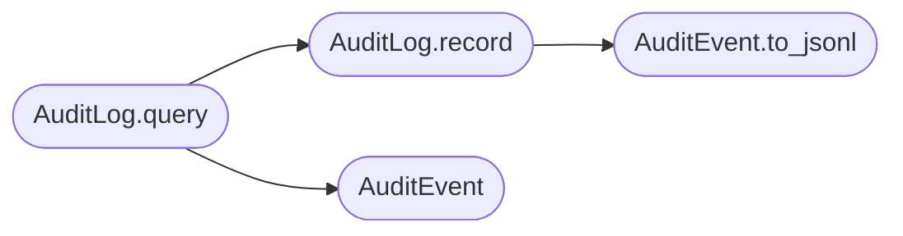

# `estorides_core.audit`

> Source: [estorides_core/audit.py:1](../../estorides_core/audit.py#L1) | language `py` | coverage 36.4% | [API index](../index.md)

estorides_core.audit ==================== Append-only audit log + per-IP rate limiter for the web layer.

Two responsibilities:

  AuditLog
    Every API call (query, run, export) gets a JSON line appended to
    `sessions/audit.jsonl` (one line per request) with: timestamp,
    remote IP, query, sources used, observation count, status, runtime
    ms, result size. This is the compliance trail that "state level"
    platforms must produce on demand.

    The log is append-only and best-effort: a disk error never breaks
    the request, it just records the failure and moves on. Concurrent
    writers are safe via a process-level lock (we only have one web
    process in the default deployment; for multi-worker setups we'd
    switch to a queue, but the file size stays small enough that the
    current model is fine).

  RateLimiter
    Simple sliding-window rate limiter, in-memory. Default: 30 requests
    per minute per IP. Configurable via env. The window is sliding
    rather than fixed-bucket so a burst of 30 right at the boundary
    doesn't get a free second batch.

This module is dependency-free. It does NOT replace a real WAF or
production-grade rate limiter (Redis-backed, distributed). It is a
defensible default for self-hosted deployments and a starting point
that real platforms can swap out without touching the rest of the code.

## Contents

- **Classes:** [`AuditEvent`](#auditevent), [`AuditLog`](#auditlog), [`RateLimiter`](#ratelimiter)
- **Constants:** [`AUDIT_PATH`](#audit_path)

## Type Diagram



## Call Graph

Solid arrows stay in this module, dashed arrows leave it.



## Classes

<a id="auditevent"></a>

### `AuditEvent`

`class` `dataclass` | [estorides_core/audit.py:55](../../estorides_core/audit.py#L55)

Decorators: `@dataclass`

```python
class AuditEvent
```

**Attributes**

| Name | Type | Default | Description |
|---|---|---|---|
| [`timestamp`](#auditevent-timestamp) | `str` |  |  |
| [`event`](#auditevent-event) | `str` |  |  |
| [`remote_ip`](#auditevent-remote_ip) | `str` |  |  |
| [`method`](#auditevent-method) | `str` |  |  |
| [`path`](#auditevent-path) | `str` |  |  |
| [`query`](#auditevent-query) | `str` | `''` |  |
| [`sources`](#auditevent-sources) | `int` | `0` |  |
| [`observations`](#auditevent-observations) | `int` | `0` |  |
| [`status`](#auditevent-status) | `str` | `'ok'` |  |
| [`runtime_ms`](#auditevent-runtime_ms) | `float` | `0.0` |  |
| [`extra`](#auditevent-extra) | `Dict[str, Any]` | `field(default_factory=dict)` |  |

**Members**

| Member | Kind | Summary |
|---|---|---|
| [`to_jsonl`](#auditevent-to_jsonl) | method |  |

<a id="auditevent-to_jsonl"></a>

#### `AuditEvent.to_jsonl`

`method` | [estorides_core/audit.py:68](../../estorides_core/audit.py#L68)

```python
def to_jsonl(self) -> str
```

**Returns:** `str`

*Called by:* [`AuditLog.record`](#auditlog-record)

---

<a id="auditlog"></a>

### `AuditLog`

`class` | [estorides_core/audit.py:72](../../estorides_core/audit.py#L72)

```python
class AuditLog
```

Append-only JSONL audit log with a size cap.

Thread-safe via a process-level lock. The on-disk file is opened
per-write so a long-running process never holds an exclusive handle
(which would defeat any out-of-band log rotation tooling).

Issue #48: the log has no built-in rotation, so a busy deployment
grows the file without bound. We apply a soft size cap
(`ESTORIDES_AUDIT_MAX_BYTES`, default 50 MiB). When the cap is
hit we rotate in place: rename the current file to
`audit.jsonl.1` and start fresh. Older rotated copies are
removed so the directory doesn't grow without bound either —
only the active file and the previous rotation survive. The
cap is checked before each write so the cost is one stat per
record.

**Members**

| Member | Kind | Summary |
|---|---|---|
| [`__init__`](#auditlog-__init__) | constructor |  |
| [`record`](#auditlog-record) | method |  |
| [`query`](#auditlog-query) | method |  |

<a id="auditlog-__init__"></a>

#### `AuditLog.__init__`

`constructor` | [estorides_core/audit.py:90](../../estorides_core/audit.py#L90)

```python
def __init__(self, path: Path = AUDIT_PATH) -> None
```

**Parameters**

| Name | Type | Default | Description |
|---|---|---|---|
| `path` | `Path` | `AUDIT_PATH` |  |

<a id="auditlog-record"></a>

#### `AuditLog.record`

`method` | [estorides_core/audit.py:104](../../estorides_core/audit.py#L104)

```python
def record(self, event: AuditEvent) -> None
```

**Parameters**

| Name | Type | Default | Description |
|---|---|---|---|
| `event` | `AuditEvent` |  |  |

*Calls:* [`AuditEvent.to_jsonl`](#auditevent-to_jsonl)

*Called by:* [`AuditLog.query`](#auditlog-query)

<a id="auditlog-query"></a>

#### `AuditLog.query`

`method` | [estorides_core/audit.py:150](../../estorides_core/audit.py#L150)

```python
def query(self, event: str, *, remote_ip: str, method: str, path: str, query: str = '', sources: int = 0, observations: int = 0, status: str = 'ok', runtime_ms: float = 0.0, **extra: Any) -> None
```

**Parameters**

| Name | Type | Default | Description |
|---|---|---|---|
| `event` | `str` |  |  |
| `remote_ip` | `str` |  |  |
| `method` | `str` |  |  |
| `path` | `str` |  |  |
| `query` | `str` | `''` |  |
| `sources` | `int` | `0` |  |
| `observations` | `int` | `0` |  |
| `status` | `str` | `'ok'` |  |
| `runtime_ms` | `float` | `0.0` |  |
| `**extra` | `Any` |  |  |

*Calls:* [`AuditEvent`](#auditevent), [`AuditLog.record`](#auditlog-record)

---

<a id="ratelimiter"></a>

### `RateLimiter`

`class` | [estorides_core/audit.py:180](../../estorides_core/audit.py#L180)

```python
class RateLimiter
```

In-process sliding-window rate limiter.

The bucket state is a `dict[str, deque[float]]` held under a
`threading.Lock`. **The state is per-process** — when the
application is deployed with gunicorn's default multi-worker mode
(`-w 4`, as documented in `wsgi.py`), each worker process has its
own counter and the effective rate limit is `N_workers * limit`.

For a multi-worker deployment there are two safe options:

1.  Set `ESTORIDES_RATE_LIMIT = ceil(desired_total / N_workers)`,
    so the per-worker cap × worker count approximates the
    documented limit. This is the recommended shape for a
    single-tenant deployment behind a reverse proxy that does
    not share state.
2.  Swap this class for a Redis-backed implementation; the call
    sites only depend on [`allow`](#ratelimiter-allow) returning a bool, so the swap
    is local to this module. Issue #38 documents the trade-off.

**Members**

| Member | Kind | Summary |
|---|---|---|
| [`__init__`](#ratelimiter-__init__) | constructor |  |
| [`allow`](#ratelimiter-allow) | method | Return (allowed, retry_after_seconds). |
| [`reset`](#ratelimiter-reset) | method |  |

<a id="ratelimiter-__init__"></a>

#### `RateLimiter.__init__`

`constructor` | [estorides_core/audit.py:201](../../estorides_core/audit.py#L201)

```python
def __init__(self, *, max_requests: int = 120, window_seconds: int = 60) -> None
```

**Parameters**

| Name | Type | Default | Description |
|---|---|---|---|
| `max_requests` | `int` | `120` |  |
| `window_seconds` | `int` | `60` |  |

<a id="ratelimiter-allow"></a>

#### `RateLimiter.allow`

`method` | [estorides_core/audit.py:214](../../estorides_core/audit.py#L214)

```python
def allow(self, key: str) -> Tuple[bool, int]
```

Return (allowed, retry_after_seconds).

`retry_after_seconds` is 0 when allowed, otherwise the number of
seconds the caller should wait before retrying.

The configured `max_requests` is re-read from the environment on
every call so an operator can hot-tune the limit without a
process restart. (The window itself is stable for a process
lifetime, which is fine for our deployment shape.)

**Parameters**

| Name | Type | Default | Description |
|---|---|---|---|
| `key` | `str` |  |  |

**Returns:** `Tuple[bool, int]`

<a id="ratelimiter-reset"></a>

#### `RateLimiter.reset`

`method` | [estorides_core/audit.py:238](../../estorides_core/audit.py#L238)

```python
def reset(self, key: Optional[str] = None) -> None
```

**Parameters**

| Name | Type | Default | Description |
|---|---|---|---|
| `key` | `Optional[str]` | `None` |  |

---

## Constants

<a id="audit_path"></a>

### `AUDIT_PATH`

`constant` | [estorides_core/audit.py:50](../../estorides_core/audit.py#L50)

```python
AUDIT_PATH: Path = DATA_DIR / 'audit.jsonl'
```

---
