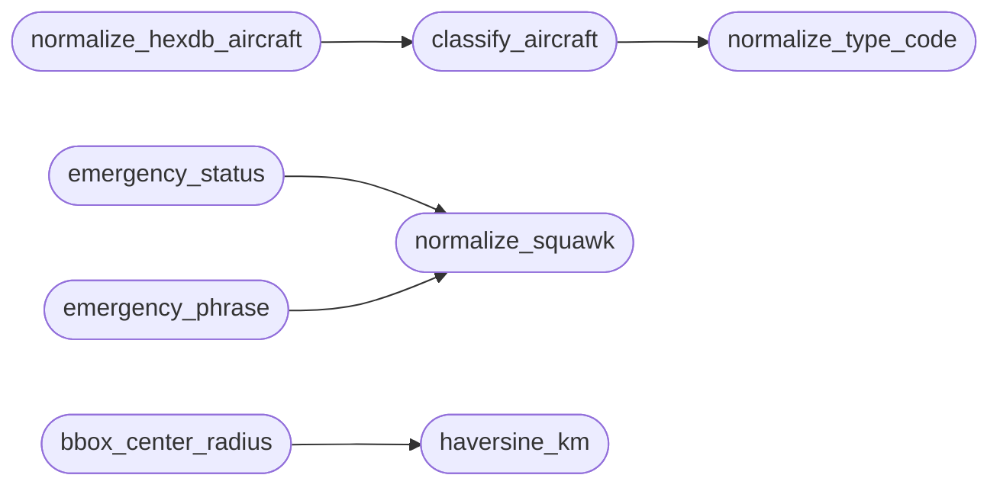

# `estorides_core.aviation`

> Source: [estorides_core/aviation.py:1](../../estorides_core/aviation.py#L1) | language `py` | coverage 100.0% | [API index](../index.md)

estorides_core.aviation ======================= Pure aircraft-intelligence helpers shared by the aerospace sources and the real-time map feeds.

Everything here is deterministic and side-effect free: no network, no
filesystem, no environment. Transport lives in
[`estorides_core.feeds`](estorides_core.feeds.py.md); the orbital math lives in
[`estorides_core.aerospace`](estorides_core.aerospace.py.md); the airport dataset lives in
[`estorides_core.airports`](estorides_core.airports.py.md).

What this module answers for one airframe:

  * **Which class of aircraft is it?** — ICAO type designators and
    ADS-B emitter categories collapse into a small display vocabulary
    (light, turboprop, airliner, widebody, quadjet, helicopter, fastjet,
    bizjet, glider, balloon, uav, ground, space).
  * **Is it broadcasting an emergency?** — Mode A squawks 7500/7600/7700
    plus the ADS-B emergency/priority field, with severity and the exact
    wording an analyst may safely quote.
  * **What do the community database flags say?** — military, interesting,
    PIA and LADD bits from the readsb ``dbFlags`` bitfield.
  * **How far apart are two points?** — haversine distance and
    bounding-box helpers used by the regional aircraft feed.

Design note: nothing here decides that an incident happened. A squawk is
what a transponder broadcast in one poll; crews pass through 7x00 codes
while dialling, and a code does not confirm or resolve an emergency.

Branding: Estorides, developed by Lazy Own Red Team.

## Contents

- **Functions:** [`normalize_type_code`](#normalize_type_code), [`classify_aircraft`](#classify_aircraft), [`aircraft_class_label`](#aircraft_class_label), [`normalize_squawk`](#normalize_squawk), [`emergency_status`](#emergency_status), [`is_emergency`](#is_emergency), [`emergency_phrase`](#emergency_phrase), [`decode_db_flags`](#decode_db_flags), [`navigation_integrity`](#navigation_integrity), [`haversine_km`](#haversine_km), [`bbox_center_radius`](#bbox_center_radius), [`point_in_bbox`](#point_in_bbox), [`normalize_hexdb_aircraft`](#normalize_hexdb_aircraft), [`normalize_hexdb_route`](#normalize_hexdb_route)
- **Constants:** [`CLASS_LIGHT`](#class_light), [`CLASS_GLIDER`](#class_glider), [`CLASS_BALLOON`](#class_balloon), [`CLASS_TURBOPROP`](#class_turboprop), [`CLASS_AIRLINER`](#class_airliner), [`CLASS_WIDEBODY`](#class_widebody), [`CLASS_QUADJET`](#class_quadjet), [`CLASS_HELICOPTER`](#class_helicopter), [`CLASS_FASTJET`](#class_fastjet), [`CLASS_BIZJET`](#class_bizjet), [`CLASS_UAV`](#class_uav), [`CLASS_GROUND`](#class_ground), [`CLASS_SPACE`](#class_space), [`CLASS_UNKNOWN`](#class_unknown), [`CLASS_LABELS`](#class_labels), [`EARTH_RADIUS_KM`](#earth_radius_km), [`KM_PER_NM`](#km_per_nm), [`MAX_REGIONAL_RADIUS_NM`](#max_regional_radius_nm), [`EMERGENCY_KINDS`](#emergency_kinds), [`NAV_LEVELS`](#nav_levels)

## Call Graph

Solid arrows stay in this module, dashed arrows leave it.



## Functions

<a id="normalize_type_code"></a>

### `normalize_type_code`

`function` | [estorides_core/aviation.py:224](../../estorides_core/aviation.py#L224)

```python
def normalize_type_code(value: Any) -> str
```

Return an upper-case ICAO type designator, or ``""``.

**Parameters**

| Name | Type | Default | Description |
|---|---|---|---|
| `value` | `Any` |  |  |

**Returns:** `str`

*Called by:* [`classify_aircraft`](#classify_aircraft)

---

<a id="classify_aircraft"></a>

### `classify_aircraft`

`function` | [estorides_core/aviation.py:230](../../estorides_core/aviation.py#L230)

```python
def classify_aircraft(type_code: Any = None, category: Any = None) -> str
```

Return the display class for one airframe.

The type designator wins over the emitter category because it is
specific. A designator nobody curated falls through to the category;
with neither signal the answer is [`CLASS_UNKNOWN`](#class_unknown).

**Parameters**

| Name | Type | Default | Description |
|---|---|---|---|
| `type_code` | `Any` | `None` |  |
| `category` | `Any` | `None` |  |

**Returns:** `str`

*Calls:* [`normalize_type_code`](#normalize_type_code)

*Called by:* [`normalize_hexdb_aircraft`](#normalize_hexdb_aircraft)

---

<a id="aircraft_class_label"></a>

### `aircraft_class_label`

`function` | [estorides_core/aviation.py:257](../../estorides_core/aviation.py#L257)

```python
def aircraft_class_label(value: Any) -> str
```

Human-readable label for a class slug (`[`unknown`](estorides_core.scope.py.md#scopereport-unknown)` when absent).

**Parameters**

| Name | Type | Default | Description |
|---|---|---|---|
| `value` | `Any` |  |  |

**Returns:** `str`

---

<a id="normalize_squawk"></a>

### `normalize_squawk`

`function` | [estorides_core/aviation.py:284](../../estorides_core/aviation.py#L284)

```python
def normalize_squawk(value: Any) -> str | None
```

Return a Mode A code as four octal digits, or ``None``.

``"7700"`` and ``7700`` are both accepted; anything that is not four
digits in 0-7 (the transponder alphabet) is rejected rather than
silently truncated.

**Parameters**

| Name | Type | Default | Description |
|---|---|---|---|
| `value` | `Any` |  |  |

**Returns:** `str | None`

*Called by:* [`emergency_phrase`](#emergency_phrase), [`emergency_status`](#emergency_status)

---

<a id="emergency_status"></a>

### `emergency_status`

`function` | [estorides_core/aviation.py:306](../../estorides_core/aviation.py#L306)

```python
def emergency_status(squawk: Any = None, emergency: Any = None) -> dict[str, Any] | None
```

Derive the emergency state from one observation.

Both inputs are what the transponder broadcast in this poll: the Mode
A squawk and the ADS-B emergency/priority field. The most severe
signal wins; on a tie the ADS-B field wins because it is more
specific. ``source`` says which one named the status, so a report can
quote the squawk only when the squawk is the evidence.

**Parameters**

| Name | Type | Default | Description |
|---|---|---|---|
| `squawk` | `Any` | `None` |  |
| `emergency` | `Any` | `None` |  |

**Returns:** `dict[str, Any] | None`

*Calls:* [`normalize_squawk`](#normalize_squawk)

---

<a id="is_emergency"></a>

### `is_emergency`

`function` | [estorides_core/aviation.py:337](../../estorides_core/aviation.py#L337)

```python
def is_emergency(status: Any) -> bool
```

True when a status dict describes an emergency (not a priority).

**Parameters**

| Name | Type | Default | Description |
|---|---|---|---|
| `status` | `Any` |  |  |

**Returns:** `bool`

---

<a id="emergency_phrase"></a>

### `emergency_phrase`

`function` | [estorides_core/aviation.py:342](../../estorides_core/aviation.py#L342)

```python
def emergency_phrase(status: Any) -> str | None
```

Wording an analyst may quote, without flattening the signal into a fact.

``broadcasting squawk 7700 (general emergency)`` when the Mode A code
is the evidence, ``ADS-B reports general emergency`` otherwise.

**Parameters**

| Name | Type | Default | Description |
|---|---|---|---|
| `status` | `Any` |  |  |

**Returns:** `str | None`

*Calls:* [`normalize_squawk`](#normalize_squawk)

---

<a id="decode_db_flags"></a>

### `decode_db_flags`

`function` | [estorides_core/aviation.py:368](../../estorides_core/aviation.py#L368)

```python
def decode_db_flags(value: Any) -> dict[str, Any] | None
```

Decode the readsb ``dbFlags`` bitfield into named booleans.

Bit 0 military, bit 1 interesting (PIA/type mismatch), bit 2 PIA
(privacy ICAO address), bit 3 LADD (limited address display). The raw
integer is preserved so a future bit is not silently lost.

**Parameters**

| Name | Type | Default | Description |
|---|---|---|---|
| `value` | `Any` |  |  |

**Returns:** `dict[str, Any] | None`

---

<a id="navigation_integrity"></a>

### `navigation_integrity`

`function` | [estorides_core/aviation.py:394](../../estorides_core/aviation.py#L394)

```python
def navigation_integrity(*, nac_p: Any = None, nic: Any = None, sil: Any = None, on_ground: bool = False) -> dict[str, Any]
```

Classify the navigation integrity an airframe is reporting.

``nominal`` at NACp/NIC >= 8, ``degraded`` at 6-7, ``poor`` at 1-5 and
``no-integrity`` at 0. With neither field present the level is
`[`unknown`](estorides_core.scope.py.md#scopereport-unknown)` — absence of evidence, not evidence of jamming.
``suspected_jamming`` is only set for an airborne aircraft in the
``poor`` or ``no-integrity`` band.

**Parameters**

| Name | Type | Default | Description |
|---|---|---|---|
| `nac_p` | `Any` | `None` |  |
| `nic` | `Any` | `None` |  |
| `sil` | `Any` | `None` |  |
| `on_ground` | `bool` | `False` |  |

**Returns:** `dict[str, Any]`

---

<a id="haversine_km"></a>

### `haversine_km`

`function` | [estorides_core/aviation.py:435](../../estorides_core/aviation.py#L435)

```python
def haversine_km(lat1: Any, lon1: Any, lat2: Any, lon2: Any) -> float | None
```

Great-circle distance in kilometres, or ``None`` for bad input.

**Parameters**

| Name | Type | Default | Description |
|---|---|---|---|
| `lat1` | `Any` |  |  |
| `lon1` | `Any` |  |  |
| `lat2` | `Any` |  |  |
| `lon2` | `Any` |  |  |

**Returns:** `float | None`

*Called by:* [`AirportIndex.nearest`](estorides_core.airports.py.md#airportindex-nearest), [`bbox_center_radius`](#bbox_center_radius)

---

<a id="bbox_center_radius"></a>

### `bbox_center_radius`

`function` | [estorides_core/aviation.py:451](../../estorides_core/aviation.py#L451)

```python
def bbox_center_radius(bbox: Any) -> tuple[float, float, float] | None
```

Centre and half-diagonal radius (nautical miles) of a bbox.

``bbox`` is ``(min_lon, min_lat, max_lon, max_lat)`` — the same order
[`estorides_core.feeds.fetch_all`](estorides_core.feeds.py.md#fetch_all) uses. ``None`` for a malformed
or degenerate box, and for boxes wider than the regional query limit
(callers then fall back to the worldwide snapshot).

**Parameters**

| Name | Type | Default | Description |
|---|---|---|---|
| `bbox` | `Any` |  |  |

**Returns:** `tuple[float, float, float] | None`

*Calls:* [`haversine_km`](#haversine_km)

---

<a id="point_in_bbox"></a>

### `point_in_bbox`

`function` | [estorides_core/aviation.py:480](../../estorides_core/aviation.py#L480)

```python
def point_in_bbox(lat: Any, lon: Any, bbox: Any) -> bool
```

True when ``(lat, lon)`` falls inside an inclusive bbox.

**Parameters**

| Name | Type | Default | Description |
|---|---|---|---|
| `lat` | `Any` |  |  |
| `lon` | `Any` |  |  |
| `bbox` | `Any` |  |  |

**Returns:** `bool`

---

<a id="normalize_hexdb_aircraft"></a>

### `normalize_hexdb_aircraft`

`function` | [estorides_core/aviation.py:496](../../estorides_core/aviation.py#L496)

```python
def normalize_hexdb_aircraft(payload: Any) -> dict[str, Any]
```

Normalise a hexdb.io ``/api/v1/aircraft/{hex}`` response.

hexdb answers ``{"status": "404", ...}`` for an unknown airframe; that
becomes an empty dict so the caller can tell "no record" from "bad
payload". Registration, type and owner are the fields that turn a bare
ICAO address into an identifiable airframe.

**Parameters**

| Name | Type | Default | Description |
|---|---|---|---|
| `payload` | `Any` |  |  |

**Returns:** `dict[str, Any]`

*Calls:* [`classify_aircraft`](#classify_aircraft)

*Called by:* [`parse_hexdb_aircraft`](estorides_core.parsers.py.md#parse_hexdb_aircraft)

---

<a id="normalize_hexdb_route"></a>

### `normalize_hexdb_route`

`function` | [estorides_core/aviation.py:527](../../estorides_core/aviation.py#L527)

```python
def normalize_hexdb_route(payload: Any) -> dict[str, Any]
```

Normalise a hexdb.io ``/api/v1/route/icao/{callsign}`` response.

The route arrives as ``"EGLL-LEMD"``; a missing or dashed route keeps
the callsign but leaves the airports ``None`` rather than inventing
them.

**Parameters**

| Name | Type | Default | Description |
|---|---|---|---|
| `payload` | `Any` |  |  |

**Returns:** `dict[str, Any]`

*Called by:* [`parse_hexdb_route`](estorides_core.parsers.py.md#parse_hexdb_route)

---

## Constants

<a id="class_light"></a>

### `CLASS_LIGHT`

`constant` | [estorides_core/aviation.py:40](../../estorides_core/aviation.py#L40)

```python
CLASS_LIGHT = 'light'
```

---

<a id="class_glider"></a>

### `CLASS_GLIDER`

`constant` | [estorides_core/aviation.py:41](../../estorides_core/aviation.py#L41)

```python
CLASS_GLIDER = 'glider'
```

---

<a id="class_balloon"></a>

### `CLASS_BALLOON`

`constant` | [estorides_core/aviation.py:42](../../estorides_core/aviation.py#L42)

```python
CLASS_BALLOON = 'balloon'
```

---

<a id="class_turboprop"></a>

### `CLASS_TURBOPROP`

`constant` | [estorides_core/aviation.py:43](../../estorides_core/aviation.py#L43)

```python
CLASS_TURBOPROP = 'turboprop'
```

---

<a id="class_airliner"></a>

### `CLASS_AIRLINER`

`constant` | [estorides_core/aviation.py:44](../../estorides_core/aviation.py#L44)

```python
CLASS_AIRLINER = 'airliner'
```

---

<a id="class_widebody"></a>

### `CLASS_WIDEBODY`

`constant` | [estorides_core/aviation.py:45](../../estorides_core/aviation.py#L45)

```python
CLASS_WIDEBODY = 'widebody'
```

---

<a id="class_quadjet"></a>

### `CLASS_QUADJET`

`constant` | [estorides_core/aviation.py:46](../../estorides_core/aviation.py#L46)

```python
CLASS_QUADJET = 'quadjet'
```

---

<a id="class_helicopter"></a>

### `CLASS_HELICOPTER`

`constant` | [estorides_core/aviation.py:47](../../estorides_core/aviation.py#L47)

```python
CLASS_HELICOPTER = 'helicopter'
```

---

<a id="class_fastjet"></a>

### `CLASS_FASTJET`

`constant` | [estorides_core/aviation.py:48](../../estorides_core/aviation.py#L48)

```python
CLASS_FASTJET = 'fastjet'
```

---

<a id="class_bizjet"></a>

### `CLASS_BIZJET`

`constant` | [estorides_core/aviation.py:49](../../estorides_core/aviation.py#L49)

```python
CLASS_BIZJET = 'bizjet'
```

---

<a id="class_uav"></a>

### `CLASS_UAV`

`constant` | [estorides_core/aviation.py:50](../../estorides_core/aviation.py#L50)

```python
CLASS_UAV = 'uav'
```

---

<a id="class_ground"></a>

### `CLASS_GROUND`

`constant` | [estorides_core/aviation.py:51](../../estorides_core/aviation.py#L51)

```python
CLASS_GROUND = 'ground'
```

---

<a id="class_space"></a>

### `CLASS_SPACE`

`constant` | [estorides_core/aviation.py:52](../../estorides_core/aviation.py#L52)

```python
CLASS_SPACE = 'space'
```

---

<a id="class_unknown"></a>

### `CLASS_UNKNOWN`

`constant` | [estorides_core/aviation.py:53](../../estorides_core/aviation.py#L53)

```python
CLASS_UNKNOWN = 'unknown'
```

---

<a id="class_labels"></a>

### `CLASS_LABELS`

`constant` | [estorides_core/aviation.py:55](../../estorides_core/aviation.py#L55)

```python
CLASS_LABELS: dict[str, str]
```

---

<a id="earth_radius_km"></a>

### `EARTH_RADIUS_KM`

`constant` | [estorides_core/aviation.py:72](../../estorides_core/aviation.py#L72)

```python
EARTH_RADIUS_KM = 6371.0088
```

---

<a id="km_per_nm"></a>

### `KM_PER_NM`

`constant` | [estorides_core/aviation.py:73](../../estorides_core/aviation.py#L73)

```python
KM_PER_NM = 1.852
```

---

<a id="max_regional_radius_nm"></a>

### `MAX_REGIONAL_RADIUS_NM`

`constant` | [estorides_core/aviation.py:75](../../estorides_core/aviation.py#L75)

```python
MAX_REGIONAL_RADIUS_NM = 250.0
```

---

<a id="emergency_kinds"></a>

### `EMERGENCY_KINDS`

`constant` | [estorides_core/aviation.py:272](../../estorides_core/aviation.py#L272)

```python
EMERGENCY_KINDS: dict[str, dict[str, str]]
```

---

<a id="nav_levels"></a>

### `NAV_LEVELS`

`constant` | [estorides_core/aviation.py:390](../../estorides_core/aviation.py#L390)

```python
NAV_LEVELS: tuple[str, ...] = ('nominal', 'degraded', 'poor', 'no-integrity', 'unknown')
```

---
