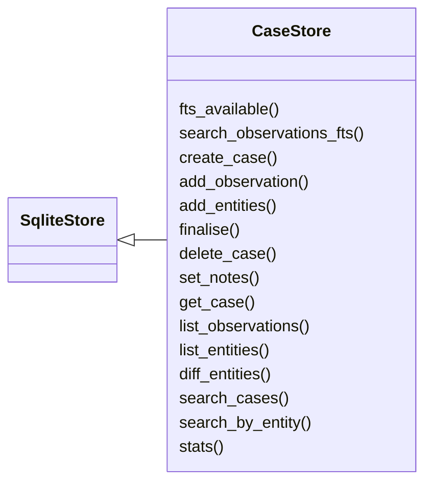
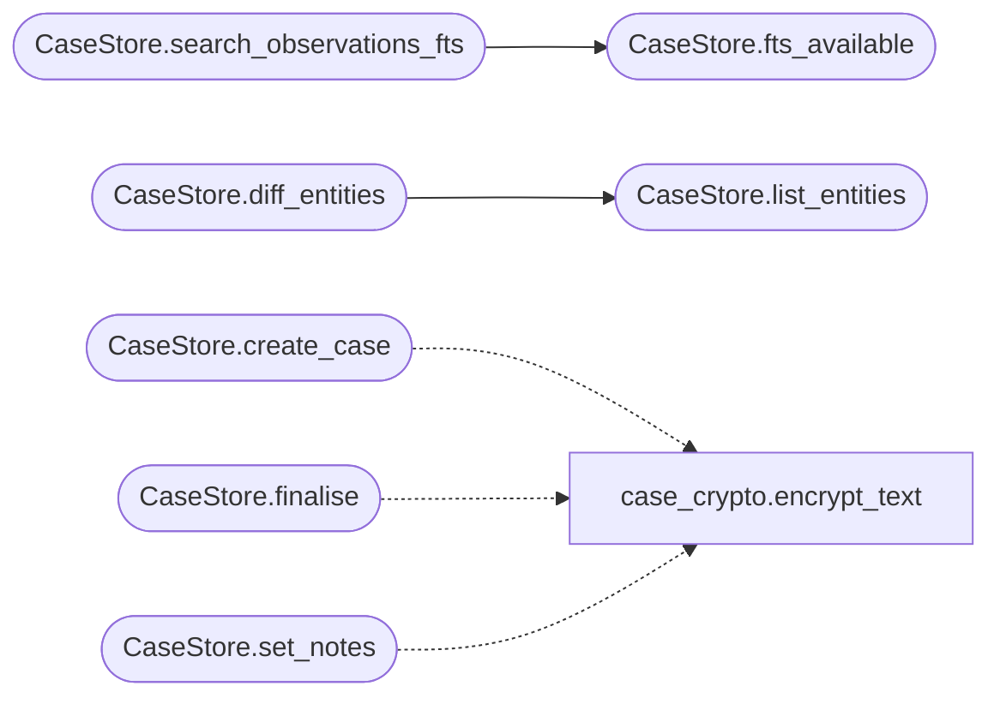

# `estorides_core.cases`

> Source: [estorides_core/cases.py:1](../../estorides_core/cases.py#L1) | language `py` | coverage 64.7% | [API index](../index.md)

estorides_core.cases ==================== Run persistence — every intelligence query becomes a "case" that survives across sessions.

Why a separate module:
  The orchestrator already writes a JSONL dataset line per run, but
  that format is append-only and has no indexes. We need cheap
  lookups by query, by entity, by date range, and a way to
  reconstruct a previous case (observations + entities + graph +
  analysis) without grepping a file.

Schema:

  cases         (id, query, query_type, created_at, status, notes,
                source_count, obs_count, entity_count, mitre_json,
                analysis_json, kg_path)
  observations  (id, case_id, source, category, parser, parsed_json,
                raw_text, meta_json, ontology_json, mitre_json)
  case_entities (case_id, type, value, source, confidence, sources_json)

`cases` is the parent; observations and case_entities have FK to it
via ON DELETE CASCADE so dropping a case cleans up.

Public surface:

    store = CaseStore()
    case_id = store.create_case(query, query_type)
    store.add_observation(case_id, observation)
    store.add_entities(case_id, entities)
    store.finalise(case_id, analysis, kg_path, status="ok")
    case = store.get_case(case_id)
    rows = store.search_cases(query_substring, limit=20)

## Contents

- **Classes:** [`CaseStore`](#casestore)
- **Constants:** [`DB_PATH`](#db_path)

## Type Diagram



## Call Graph

Solid arrows stay in this module, dashed arrows leave it.



## Classes

<a id="casestore"></a>

### `CaseStore`

`class` | [estorides_core/cases.py:112](../../estorides_core/cases.py#L112)

```python
class CaseStore(SqliteStore)
```

Bases: [`SqliteStore`](estorides_core.sqlite_store.py.md#sqlitestore)

Thread-safe SQLite-backed case repository.

SQLite is plenty for OSINT-sized workloads (a few thousand cases
per operator per month) and avoids a separate service. The
underlying file is shared with the cache if you point both env
vars at the same path; otherwise we live in `estorides_cases.sqlite`
next to it.

**Members**

| Member | Kind | Summary |
|---|---|---|
| [`fts_available`](#casestore-fts_available) | method | True when the FTS5 index exists and answers queries. |
| [`search_observations_fts`](#casestore-search_observations_fts) | method | Full text search over observations ordered by rank. |
| [`create_case`](#casestore-create_case) | method | Open a new case and return its id (8-char slug). |
| [`add_observation`](#casestore-add_observation) | method | Persist a single observation row. |
| [`add_entities`](#casestore-add_entities) | method | Persist the merged entity list. |
| [`finalise`](#casestore-finalise) | method |  |
| [`delete_case`](#casestore-delete_case) | method |  |
| [`set_notes`](#casestore-set_notes) | method | Overwrite the free-text [`notes`](estorides_core.monitoring.py.md#watchtarget-notes) column for a case. |
| [`get_case`](#casestore-get_case) | method |  |
| [`list_observations`](#casestore-list_observations) | method |  |
| [`list_entities`](#casestore-list_entities) | method |  |
| [`diff_entities`](#casestore-diff_entities) | method | Compare two cases by entity (type, value) keys. |
| [`search_cases`](#casestore-search_cases) | method | Lightweight case search. |
| [`search_by_entity`](#casestore-search_by_entity) | method | Find every case that observed a given entity. |
| [`stats`](#casestore-stats) | method |  |

<a id="casestore-fts_available"></a>

#### `CaseStore.fts_available`

`method` | [estorides_core/cases.py:147](../../estorides_core/cases.py#L147)

```python
def fts_available(self) -> bool
```

True when the FTS5 index exists and answers queries.

**Returns:** `bool`

*Called by:* [`CaseStore.search_observations_fts`](#casestore-search_observations_fts)

<a id="casestore-search_observations_fts"></a>

#### `CaseStore.search_observations_fts`

`method` | [estorides_core/cases.py:151](../../estorides_core/cases.py#L151)

```python
def search_observations_fts(self, query: str, limit: int = 20) -> list[dict[str, object]]
```

Full text search over observations ordered by rank.

**Parameters**

| Name | Type | Default | Description |
|---|---|---|---|
| `query` | `str` |  |  |
| `limit` | `int` | `20` |  |

**Returns:** `list[dict[str, object]]`

*Calls:* [`CaseStore.fts_available`](#casestore-fts_available)

<a id="casestore-create_case"></a>

#### `CaseStore.create_case`

`method` | [estorides_core/cases.py:173](../../estorides_core/cases.py#L173)

```python
def create_case(self, query: str, query_type: str = '', notes: str = '') -> str
```

Open a new case and return its id (8-char slug).

**Parameters**

| Name | Type | Default | Description |
|---|---|---|---|
| `query` | `str` |  |  |
| `query_type` | `str` | `''` |  |
| `notes` | `str` | `''` |  |

**Returns:** `str`

*Calls:* [`encrypt_text`](estorides_core.case_crypto.py.md#encrypt_text)

<a id="casestore-add_observation"></a>

#### `CaseStore.add_observation`

`method` | [estorides_core/cases.py:189](../../estorides_core/cases.py#L189)

```python
def add_observation(self, case_id: str, observation: Dict[str, Any]) -> None
```

Persist a single observation row.

The full parsed/raw payload is JSON-encoded so we can
reconstruct the run later without re-running the source.

**Parameters**

| Name | Type | Default | Description |
|---|---|---|---|
| `case_id` | `str` |  |  |
| `observation` | `Dict[str, Any]` |  |  |

<a id="casestore-add_entities"></a>

#### `CaseStore.add_entities`

`method` | [estorides_core/cases.py:223](../../estorides_core/cases.py#L223)

```python
def add_entities(self, case_id: str, entities: Iterable[Dict[str, Any]]) -> None
```

Persist the merged entity list.

Duplicate (type, value) rows for the same case are silently ignored — the PK is the guard.

**Parameters**

| Name | Type | Default | Description |
|---|---|---|---|
| `case_id` | `str` |  |  |
| `entities` | `Iterable[Dict[str, Any]]` |  |  |

<a id="casestore-finalise"></a>

#### `CaseStore.finalise`

`method` | [estorides_core/cases.py:246](../../estorides_core/cases.py#L246)

```python
def finalise(self, case_id: str, analysis: Optional[Dict[str, Any]] = None, kg_path: Optional[str] = None, mitre: Optional[Dict[str, Any]] = None, source_count: int = 0, obs_count: int = 0, entity_count: int = 0, status: str = 'ok') -> None
```

**Parameters**

| Name | Type | Default | Description |
|---|---|---|---|
| `case_id` | `str` |  |  |
| `analysis` | `Optional[Dict[str, Any]]` | `None` |  |
| `kg_path` | `Optional[str]` | `None` |  |
| `mitre` | `Optional[Dict[str, Any]]` | `None` |  |
| `source_count` | `int` | `0` |  |
| `obs_count` | `int` | `0` |  |
| `entity_count` | `int` | `0` |  |
| `status` | `str` | `'ok'` |  |

*Calls:* [`encrypt_text`](estorides_core.case_crypto.py.md#encrypt_text)

<a id="casestore-delete_case"></a>

#### `CaseStore.delete_case`

`method` | [estorides_core/cases.py:276](../../estorides_core/cases.py#L276)

```python
def delete_case(self, case_id: str) -> None
```

**Parameters**

| Name | Type | Default | Description |
|---|---|---|---|
| `case_id` | `str` |  |  |

<a id="casestore-set_notes"></a>

#### `CaseStore.set_notes`

`method` | [estorides_core/cases.py:280](../../estorides_core/cases.py#L280)

```python
def set_notes(self, case_id: str, notes: str) -> None
```

Overwrite the free-text [`notes`](estorides_core.monitoring.py.md#watchtarget-notes) column for a case.

Used by the UI "save/bookmark" gesture. Kept here (rather than
reaching into `_lock`/`_conn` from the route) so the store owns
its own transaction boundary.

**Parameters**

| Name | Type | Default | Description |
|---|---|---|---|
| `case_id` | `str` |  |  |
| `notes` | `str` |  |  |

*Calls:* [`encrypt_text`](estorides_core.case_crypto.py.md#encrypt_text)

<a id="casestore-get_case"></a>

#### `CaseStore.get_case`

`method` | [estorides_core/cases.py:291](../../estorides_core/cases.py#L291)

```python
def get_case(self, case_id: str) -> Optional[Dict[str, Any]]
```

**Parameters**

| Name | Type | Default | Description |
|---|---|---|---|
| `case_id` | `str` |  |  |

**Returns:** `Optional[Dict[str, Any]]`

<a id="casestore-list_observations"></a>

#### `CaseStore.list_observations`

`method` | [estorides_core/cases.py:304](../../estorides_core/cases.py#L304)

```python
def list_observations(self, case_id: str) -> List[Dict[str, Any]]
```

**Parameters**

| Name | Type | Default | Description |
|---|---|---|---|
| `case_id` | `str` |  |  |

**Returns:** `List[Dict[str, Any]]`

<a id="casestore-list_entities"></a>

#### `CaseStore.list_entities`

`method` | [estorides_core/cases.py:327](../../estorides_core/cases.py#L327)

```python
def list_entities(self, case_id: str) -> List[Dict[str, Any]]
```

**Parameters**

| Name | Type | Default | Description |
|---|---|---|---|
| `case_id` | `str` |  |  |

**Returns:** `List[Dict[str, Any]]`

*Called by:* [`CaseStore.diff_entities`](#casestore-diff_entities)

<a id="casestore-diff_entities"></a>

#### `CaseStore.diff_entities`

`method` | [estorides_core/cases.py:342](../../estorides_core/cases.py#L342)

```python
def diff_entities(self, case_a: str, case_b: str) -> Dict[str, Any]
```

Compare two cases by entity (type, value) keys.

Returns the symmetric difference plus counts and the per-type
breakdown. The "added" set is what case B learned that A did
not have; "removed" is the inverse. This is the OSINT analogue
of `git diff A B` and is the building block for the
"what's new since last run" UI the analyst wants to see.

Both cases are looked up in a single connection hold so the
diff is consistent even if the case store is being written
to concurrently.

**Parameters**

| Name | Type | Default | Description |
|---|---|---|---|
| `case_a` | `str` |  |  |
| `case_b` | `str` |  |  |

**Returns:** `Dict[str, Any]`

*Calls:* [`CaseStore.list_entities`](#casestore-list_entities)

<a id="casestore-search_cases"></a>

#### `CaseStore.search_cases`

`method` | [estorides_core/cases.py:389](../../estorides_core/cases.py#L389)

```python
def search_cases(self, query_substring: str = '', limit: int = 20, query_type: str = '') -> List[Dict[str, Any]]
```

Lightweight case search.

LIKE on `query` (not indexed, but acceptable for the OSINT scale of a few thousand cases).

**Parameters**

| Name | Type | Default | Description |
|---|---|---|---|
| `query_substring` | `str` | `''` |  |
| `limit` | `int` | `20` |  |
| `query_type` | `str` | `''` |  |

**Returns:** `List[Dict[str, Any]]`

<a id="casestore-search_by_entity"></a>

#### `CaseStore.search_by_entity`

`method` | [estorides_core/cases.py:419](../../estorides_core/cases.py#L419)

```python
def search_by_entity(self, ent_type: str, value: str, limit: int = 20) -> List[Dict[str, Any]]
```

Find every case that observed a given entity.

This is the cross-run memory query — the heart of "have I
seen this before?".

**Parameters**

| Name | Type | Default | Description |
|---|---|---|---|
| `ent_type` | `str` |  |  |
| `value` | `str` |  |  |
| `limit` | `int` | `20` |  |

**Returns:** `List[Dict[str, Any]]`

<a id="casestore-stats"></a>

#### `CaseStore.stats`

`method` | [estorides_core/cases.py:447](../../estorides_core/cases.py#L447)

```python
def stats(self) -> Dict[str, Any]
```

**Returns:** `Dict[str, Any]`

---

## Constants

<a id="db_path"></a>

### `DB_PATH`

`constant` | [estorides_core/cases.py:53](../../estorides_core/cases.py#L53)

```python
DB_PATH: Path
```

---
