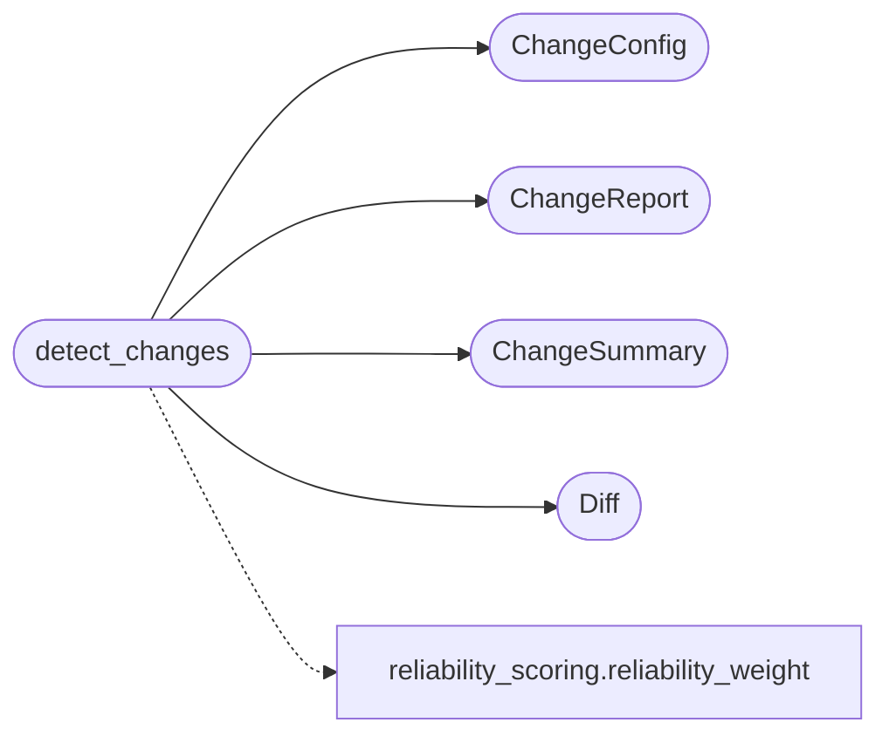

# `estorides_core.change_detection`

> Source: [estorides_core/change_detection.py:1](../../estorides_core/change_detection.py#L1) | language `py` | coverage 100.0% | [API index](../index.md)

estorides_core.change_detection =============================== The temporal layer: "what changed in this investigation since the last run?".

Takes two immutable [`Snapshot`](#snapshot) objects and emits a [`ChangeReport`](#changereport) listing every new entity, every disappeared one, every property change, every new source corroboration, and every edge added/removed. Each [`Change`](#change) carries an auditable `[`score`](#change-score)` reliability-weighted via `reliability_scoring`.

Pure module: no I/O, no DB writes, no logging of payload, no clock.
Same input ⇒ same output bit-by-bit. Change ids are content hashes
so the case store can deduplicate events across runs.

Public surface::

    detect_changes(snapshot_before, snapshot_after, *, config=ChangeConfig())
        -> ChangeReport

## Contents

- **Classes:** [`Edge`](#edge), [`SnapshotEntity`](#snapshotentity), [`Snapshot`](#snapshot), [`ChangeConfig`](#changeconfig), [`Diff`](#diff), [`Change`](#change), [`ChangeSummary`](#changesummary), [`ChangeReport`](#changereport)
- **Functions:** [`detect_changes`](#detect_changes)
- **Constants:** [`CHANGE_KINDS`](#change_kinds)

## Type Diagram

```mermaid
classDiagram
    direction LR
    class Edge
    Edge : str dst
    Edge : str rel
    class SnapshotEntity
    SnapshotEntity : str id
    SnapshotEntity : str type
    SnapshotEntity : str value
    SnapshotEntity : list[str] sources
    SnapshotEntity : dict[str, str] properties
    SnapshotEntity : list[Edge] edges
    SnapshotEntity : float first_seen
    SnapshotEntity : float last_seen
    SnapshotEntity : float confidence
    class Snapshot
    Snapshot : list[SnapshotEntity] entities
    Snapshot : float snapshot_at
    class ChangeConfig
    ChangeConfig : SourceReliability min_reliability
    ChangeConfig : float min_change_score
    ChangeConfig : float disappear_grace_days
    ChangeConfig : bool include_disappeared
    ChangeConfig : bool include_property_changes
    ChangeConfig : bool include_source_added
    ChangeConfig : int max_changes
    class Diff
    Diff : list[str] added
    Diff : dict[str, list[str]] changed
    Diff : list[str] removed
    class Change
    Change : str id
    Change : str kind
    Change : str entity_id
    Change : str entity_type
    Change : str entity_value
    Change : dict[str, Any]  None before
    Change : dict[str, Any]  None after
    Change : Diff diff
    Change : float score
    Change : list[str] sources
    Change : float detected_at
    class ChangeSummary
    ChangeSummary : int total
    ChangeSummary : dict[str, int] by_kind
    ChangeSummary : int entities_compared
    ChangeSummary : int entities_added
    ChangeSummary : int entities_removed
    ChangeSummary : int properties_changed
    ChangeSummary : float score_max
    ChangeSummary : float score_mean
    ChangeSummary : float computed_at
    ChangeSummary : float snapshot_before_at
    ChangeSummary : float snapshot_after_at
    class ChangeReport
    ChangeReport : list[Change] changes
    ChangeReport : ChangeSummary summary
```



## Call Graph

Solid arrows stay in this module, dashed arrows leave it.



## Classes

<a id="edge"></a>

### `Edge`

`class` `dataclass` | [estorides_core/change_detection.py:59](../../estorides_core/change_detection.py#L59)

Decorators: `@dataclass(frozen=True)`

```python
class Edge
```

Outgoing edge: typed destination + relation name.

**Attributes**

| Name | Type | Default | Description |
|---|---|---|---|
| [`dst`](#edge-dst) | `str` |  |  |
| [`rel`](#edge-rel) | `str` |  |  |

---

<a id="snapshotentity"></a>

### `SnapshotEntity`

`class` `dataclass` | [estorides_core/change_detection.py:67](../../estorides_core/change_detection.py#L67)

Decorators: `@dataclass(frozen=True)`

```python
class SnapshotEntity
```

One entity as captured at snapshot time.

Mirrors the fields the fusion store already persists
(`[`first_seen`](#snapshotentity-first_seen)`/`[`last_seen`](#snapshotentity-last_seen)`/`[`confidence`](#snapshotentity-confidence)`/`[`sources`](#snapshotentity-sources)`), so a
Snapshot can be built directly from a fused row.

**Attributes**

| Name | Type | Default | Description |
|---|---|---|---|
| [`id`](#snapshotentity-id) | `str` |  |  |
| [`type`](#snapshotentity-type) | `str` |  |  |
| [`value`](#snapshotentity-value) | `str` |  |  |
| [`sources`](#snapshotentity-sources) | `list[str]` | `field(default_factory=list)` |  |
| [`properties`](#snapshotentity-properties) | `dict[str, str]` | `field(default_factory=dict)` |  |
| [`edges`](#snapshotentity-edges) | `list[Edge]` | `field(default_factory=list)` |  |
| [`first_seen`](#snapshotentity-first_seen) | `float` | `0.0` |  |
| [`last_seen`](#snapshotentity-last_seen) | `float` | `0.0` |  |
| [`confidence`](#snapshotentity-confidence) | `float` | `0.5` |  |

---

<a id="snapshot"></a>

### `Snapshot`

`class` `dataclass` | [estorides_core/change_detection.py:97](../../estorides_core/change_detection.py#L97)

Decorators: `@dataclass(frozen=True)`

```python
class Snapshot
```

An immutable view of an investigation at one point in time.

**Attributes**

| Name | Type | Default | Description |
|---|---|---|---|
| [`entities`](#snapshot-entities) | `list[SnapshotEntity]` | `field(default_factory=list)` |  |
| [`snapshot_at`](#snapshot-snapshot_at) | `float` | `0.0` |  |

---

<a id="changeconfig"></a>

### `ChangeConfig`

`class` `dataclass` | [estorides_core/change_detection.py:105](../../estorides_core/change_detection.py#L105)

Decorators: `@dataclass(frozen=True)`

```python
class ChangeConfig
```

Tuning for [`detect_changes`](#detect_changes).

**Attributes**

| Name | Type | Default | Description |
|---|---|---|---|
| [`min_reliability`](#changeconfig-min_reliability) | `SourceReliability` | `SourceReliability.C` |  |
| [`min_change_score`](#changeconfig-min_change_score) | `float` | `0.1` |  |
| [`disappear_grace_days`](#changeconfig-disappear_grace_days) | `float` | `7.0` |  |
| [`include_disappeared`](#changeconfig-include_disappeared) | `bool` | `True` |  |
| [`include_property_changes`](#changeconfig-include_property_changes) | `bool` | `True` |  |
| [`include_source_added`](#changeconfig-include_source_added) | `bool` | `True` |  |
| [`max_changes`](#changeconfig-max_changes) | `int` | `500` |  |

---

<a id="diff"></a>

### `Diff`

`class` `dataclass` | [estorides_core/change_detection.py:126](../../estorides_core/change_detection.py#L126)

Decorators: `@dataclass(frozen=True)`

```python
class Diff
```

Structured description of a single change's delta.

**Attributes**

| Name | Type | Default | Description |
|---|---|---|---|
| [`added`](#diff-added) | `list[str]` | `field(default_factory=list)` |  |
| [`changed`](#diff-changed) | `dict[str, list[str]]` | `field(default_factory=dict)` |  |
| [`removed`](#diff-removed) | `list[str]` | `field(default_factory=list)` |  |

---

<a id="change"></a>

### `Change`

`class` `dataclass` | [estorides_core/change_detection.py:135](../../estorides_core/change_detection.py#L135)

Decorators: `@dataclass(frozen=True)`

```python
class Change
```

One detected change.

**Attributes**

| Name | Type | Default | Description |
|---|---|---|---|
| [`id`](#change-id) | `str` |  |  |
| [`kind`](#change-kind) | `str` |  |  |
| [`entity_id`](#change-entity_id) | `str` |  |  |
| [`entity_type`](#change-entity_type) | `str` |  |  |
| [`entity_value`](#change-entity_value) | `str` |  |  |
| [`before`](#change-before) | `dict[str, Any] \| None` |  |  |
| [`after`](#change-after) | `dict[str, Any] \| None` |  |  |
| [`diff`](#change-diff) | `Diff` |  |  |
| [`score`](#change-score) | `float` |  |  |
| [`sources`](#change-sources) | `list[str]` |  |  |
| [`detected_at`](#change-detected_at) | `float` |  |  |

---

<a id="changesummary"></a>

### `ChangeSummary`

`class` `dataclass` | [estorides_core/change_detection.py:152](../../estorides_core/change_detection.py#L152)

Decorators: `@dataclass(frozen=True)`

```python
class ChangeSummary
```

Aggregate stats for a [`ChangeReport`](#changereport).

**Attributes**

| Name | Type | Default | Description |
|---|---|---|---|
| [`total`](#changesummary-total) | `int` |  |  |
| [`by_kind`](#changesummary-by_kind) | `dict[str, int]` |  |  |
| [`entities_compared`](#changesummary-entities_compared) | `int` |  |  |
| [`entities_added`](#changesummary-entities_added) | `int` |  |  |
| [`entities_removed`](#changesummary-entities_removed) | `int` |  |  |
| [`properties_changed`](#changesummary-properties_changed) | `int` |  |  |
| [`score_max`](#changesummary-score_max) | `float` |  |  |
| [`score_mean`](#changesummary-score_mean) | `float` |  |  |
| [`computed_at`](#changesummary-computed_at) | `float` |  |  |
| [`snapshot_before_at`](#changesummary-snapshot_before_at) | `float` |  |  |
| [`snapshot_after_at`](#changesummary-snapshot_after_at) | `float` |  |  |

---

<a id="changereport"></a>

### `ChangeReport`

`class` `dataclass` | [estorides_core/change_detection.py:169](../../estorides_core/change_detection.py#L169)

Decorators: `@dataclass(frozen=True)`

```python
class ChangeReport
```

Top-N changes + summary stats for a single diff operation.

**Attributes**

| Name | Type | Default | Description |
|---|---|---|---|
| [`changes`](#changereport-changes) | `list[Change]` |  |  |
| [`summary`](#changereport-summary) | `ChangeSummary` |  |  |

---

## Functions

<a id="detect_changes"></a>

### `detect_changes`

`function` | [estorides_core/change_detection.py:284](../../estorides_core/change_detection.py#L284)

```python
def detect_changes(snapshot_before: Snapshot | None, snapshot_after: Snapshot | None, *, config: ChangeConfig | None = None) -> ChangeReport
```

Diff two snapshots.

Pure: no I/O, deterministic, bounded.

**Parameters**

| Name | Type | Default | Description |
|---|---|---|---|
| `snapshot_before` | `Snapshot \| None` |  |  |
| `snapshot_after` | `Snapshot \| None` |  |  |
| `config` | `ChangeConfig \| None` | `None` | Optional tuning. See [`ChangeConfig`](#changeconfig). |

**Returns:** `ChangeReport`

*Calls:* [`ChangeConfig`](#changeconfig), [`ChangeReport`](#changereport), [`ChangeSummary`](#changesummary), [`Diff`](#diff), [`reliability_weight`](estorides_core.reliability_scoring.py.md#reliability_weight)

---

## Constants

<a id="change_kinds"></a>

### `CHANGE_KINDS`

`constant` | [estorides_core/change_detection.py:36](../../estorides_core/change_detection.py#L36)

```python
CHANGE_KINDS: frozenset[str]
```

---
