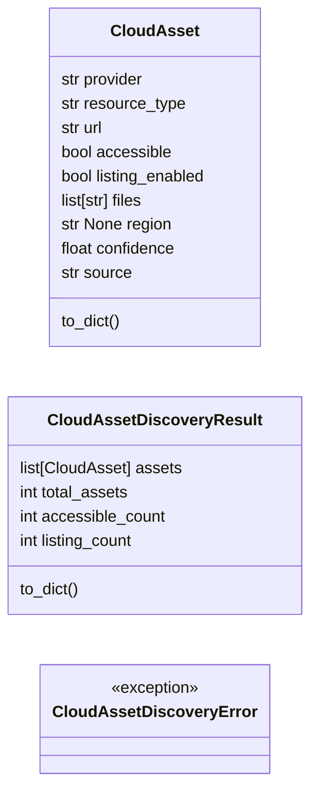

# `estorides_core.cloud_asset_discovery`

> Source: [estorides_core/cloud_asset_discovery.py:1](../../estorides_core/cloud_asset_discovery.py#L1) | language `py` | coverage 0.0% | [API index](../index.md)

## Contents

- **Classes:** [`CloudAsset`](#cloudasset), [`CloudAssetDiscoveryResult`](#cloudassetdiscoveryresult)
- **Exceptions:** [`CloudAssetDiscoveryError`](#cloudassetdiscoveryerror)
- **Functions:** [`generate_bucket_names`](#generate_bucket_names), [`assess_bucket`](#assess_bucket)
- **Constants:** [`MAX_REQS_PER_SEC`](#max_reqs_per_sec), [`COMMON_BUCKET_PREFIXES`](#common_bucket_prefixes), [`CLOUD_ENDPOINTS`](#cloud_endpoints)

## Type Diagram



## Classes

<a id="cloudasset"></a>

### `CloudAsset`

`class` `dataclass` | [estorides_core/cloud_asset_discovery.py:34](../../estorides_core/cloud_asset_discovery.py#L34)

Decorators: `@dataclass`

```python
class CloudAsset
```

**Attributes**

| Name | Type | Default | Description |
|---|---|---|---|
| [`provider`](#cloudasset-provider) | `str` |  |  |
| [`resource_type`](#cloudasset-resource_type) | `str` |  |  |
| [`url`](#cloudasset-url) | `str` |  |  |
| [`accessible`](#cloudasset-accessible) | `bool` |  |  |
| [`listing_enabled`](#cloudasset-listing_enabled) | `bool` |  |  |
| [`files`](#cloudasset-files) | `list[str]` |  |  |
| [`region`](#cloudasset-region) | `str \| None` |  |  |
| [`confidence`](#cloudasset-confidence) | `float` |  |  |
| [`source`](#cloudasset-source) | `str` |  |  |

**Members**

| Member | Kind | Summary |
|---|---|---|
| [`to_dict`](#cloudasset-to_dict) | method |  |

<a id="cloudasset-to_dict"></a>

#### `CloudAsset.to_dict`

`method` | [estorides_core/cloud_asset_discovery.py:45](../../estorides_core/cloud_asset_discovery.py#L45)

```python
def to_dict(self) -> dict[str, Any]
```

**Returns:** `dict[str, Any]`

---

<a id="cloudassetdiscoveryresult"></a>

### `CloudAssetDiscoveryResult`

`class` `dataclass` | [estorides_core/cloud_asset_discovery.py:50](../../estorides_core/cloud_asset_discovery.py#L50)

Decorators: `@dataclass`

```python
class CloudAssetDiscoveryResult
```

**Attributes**

| Name | Type | Default | Description |
|---|---|---|---|
| [`assets`](#cloudassetdiscoveryresult-assets) | `list[CloudAsset]` | `field(default_factory=list)` |  |
| [`total_assets`](#cloudassetdiscoveryresult-total_assets) | `int` | `0` |  |
| [`accessible_count`](#cloudassetdiscoveryresult-accessible_count) | `int` | `0` |  |
| [`listing_count`](#cloudassetdiscoveryresult-listing_count) | `int` | `0` |  |

**Members**

| Member | Kind | Summary |
|---|---|---|
| [`to_dict`](#cloudassetdiscoveryresult-to_dict) | method |  |

<a id="cloudassetdiscoveryresult-to_dict"></a>

#### `CloudAssetDiscoveryResult.to_dict`

`method` | [estorides_core/cloud_asset_discovery.py:56](../../estorides_core/cloud_asset_discovery.py#L56)

```python
def to_dict(self) -> dict[str, Any]
```

**Returns:** `dict[str, Any]`

*Called by:* [`run_passive_recon`](estorides_core.recon_pipeline.py.md#run_passive_recon)

---

## Exceptions

<a id="cloudassetdiscoveryerror"></a>

### `CloudAssetDiscoveryError`

`exception` | [estorides_core/cloud_asset_discovery.py:93](../../estorides_core/cloud_asset_discovery.py#L93)

```python
class CloudAssetDiscoveryError(Exception)
```

Bases: `Exception`

---

## Functions

<a id="generate_bucket_names"></a>

### `generate_bucket_names`

`function` | [estorides_core/cloud_asset_discovery.py:65](../../estorides_core/cloud_asset_discovery.py#L65)

```python
def generate_bucket_names(domain: str) -> list[str]
```

**Parameters**

| Name | Type | Default | Description |
|---|---|---|---|
| `domain` | `str` |  |  |

**Returns:** `list[str]`

---

<a id="assess_bucket"></a>

### `assess_bucket`

`function` | [estorides_core/cloud_asset_discovery.py:84](../../estorides_core/cloud_asset_discovery.py#L84)

```python
def assess_bucket(url: str, method: str = 'GET') -> dict[str, Any]
```

**Parameters**

| Name | Type | Default | Description |
|---|---|---|---|
| `url` | `str` |  |  |
| `method` | `str` | `'GET'` |  |

**Returns:** `dict[str, Any]`

---

## Constants

<a id="max_reqs_per_sec"></a>

### `MAX_REQS_PER_SEC`

`constant` | [estorides_core/cloud_asset_discovery.py:9](../../estorides_core/cloud_asset_discovery.py#L9)

```python
MAX_REQS_PER_SEC = 5
```

---

<a id="common_bucket_prefixes"></a>

### `COMMON_BUCKET_PREFIXES`

`constant` | [estorides_core/cloud_asset_discovery.py:11](../../estorides_core/cloud_asset_discovery.py#L11)

```python
COMMON_BUCKET_PREFIXES
```

---

<a id="cloud_endpoints"></a>

### `CLOUD_ENDPOINTS`

`constant` | [estorides_core/cloud_asset_discovery.py:22](../../estorides_core/cloud_asset_discovery.py#L22)

```python
CLOUD_ENDPOINTS: list[tuple[str, str, str]]
```

---
