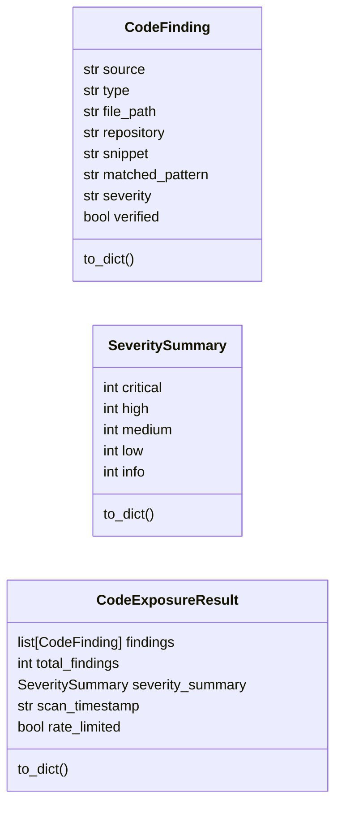
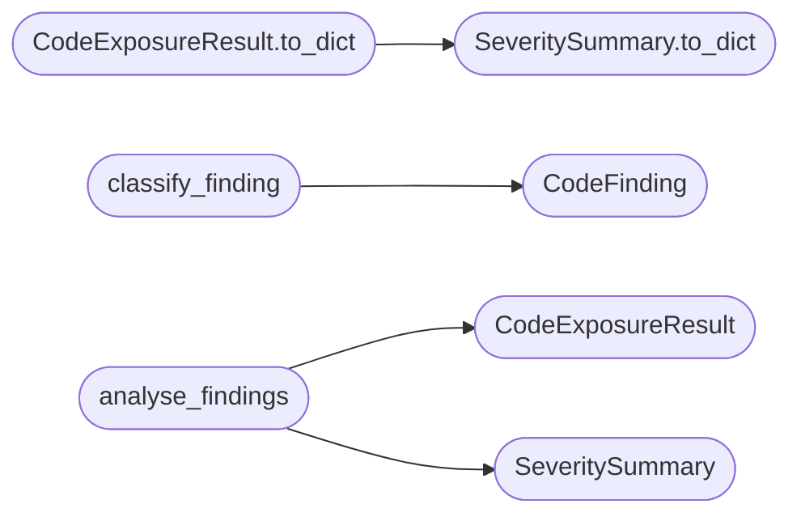

# `estorides_core.code_exposure`

> Source: [estorides_core/code_exposure.py:1](../../estorides_core/code_exposure.py#L1) | language `py` | coverage 0.0% | [API index](../index.md)

## Contents

- **Classes:** [`CodeFinding`](#codefinding), [`SeveritySummary`](#severitysummary), [`CodeExposureResult`](#codeexposureresult)
- **Functions:** [`validate_aws_key`](#validate_aws_key), [`classify_finding`](#classify_finding), [`analyse_findings`](#analyse_findings)
- **Constants:** [`MAX_SNIPPET_CHARS`](#max_snippet_chars), [`AWS_KEY_RE`](#aws_key_re), [`GCP_KEY_RE`](#gcp_key_re), [`STRIPE_KEY_RE`](#stripe_key_re), [`GITHUB_TOKEN_RE`](#github_token_re), [`SLACK_TOKEN_RE`](#slack_token_re), [`PRIVATE_KEY_RE`](#private_key_re), [`JWT_RE`](#jwt_re), [`INTERNAL_URL_RE`](#internal_url_re), [`CRED_PATTERNS`](#cred_patterns), [`CONFIG_FILE_PATTERNS`](#config_file_patterns), [`PLACEHOLDER_RE`](#placeholder_re)

## Type Diagram



## Call Graph

Solid arrows stay in this module, dashed arrows leave it.



## Classes

<a id="codefinding"></a>

### `CodeFinding`

`class` `dataclass` | [estorides_core/code_exposure.py:47](../../estorides_core/code_exposure.py#L47)

Decorators: `@dataclass`

```python
class CodeFinding
```

**Attributes**

| Name | Type | Default | Description |
|---|---|---|---|
| [`source`](#codefinding-source) | `str` |  |  |
| [`type`](#codefinding-type) | `str` |  |  |
| [`file_path`](#codefinding-file_path) | `str` |  |  |
| [`repository`](#codefinding-repository) | `str` |  |  |
| [`snippet`](#codefinding-snippet) | `str` |  |  |
| [`matched_pattern`](#codefinding-matched_pattern) | `str` |  |  |
| [`severity`](#codefinding-severity) | `str` |  |  |
| [`verified`](#codefinding-verified) | `bool` |  |  |

**Members**

| Member | Kind | Summary |
|---|---|---|
| [`to_dict`](#codefinding-to_dict) | method |  |

<a id="codefinding-to_dict"></a>

#### `CodeFinding.to_dict`

`method` | [estorides_core/code_exposure.py:57](../../estorides_core/code_exposure.py#L57)

```python
def to_dict(self) -> dict[str, Any]
```

**Returns:** `dict[str, Any]`

---

<a id="severitysummary"></a>

### `SeveritySummary`

`class` `dataclass` | [estorides_core/code_exposure.py:62](../../estorides_core/code_exposure.py#L62)

Decorators: `@dataclass`

```python
class SeveritySummary
```

**Attributes**

| Name | Type | Default | Description |
|---|---|---|---|
| [`critical`](#severitysummary-critical) | `int` | `0` |  |
| [`high`](#severitysummary-high) | `int` | `0` |  |
| [`medium`](#severitysummary-medium) | `int` | `0` |  |
| [`low`](#severitysummary-low) | `int` | `0` |  |
| [`info`](#severitysummary-info) | `int` | `0` |  |

**Members**

| Member | Kind | Summary |
|---|---|---|
| [`to_dict`](#severitysummary-to_dict) | method |  |

<a id="severitysummary-to_dict"></a>

#### `SeveritySummary.to_dict`

`method` | [estorides_core/code_exposure.py:69](../../estorides_core/code_exposure.py#L69)

```python
def to_dict(self) -> dict[str, Any]
```

**Returns:** `dict[str, Any]`

*Called by:* [`CodeExposureResult.to_dict`](#codeexposureresult-to_dict)

---

<a id="codeexposureresult"></a>

### `CodeExposureResult`

`class` `dataclass` | [estorides_core/code_exposure.py:74](../../estorides_core/code_exposure.py#L74)

Decorators: `@dataclass`

```python
class CodeExposureResult
```

**Attributes**

| Name | Type | Default | Description |
|---|---|---|---|
| [`findings`](#codeexposureresult-findings) | `list[CodeFinding]` | `field(default_factory=list)` |  |
| [`total_findings`](#codeexposureresult-total_findings) | `int` | `0` |  |
| [`severity_summary`](#codeexposureresult-severity_summary) | `SeveritySummary` | `field(default_factory=SeveritySummary)` |  |
| [`scan_timestamp`](#codeexposureresult-scan_timestamp) | `str` | `''` |  |
| [`rate_limited`](#codeexposureresult-rate_limited) | `bool` | `False` |  |

**Members**

| Member | Kind | Summary |
|---|---|---|
| [`to_dict`](#codeexposureresult-to_dict) | method |  |

<a id="codeexposureresult-to_dict"></a>

#### `CodeExposureResult.to_dict`

`method` | [estorides_core/code_exposure.py:81](../../estorides_core/code_exposure.py#L81)

```python
def to_dict(self) -> dict[str, Any]
```

**Returns:** `dict[str, Any]`

*Calls:* [`SeveritySummary.to_dict`](#severitysummary-to_dict)

---

## Functions

<a id="validate_aws_key"></a>

### `validate_aws_key`

`function` | [estorides_core/code_exposure.py:91](../../estorides_core/code_exposure.py#L91)

```python
def validate_aws_key(key: str) -> bool
```

**Parameters**

| Name | Type | Default | Description |
|---|---|---|---|
| `key` | `str` |  |  |

**Returns:** `bool`

---

<a id="classify_finding"></a>

### `classify_finding`

`function` | [estorides_core/code_exposure.py:99](../../estorides_core/code_exposure.py#L99)

```python
def classify_finding(content: str, source: str, file_path: str) -> CodeFinding
```

**Parameters**

| Name | Type | Default | Description |
|---|---|---|---|
| `content` | `str` |  |  |
| `source` | `str` |  |  |
| `file_path` | `str` |  |  |

**Returns:** `CodeFinding`

*Calls:* [`CodeFinding`](#codefinding)

---

<a id="analyse_findings"></a>

### `analyse_findings`

`function` | [estorides_core/code_exposure.py:189](../../estorides_core/code_exposure.py#L189)

```python
def analyse_findings(findings: list[CodeFinding], rate_limited: bool = False) -> CodeExposureResult
```

**Parameters**

| Name | Type | Default | Description |
|---|---|---|---|
| `findings` | `list[CodeFinding]` |  |  |
| `rate_limited` | `bool` | `False` |  |

**Returns:** `CodeExposureResult`

*Calls:* [`CodeExposureResult`](#codeexposureresult), [`SeveritySummary`](#severitysummary)

*Called by:* [`run_passive_recon`](estorides_core.recon_pipeline.py.md#run_passive_recon)

---

## Constants

<a id="max_snippet_chars"></a>

### `MAX_SNIPPET_CHARS`

`constant` | [estorides_core/code_exposure.py:10](../../estorides_core/code_exposure.py#L10)

```python
MAX_SNIPPET_CHARS = 200
```

---

<a id="aws_key_re"></a>

### `AWS_KEY_RE`

`constant` | [estorides_core/code_exposure.py:12](../../estorides_core/code_exposure.py#L12)

```python
AWS_KEY_RE = re.compile('AKIA[0-9A-Z]{16}')
```

---

<a id="gcp_key_re"></a>

### `GCP_KEY_RE`

`constant` | [estorides_core/code_exposure.py:13](../../estorides_core/code_exposure.py#L13)

```python
GCP_KEY_RE = re.compile('AIza[0-9A-Za-z_-]{35}')
```

---

<a id="stripe_key_re"></a>

### `STRIPE_KEY_RE`

`constant` | [estorides_core/code_exposure.py:14](../../estorides_core/code_exposure.py#L14)

```python
STRIPE_KEY_RE = re.compile('(?:sk|pk)_(?:live|test)_[0-9a-zA-Z]{24,}')
```

---

<a id="github_token_re"></a>

### `GITHUB_TOKEN_RE`

`constant` | [estorides_core/code_exposure.py:15](../../estorides_core/code_exposure.py#L15)

```python
GITHUB_TOKEN_RE = re.compile('gh[ps]_[0-9a-zA-Z]{36}')
```

---

<a id="slack_token_re"></a>

### `SLACK_TOKEN_RE`

`constant` | [estorides_core/code_exposure.py:16](../../estorides_core/code_exposure.py#L16)

```python
SLACK_TOKEN_RE = re.compile('xox[baprs]-[0-9a-zA-Z-]{24,}')
```

---

<a id="private_key_re"></a>

### `PRIVATE_KEY_RE`

`constant` | [estorides_core/code_exposure.py:17](../../estorides_core/code_exposure.py#L17)

```python
PRIVATE_KEY_RE
```

---

<a id="jwt_re"></a>

### `JWT_RE`

`constant` | [estorides_core/code_exposure.py:18](../../estorides_core/code_exposure.py#L18)

```python
JWT_RE = re.compile('eyJ[a-zA-Z0-9_-]+\\.eyJ[a-zA-Z0-9_-]+\\.[a-zA-Z0-9_-]+')
```

---

<a id="internal_url_re"></a>

### `INTERNAL_URL_RE`

`constant` | [estorides_core/code_exposure.py:20](../../estorides_core/code_exposure.py#L20)

```python
INTERNAL_URL_RE
```

---

<a id="cred_patterns"></a>

### `CRED_PATTERNS`

`constant` | [estorides_core/code_exposure.py:22](../../estorides_core/code_exposure.py#L22)

```python
CRED_PATTERNS: list[tuple[re.Pattern[Any], str, str]]
```

---

<a id="config_file_patterns"></a>

### `CONFIG_FILE_PATTERNS`

`constant` | [estorides_core/code_exposure.py:31](../../estorides_core/code_exposure.py#L31)

```python
CONFIG_FILE_PATTERNS: list[tuple[re.Pattern[Any], str, str]]
```

---

<a id="placeholder_re"></a>

### `PLACEHOLDER_RE`

`constant` | [estorides_core/code_exposure.py:43](../../estorides_core/code_exposure.py#L43)

```python
PLACEHOLDER_RE = re.compile('(?i)(?:your-|example|placeholder|test_|YOUR_)')
```

---
