# `estorides_core.config`

> Source: [estorides_core/config.py:1](../../estorides_core/config.py#L1) | language `py` | coverage 100.0% | [API index](../index.md)

estorides.config ================ Central configuration.

Everything tunable lives here.

Two layers coexist on purpose:

  * Module-level constants (the original surface). Kept verbatim so the
    rest of the engine keeps importing `from .config import X` unchanged.
  * Frozen dataclass config objects (the structured surface) for the
    v1.3 subsystems: response cache TTL, the recursive pivot engine, the
    SSE streaming layer and the web tunables. These group related knobs,
    validate their own bounds at construction and expose a single
    immutable instance each. No subsystem hard-codes a number; it reads
    its field off the relevant config object.

Every tunable resolves from an environment variable with a typed,
fault-tolerant reader (a malformed env var falls back to the default and
logs, instead of crashing the whole process at import time).

## Contents

- **Classes:** [`CacheConfig`](#cacheconfig), [`PivotPolicyConfig`](#pivotpolicyconfig), [`PivotConfig`](#pivotconfig), [`StreamConfig`](#streamconfig), [`ReconFusionConfig`](#reconfusionconfig), [`SchemaConfig`](#schemaconfig), [`WebConfig`](#webconfig), [`RetryConfig`](#retryconfig)
- **Functions:** [`ensure_data_dirs`](#ensure_data_dirs), [`ensure_reports_dir`](#ensure_reports_dir), [`contact_level`](#contact_level), [`effective_proxies`](#effective_proxies), [`retry_delay`](#retry_delay)
- **Constants:** [`PROJECT_ROOT`](#project_root), [`SOURCES_DIR`](#sources_dir), [`DATA_DIR`](#data_dir), [`REPORTS_DIR`](#reports_dir), [`TEMPLATES_DIR`](#templates_dir), [`STATIC_DIR`](#static_dir), [`DATASET_PATH`](#dataset_path), [`GRAPH_PATH`](#graph_path), [`CACHE_PATH`](#cache_path), [`STIX_BUNDLE_PATH`](#stix_bundle_path), [`MISP_EVENT_PATH`](#misp_event_path), [`ENTITY_STORE_PATH`](#entity_store_path), [`FUSION_DB_PATH`](#fusion_db_path), [`FUSION_ENABLED`](#fusion_enabled), [`ER_ENABLED`](#er_enabled), [`ER_MERGE_THRESHOLD`](#er_merge_threshold), [`ER_LINK_THRESHOLD`](#er_link_threshold), [`ER_MAX_BUCKET`](#er_max_bucket), [`ER_PERSIST`](#er_persist), [`HTTP_TIMEOUT`](#http_timeout), [`RUN_DEADLINE`](#run_deadline), [`HTTP_MAX_RETRIES`](#http_max_retries), [`HTTP_BACKOFF_BASE`](#http_backoff_base), [`HTTP_BACKOFF_FACTOR`](#http_backoff_factor), [`HTTP_MAX_PARALLEL`](#http_max_parallel), [`USER_AGENT`](#user_agent), [`TOOL_ALLOWLIST`](#tool_allowlist), [`TOOL_TIMEOUT`](#tool_timeout), [`TOOL_MAX_OUTPUT_BYTES`](#tool_max_output_bytes), [`TOOL_RECIPES_DIR`](#tool_recipes_dir), [`TOOLS_DIR`](#tools_dir), [`TOOL_INSTALL_TIMEOUT_S`](#tool_install_timeout_s), [`TOOL_INSTALL_MAX_OUTPUT_BYTES`](#tool_install_max_output_bytes), [`CIRCUIT_FAIL_THRESHOLD`](#circuit_fail_threshold), [`CIRCUIT_COOLDOWN_S`](#circuit_cooldown_s), [`HTTP_CACHE_TTL_S`](#http_cache_ttl_s), [`CONTACT_NONE`](#contact_none), [`CONTACT_BROKER`](#contact_broker), [`CONTACT_ACTIVE`](#contact_active), [`CONTACT_LEVELS`](#contact_levels), [`DEFAULT_CONTACT`](#default_contact), [`PASSIVE_ONLY`](#passive_only), [`HTTP_PROXY`](#http_proxy), [`HTTP_PROXY_POOL`](#http_proxy_pool), [`PROXY_REMOTE_DNS`](#proxy_remote_dns), [`LLM_MAX_TOKENS`](#llm_max_tokens), [`LLM_TEMPERATURE`](#llm_temperature), [`LLM_REQUEST_TIMEOUT`](#llm_request_timeout), [`LLM_BACKSTOP_S`](#llm_backstop_s), [`TEMPLATE_ENVS`](#template_envs), [`LLM_MODELS`](#llm_models), [`OLLAMA_URL`](#ollama_url), [`OPENROUTER_URL`](#openrouter_url), [`ANTHROPIC_URL`](#anthropic_url), [`OPENAI_URL`](#openai_url), [`ENTITY_REGEX`](#entity_regex), [`ENTITY_MAX_SCAN_CHARS`](#entity_max_scan_chars), [`ENTITY_MAX_PER_TYPE`](#entity_max_per_type), [`KG_MAX_COOCCUR_ENTITIES`](#kg_max_cooccur_entities), [`DOMAIN_BLACKLIST`](#domain_blacklist), [`CLUSTER_PALETTE`](#cluster_palette), [`CATEGORY_PALETTE`](#category_palette), [`FLASK_HOST`](#flask_host), [`FLASK_PORT`](#flask_port), [`FLASK_DEBUG`](#flask_debug), [`SCHEMA`](#schema), [`HTTP_CACHE`](#http_cache), [`PIVOT_POLICY_FULL`](#pivot_policy_full), [`PIVOT_POLICY_INFRA`](#pivot_policy_infra), [`PIVOT`](#pivot), [`STREAM`](#stream), [`RECON_FUSION`](#recon_fusion), [`WEB`](#web), [`RETRY`](#retry)

## Type Diagram

```mermaid
classDiagram
    direction LR
    class CacheConfig
    CacheConfig : int ttl_seconds
    CacheConfig : bool enabled
    CacheConfig : is_active()
    class PivotPolicyConfig
    PivotPolicyConfig : frozenset[str] pivotable_types
    PivotPolicyConfig : Mapping[str, float] type_weights
    PivotPolicyConfig : float default_weight
    PivotPolicyConfig : float depth_decay
    PivotPolicyConfig : is_pivotable()
    PivotPolicyConfig : lead_score()
    class PivotConfig
    PivotConfig : int max_depth
    PivotConfig : int max_steps
    PivotConfig : int max_entities
    PivotConfig : float deadline_seconds
    PivotConfig : float per_target_timeout_seconds
    PivotConfig : int parallel
    PivotConfig : int breadth_per_step
    PivotConfig : float seed_score
    PivotConfig : PivotPolicyConfig policy
    PivotConfig : int max_depth_cap
    PivotConfig : int max_steps_cap
    PivotConfig : int max_entities_cap
    PivotConfig : int parallel_cap
    PivotConfig : float deadline_cap_seconds
    PivotConfig : clamp_depth()
    PivotConfig : clamp_steps()
    PivotConfig : clamp_entities()
    PivotConfig : clamp_parallel()
    PivotConfig : clamp_deadline()
    class StreamConfig
    StreamConfig : int sse_buffer_cap
    StreamConfig : float poll_interval_seconds
    StreamConfig : int heartbeat_idle_ticks
    StreamConfig : float start_dispatch_timeout_seconds
    StreamConfig : int job_registry_max_size
    StreamConfig : int job_registry_ttl_seconds
    class ReconFusionConfig
    ReconFusionConfig : int critical_min_sources
    ReconFusionConfig : int high_min_sources
    ReconFusionConfig : str high_min_reliability
    ReconFusionConfig : str medium_min_reliability
    ReconFusionConfig : str noise_max_reliability
    ReconFusionConfig : float freshness_max_hours
    ReconFusionConfig : float direct_match_boost
    ReconFusionConfig : tuple[str, ] exact_dedup_keys
    ReconFusionConfig : dict[str, str] source_reliability_overrides
    class SchemaConfig
    SchemaConfig : int max_str_len
    SchemaConfig : int max_value_len
    SchemaConfig : int max_url_len
    SchemaConfig : int schema_version
    class WebConfig
    WebConfig : int graph_render_node_limit
    WebConfig : int graph_render_edge_limit
    WebConfig : int graph_node_base_size
    WebConfig : int graph_node_max_bonus
    WebConfig : int default_parallel
    WebConfig : float default_timeout_seconds
    WebConfig : float default_deadline_seconds
    WebConfig : int cases_default_limit
    WebConfig : int intel_neighbor_hops
    class RetryConfig
    RetryConfig : int attempts
    RetryConfig : float base_s
    RetryConfig : float factor
    RetryConfig : float cap_s
    RetryConfig : delay()
```



## Classes

<a id="cacheconfig"></a>

### `CacheConfig`

`class` `dataclass` | [estorides_core/config.py:366](../../estorides_core/config.py#L366)

Decorators: `@dataclass(frozen=True)`

```python
class CacheConfig
```

Disk response-cache behaviour.

**Attributes**

| Name | Type | Default | Description |
|---|---|---|---|
| [`ttl_seconds`](#cacheconfig-ttl_seconds) | `int` |  |  |
| [`enabled`](#cacheconfig-enabled) | `bool` |  |  |

**Members**

| Member | Kind | Summary |
|---|---|---|
| [`is_active`](#cacheconfig-is_active) | property | Cache is only consulted when enabled and the TTL is positive. |

<a id="cacheconfig-is_active"></a>

#### `CacheConfig.is_active`

`property` | [estorides_core/config.py:373](../../estorides_core/config.py#L373)

Decorators: `@property`

```python
def is_active(self) -> bool
```

Cache is only consulted when enabled and the TTL is positive.

**Returns:** `bool`

---

<a id="pivotpolicyconfig"></a>

### `PivotPolicyConfig`

`class` `dataclass` | [estorides_core/config.py:379](../../estorides_core/config.py#L379)

Decorators: `@dataclass(frozen=True)`

```python
class PivotPolicyConfig
```

Which entity types are worth pivoting on, and how leads are scored.

The recursive cross-search expands the highest-scoring leads first.
[`type_weights`](#pivotpolicyconfig-type_weights) lets a high-signal selector (an email, a wallet) outrank
a low-signal one (a shared CDN IP) at the same depth. [`depth_decay`](#pivotpolicyconfig-depth_decay)
discounts every additional hop so the frontier stays close to the seed.

**Attributes**

| Name | Type | Default | Description |
|---|---|---|---|
| [`pivotable_types`](#pivotpolicyconfig-pivotable_types) | `frozenset[str]` |  |  |
| [`type_weights`](#pivotpolicyconfig-type_weights) | `Mapping[str, float]` |  |  |
| [`default_weight`](#pivotpolicyconfig-default_weight) | `float` |  |  |
| [`depth_decay`](#pivotpolicyconfig-depth_decay) | `float` |  |  |

**Members**

| Member | Kind | Summary |
|---|---|---|
| [`is_pivotable`](#pivotpolicyconfig-is_pivotable) | method | True when an entity of `entity_type` should be re-queried. |
| [`lead_score`](#pivotpolicyconfig-lead_score) | method | Priority of expanding this lead. |

<a id="pivotpolicyconfig-is_pivotable"></a>

#### `PivotPolicyConfig.is_pivotable`

`method` | [estorides_core/config.py:393](../../estorides_core/config.py#L393)

```python
def is_pivotable(self, entity_type: str) -> bool
```

True when an entity of `entity_type` should be re-queried.

**Parameters**

| Name | Type | Default | Description |
|---|---|---|---|
| `entity_type` | `str` |  |  |

**Returns:** `bool`

<a id="pivotpolicyconfig-lead_score"></a>

#### `PivotPolicyConfig.lead_score`

`method` | [estorides_core/config.py:397](../../estorides_core/config.py#L397)

```python
def lead_score(self, entity_type: str, depth: int, parent_score: float) -> float
```

Priority of expanding this lead.

Higher expands sooner.

**Parameters**

| Name | Type | Default | Description |
|---|---|---|---|
| `entity_type` | `str` |  |  |
| `depth` | `int` |  |  |
| `parent_score` | `float` |  |  |

**Returns:** `float`

---

<a id="pivotconfig"></a>

### `PivotConfig`

`class` `dataclass` | [estorides_core/config.py:404](../../estorides_core/config.py#L404)

Decorators: `@dataclass(frozen=True)`

```python
class PivotConfig
```

Bounds and defaults for the recursive pivot engine.

`*_cap` values are the absolute ceilings applied to any caller-supplied
override (e.g. an API request body), so an untrusted client can never
request an unbounded crawl.

**Attributes**

| Name | Type | Default | Description |
|---|---|---|---|
| [`max_depth`](#pivotconfig-max_depth) | `int` |  |  |
| [`max_steps`](#pivotconfig-max_steps) | `int` |  |  |
| [`max_entities`](#pivotconfig-max_entities) | `int` |  |  |
| [`deadline_seconds`](#pivotconfig-deadline_seconds) | `float` |  |  |
| [`per_target_timeout_seconds`](#pivotconfig-per_target_timeout_seconds) | `float` |  |  |
| [`parallel`](#pivotconfig-parallel) | `int` |  |  |
| [`breadth_per_step`](#pivotconfig-breadth_per_step) | `int` |  |  |
| [`seed_score`](#pivotconfig-seed_score) | `float` |  |  |
| [`policy`](#pivotconfig-policy) | `PivotPolicyConfig` |  |  |
| [`max_depth_cap`](#pivotconfig-max_depth_cap) | `int` |  |  |
| [`max_steps_cap`](#pivotconfig-max_steps_cap) | `int` |  |  |
| [`max_entities_cap`](#pivotconfig-max_entities_cap) | `int` |  |  |
| [`parallel_cap`](#pivotconfig-parallel_cap) | `int` |  |  |
| [`deadline_cap_seconds`](#pivotconfig-deadline_cap_seconds) | `float` |  |  |

**Members**

| Member | Kind | Summary |
|---|---|---|
| [`clamp_depth`](#pivotconfig-clamp_depth) | method | Clamp a requested depth into [1, max_depth_cap]. |
| [`clamp_steps`](#pivotconfig-clamp_steps) | method | Clamp a requested step budget into [1, max_steps_cap]. |
| [`clamp_entities`](#pivotconfig-clamp_entities) | method | Clamp a requested entity budget into [1, max_entities_cap]. |
| [`clamp_parallel`](#pivotconfig-clamp_parallel) | method | Clamp a requested fan-out width into [1, parallel_cap]. |
| [`clamp_deadline`](#pivotconfig-clamp_deadline) | method | Clamp a requested per-target deadline into (0, deadline_cap_seconds]. |

<a id="pivotconfig-clamp_depth"></a>

#### `PivotConfig.clamp_depth`

`method` | [estorides_core/config.py:427](../../estorides_core/config.py#L427)

```python
def clamp_depth(self, value: int) -> int
```

Clamp a requested depth into [1, max_depth_cap].

**Parameters**

| Name | Type | Default | Description |
|---|---|---|---|
| `value` | `int` |  |  |

**Returns:** `int`

*Called by:* [`PivotEngine.__init__`](estorides_core.pivot_engine.py.md#pivotengine-__init__)

<a id="pivotconfig-clamp_steps"></a>

#### `PivotConfig.clamp_steps`

`method` | [estorides_core/config.py:431](../../estorides_core/config.py#L431)

```python
def clamp_steps(self, value: int) -> int
```

Clamp a requested step budget into [1, max_steps_cap].

**Parameters**

| Name | Type | Default | Description |
|---|---|---|---|
| `value` | `int` |  |  |

**Returns:** `int`

*Called by:* [`PivotEngine.__init__`](estorides_core.pivot_engine.py.md#pivotengine-__init__)

<a id="pivotconfig-clamp_entities"></a>

#### `PivotConfig.clamp_entities`

`method` | [estorides_core/config.py:435](../../estorides_core/config.py#L435)

```python
def clamp_entities(self, value: int) -> int
```

Clamp a requested entity budget into [1, max_entities_cap].

**Parameters**

| Name | Type | Default | Description |
|---|---|---|---|
| `value` | `int` |  |  |

**Returns:** `int`

*Called by:* [`PivotEngine.__init__`](estorides_core.pivot_engine.py.md#pivotengine-__init__)

<a id="pivotconfig-clamp_parallel"></a>

#### `PivotConfig.clamp_parallel`

`method` | [estorides_core/config.py:439](../../estorides_core/config.py#L439)

```python
def clamp_parallel(self, value: int) -> int
```

Clamp a requested fan-out width into [1, parallel_cap].

**Parameters**

| Name | Type | Default | Description |
|---|---|---|---|
| `value` | `int` |  |  |

**Returns:** `int`

*Called by:* [`PivotEngine.__init__`](estorides_core.pivot_engine.py.md#pivotengine-__init__)

<a id="pivotconfig-clamp_deadline"></a>

#### `PivotConfig.clamp_deadline`

`method` | [estorides_core/config.py:443](../../estorides_core/config.py#L443)

```python
def clamp_deadline(self, value: float) -> float
```

Clamp a requested per-target deadline into (0, deadline_cap_seconds].

**Parameters**

| Name | Type | Default | Description |
|---|---|---|---|
| `value` | `float` |  |  |

**Returns:** `float`

*Called by:* [`PivotEngine.__init__`](estorides_core.pivot_engine.py.md#pivotengine-__init__)

---

<a id="streamconfig"></a>

### `StreamConfig`

`class` `dataclass` | [estorides_core/config.py:449](../../estorides_core/config.py#L449)

Decorators: `@dataclass(frozen=True)`

```python
class StreamConfig
```

Server-Sent-Events streaming knobs (buffer size, cadence).

**Attributes**

| Name | Type | Default | Description |
|---|---|---|---|
| [`sse_buffer_cap`](#streamconfig-sse_buffer_cap) | `int` |  |  |
| [`poll_interval_seconds`](#streamconfig-poll_interval_seconds) | `float` |  |  |
| [`heartbeat_idle_ticks`](#streamconfig-heartbeat_idle_ticks) | `int` |  |  |
| [`start_dispatch_timeout_seconds`](#streamconfig-start_dispatch_timeout_seconds) | `float` |  |  |
| [`job_registry_max_size`](#streamconfig-job_registry_max_size) | `int` |  |  |
| [`job_registry_ttl_seconds`](#streamconfig-job_registry_ttl_seconds) | `int` |  |  |

---

<a id="reconfusionconfig"></a>

### `ReconFusionConfig`

`class` `dataclass` | [estorides_core/config.py:461](../../estorides_core/config.py#L461)

Decorators: `@dataclass(frozen=True)`

```python
class ReconFusionConfig
```

Centralised tunables for the passive recon fusion engine.

Controls how raw OSINT results are grouped, deduplicated and classified
into relevance tiers. Every field has an env var equivalent so the
operator can adjust behaviour without touching code.

This is the SINGLE source of truth. The engine module imports from here
and never defines its own copy.

**Attributes**

| Name | Type | Default | Description |
|---|---|---|---|
| [`critical_min_sources`](#reconfusionconfig-critical_min_sources) | `int` |  |  |
| [`high_min_sources`](#reconfusionconfig-high_min_sources) | `int` |  |  |
| [`high_min_reliability`](#reconfusionconfig-high_min_reliability) | `str` |  |  |
| [`medium_min_reliability`](#reconfusionconfig-medium_min_reliability) | `str` |  |  |
| [`noise_max_reliability`](#reconfusionconfig-noise_max_reliability) | `str` |  |  |
| [`freshness_max_hours`](#reconfusionconfig-freshness_max_hours) | `float` |  |  |
| [`direct_match_boost`](#reconfusionconfig-direct_match_boost) | `float` |  |  |
| [`exact_dedup_keys`](#reconfusionconfig-exact_dedup_keys) | `tuple[str, ...]` |  |  |
| [`source_reliability_overrides`](#reconfusionconfig-source_reliability_overrides) | `dict[str, str]` |  |  |

---

<a id="schemaconfig"></a>

### `SchemaConfig`

`class` `dataclass` | [estorides_core/config.py:493](../../estorides_core/config.py#L493)

Decorators: `@dataclass(frozen=True)`

```python
class SchemaConfig
```

Bounds and version for the strict observation/entity data contracts.

[`max_str_len`](#schemaconfig-max_str_len) caps any free-form string field (source, category, …).
[`max_value_len`](#schemaconfig-max_value_len) caps the identity-bearing entity `value`: it is tighter
than [`max_str_len`](#schemaconfig-max_str_len) because a `value` is the merge/identity key used to
derive [`canonical_id`](estorides_core.entity_resolution.py.md#canonical_id) downstream, so an oversized blob must be rejected,
not truncated. [`max_url_len`](#schemaconfig-max_url_len) is applied as a truncation bound on `meta.url`
(a URL is not identity-bearing; truncating it is a documented, safe bound).
[`schema_version`](#schemaconfig-schema_version) lets consumers detect a contract drift.

**Attributes**

| Name | Type | Default | Description |
|---|---|---|---|
| [`max_str_len`](#schemaconfig-max_str_len) | `int` |  |  |
| [`max_value_len`](#schemaconfig-max_value_len) | `int` |  |  |
| [`max_url_len`](#schemaconfig-max_url_len) | `int` |  |  |
| [`schema_version`](#schemaconfig-schema_version) | `int` |  |  |

---

<a id="webconfig"></a>

### `WebConfig`

`class` `dataclass` | [estorides_core/config.py:520](../../estorides_core/config.py#L520)

Decorators: `@dataclass(frozen=True)`

```python
class WebConfig
```

Per-endpoint defaults and render limits for the Flask layer.

**Attributes**

| Name | Type | Default | Description |
|---|---|---|---|
| [`graph_render_node_limit`](#webconfig-graph_render_node_limit) | `int` |  |  |
| [`graph_render_edge_limit`](#webconfig-graph_render_edge_limit) | `int` |  |  |
| [`graph_node_base_size`](#webconfig-graph_node_base_size) | `int` |  |  |
| [`graph_node_max_bonus`](#webconfig-graph_node_max_bonus) | `int` |  |  |
| [`default_parallel`](#webconfig-default_parallel) | `int` |  |  |
| [`default_timeout_seconds`](#webconfig-default_timeout_seconds) | `float` |  |  |
| [`default_deadline_seconds`](#webconfig-default_deadline_seconds) | `float` |  |  |
| [`cases_default_limit`](#webconfig-cases_default_limit) | `int` |  |  |
| [`intel_neighbor_hops`](#webconfig-intel_neighbor_hops) | `int` |  |  |

---

<a id="retryconfig"></a>

### `RetryConfig`

`class` `dataclass` | [estorides_core/config.py:535](../../estorides_core/config.py#L535)

Decorators: `@dataclass(frozen=True)`

```python
class RetryConfig
```

Central retry bounds for HTTP fanout.

**Attributes**

| Name | Type | Default | Description |
|---|---|---|---|
| [`attempts`](#retryconfig-attempts) | `int` |  |  |
| [`base_s`](#retryconfig-base_s) | `float` |  |  |
| [`factor`](#retryconfig-factor) | `float` |  |  |
| [`cap_s`](#retryconfig-cap_s) | `float` |  |  |

**Members**

| Member | Kind | Summary |
|---|---|---|
| [`delay`](#retryconfig-delay) | method | Exponential backoff for 1-indexed attempt, clamped to cap. |

<a id="retryconfig-delay"></a>

#### `RetryConfig.delay`

`method` | [estorides_core/config.py:543](../../estorides_core/config.py#L543)

```python
def delay(self, attempt: int) -> float
```

Exponential backoff for 1-indexed attempt, clamped to cap.

**Parameters**

| Name | Type | Default | Description |
|---|---|---|---|
| `attempt` | `int` |  |  |

**Returns:** `float`

---

## Functions

<a id="ensure_data_dirs"></a>

### `ensure_data_dirs`

`function` | [estorides_core/config.py:58](../../estorides_core/config.py#L58)

```python
def ensure_data_dirs() -> None
```

Idempotently create DATA_DIR.

Replaces the import-time mkdir that issue #49 reported. Call
this from the app factory and from any code path that actually
needs to write to DATA_DIR. Idempotent: exist_ok=True so a
pre-existing directory is fine.

---

<a id="ensure_reports_dir"></a>

### `ensure_reports_dir`

`function` | [estorides_core/config.py:69](../../estorides_core/config.py#L69)

```python
def ensure_reports_dir() -> None
```

Idempotently create REPORTS_DIR.

Same posture as ensure_data_dirs(). /api/export/<fmt> used to
write through this path; issue #43 moved export artefacts to a
tempfile, but the directory is still useful for operator-facing
exports.

---

<a id="contact_level"></a>

### `contact_level`

`function` | [estorides_core/config.py:206](../../estorides_core/config.py#L206)

```python
def contact_level(contact: str) -> int
```

Map a contact class to its numeric severity, unknown values to active.

An unrecognised class is treated as the most exposing (`active`) so a
typo in a source YAML can never silently downgrade an operator's
passive-only guarantee.

**Parameters**

| Name | Type | Default | Description |
|---|---|---|---|
| `contact` | `str` |  |  |

**Returns:** `int`

*Called by:* [`SourceRegistry.filter`](estorides_core.source_loader.py.md#sourceregistry-filter)

---

<a id="effective_proxies"></a>

### `effective_proxies`

`function` | [estorides_core/config.py:232](../../estorides_core/config.py#L232)

```python
def effective_proxies(explicit: str | None = None) -> list[str]
```

Resolve the proxy rotation pool from an explicit value or the env.

Precedence: an explicit caller value (CLI flag) wins; otherwise the
pool env var, otherwise the single-proxy env var. Returns an empty
list when no anonymising egress is configured.

**Parameters**

| Name | Type | Default | Description |
|---|---|---|---|
| `explicit` | `str \| None` | `None` |  |

**Returns:** `list[str]`

*Called by:* [`AsyncClient.__init__`](estorides_core.async_client.py.md#asyncclient-__init__), [`sync_fetch`](estorides_core.async_client.py.md#sync_fetch), [`Orchestrator.run`](estorides_core.orchestrator.py.md#orchestrator-run)

---

<a id="retry_delay"></a>

### `retry_delay`

`function` | [estorides_core/config.py:672](../../estorides_core/config.py#L672)

```python
def retry_delay(attempt: int) -> float
```

Return the backoff sleep for a 1-indexed attempt.

**Parameters**

| Name | Type | Default | Description |
|---|---|---|---|
| `attempt` | `int` |  |  |

**Returns:** `float`

*Called by:* [`AsyncClient.fetch`](estorides_core.async_client.py.md#asyncclient-fetch)

---

## Constants

<a id="project_root"></a>

### `PROJECT_ROOT`

`constant` | [estorides_core/config.py:38](../../estorides_core/config.py#L38)

```python
PROJECT_ROOT: Path = Path(__file__).resolve().parent.parent
```

---

<a id="sources_dir"></a>

### `SOURCES_DIR`

`constant` | [estorides_core/config.py:39](../../estorides_core/config.py#L39)

```python
SOURCES_DIR: Path = Path(os.environ.get('ESTORIDES_SOURCES_DIR', str(PROJECT_ROOT / 'sources')))
```

---

<a id="data_dir"></a>

### `DATA_DIR`

`constant` | [estorides_core/config.py:40](../../estorides_core/config.py#L40)

```python
DATA_DIR: Path = PROJECT_ROOT / 'data'
```

---

<a id="reports_dir"></a>

### `REPORTS_DIR`

`constant` | [estorides_core/config.py:41](../../estorides_core/config.py#L41)

```python
REPORTS_DIR: Path = PROJECT_ROOT / 'reports'
```

---

<a id="templates_dir"></a>

### `TEMPLATES_DIR`

`constant` | [estorides_core/config.py:42](../../estorides_core/config.py#L42)

```python
TEMPLATES_DIR: Path = PROJECT_ROOT / 'templates'
```

---

<a id="static_dir"></a>

### `STATIC_DIR`

`constant` | [estorides_core/config.py:43](../../estorides_core/config.py#L43)

```python
STATIC_DIR: Path = PROJECT_ROOT / 'static'
```

---

<a id="dataset_path"></a>

### `DATASET_PATH`

`constant` | [estorides_core/config.py:53](../../estorides_core/config.py#L53)

```python
DATASET_PATH: Path = DATA_DIR / 'estorides_dataset.jsonl'
```

---

<a id="graph_path"></a>

### `GRAPH_PATH`

`constant` | [estorides_core/config.py:54](../../estorides_core/config.py#L54)

```python
GRAPH_PATH: Path = DATA_DIR / 'estorides_graph.graphml'
```

---

<a id="cache_path"></a>

### `CACHE_PATH`

`constant` | [estorides_core/config.py:55](../../estorides_core/config.py#L55)

```python
CACHE_PATH: Path = DATA_DIR / 'estorides_cache.sqlite'
```

---

<a id="stix_bundle_path"></a>

### `STIX_BUNDLE_PATH`

`constant` | [estorides_core/config.py:78](../../estorides_core/config.py#L78)

```python
STIX_BUNDLE_PATH: Path = DATA_DIR / 'estorides_stix_bundle.json'
```

---

<a id="misp_event_path"></a>

### `MISP_EVENT_PATH`

`constant` | [estorides_core/config.py:79](../../estorides_core/config.py#L79)

```python
MISP_EVENT_PATH: Path = DATA_DIR / 'estorides_misp_event.json'
```

---

<a id="entity_store_path"></a>

### `ENTITY_STORE_PATH`

`constant` | [estorides_core/config.py:80](../../estorides_core/config.py#L80)

```python
ENTITY_STORE_PATH: Path
```

---

<a id="fusion_db_path"></a>

### `FUSION_DB_PATH`

`constant` | [estorides_core/config.py:87](../../estorides_core/config.py#L87)

```python
FUSION_DB_PATH: Path
```

---

<a id="fusion_enabled"></a>

### `FUSION_ENABLED`

`constant` | [estorides_core/config.py:90](../../estorides_core/config.py#L90)

```python
FUSION_ENABLED: bool = _env_bool('ESTORIDES_FUSION_ENABLED', True)
```

---

<a id="er_enabled"></a>

### `ER_ENABLED`

`constant` | [estorides_core/config.py:100](../../estorides_core/config.py#L100)

```python
ER_ENABLED: bool = _env_bool('ESTORIDES_ER_ENABLED', True)
```

---

<a id="er_merge_threshold"></a>

### `ER_MERGE_THRESHOLD`

`constant` | [estorides_core/config.py:101](../../estorides_core/config.py#L101)

```python
ER_MERGE_THRESHOLD: float = _env_float('ESTORIDES_ER_MERGE_THRESHOLD', 0.92)
```

---

<a id="er_link_threshold"></a>

### `ER_LINK_THRESHOLD`

`constant` | [estorides_core/config.py:102](../../estorides_core/config.py#L102)

```python
ER_LINK_THRESHOLD: float = _env_float('ESTORIDES_ER_LINK_THRESHOLD', 0.84)
```

---

<a id="er_max_bucket"></a>

### `ER_MAX_BUCKET`

`constant` | [estorides_core/config.py:106](../../estorides_core/config.py#L106)

```python
ER_MAX_BUCKET: int = _env_int('ESTORIDES_ER_MAX_BUCKET', 400)
```

---

<a id="er_persist"></a>

### `ER_PERSIST`

`constant` | [estorides_core/config.py:110](../../estorides_core/config.py#L110)

```python
ER_PERSIST: bool = _env_bool('ESTORIDES_ER_PERSIST', True)
```

---

<a id="http_timeout"></a>

### `HTTP_TIMEOUT`

`constant` | [estorides_core/config.py:115](../../estorides_core/config.py#L115)

```python
HTTP_TIMEOUT: float = _env_float('ESTORIDES_TIMEOUT', 12.0)
```

---

<a id="run_deadline"></a>

### `RUN_DEADLINE`

`constant` | [estorides_core/config.py:118](../../estorides_core/config.py#L118)

```python
RUN_DEADLINE: float = _env_float('ESTORIDES_RUN_DEADLINE', 30.0)
```

---

<a id="http_max_retries"></a>

### `HTTP_MAX_RETRIES`

`constant` | [estorides_core/config.py:119](../../estorides_core/config.py#L119)

```python
HTTP_MAX_RETRIES: int = _env_int('ESTORIDES_MAX_RETRIES', 3)
```

---

<a id="http_backoff_base"></a>

### `HTTP_BACKOFF_BASE`

`constant` | [estorides_core/config.py:120](../../estorides_core/config.py#L120)

```python
HTTP_BACKOFF_BASE: float = _env_float('ESTORIDES_BACKOFF_BASE', 0.6)
```

---

<a id="http_backoff_factor"></a>

### `HTTP_BACKOFF_FACTOR`

`constant` | [estorides_core/config.py:121](../../estorides_core/config.py#L121)

```python
HTTP_BACKOFF_FACTOR: float = _env_float('ESTORIDES_BACKOFF_FACTOR', 2.0)
```

---

<a id="http_max_parallel"></a>

### `HTTP_MAX_PARALLEL`

`constant` | [estorides_core/config.py:122](../../estorides_core/config.py#L122)

```python
HTTP_MAX_PARALLEL: int = _env_int('ESTORIDES_PARALLEL', 8)
```

---

<a id="user_agent"></a>

### `USER_AGENT`

`constant` | [estorides_core/config.py:123](../../estorides_core/config.py#L123)

```python
USER_AGENT: str = os.environ.get('ESTORIDES_UA', 'Estorides/1.0 (+open-source OSINT platform)')
```

---

<a id="tool_allowlist"></a>

### `TOOL_ALLOWLIST`

`constant` | [estorides_core/config.py:152](../../estorides_core/config.py#L152)

```python
TOOL_ALLOWLIST: set[str] = _env_tool_allowlist()
```

---

<a id="tool_timeout"></a>

### `TOOL_TIMEOUT`

`constant` | [estorides_core/config.py:153](../../estorides_core/config.py#L153)

```python
TOOL_TIMEOUT: int = _env_int('ESTORIDES_TOOL_TIMEOUT', 300)
```

---

<a id="tool_max_output_bytes"></a>

### `TOOL_MAX_OUTPUT_BYTES`

`constant` | [estorides_core/config.py:154](../../estorides_core/config.py#L154)

```python
TOOL_MAX_OUTPUT_BYTES: int = _env_int('ESTORIDES_TOOL_MAX_OUTPUT', 10485760)
```

---

<a id="tool_recipes_dir"></a>

### `TOOL_RECIPES_DIR`

`constant` | [estorides_core/config.py:160](../../estorides_core/config.py#L160)

```python
TOOL_RECIPES_DIR: Path
```

---

<a id="tools_dir"></a>

### `TOOLS_DIR`

`constant` | [estorides_core/config.py:163](../../estorides_core/config.py#L163)

```python
TOOLS_DIR: Path = Path(os.environ.get('ESTORIDES_TOOLS_DIR', str(PROJECT_ROOT / '.tools')))
```

---

<a id="tool_install_timeout_s"></a>

### `TOOL_INSTALL_TIMEOUT_S`

`constant` | [estorides_core/config.py:168](../../estorides_core/config.py#L168)

```python
TOOL_INSTALL_TIMEOUT_S: int = _env_int('ESTORIDES_TOOL_INSTALL_TIMEOUT', 1800)
```

---

<a id="tool_install_max_output_bytes"></a>

### `TOOL_INSTALL_MAX_OUTPUT_BYTES`

`constant` | [estorides_core/config.py:169](../../estorides_core/config.py#L169)

```python
TOOL_INSTALL_MAX_OUTPUT_BYTES: int = _env_int('ESTORIDES_TOOL_INSTALL_MAX_OUTPUT', 1048576)
```

---

<a id="circuit_fail_threshold"></a>

### `CIRCUIT_FAIL_THRESHOLD`

`constant` | [estorides_core/config.py:172](../../estorides_core/config.py#L172)

```python
CIRCUIT_FAIL_THRESHOLD: int = _env_int('ESTORIDES_CIRCUIT_FAIL_THRESHOLD', 5)
```

---

<a id="circuit_cooldown_s"></a>

### `CIRCUIT_COOLDOWN_S`

`constant` | [estorides_core/config.py:173](../../estorides_core/config.py#L173)

```python
CIRCUIT_COOLDOWN_S: int = _env_int('ESTORIDES_CIRCUIT_COOLDOWN_S', 300)
```

---

<a id="http_cache_ttl_s"></a>

### `HTTP_CACHE_TTL_S`

`constant` | [estorides_core/config.py:179](../../estorides_core/config.py#L179)

```python
HTTP_CACHE_TTL_S: int = _env_int('ESTORIDES_CACHE_TTL_S', 86400)
```

---

<a id="contact_none"></a>

### `CONTACT_NONE`

`constant` | [estorides_core/config.py:198](../../estorides_core/config.py#L198)

```python
CONTACT_NONE: str = 'none'
```

---

<a id="contact_broker"></a>

### `CONTACT_BROKER`

`constant` | [estorides_core/config.py:199](../../estorides_core/config.py#L199)

```python
CONTACT_BROKER: str = 'broker'
```

---

<a id="contact_active"></a>

### `CONTACT_ACTIVE`

`constant` | [estorides_core/config.py:200](../../estorides_core/config.py#L200)

```python
CONTACT_ACTIVE: str = 'active'
```

---

<a id="contact_levels"></a>

### `CONTACT_LEVELS`

`constant` | [estorides_core/config.py:201](../../estorides_core/config.py#L201)

```python
CONTACT_LEVELS: dict[str, int] = {CONTACT_NONE: 0, CONTACT_BROKER: 1, CONTACT_ACTIVE: 2}
```

---

<a id="default_contact"></a>

### `DEFAULT_CONTACT`

`constant` | [estorides_core/config.py:202](../../estorides_core/config.py#L202)

```python
DEFAULT_CONTACT: str = CONTACT_NONE
```

---

<a id="passive_only"></a>

### `PASSIVE_ONLY`

`constant` | [estorides_core/config.py:203](../../estorides_core/config.py#L203)

```python
PASSIVE_ONLY: bool = _env_bool('ESTORIDES_PASSIVE_ONLY', False)
```

---

<a id="http_proxy"></a>

### `HTTP_PROXY`

`constant` | [estorides_core/config.py:220](../../estorides_core/config.py#L220)

```python
HTTP_PROXY: str = (os.environ.get('ESTORIDES_HTTP_PROXY') or '').strip()
```

---

<a id="http_proxy_pool"></a>

### `HTTP_PROXY_POOL`

`constant` | [estorides_core/config.py:221](../../estorides_core/config.py#L221)

```python
HTTP_PROXY_POOL: list[str]
```

---

<a id="proxy_remote_dns"></a>

### `PROXY_REMOTE_DNS`

`constant` | [estorides_core/config.py:229](../../estorides_core/config.py#L229)

```python
PROXY_REMOTE_DNS: bool = _env_bool('ESTORIDES_PROXY_REMOTE_DNS', True)
```

---

<a id="llm_max_tokens"></a>

### `LLM_MAX_TOKENS`

`constant` | [estorides_core/config.py:249](../../estorides_core/config.py#L249)

```python
LLM_MAX_TOKENS: int = _env_int('ESTORIDES_LLM_MAX_TOKENS', 2048)
```

---

<a id="llm_temperature"></a>

### `LLM_TEMPERATURE`

`constant` | [estorides_core/config.py:250](../../estorides_core/config.py#L250)

```python
LLM_TEMPERATURE: float = _env_float('ESTORIDES_LLM_TEMP', 0.25)
```

---

<a id="llm_request_timeout"></a>

### `LLM_REQUEST_TIMEOUT`

`constant` | [estorides_core/config.py:261](../../estorides_core/config.py#L261)

```python
LLM_REQUEST_TIMEOUT: float = _env_float('ESTORIDES_LLM_REQUEST_TIMEOUT', 600.0)
```

---

<a id="llm_backstop_s"></a>

### `LLM_BACKSTOP_S`

`constant` | [estorides_core/config.py:264](../../estorides_core/config.py#L264)

```python
LLM_BACKSTOP_S: float = _env_float('ESTORIDES_LLM_BACKSTOP_S', 3.0)
```

---

<a id="template_envs"></a>

### `TEMPLATE_ENVS`

`constant` | [estorides_core/config.py:269](../../estorides_core/config.py#L269)

```python
TEMPLATE_ENVS: tuple[str, ...]
```

---

<a id="llm_models"></a>

### `LLM_MODELS`

`constant` | [estorides_core/config.py:275](../../estorides_core/config.py#L275)

```python
LLM_MODELS: dict[str, str]
```

---

<a id="ollama_url"></a>

### `OLLAMA_URL`

`constant` | [estorides_core/config.py:284](../../estorides_core/config.py#L284)

```python
OLLAMA_URL: str = os.environ.get('ESTORIDES_OLLAMA_URL', 'http://localhost:11434')
```

---

<a id="openrouter_url"></a>

### `OPENROUTER_URL`

`constant` | [estorides_core/config.py:285](../../estorides_core/config.py#L285)

```python
OPENROUTER_URL: str = os.environ.get('ESTORIDES_OPENROUTER_URL', 'https://openrouter.ai/api/v1')
```

---

<a id="anthropic_url"></a>

### `ANTHROPIC_URL`

`constant` | [estorides_core/config.py:286](../../estorides_core/config.py#L286)

```python
ANTHROPIC_URL: str = os.environ.get('ESTORIDES_ANTHROPIC_URL', 'https://api.anthropic.com/v1')
```

---

<a id="openai_url"></a>

### `OPENAI_URL`

`constant` | [estorides_core/config.py:287](../../estorides_core/config.py#L287)

```python
OPENAI_URL: str = os.environ.get('ESTORIDES_OPENAI_URL', 'https://api.openai.com/v1')
```

---

<a id="entity_regex"></a>

### `ENTITY_REGEX`

`constant` | [estorides_core/config.py:292](../../estorides_core/config.py#L292)

```python
ENTITY_REGEX
```

---

<a id="entity_max_scan_chars"></a>

### `ENTITY_MAX_SCAN_CHARS`

`constant` | [estorides_core/config.py:315](../../estorides_core/config.py#L315)

```python
ENTITY_MAX_SCAN_CHARS: int = _env_int('ESTORIDES_ENTITY_MAX_SCAN', 120000)
```

---

<a id="entity_max_per_type"></a>

### `ENTITY_MAX_PER_TYPE`

`constant` | [estorides_core/config.py:316](../../estorides_core/config.py#L316)

```python
ENTITY_MAX_PER_TYPE: int = _env_int('ESTORIDES_ENTITY_MAX_PER_TYPE', 750)
```

---

<a id="kg_max_cooccur_entities"></a>

### `KG_MAX_COOCCUR_ENTITIES`

`constant` | [estorides_core/config.py:321](../../estorides_core/config.py#L321)

```python
KG_MAX_COOCCUR_ENTITIES: int = _env_int('ESTORIDES_KG_MAX_COOCCUR', 30)
```

---

<a id="domain_blacklist"></a>

### `DOMAIN_BLACKLIST`

`constant` | [estorides_core/config.py:324](../../estorides_core/config.py#L324)

```python
DOMAIN_BLACKLIST: set[str]
```

---

<a id="cluster_palette"></a>

### `CLUSTER_PALETTE`

`constant` | [estorides_core/config.py:332](../../estorides_core/config.py#L332)

```python
CLUSTER_PALETTE: tuple[str, ...]
```

---

<a id="category_palette"></a>

### `CATEGORY_PALETTE`

`constant` | [estorides_core/config.py:338](../../estorides_core/config.py#L338)

```python
CATEGORY_PALETTE: dict[str, str]
```

---

<a id="flask_host"></a>

### `FLASK_HOST`

`constant` | [estorides_core/config.py:356](../../estorides_core/config.py#L356)

```python
FLASK_HOST: str = os.environ.get('ESTORIDES_HOST', '127.0.0.1')
```

---

<a id="flask_port"></a>

### `FLASK_PORT`

`constant` | [estorides_core/config.py:357](../../estorides_core/config.py#L357)

```python
FLASK_PORT: int = _env_int('ESTORIDES_PORT', 5050)
```

---

<a id="flask_debug"></a>

### `FLASK_DEBUG`

`constant` | [estorides_core/config.py:358](../../estorides_core/config.py#L358)

```python
FLASK_DEBUG: bool = _env_bool('ESTORIDES_DEBUG', False)
```

---

<a id="schema"></a>

### `SCHEMA`

`constant` | [estorides_core/config.py:511](../../estorides_core/config.py#L511)

```python
SCHEMA: SchemaConfig
```

---

<a id="http_cache"></a>

### `HTTP_CACHE`

`constant` | [estorides_core/config.py:575](../../estorides_core/config.py#L575)

```python
HTTP_CACHE: CacheConfig
```

---

<a id="pivot_policy_full"></a>

### `PIVOT_POLICY_FULL`

`constant` | [estorides_core/config.py:582](../../estorides_core/config.py#L582)

```python
PIVOT_POLICY_FULL: PivotPolicyConfig
```

---

<a id="pivot_policy_infra"></a>

### `PIVOT_POLICY_INFRA`

`constant` | [estorides_core/config.py:594](../../estorides_core/config.py#L594)

```python
PIVOT_POLICY_INFRA: PivotPolicyConfig
```

---

<a id="pivot"></a>

### `PIVOT`

`constant` | [estorides_core/config.py:604](../../estorides_core/config.py#L604)

```python
PIVOT: PivotConfig
```

---

<a id="stream"></a>

### `STREAM`

`constant` | [estorides_core/config.py:621](../../estorides_core/config.py#L621)

```python
STREAM: StreamConfig
```

---

<a id="recon_fusion"></a>

### `RECON_FUSION`

`constant` | [estorides_core/config.py:636](../../estorides_core/config.py#L636)

```python
RECON_FUSION: ReconFusionConfig
```

---

<a id="web"></a>

### `WEB`

`constant` | [estorides_core/config.py:652](../../estorides_core/config.py#L652)

```python
WEB: WebConfig
```

---

<a id="retry"></a>

### `RETRY`

`constant` | [estorides_core/config.py:664](../../estorides_core/config.py#L664)

```python
RETRY: RetryConfig
```

---
