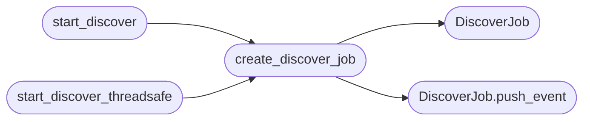

# `estorides_core.discoverer`

> Source: [estorides_core/discoverer.py:1](../../estorides_core/discoverer.py#L1) | language `py` | coverage 77.8% | [API index](../index.md)

Background subdomain/domain discoverer.

Drops a seed and walks the passive attack surface recursively. As of
v1.3 the recursion itself lives in `pivot_engine.PivotEngine`; this
module is the thin adapter that:

  * owns the long-lived [`DiscoverJob`](#discoverjob) registry the SSE/CLI layers poll,
  * drives the engine with the infrastructure-only pivot policy (domains
    and IPs, the historical discoverer surface), and
  * translates engine [`PivotEvent`](estorides_core.pivot_engine.py.md#pivotevent)s into the legacy event dicts the UI
    and CLI already understand (`started`, `step_start`, `node_found`,
    `step_done`, `finished`, [`error`](#discoverjob-error), ...).

Keeping one engine and many adapters is the DRY win: the deep-run SSE
endpoint and this background discoverer share identical recursion,
scoring and budgeting code; only the policy and the event shape differ.

Design guarantees preserved from v1.2:

  * No new HTTP layer — the engine reuses the existing [`Orchestrator`](estorides_core.orchestrator.py.md#orchestrator).
  * Persistence is via the case store; every hop appends to one case.
  * Bounded: depth, steps and entity ceilings come from config caps.
  * Idempotent: re-queuing the same (type, value) is a no-op (engine).

## Contents

- **Classes:** [`DiscoverJob`](#discoverjob)
- **Functions:** [`create_discover_job`](#create_discover_job), [`start_discover`](#start_discover), [`start_discover_threadsafe`](#start_discover_threadsafe), [`list_jobs`](#list_jobs)
- **Constants:** [`DEFAULT_MAX_DEPTH`](#default_max_depth), [`DEFAULT_MAX_STEPS`](#default_max_steps), [`DEFAULT_MAX_ENTITIES`](#default_max_entities), [`DISCOVER_JOBS`](#discover_jobs)

## Call Graph

Solid arrows stay in this module, dashed arrows leave it.



## Classes

<a id="discoverjob"></a>

### `DiscoverJob`

`class` `dataclass` | [estorides_core/discoverer.py:50](../../estorides_core/discoverer.py#L50)

Decorators: `@dataclass`

```python
class DiscoverJob
```

One background discovery session.

Lives in [`DISCOVER_JOBS`](#discover_jobs) keyed by job_id; survives the SSE handler
exiting (so a UI reload reconnects and resumes).

**Attributes**

| Name | Type | Default | Description |
|---|---|---|---|
| [`job_id`](#discoverjob-job_id) | `str` |  |  |
| [`case_id`](#discoverjob-case_id) | `str` |  |  |
| [`seed_type`](#discoverjob-seed_type) | `str` |  |  |
| [`seed_value`](#discoverjob-seed_value) | `str` |  |  |
| [`max_depth`](#discoverjob-max_depth) | `int` | `DEFAULT_MAX_DEPTH` |  |
| [`max_steps`](#discoverjob-max_steps) | `int` | `DEFAULT_MAX_STEPS` |  |
| [`max_entities`](#discoverjob-max_entities) | `int` | `DEFAULT_MAX_ENTITIES` |  |
| [`deadline_s`](#discoverjob-deadline_s) | `float` | `PIVOT.per_target_timeout_seconds` |  |
| [`parallel`](#discoverjob-parallel) | `int` | `PIVOT.parallel` |  |
| [`passive_only`](#discoverjob-passive_only) | `bool` | `False` |  |
| [`proxy`](#discoverjob-proxy) | `str \| None` | `None` |  |
| [`started_at`](#discoverjob-started_at) | `float` | `field(default_factory=time.time)` |  |
| [`status`](#discoverjob-status) | `str` | `'queued'` |  |
| [`steps_done`](#discoverjob-steps_done) | `int` | `0` |  |
| [`entities_seen`](#discoverjob-entities_seen) | `int` | `0` |  |
| [`queue_remaining`](#discoverjob-queue_remaining) | `int` | `0` |  |
| [`seen`](#discoverjob-seen) | `set[tuple[str, str]]` | `field(default_factory=set)` |  |
| [`events`](#discoverjob-events) | `list[dict[str, Any]]` | `field(default_factory=list)` |  |
| [`error`](#discoverjob-error) | `str \| None` | `None` |  |

**Members**

| Member | Kind | Summary |
|---|---|---|
| [`stop`](#discoverjob-stop) | method |  |
| [`should_stop`](#discoverjob-should_stop) | method |  |
| [`push_event`](#discoverjob-push_event) | method | Append an event and keep the buffer bounded. |

<a id="discoverjob-stop"></a>

#### `DiscoverJob.stop`

`method` | [estorides_core/discoverer.py:78](../../estorides_core/discoverer.py#L78)

```python
def stop(self) -> None
```

<a id="discoverjob-should_stop"></a>

#### `DiscoverJob.should_stop`

`method` | [estorides_core/discoverer.py:81](../../estorides_core/discoverer.py#L81)

```python
def should_stop(self) -> bool
```

**Returns:** `bool`

<a id="discoverjob-push_event"></a>

#### `DiscoverJob.push_event`

`method` | [estorides_core/discoverer.py:84](../../estorides_core/discoverer.py#L84)

```python
def push_event(self, ev: dict[str, Any]) -> None
```

Append an event and keep the buffer bounded.

**Parameters**

| Name | Type | Default | Description |
|---|---|---|---|
| `ev` | `dict[str, Any]` |  |  |

*Called by:* [`create_discover_job`](#create_discover_job)

---

## Functions

<a id="create_discover_job"></a>

### `create_discover_job`

`function` | [estorides_core/discoverer.py:194](../../estorides_core/discoverer.py#L194)

```python
def create_discover_job(seed_type: str, seed_value: str, *, max_depth: int = DEFAULT_MAX_DEPTH, max_steps: int = DEFAULT_MAX_STEPS, max_entities: int = DEFAULT_MAX_ENTITIES, deadline_s: float = PIVOT.per_target_timeout_seconds, parallel: int = PIVOT.parallel, passive_only: bool = False, proxy: str | None = None) -> DiscoverJob
```

Create and register a discovery job synchronously.

This does only fast, loop-free work (a case-store insert and some
bookkeeping), so it is safe to call straight from a Flask request
thread. The asyncio worker that actually crawls is scheduled
separately by [`start_discover`](#start_discover) / [`start_discover_threadsafe`](#start_discover_threadsafe), so the
caller never blocks on the shared background loop.

**Parameters**

| Name | Type | Default | Description |
|---|---|---|---|
| `seed_type` | `str` |  |  |
| `seed_value` | `str` |  |  |
| `max_depth` | `int` | `DEFAULT_MAX_DEPTH` |  |
| `max_steps` | `int` | `DEFAULT_MAX_STEPS` |  |
| `max_entities` | `int` | `DEFAULT_MAX_ENTITIES` |  |
| `deadline_s` | `float` | `PIVOT.per_target_timeout_seconds` |  |
| `parallel` | `int` | `PIVOT.parallel` |  |
| `passive_only` | `bool` | `False` |  |
| `proxy` | `str \| None` | `None` |  |

**Returns:** `DiscoverJob`

*Calls:* [`DiscoverJob`](#discoverjob), [`DiscoverJob.push_event`](#discoverjob-push_event)

*Called by:* [`start_discover`](#start_discover), [`start_discover_threadsafe`](#start_discover_threadsafe)

---

<a id="start_discover"></a>

### `start_discover`

`function` `async` | [estorides_core/discoverer.py:252](../../estorides_core/discoverer.py#L252)

```python
async def start_discover(seed_type: str, seed_value: str, *, max_depth: int = DEFAULT_MAX_DEPTH, max_steps: int = DEFAULT_MAX_STEPS, max_entities: int = DEFAULT_MAX_ENTITIES, deadline_s: float = PIVOT.per_target_timeout_seconds, parallel: int = PIVOT.parallel, passive_only: bool = False, proxy: str | None = None) -> DiscoverJob
```

Create a discovery job and schedule its worker on the current loop.

Kept as the coroutine entry point for callers that already own a
running loop (the CLI). Web callers use [`start_discover_threadsafe`](#start_discover_threadsafe),
which never blocks the request thread on the background loop.

**Parameters**

| Name | Type | Default | Description |
|---|---|---|---|
| `seed_type` | `str` |  |  |
| `seed_value` | `str` |  |  |
| `max_depth` | `int` | `DEFAULT_MAX_DEPTH` |  |
| `max_steps` | `int` | `DEFAULT_MAX_STEPS` |  |
| `max_entities` | `int` | `DEFAULT_MAX_ENTITIES` |  |
| `deadline_s` | `float` | `PIVOT.per_target_timeout_seconds` |  |
| `parallel` | `int` | `PIVOT.parallel` |  |
| `passive_only` | `bool` | `False` |  |
| `proxy` | `str \| None` | `None` |  |

**Returns:** `DiscoverJob`

*Calls:* [`create_discover_job`](#create_discover_job)

*Called by:* [`cmd_discover`](estorides_cli.py.md#cmd_discover)

---

<a id="start_discover_threadsafe"></a>

### `start_discover_threadsafe`

`function` | [estorides_core/discoverer.py:285](../../estorides_core/discoverer.py#L285)

```python
def start_discover_threadsafe(loop: asyncio.AbstractEventLoop, seed_type: str, seed_value: str, *, max_depth: int = DEFAULT_MAX_DEPTH, max_steps: int = DEFAULT_MAX_STEPS, max_entities: int = DEFAULT_MAX_ENTITIES, deadline_s: float = PIVOT.per_target_timeout_seconds, parallel: int = PIVOT.parallel, passive_only: bool = False, proxy: str | None = None) -> DiscoverJob
```

Create the job in the calling thread, fire its worker on `loop`.

Returns immediately. The worker is queued with
`run_coroutine_threadsafe` and runs whenever the loop is next free, so
a busy loop (a concurrent deep-run) can never make this call time out.

**Parameters**

| Name | Type | Default | Description |
|---|---|---|---|
| `loop` | `asyncio.AbstractEventLoop` |  |  |
| `seed_type` | `str` |  |  |
| `seed_value` | `str` |  |  |
| `max_depth` | `int` | `DEFAULT_MAX_DEPTH` |  |
| `max_steps` | `int` | `DEFAULT_MAX_STEPS` |  |
| `max_entities` | `int` | `DEFAULT_MAX_ENTITIES` |  |
| `deadline_s` | `float` | `PIVOT.per_target_timeout_seconds` |  |
| `parallel` | `int` | `PIVOT.parallel` |  |
| `passive_only` | `bool` | `False` |  |
| `proxy` | `str \| None` | `None` |  |

**Returns:** `DiscoverJob`

*Calls:* [`create_discover_job`](#create_discover_job)

*Called by:* [`create_app`](estorides_web.py.md#create_app)

---

<a id="list_jobs"></a>

### `list_jobs`

`function` | [estorides_core/discoverer.py:349](../../estorides_core/discoverer.py#L349)

```python
def list_jobs(limit: int = 20) -> list[dict[str, Any]]
```

Snapshot of the recent jobs for the /api/discover/jobs endpoint.

**Parameters**

| Name | Type | Default | Description |
|---|---|---|---|
| `limit` | `int` | `20` |  |

**Returns:** `list[dict[str, Any]]`

---

## Constants

<a id="default_max_depth"></a>

### `DEFAULT_MAX_DEPTH`

`constant` | [estorides_core/discoverer.py:44](../../estorides_core/discoverer.py#L44)

```python
DEFAULT_MAX_DEPTH: int = PIVOT.max_depth
```

---

<a id="default_max_steps"></a>

### `DEFAULT_MAX_STEPS`

`constant` | [estorides_core/discoverer.py:45](../../estorides_core/discoverer.py#L45)

```python
DEFAULT_MAX_STEPS: int = PIVOT.max_steps
```

---

<a id="default_max_entities"></a>

### `DEFAULT_MAX_ENTITIES`

`constant` | [estorides_core/discoverer.py:46](../../estorides_core/discoverer.py#L46)

```python
DEFAULT_MAX_ENTITIES: int = PIVOT.max_entities
```

---

<a id="discover_jobs"></a>

### `DISCOVER_JOBS`

`constant` | [estorides_core/discoverer.py:183](../../estorides_core/discoverer.py#L183)

```python
DISCOVER_JOBS
```

---
