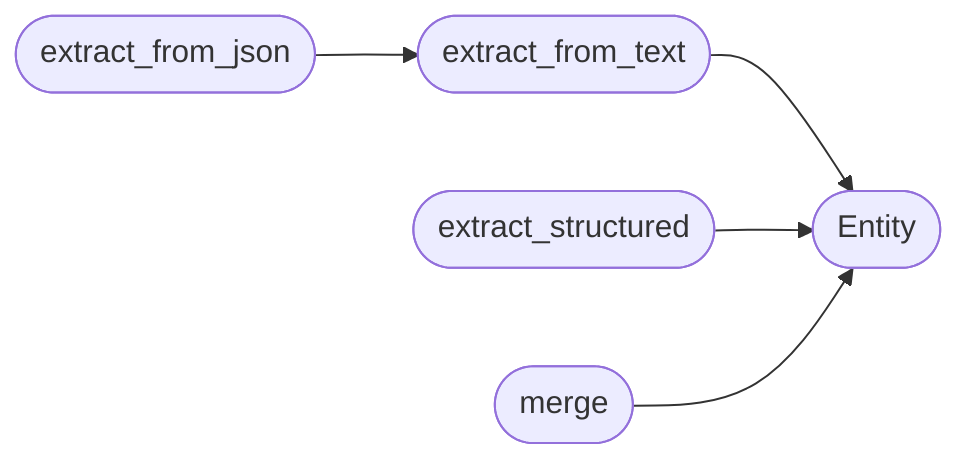

# `estorides_core.entity_extraction`

> Source: [estorides_core/entity_extraction.py:1](../../estorides_core/entity_extraction.py#L1) | language `py` | coverage 77.8% | [API index](../index.md)

estorides_core.entity_extraction ================================ Single source of truth for finding entities (IPs, domains, emails, CVEs, crypto addresses, etc.) anywhere in any JSON / text response.

This is the function that turns a wall of OSINT JSON into nodes
the knowledge graph can wire up.

## Contents

- **Classes:** [`Entity`](#entity)
- **Functions:** [`normalize_query`](#normalize_query), [`detect_query_type`](#detect_query_type), [`extract_from_text`](#extract_from_text), [`extract_from_json`](#extract_from_json), [`extract_structured`](#extract_structured), [`merge`](#merge)
- **Constants:** [`FUZZY_THRESHOLD`](#fuzzy_threshold)

## Call Graph

Solid arrows stay in this module, dashed arrows leave it.



## Classes

<a id="entity"></a>

### `Entity`

`class` `dataclass` | [estorides_core/entity_extraction.py:22](../../estorides_core/entity_extraction.py#L22)

Decorators: `@dataclass`

```python
class Entity
```

**Attributes**

| Name | Type | Default | Description |
|---|---|---|---|
| [`type`](#entity-type) | `str` |  |  |
| [`value`](#entity-value) | `str` |  |  |
| [`source`](#entity-source) | `str` |  |  |
| [`context`](#entity-context) | `str` | `''` |  |
| [`confidence`](#entity-confidence) | `float` | `1.0` |  |
| [`attributes`](#entity-attributes) | `Dict[str, Any]` | `field(default_factory=dict)` |  |
| [`sources`](#entity-sources) | `List[str]` | `field(default_factory=list)` |  |

**Members**

| Member | Kind | Summary |
|---|---|---|
| [`to_dict`](#entity-to_dict) | method |  |

<a id="entity-to_dict"></a>

#### `Entity.to_dict`

`method` | [estorides_core/entity_extraction.py:34](../../estorides_core/entity_extraction.py#L34)

```python
def to_dict(self) -> Dict[str, Any]
```

**Returns:** `Dict[str, Any]`

---

## Functions

<a id="normalize_query"></a>

### `normalize_query`

`function` | [estorides_core/entity_extraction.py:57](../../estorides_core/entity_extraction.py#L57)

```python
def normalize_query(query: str) -> str
```

Return the routing form of raw operator input.

URLs reduce to their lowercased host (userinfo, port, path, query
and fragment stripped); `@handles` reduce to the bare handle;
everything else is trimmed verbatim.

**Parameters**

| Name | Type | Default | Description |
|---|---|---|---|
| `query` | `str` |  |  |

**Returns:** `str`

---

<a id="detect_query_type"></a>

### `detect_query_type`

`function` | [estorides_core/entity_extraction.py:100](../../estorides_core/entity_extraction.py#L100)

```python
def detect_query_type(query: str) -> str
```

Return the detected type of a free-form query.

Falls back to 'domain' for anything that looks like a hostname
(contains a dot, no spaces), and to 'keyword' for everything else.

**Parameters**

| Name | Type | Default | Description |
|---|---|---|---|
| `query` | `str` |  |  |

**Returns:** `str`

*Called by:* [`cmd_discover`](estorides_cli.py.md#cmd_discover), [`cmd_watch_add`](estorides_cli.py.md#cmd_watch_add), [`Orchestrator.run`](estorides_core.orchestrator.py.md#orchestrator-run), [`validate_query`](estorides_core.validation.py.md#validate_query), [`create_app`](estorides_web.py.md#create_app)

---

<a id="extract_from_text"></a>

### `extract_from_text`

`function` | [estorides_core/entity_extraction.py:146](../../estorides_core/entity_extraction.py#L146)

```python
def extract_from_text(text: str, source: str, *, types: Optional[List[str]] = None) -> List[Entity]
```

Find every recognised entity in a raw text blob.

`types` optionally restricts which kinds of entity to look for.

**Parameters**

| Name | Type | Default | Description |
|---|---|---|---|
| `text` | `str` |  |  |
| `source` | `str` |  |  |
| `types` | `Optional[List[str]]` | `None` |  |

**Returns:** `List[Entity]`

*Calls:* [`Entity`](#entity)

*Called by:* [`extract_from_json`](#extract_from_json)

---

<a id="extract_from_json"></a>

### `extract_from_json`

`function` | [estorides_core/entity_extraction.py:210](../../estorides_core/entity_extraction.py#L210)

```python
def extract_from_json(payload: Any, source: str, *, types: Optional[List[str]] = None) -> List[Entity]
```

Pull entities out of a JSON-like structure.

Earlier this recursed into every string and ran all patterns on each one,
so a response with thousands of entries (crt.sh subdomains, wayback URLs)
triggered hundreds of thousands of regex passes. We now flatten the payload
to a single capped string and scan it once; entities span keys and values
just as well, and the cost is bounded by [`extract_from_text`](#extract_from_text).

**Parameters**

| Name | Type | Default | Description |
|---|---|---|---|
| `payload` | `Any` |  |  |
| `source` | `str` |  |  |
| `types` | `Optional[List[str]]` | `None` |  |

**Returns:** `List[Entity]`

*Calls:* [`extract_from_text`](#extract_from_text)

*Called by:* [`Orchestrator.run`](estorides_core.orchestrator.py.md#orchestrator-run)

---

<a id="extract_structured"></a>

### `extract_structured`

`function` | [estorides_core/entity_extraction.py:330](../../estorides_core/entity_extraction.py#L330)

```python
def extract_structured(payload: Any, source: str) -> List[Entity]
```

Extract human selectors (email, username, person, org, phone) by key.

Walks the JSON structure and types values by the key they sit under,
which is the only reliable way to recover usernames and person names
(they have no lexical signature for a regex to catch). Bounded by
[`ENTITY_MAX_PER_TYPE`](estorides_core.config.py.md#entity_max_per_type) per type and a node-visit cap so a pathological
response cannot turn this into a CPU stall.

**Parameters**

| Name | Type | Default | Description |
|---|---|---|---|
| `payload` | `Any` |  |  |
| `source` | `str` |  |  |

**Returns:** `List[Entity]`

*Calls:* [`Entity`](#entity)

*Called by:* [`Orchestrator.run`](estorides_core.orchestrator.py.md#orchestrator-run)

---

<a id="merge"></a>

### `merge`

`function` | [estorides_core/entity_extraction.py:382](../../estorides_core/entity_extraction.py#L382)

```python
def merge(*entity_lists: Iterable[Entity], fuzzy: bool = True) -> List[Entity]
```

Deduplicate by (type, value) and merge sources / contexts.

Two entities with the same (type, value) collapse into a single
record. Their [`sources`](#entity-sources) lists are unioned (preserving the first
seen order), [`context`](#entity-context) is concatenated up to a 200-char window,
and [`confidence`](#entity-confidence) is bumped by 0.1 for each extra observation
(capped at 1.0) — a simple "corroboration bonus".

The [`sources`](#entity-sources) field is the canonical "all the places this was
seen" record. The previous implementation stored it in a
private attribute (`_src`) that was never serialised and broke
`asdict()` (TypeError on `dataclasses.asdict` for non-dataclass
attributes). This version is a real, declared field.

v1.1: After exact-key dedup, run a second pass with
`difflib.SequenceMatcher` to catch near-misses like
`EvilCorp.com` vs `evil-corp.com`. Anything above the
[`FUZZY_THRESHOLD`](#fuzzy_threshold) ratio collapses into a single record.
Returns the deduped list, with cluster groups available via
`fuzzy_clusters` if the caller wants them.

v1.4: pass ``fuzzy=False`` to do exact-key dedup only. The
orchestrator does this when the canonical identity layer
(`entity_resolution`) is active, so the resolver owns every fuzzy
decision instead of inheriting a coarser difflib pre-merge that would,
for example, silently fuse two distinct domain registrations the
resolver intends to keep separate and merely *link*.

**Parameters**

| Name | Type | Default | Description |
|---|---|---|---|
| `*entity_lists` | `Iterable[Entity]` |  |  |
| `fuzzy` | `bool` | `True` |  |

**Returns:** `List[Entity]`

*Calls:* [`Entity`](#entity)

*Called by:* [`Orchestrator.run`](estorides_core.orchestrator.py.md#orchestrator-run), [`drawHulls`](static.js.estorides.js.md#drawhulls)

---

## Constants

<a id="fuzzy_threshold"></a>

### `FUZZY_THRESHOLD`

`constant` | [estorides_core/entity_extraction.py:473](../../estorides_core/entity_extraction.py#L473)

```python
FUZZY_THRESHOLD: float = 0.85
```

---
