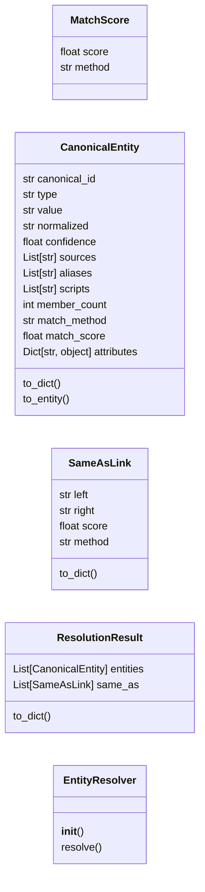
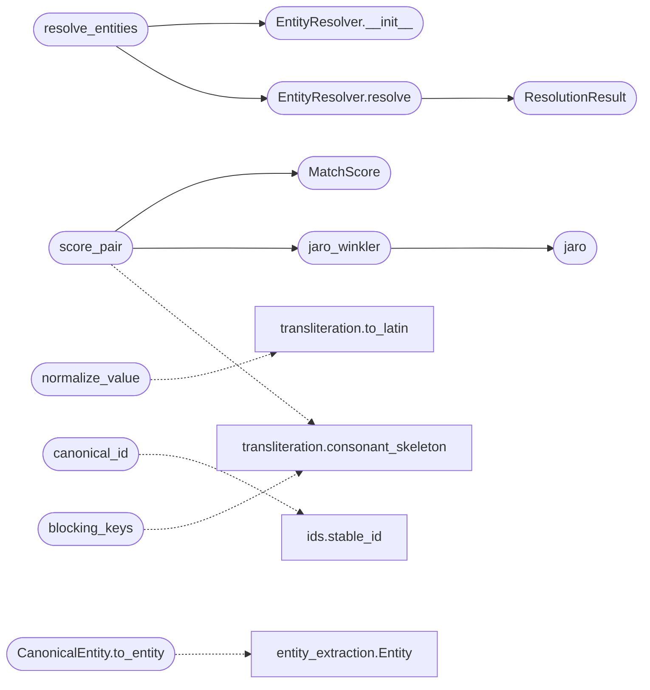

# `estorides_core.entity_resolution`

> Source: [estorides_core/entity_resolution.py:1](../../estorides_core/entity_resolution.py#L1) | language `py` | coverage 78.9% | [API index](../index.md)

estorides_core.entity_resolution ================================ Canonical identity layer.

The v1.1 engine collapsed near-duplicate entities with a single
``difflib.SequenceMatcher`` ratio at 0.85. That is fine for typo folding
but it is not entity resolution: it has no stable identifier, no blocking
(so it is quietly O(n^2) over the whole entity list), no notion of which
match was deterministic versus a guess, and no cross-script awareness, so
``Владимир Путин`` and ``Vladimir Putin`` stay two unrelated nodes.

This module is the replacement. For a per-run list of [`Entity`](estorides_core.entity_extraction.py.md#entity)
records it produces a list of [`CanonicalEntity`](#canonicalentity) records, each with:

* a **stable canonical id** derived from a type-aware normalised form, so
  the same real-world entity gets the same id on every run (and, with the
  persistent store, across runs);
* **blocked, scored matching** — exact normalised equality is a
  deterministic merge; close-but-not-equal pairs inside the same blocking
  bucket are scored with Jaro-Winkler (and a cross-script consonant
  skeleton booster) and either merged or surfaced as a ``SAME_AS``
  candidate link, never silently fused;
* **provenance** — the sources, original surface forms (aliases), scripts,
  and the match method/score that justified each merge.

Deterministic types (IP, hash, CVE, ASN, crypto address) never fuzzy
match: for those, equality of the normalised form is the only merge rule,
because a one-character difference is a different host, file, or wallet.

The engine is stdlib-only. The optional cross-run identity store lives in
[`estorides_core.entity_store`](estorides_core.entity_store.py.md) and is wired in by the resolver when
`[`ER_PERSIST`](estorides_core.config.py.md#er_persist)` is set.

## Contents

- **Classes:** [`MatchScore`](#matchscore), [`CanonicalEntity`](#canonicalentity), [`SameAsLink`](#sameaslink), [`ResolutionResult`](#resolutionresult), [`EntityResolver`](#entityresolver)
- **Functions:** [`jaro`](#jaro), [`jaro_winkler`](#jaro_winkler), [`normalize_value`](#normalize_value), [`canonical_id`](#canonical_id), [`blocking_keys`](#blocking_keys), [`score_pair`](#score_pair), [`resolve_entities`](#resolve_entities)
- **Constants:** [`DETERMINISTIC_TYPES`](#deterministic_types), [`FUZZY_TYPES`](#fuzzy_types), [`MERGE_ELIGIBLE_TYPES`](#merge_eligible_types)

## Type Diagram



## Call Graph

Solid arrows stay in this module, dashed arrows leave it.



## Classes

<a id="matchscore"></a>

### `MatchScore`

`class` `dataclass` | [estorides_core/entity_resolution.py:295](../../estorides_core/entity_resolution.py#L295)

Decorators: `@dataclass`

```python
class MatchScore
```

The result of comparing two entity values of the same type.

**Attributes**

| Name | Type | Default | Description |
|---|---|---|---|
| [`score`](#matchscore-score) | `float` |  |  |
| [`method`](#matchscore-method) | `str` |  |  |

---

<a id="canonicalentity"></a>

### `CanonicalEntity`

`class` `dataclass` | [estorides_core/entity_resolution.py:341](../../estorides_core/entity_resolution.py#L341)

Decorators: `@dataclass`

```python
class CanonicalEntity
```

A resolved identity fused from one or more observed entities.

**Attributes**

| Name | Type | Default | Description |
|---|---|---|---|
| [`canonical_id`](#canonicalentity-canonical_id) | `str` |  |  |
| [`type`](#canonicalentity-type) | `str` |  |  |
| [`value`](#canonicalentity-value) | `str` |  |  |
| [`normalized`](#canonicalentity-normalized) | `str` |  |  |
| [`confidence`](#canonicalentity-confidence) | `float` | `1.0` |  |
| [`sources`](#canonicalentity-sources) | `List[str]` | `field(default_factory=list)` |  |
| [`aliases`](#canonicalentity-aliases) | `List[str]` | `field(default_factory=list)` |  |
| [`scripts`](#canonicalentity-scripts) | `List[str]` | `field(default_factory=list)` |  |
| [`member_count`](#canonicalentity-member_count) | `int` | `1` |  |
| [`match_method`](#canonicalentity-match_method) | `str` | `'exact'` |  |
| [`match_score`](#canonicalentity-match_score) | `float` | `1.0` |  |
| [`attributes`](#canonicalentity-attributes) | `Dict[str, object]` | `field(default_factory=dict)` |  |

**Members**

| Member | Kind | Summary |
|---|---|---|
| [`to_dict`](#canonicalentity-to_dict) | method |  |
| [`to_entity`](#canonicalentity-to_entity) | method | Project back onto the legacy [`Entity`](estorides_core.entity_extraction.py.md#entity) shape. |

<a id="canonicalentity-to_dict"></a>

#### `CanonicalEntity.to_dict`

`method` | [estorides_core/entity_resolution.py:357](../../estorides_core/entity_resolution.py#L357)

```python
def to_dict(self) -> Dict[str, object]
```

**Returns:** `Dict[str, object]`

<a id="canonicalentity-to_entity"></a>

#### `CanonicalEntity.to_entity`

`method` | [estorides_core/entity_resolution.py:373](../../estorides_core/entity_resolution.py#L373)

```python
def to_entity(self) -> Entity
```

Project back onto the legacy [`Entity`](estorides_core.entity_extraction.py.md#entity) shape.

Lets the resolver drop into the existing orchestrator, knowledge
graph, and case-store paths without changing their interfaces while
carrying the new identity metadata in `[`attributes`](#canonicalentity-attributes)`.

**Returns:** `Entity`

*Calls:* [`Entity`](estorides_core.entity_extraction.py.md#entity)

---

<a id="sameaslink"></a>

### `SameAsLink`

`class` `dataclass` | [estorides_core/entity_resolution.py:401](../../estorides_core/entity_resolution.py#L401)

Decorators: `@dataclass`

```python
class SameAsLink
```

A suggested-but-unmerged identity link between two canonical ids.

**Attributes**

| Name | Type | Default | Description |
|---|---|---|---|
| [`left`](#sameaslink-left) | `str` |  |  |
| [`right`](#sameaslink-right) | `str` |  |  |
| [`score`](#sameaslink-score) | `float` |  |  |
| [`method`](#sameaslink-method) | `str` |  |  |

**Members**

| Member | Kind | Summary |
|---|---|---|
| [`to_dict`](#sameaslink-to_dict) | method |  |

<a id="sameaslink-to_dict"></a>

#### `SameAsLink.to_dict`

`method` | [estorides_core/entity_resolution.py:409](../../estorides_core/entity_resolution.py#L409)

```python
def to_dict(self) -> Dict[str, object]
```

**Returns:** `Dict[str, object]`

---

<a id="resolutionresult"></a>

### `ResolutionResult`

`class` `dataclass` | [estorides_core/entity_resolution.py:419](../../estorides_core/entity_resolution.py#L419)

Decorators: `@dataclass`

```python
class ResolutionResult
```

Output of a resolve() call: fused entities plus candidate links.

**Attributes**

| Name | Type | Default | Description |
|---|---|---|---|
| [`entities`](#resolutionresult-entities) | `List[CanonicalEntity]` |  |  |
| [`same_as`](#resolutionresult-same_as) | `List[SameAsLink]` | `field(default_factory=list)` |  |

**Members**

| Member | Kind | Summary |
|---|---|---|
| [`to_dict`](#resolutionresult-to_dict) | method |  |

<a id="resolutionresult-to_dict"></a>

#### `ResolutionResult.to_dict`

`method` | [estorides_core/entity_resolution.py:425](../../estorides_core/entity_resolution.py#L425)

```python
def to_dict(self) -> Dict[str, object]
```

**Returns:** `Dict[str, object]`

---

<a id="entityresolver"></a>

### `EntityResolver`

`class` | [estorides_core/entity_resolution.py:454](../../estorides_core/entity_resolution.py#L454)

```python
class EntityResolver
```

Resolve a per-run entity list into canonical identities.

The resolver is deliberately stateless across calls by default; pass a
store (see [`estorides_core.entity_store`](estorides_core.entity_store.py.md)) to make canonical ids
stable across runs. A single [`resolve`](#entityresolver-resolve) call:

1. exact-merges entities sharing a ``(type, normalized)`` key;
2. blocks the remaining fuzzy-eligible groups and scores in-bucket
   pairs, unioning clusters at or above the merge threshold and
   recording ``SAME_AS`` candidates above the link threshold;
3. emits one [`CanonicalEntity`](#canonicalentity) per cluster with a deterministic
   representative and full provenance.

**Members**

| Member | Kind | Summary |
|---|---|---|
| [`__init__`](#entityresolver-__init__) | constructor |  |
| [`resolve`](#entityresolver-resolve) | method | Resolve ``entities`` into canonical identities and links. |

<a id="entityresolver-__init__"></a>

#### `EntityResolver.__init__`

`constructor` | [estorides_core/entity_resolution.py:469](../../estorides_core/entity_resolution.py#L469)

```python
def __init__(self, *, merge_threshold: float = ER_MERGE_THRESHOLD, link_threshold: float = ER_LINK_THRESHOLD, max_bucket: int = ER_MAX_BUCKET, store: Optional[object] = None) -> None
```

**Parameters**

| Name | Type | Default | Description |
|---|---|---|---|
| `merge_threshold` | `float` | `ER_MERGE_THRESHOLD` |  |
| `link_threshold` | `float` | `ER_LINK_THRESHOLD` |  |
| `max_bucket` | `int` | `ER_MAX_BUCKET` |  |
| `store` | `Optional[object]` | `None` |  |

*Called by:* [`resolve_entities`](#resolve_entities)

<a id="entityresolver-resolve"></a>

#### `EntityResolver.resolve`

`method` | [estorides_core/entity_resolution.py:482](../../estorides_core/entity_resolution.py#L482)

```python
def resolve(self, entities: List[Entity]) -> ResolutionResult
```

Resolve ``entities`` into canonical identities and links.

**Parameters**

| Name | Type | Default | Description |
|---|---|---|---|
| `entities` | `List[Entity]` |  |  |

**Returns:** `ResolutionResult`

*Calls:* [`ResolutionResult`](#resolutionresult)

*Called by:* [`resolve_entities`](#resolve_entities)

---

## Functions

<a id="jaro"></a>

### `jaro`

`function` | [estorides_core/entity_resolution.py:83](../../estorides_core/entity_resolution.py#L83)

```python
def jaro(s1: str, s2: str) -> float
```

Return the Jaro similarity of two strings in ``[0, 1]``.

**Parameters**

| Name | Type | Default | Description |
|---|---|---|---|
| `s1` | `str` |  |  |
| `s2` | `str` |  |  |

**Returns:** `float`

*Called by:* [`jaro_winkler`](#jaro_winkler)

---

<a id="jaro_winkler"></a>

### `jaro_winkler`

`function` | [estorides_core/entity_resolution.py:126](../../estorides_core/entity_resolution.py#L126)

```python
def jaro_winkler(s1: str, s2: str, prefix_weight: float = 0.1) -> float
```

Jaro-Winkler similarity: Jaro with a shared-prefix bonus.

The prefix bonus (up to 4 leading characters) rewards strings that
agree at the start, which is the common shape of name and domain
variants. ``prefix_weight`` is capped at 0.25 to keep the result in
``[0, 1]``.

**Parameters**

| Name | Type | Default | Description |
|---|---|---|---|
| `s1` | `str` |  |  |
| `s2` | `str` |  |  |
| `prefix_weight` | `float` | `0.1` |  |

**Returns:** `float`

*Calls:* [`jaro`](#jaro)

*Called by:* [`score_pair`](#score_pair)

---

<a id="normalize_value"></a>

### `normalize_value`

`function` | [estorides_core/entity_resolution.py:206](../../estorides_core/entity_resolution.py#L206)

```python
def normalize_value(etype: str, value: str) -> str
```

Return the canonical normalised form of an entity value.

The normalised form is the merge key for deterministic types and the
seed of the stable canonical id for every type. It is intentionally
lossy (case, ordering, ornament removed) but never collapses distinct
objects of a deterministic type.

**Parameters**

| Name | Type | Default | Description |
|---|---|---|---|
| `etype` | `str` |  |  |
| `value` | `str` |  |  |

**Returns:** `str`

*Calls:* [`to_latin`](estorides_core.transliteration.py.md#to_latin)

*Called by:* [`EntityStore.lookup`](estorides_core.entity_store.py.md#entitystore-lookup), [`EntityStore.upsert`](estorides_core.entity_store.py.md#entitystore-upsert), [`FusionStore.fuse_entity`](estorides_core.fusion_store.py.md#fusionstore-fuse_entity), [`entity_id`](estorides_core.fusion_store.py.md#entity_id)

---

<a id="canonical_id"></a>

### `canonical_id`

`function` | [estorides_core/entity_resolution.py:246](../../estorides_core/entity_resolution.py#L246)

```python
def canonical_id(etype: str, normalized: str) -> str
```

Stable, content-addressed id for a normalised entity.

Same ``(type, normalized)`` always yields the same id, so a canonical
entity keeps its identity for as long as its normalised form is stable.
The persistent store additionally maps known aliases onto an existing
id so a never-before-seen surface form still resolves to the same node.

**Parameters**

| Name | Type | Default | Description |
|---|---|---|---|
| `etype` | `str` |  |  |
| `normalized` | `str` |  |  |

**Returns:** `str`

*Calls:* [`stable_id`](estorides_core.ids.py.md#stable_id)

---

<a id="blocking_keys"></a>

### `blocking_keys`

`function` | [estorides_core/entity_resolution.py:257](../../estorides_core/entity_resolution.py#L257)

```python
def blocking_keys(etype: str, normalized: str, value: str) -> List[str]
```

Return the blocking keys that bucket an entity for comparison.

Two entities are only ever scored against each other if they share at
least one blocking key. The keys are chosen to be high-recall (so true
matches land together) while keeping buckets small enough that the
in-bucket pairwise scan stays cheap.

**Parameters**

| Name | Type | Default | Description |
|---|---|---|---|
| `etype` | `str` |  |  |
| `normalized` | `str` |  |  |
| `value` | `str` |  |  |

**Returns:** `List[str]`

*Calls:* [`consonant_skeleton`](estorides_core.transliteration.py.md#consonant_skeleton)

---

<a id="score_pair"></a>

### `score_pair`

`function` | [estorides_core/entity_resolution.py:302](../../estorides_core/entity_resolution.py#L302)

```python
def score_pair(etype: str, a_value: str, b_value: str, a_norm: str, b_norm: str) -> MatchScore
```

Score how likely two same-type entities denote the same object.

Deterministic types return 1.0 only on normalised equality and 0.0
otherwise. Fuzzy types layer Jaro-Winkler over the normalised form with
a cross-script consonant-skeleton booster for names, so a Cyrillic and
a Latin spelling of one person can clear the link bar even when their
transliterated vowels differ.

**Parameters**

| Name | Type | Default | Description |
|---|---|---|---|
| `etype` | `str` |  |  |
| `a_value` | `str` |  |  |
| `b_value` | `str` |  |  |
| `a_norm` | `str` |  |  |
| `b_norm` | `str` |  |  |

**Returns:** `MatchScore`

*Calls:* [`MatchScore`](#matchscore), [`jaro_winkler`](#jaro_winkler), [`consonant_skeleton`](estorides_core.transliteration.py.md#consonant_skeleton)

---

<a id="resolve_entities"></a>

### `resolve_entities`

`function` | [estorides_core/entity_resolution.py:727](../../estorides_core/entity_resolution.py#L727)

```python
def resolve_entities(entities: List[Entity], *, store: Optional[object] = None) -> ResolutionResult
```

Module-level convenience wrapper around [`EntityResolver`](#entityresolver).

**Parameters**

| Name | Type | Default | Description |
|---|---|---|---|
| `entities` | `List[Entity]` |  |  |
| `store` | `Optional[object]` | `None` |  |

**Returns:** `ResolutionResult`

*Calls:* [`EntityResolver.__init__`](#entityresolver-__init__), [`EntityResolver.resolve`](#entityresolver-resolve)

---

## Constants

<a id="deterministic_types"></a>

### `DETERMINISTIC_TYPES`

`constant` | [estorides_core/entity_resolution.py:49](../../estorides_core/entity_resolution.py#L49)

```python
DETERMINISTIC_TYPES: frozenset
```

---

<a id="fuzzy_types"></a>

### `FUZZY_TYPES`

`constant` | [estorides_core/entity_resolution.py:55](../../estorides_core/entity_resolution.py#L55)

```python
FUZZY_TYPES: frozenset
```

---

<a id="merge_eligible_types"></a>

### `MERGE_ELIGIBLE_TYPES`

`constant` | [estorides_core/entity_resolution.py:64](../../estorides_core/entity_resolution.py#L64)

```python
MERGE_ELIGIBLE_TYPES: frozenset = frozenset({'person', 'org', 'organization', 'username', 'keyword'})
```

---
