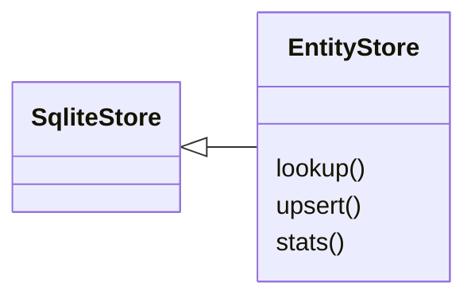
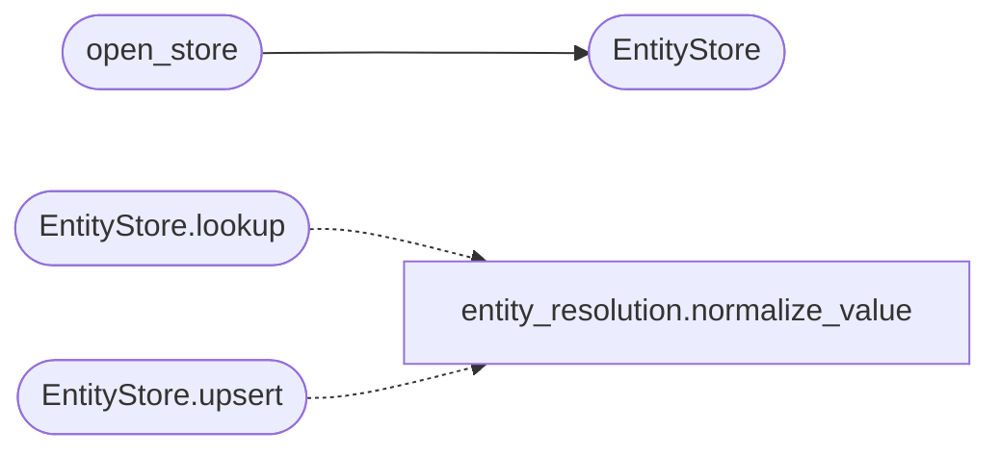

# `estorides_core.entity_store`

> Source: [estorides_core/entity_store.py:1](../../estorides_core/entity_store.py#L1) | language `py` | coverage 100.0% | [API index](../index.md)

estorides_core.entity_store =========================== Cross-run canonical identity store.

The resolver in [`estorides_core.entity_resolution`](estorides_core.entity_resolution.py.md) produces stable
canonical ids *within* a run from content-addressed normalised forms. That
is not enough for state-level work, where the same target recurs across
investigations: a person seen as ``Vladimir Putin`` in one case and only as
``Владимир Путин`` in the next must keep one identifier so the graph,
watchlists, and case history all join on it.

This store closes that gap. It persists every canonical entity and *all*
the surface forms (aliases) ever observed for it, each indexed by its
normalised key. On a later run the resolver asks [`lookup`](#entitystore-lookup) whether any
of a freshly computed entity's normalised forms — its own or any of its
aliases — has been seen before, and if so adopts the established canonical
id instead of minting a new one.

It is a thin SQLite layer, matching [`estorides_core.cases`](estorides_core.cases.py.md): WAL mode,
a single serialised connection behind a lock, and a fail-soft contract —
the resolver treats any store error as "no prior knowledge" and proceeds,
so a read-only or missing data directory degrades to in-run resolution
rather than breaking a run.

## Contents

- **Classes:** [`EntityStore`](#entitystore)
- **Functions:** [`open_store`](#open_store)

## Type Diagram



## Call Graph

Solid arrows stay in this module, dashed arrows leave it.



## Classes

<a id="entitystore"></a>

### `EntityStore`

`class` | [estorides_core/entity_store.py:60](../../estorides_core/entity_store.py#L60)

```python
class EntityStore(SqliteStore)
```

Bases: [`SqliteStore`](estorides_core.sqlite_store.py.md#sqlitestore)

Thread-safe SQLite repository of canonical identities and aliases.

**Members**

| Member | Kind | Summary |
|---|---|---|
| [`lookup`](#entitystore-lookup) | method | Return an existing canonical id for any known form, or None. |
| [`upsert`](#entitystore-upsert) | method | Persist (insert or update) a canonical entity and its aliases. |
| [`stats`](#entitystore-stats) | method | Return a one-glance summary of store size. |

<a id="entitystore-lookup"></a>

#### `EntityStore.lookup`

`method` | [estorides_core/entity_store.py:66](../../estorides_core/entity_store.py#L66)

```python
def lookup(self, etype: str, normalized: str, aliases: Iterable[str]) -> Optional[str]
```

Return an existing canonical id for any known form, or None.

Checks every normalised key the entity can present — its own and
each alias's — against both the canonical ``entities`` table and the
``aliases`` table. The first established id wins, so a never-before
spelling of a known target still resolves to its prior identity.

**Parameters**

| Name | Type | Default | Description |
|---|---|---|---|
| `etype` | `str` |  |  |
| `normalized` | `str` |  |  |
| `aliases` | `Iterable[str]` |  |  |

**Returns:** `Optional[str]`

*Calls:* [`normalize_value`](estorides_core.entity_resolution.py.md#normalize_value)

<a id="entitystore-upsert"></a>

#### `EntityStore.upsert`

`method` | [estorides_core/entity_store.py:104](../../estorides_core/entity_store.py#L104)

```python
def upsert(self, entity: CanonicalEntity) -> None
```

Persist (insert or update) a canonical entity and its aliases.

``first_seen`` is preserved across updates; ``last_seen``,
`[`member_count`](estorides_core.entity_resolution.py.md#canonicalentity-member_count)`, ``source_count``, ``value``, and ``confidence``
track the latest resolution. Every alias is recorded with its
normalised key so future lookups can route any surface form back to
this id.

**Parameters**

| Name | Type | Default | Description |
|---|---|---|---|
| `entity` | `CanonicalEntity` |  |  |

*Calls:* [`normalize_value`](estorides_core.entity_resolution.py.md#normalize_value)

<a id="entitystore-stats"></a>

#### `EntityStore.stats`

`method` | [estorides_core/entity_store.py:143](../../estorides_core/entity_store.py#L143)

```python
def stats(self) -> dict
```

Return a one-glance summary of store size.

**Returns:** `dict`

---

## Functions

<a id="open_store"></a>

### `open_store`

`function` | [estorides_core/entity_store.py:155](../../estorides_core/entity_store.py#L155)

```python
def open_store(path: Optional[Path] = None) -> Optional[EntityStore]
```

Open the store, returning None instead of raising on failure.

The resolver calls this so that an unwritable or locked data directory
degrades the cross-run identity feature to in-run-only resolution rather
than aborting an investigation.

**Parameters**

| Name | Type | Default | Description |
|---|---|---|---|
| `path` | `Optional[Path]` | `None` |  |

**Returns:** `Optional[EntityStore]`

*Calls:* [`EntityStore`](#entitystore)

---
