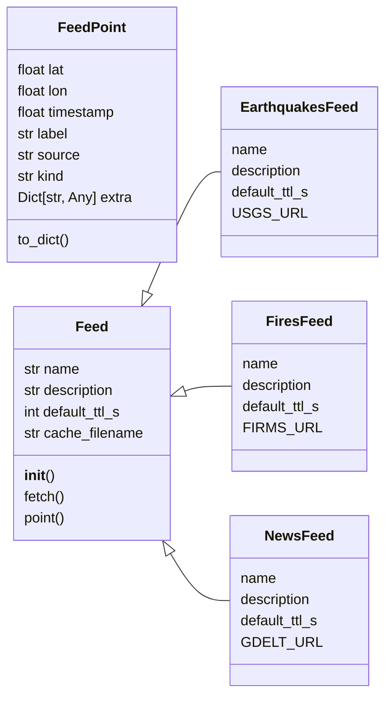

# `estorides_core.feeds`

> Source: [estorides_core/feeds.py:1](../../estorides_core/feeds.py#L1) | language `py` | coverage 76.9% | [API index](../index.md)

estorides_core.feeds ==================== Real-time intelligence feeds, polled and cached locally.

This is the "osiris map layers" feature, brought to the Python side:
each feed is a small object that knows how to fetch, parse, and
normalise one external signal (flights, earthquakes, fires, news,
sanctions) into a common GeoPoint shape ready for the map.

Why a separate module instead of just YAML sources?
  * The feeds are polled, not queried. They don't take a user query;
    they take a bounding box or a time window.
  * They produce spatiotemporal data (lat, lon, timestamp) which
    doesn't fit the source-parser model.
  * They have a much higher refresh rate (15-60 min) so we cache
    aggressively to disk and short-circuit on the same minute.

Each feed exposes a uniform API:
  * [`name`](#feed-name)  — slug used by the API
  * [`description`](#feed-description) — human-readable one-liner
  * `fetch(bbox=None)` — list[dict] of normalised records
  * `point(record)` — (lat, lon) tuple, or None

Records are plain dicts with at least: {lat, lon, timestamp, label, source}.

## Contents

- **Classes:** [`FeedPoint`](#feedpoint), [`Feed`](#feed), [`EarthquakesFeed`](#earthquakesfeed), [`FiresFeed`](#firesfeed), [`NewsFeed`](#newsfeed)
- **Functions:** [`list_feeds`](#list_feeds), [`get_feed`](#get_feed), [`fetch_all`](#fetch_all)
- **Constants:** [`FEED_CACHE_DIR`](#feed_cache_dir), [`DEFAULT_TTL_S`](#default_ttl_s), [`FEEDS`](#feeds)

## Type Diagram



## Call Graph

Solid arrows stay in this module, dashed arrows leave it.


## Classes

<a id="feedpoint"></a>

### `FeedPoint`

`class` `dataclass` | [estorides_core/feeds.py:54](../../estorides_core/feeds.py#L54)

Decorators: `@dataclass`

```python
class FeedPoint
```

Normalised point for the map layer.

[`kind`](#feedpoint-kind) discriminates the marker on the map (flight / quake / fire /
news / vessel). [`extra`](#feedpoint-extra) is an open dict for source-specific fields
the frontend may want to render in the popup.

**Attributes**

| Name | Type | Default | Description |
|---|---|---|---|
| [`lat`](#feedpoint-lat) | `float` |  |  |
| [`lon`](#feedpoint-lon) | `float` |  |  |
| [`timestamp`](#feedpoint-timestamp) | `float` |  |  |
| [`label`](#feedpoint-label) | `str` |  |  |
| [`source`](#feedpoint-source) | `str` |  |  |
| [`kind`](#feedpoint-kind) | `str` |  |  |
| [`extra`](#feedpoint-extra) | `Dict[str, Any]` | `field(default_factory=dict)` |  |

**Members**

| Member | Kind | Summary |
|---|---|---|
| [`to_dict`](#feedpoint-to_dict) | method |  |

<a id="feedpoint-to_dict"></a>

#### `FeedPoint.to_dict`

`method` | [estorides_core/feeds.py:69](../../estorides_core/feeds.py#L69)

```python
def to_dict(self) -> Dict[str, Any]
```

**Returns:** `Dict[str, Any]`

---

<a id="feed"></a>

### `Feed`

`class` `abstract` | [estorides_core/feeds.py:74](../../estorides_core/feeds.py#L74)

```python
class Feed(ABC)
```

Bases: `ABC`

Subclasses: [`EarthquakesFeed`](#earthquakesfeed), [`FiresFeed`](#firesfeed), [`NewsFeed`](#newsfeed)

Base class for a real-time feed.

**Attributes**

| Name | Type | Default | Description |
|---|---|---|---|
| [`name`](#feed-name) | `str` | `''` |  |
| [`description`](#feed-description) | `str` | `''` |  |
| [`default_ttl_s`](#feed-default_ttl_s) | `int` | `DEFAULT_TTL_S` |  |
| [`cache_filename`](#feed-cache_filename) | `str` | `''` |  |

**Members**

| Member | Kind | Summary |
|---|---|---|
| [`__init__`](#feed-__init__) | constructor |  |
| [`fetch`](#feed-fetch) | method | Public entrypoint. |
| [`point`](#feed-point) | method | Default: return (lat, lon) if both present. |

<a id="feed-__init__"></a>

#### `Feed.__init__`

`constructor` | [estorides_core/feeds.py:82](../../estorides_core/feeds.py#L82)

```python
def __init__(self) -> None
```

<a id="feed-fetch"></a>

#### `Feed.fetch`

`method` | [estorides_core/feeds.py:90](../../estorides_core/feeds.py#L90)

```python
def fetch(self, *, use_cache: bool = True) -> List[FeedPoint]
```

Public entrypoint.

Reads/writes the on-disk cache.

The cache is a simple `{fetched_at, points}` JSON blob —
good enough for a self-hosted deployment. A real production
system would want a TTL'd Redis layer, but that pulls in a
network dependency.

**Parameters**

| Name | Type | Default | Description |
|---|---|---|---|
| `use_cache` | `bool` | `True` |  |

**Returns:** `List[FeedPoint]`

*Calls:* [`FeedPoint`](#feedpoint)

<a id="feed-point"></a>

#### `Feed.point`

`method` | [estorides_core/feeds.py:135](../../estorides_core/feeds.py#L135)

```python
def point(self, record: Dict[str, Any]) -> Optional[Tuple[float, float]]
```

Default: return (lat, lon) if both present.

**Parameters**

| Name | Type | Default | Description |
|---|---|---|---|
| `record` | `Dict[str, Any]` |  |  |

**Returns:** `Optional[Tuple[float, float]]`

---

<a id="earthquakesfeed"></a>

### `EarthquakesFeed`

`class` | [estorides_core/feeds.py:148](../../estorides_core/feeds.py#L148)

```python
class EarthquakesFeed(Feed)
```

Bases: [`Feed`](#feed)

USGS M2.5+ earthquakes, last 24h, worldwide.

**Attributes**

| Name | Type | Default | Description |
|---|---|---|---|
| [`name`](#earthquakesfeed-name) |  | `'earthquakes'` |  |
| [`description`](#earthquakesfeed-description) |  | `'USGS M2.5+ earthquakes (last 24h)'` |  |
| [`default_ttl_s`](#earthquakesfeed-default_ttl_s) |  | `10 * 60` |  |
| [`USGS_URL`](#earthquakesfeed-usgs_url) |  | `'https://earthquake.usgs.gov/earthquakes/feed/v1.0/summary/2.5_day.geojson'` |  |

---

<a id="firesfeed"></a>

### `FiresFeed`

`class` | [estorides_core/feeds.py:190](../../estorides_core/feeds.py#L190)

```python
class FiresFeed(Feed)
```

Bases: [`Feed`](#feed)

NASA FIRMS active fire hotspots (VIIRS_NOAA20_NRT, last 24h).

FIRMS retired its keyless CSV download in 2024. The new endpoint
at `api/data/active_fire/csv/...` requires a MAP_KEY (free with
NASA Earthdata registration) which is read from the
`ESTORIDES_FIRMS_KEY` env var. If the key is missing the feed
silently returns zero points and logs a warning — it never
breaks the rest of the platform.

**Attributes**

| Name | Type | Default | Description |
|---|---|---|---|
| [`name`](#firesfeed-name) |  | `'fires'` |  |
| [`description`](#firesfeed-description) |  | `'NASA FIRMS active fire hotspots (VIIRS_NOAA20_NRT, last 24h)'` |  |
| [`default_ttl_s`](#firesfeed-default_ttl_s) |  | `30 * 60` |  |
| [`FIRMS_URL`](#firesfeed-firms_url) |  | `'https://firms.modaps.eosdis.nasa.gov/api/data/active_fire/csv/VIIRS_NOAA20_NRT/world/24h.csv'` |  |

---

<a id="newsfeed"></a>

### `NewsFeed`

`class` | [estorides_core/feeds.py:251](../../estorides_core/feeds.py#L251)

```python
class NewsFeed(Feed)
```

Bases: [`Feed`](#feed)

GDELT 2.0 — global news articles (article-list API).

The GeoJSON endpoint we used in the previous version was retired.
The current keyless endpoint is the article-list API at
`/api/v2/doc/doc` which returns a JSON `articles` array. We
attempt to geocode the article URL via the embedded
`socialimage` or [`domain`](estorides_core.supply_chain.py.md#thirdparty-domain) field when coordinates aren't in the
payload — falling back to the article's source domain
coordinates is intentionally out of scope for this version, so
a record without explicit coordinates is dropped.

**Attributes**

| Name | Type | Default | Description |
|---|---|---|---|
| [`name`](#newsfeed-name) |  | `'news'` |  |
| [`description`](#newsfeed-description) |  | `'GDELT 2.0 global news articles (last 15 min)'` |  |
| [`default_ttl_s`](#newsfeed-default_ttl_s) |  | `15 * 60` |  |
| [`GDELT_URL`](#newsfeed-gdelt_url) |  | `'https://api.gdeltproject.org/api/v2/doc/doc?query=*&mode=artlist&maxrecords=250&format=json'` |  |

---

## Functions

<a id="list_feeds"></a>

### `list_feeds`

`function` | [estorides_core/feeds.py:313](../../estorides_core/feeds.py#L313)

```python
def list_feeds() -> List[Dict[str, str]]
```

Return public feed descriptions for the /api/feeds endpoint.

**Returns:** `List[Dict[str, str]]`

*Called by:* [`create_app`](estorides_web.py.md#create_app)

---

<a id="get_feed"></a>

### `get_feed`

`function` | [estorides_core/feeds.py:321](../../estorides_core/feeds.py#L321)

```python
def get_feed(name: str) -> Optional[Feed]
```

**Parameters**

| Name | Type | Default | Description |
|---|---|---|---|
| `name` | `str` |  |  |

**Returns:** `Optional[Feed]`

---

<a id="fetch_all"></a>

### `fetch_all`

`function` | [estorides_core/feeds.py:325](../../estorides_core/feeds.py#L325)

```python
def fetch_all(bbox: Optional[Tuple[float, float, float, float]] = None, use_cache: bool = True) -> Dict[str, List[FeedPoint]]
```

Fetch every registered feed (optionally clipped to a bbox).

Used by /api/feeds to populate the map in one round-trip.

bbox = (min_lon, min_lat, max_lon, max_lat). Points outside the
bbox are dropped before the response is returned.

**Parameters**

| Name | Type | Default | Description |
|---|---|---|---|
| `bbox` | `Optional[Tuple[float, float, float, float]]` | `None` |  |
| `use_cache` | `bool` | `True` |  |

**Returns:** `Dict[str, List[FeedPoint]]`

*Called by:* [`create_app`](estorides_web.py.md#create_app)

---

## Constants

<a id="feed_cache_dir"></a>

### `FEED_CACHE_DIR`

`constant` | [estorides_core/feeds.py:43](../../estorides_core/feeds.py#L43)

```python
FEED_CACHE_DIR: Path = DATA_DIR / 'feeds'
```

---

<a id="default_ttl_s"></a>

### `DEFAULT_TTL_S`

`constant` | [estorides_core/feeds.py:49](../../estorides_core/feeds.py#L49)

```python
DEFAULT_TTL_S: int = 15 * 60
```

---

<a id="feeds"></a>

### `FEEDS`

`constant` | [estorides_core/feeds.py:307](../../estorides_core/feeds.py#L307)

```python
FEEDS: Dict[str, Feed] = {cls().name: cls() for cls in (EarthquakesFeed, FiresFeed, NewsFeed)}
```

---
