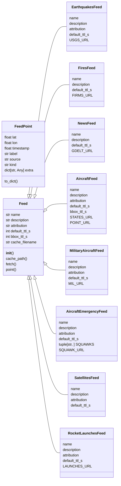
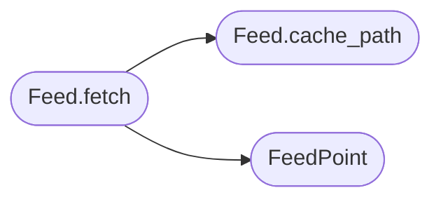

# `estorides_core.feeds`

> Source: [estorides_core/feeds.py:1](../../estorides_core/feeds.py#L1) | language `py` | coverage 85.0% | [API index](../index.md)

estorides_core.feeds ==================== Real-time intelligence feeds, polled and cached locally.

This is the "osiris map layers" feature, brought to the Python side:
each feed is a small object that knows how to fetch, parse, and
normalise one external signal (flights, earthquakes, fires, news,
sanctions) into a common GeoPoint shape ready for the map.

Why a separate module instead of just YAML sources?
  * The feeds are polled, not queried. They don't take a user query;
    they take a bounding box or a time window.
  * They produce spatiotemporal data (lat, lon, timestamp) which
    doesn't fit the source-parser model.
  * They have a much higher refresh rate (15-60 min) so we cache
    aggressively to disk and short-circuit on the same minute.

Each feed exposes a uniform API:
  * [`name`](#feed-name)  — slug used by the API
  * [`description`](#feed-description) — human-readable one-liner
  * `fetch(bbox=None)` — list[dict] of normalised records
  * `point(record)` — (lat, lon) tuple, or None

Records are plain dicts with at least: {lat, lon, timestamp, label, source}.

## Contents

- **Classes:** [`FeedPoint`](#feedpoint), [`Feed`](#feed), [`EarthquakesFeed`](#earthquakesfeed), [`FiresFeed`](#firesfeed), [`NewsFeed`](#newsfeed), [`AircraftFeed`](#aircraftfeed), [`MilitaryAircraftFeed`](#militaryaircraftfeed), [`AircraftEmergencyFeed`](#aircraftemergencyfeed), [`SatellitesFeed`](#satellitesfeed), [`RocketLaunchesFeed`](#rocketlaunchesfeed)
- **Functions:** [`airports_enabled`](#airports_enabled), [`list_feeds`](#list_feeds), [`get_feed`](#get_feed), [`fetch_all`](#fetch_all)
- **Constants:** [`FEED_CACHE_DIR`](#feed_cache_dir), [`DEFAULT_TTL_S`](#default_ttl_s), [`BBOX_CACHE_MAX_FILES`](#bbox_cache_max_files), [`AIRPORTS_URL`](#airports_url), [`AIRPORTS_CACHE_FILE`](#airports_cache_file), [`AIRPORTS_TTL_S`](#airports_ttl_s), [`AIRPORTS_MAX_BYTES`](#airports_max_bytes), [`FEEDS`](#feeds)

## Type Diagram



## Call Graph

Solid arrows stay in this module, dashed arrows leave it.



## Classes

<a id="feedpoint"></a>

### `FeedPoint`

`class` `dataclass` | [estorides_core/feeds.py:201](../../estorides_core/feeds.py#L201)

Decorators: `@dataclass`

```python
class FeedPoint
```

Normalised point for the map layer.

[`kind`](#feedpoint-kind) discriminates the marker on the map (flight / quake / fire /
news / vessel). [`extra`](#feedpoint-extra) is an open dict for source-specific fields
the frontend may want to render in the popup.

**Attributes**

| Name | Type | Default | Description |
|---|---|---|---|
| [`lat`](#feedpoint-lat) | `float` |  |  |
| [`lon`](#feedpoint-lon) | `float` |  |  |
| [`timestamp`](#feedpoint-timestamp) | `float` |  |  |
| [`label`](#feedpoint-label) | `str` |  |  |
| [`source`](#feedpoint-source) | `str` |  |  |
| [`kind`](#feedpoint-kind) | `str` |  |  |
| [`extra`](#feedpoint-extra) | `dict[str, Any]` | `field(default_factory=dict)` |  |

**Members**

| Member | Kind | Summary |
|---|---|---|
| [`to_dict`](#feedpoint-to_dict) | method |  |

<a id="feedpoint-to_dict"></a>

#### `FeedPoint.to_dict`

`method` | [estorides_core/feeds.py:216](../../estorides_core/feeds.py#L216)

```python
def to_dict(self) -> dict[str, Any]
```

**Returns:** `dict[str, Any]`

---

<a id="feed"></a>

### `Feed`

`class` `abstract` | [estorides_core/feeds.py:221](../../estorides_core/feeds.py#L221)

```python
class Feed(ABC)
```

Bases: `ABC`

Subclasses: [`AircraftEmergencyFeed`](#aircraftemergencyfeed), [`AircraftFeed`](#aircraftfeed), [`EarthquakesFeed`](#earthquakesfeed), [`FiresFeed`](#firesfeed), [`MilitaryAircraftFeed`](#militaryaircraftfeed), [`NewsFeed`](#newsfeed), [`RocketLaunchesFeed`](#rocketlaunchesfeed), [`SatellitesFeed`](#satellitesfeed)

Base class for a real-time feed.

**Attributes**

| Name | Type | Default | Description |
|---|---|---|---|
| [`name`](#feed-name) | `str` | `''` |  |
| [`description`](#feed-description) | `str` | `''` |  |
| [`attribution`](#feed-attribution) | `str` | `''` |  |
| [`default_ttl_s`](#feed-default_ttl_s) | `int` | `DEFAULT_TTL_S` |  |
| [`bbox_ttl_s`](#feed-bbox_ttl_s) | `int` | `0` |  |
| [`cache_filename`](#feed-cache_filename) | `str` | `''` |  |

**Members**

| Member | Kind | Summary |
|---|---|---|
| [`__init__`](#feed-__init__) | constructor |  |
| [`cache_path`](#feed-cache_path) | method | On-disk cache path, namespaced by bbox when one is supplied. |
| [`fetch`](#feed-fetch) | method | Public entrypoint. |
| [`point`](#feed-point) | method | Default: return (lat, lon) if both present. |

<a id="feed-__init__"></a>

#### `Feed.__init__`

`constructor` | [estorides_core/feeds.py:235](../../estorides_core/feeds.py#L235)

```python
def __init__(self) -> None
```

<a id="feed-cache_path"></a>

#### `Feed.cache_path`

`method` | [estorides_core/feeds.py:259](../../estorides_core/feeds.py#L259)

```python
def cache_path(self, bbox: tuple[float, float, float, float] | None = None) -> Path
```

On-disk cache path, namespaced by bbox when one is supplied.

A feed that cannot answer a box regionally keeps one global cache
file even when the caller passes a bbox: its answer is the world,
clipped afterwards, so keying it by box would refetch the same
world once per viewport.

**Parameters**

| Name | Type | Default | Description |
|---|---|---|---|
| `bbox` | `tuple[float, float, float, float] \| None` | `None` |  |

**Returns:** `Path`

*Called by:* [`Feed.fetch`](#feed-fetch)

<a id="feed-fetch"></a>

#### `Feed.fetch`

`method` | [estorides_core/feeds.py:290](../../estorides_core/feeds.py#L290)

```python
def fetch(self, *, use_cache: bool = True, bbox: tuple[float, float, float, float] | None = None) -> list[FeedPoint]
```

Public entrypoint.

Reads/writes the on-disk cache.

The cache is a simple `{fetched_at, points}` JSON blob — good
enough for a self-hosted deployment. A real production system
would want a TTL'd Redis layer, but that pulls in a network
dependency.

A ``bbox`` asks for a regional answer: the feed may serve it from
its upstream's own regional endpoint and caches it under a
bbox-specific key, so a wide and a narrow request never poison
each other.

**Parameters**

| Name | Type | Default | Description |
|---|---|---|---|
| `use_cache` | `bool` | `True` |  |
| `bbox` | `tuple[float, float, float, float] \| None` | `None` |  |

**Returns:** `list[FeedPoint]`

*Calls:* [`Feed.cache_path`](#feed-cache_path), [`FeedPoint`](#feedpoint)

<a id="feed-point"></a>

#### `Feed.point`

`method` | [estorides_core/feeds.py:352](../../estorides_core/feeds.py#L352)

```python
def point(self, record: dict[str, Any]) -> tuple[float, float] | None
```

Default: return (lat, lon) if both present.

**Parameters**

| Name | Type | Default | Description |
|---|---|---|---|
| `record` | `dict[str, Any]` |  |  |

**Returns:** `tuple[float, float] | None`

---

<a id="earthquakesfeed"></a>

### `EarthquakesFeed`

`class` | [estorides_core/feeds.py:365](../../estorides_core/feeds.py#L365)

```python
class EarthquakesFeed(Feed)
```

Bases: [`Feed`](#feed)

USGS M2.5+ earthquakes, last 24h, worldwide.

**Attributes**

| Name | Type | Default | Description |
|---|---|---|---|
| [`name`](#earthquakesfeed-name) |  | `'earthquakes'` |  |
| [`description`](#earthquakesfeed-description) |  | `'USGS M2.5+ earthquakes (last 24h)'` |  |
| [`attribution`](#earthquakesfeed-attribution) |  | `'USGS earthquake hazards program (public domain)'` |  |
| [`default_ttl_s`](#earthquakesfeed-default_ttl_s) |  | `10 * 60` |  |
| [`USGS_URL`](#earthquakesfeed-usgs_url) |  | `'https://earthquake.usgs.gov/earthquakes/feed/v1.0/summary/2.5_day.geojson'` |  |

---

<a id="firesfeed"></a>

### `FiresFeed`

`class` | [estorides_core/feeds.py:408](../../estorides_core/feeds.py#L408)

```python
class FiresFeed(Feed)
```

Bases: [`Feed`](#feed)

NASA FIRMS active fire hotspots (VIIRS_NOAA20_NRT, last 24h).

FIRMS retired its keyless CSV download in 2024. The new endpoint
at `api/data/active_fire/csv/...` requires a MAP_KEY (free with
NASA Earthdata registration) which is read from the
`ESTORIDES_FIRMS_KEY` env var. If the key is missing the feed
silently returns zero points and logs a warning — it never
breaks the rest of the platform.

**Attributes**

| Name | Type | Default | Description |
|---|---|---|---|
| [`name`](#firesfeed-name) |  | `'fires'` |  |
| [`description`](#firesfeed-description) |  | `'NASA FIRMS active fire hotspots (VIIRS_NOAA20_NRT, last 24h)'` |  |
| [`default_ttl_s`](#firesfeed-default_ttl_s) |  | `30 * 60` |  |
| [`FIRMS_URL`](#firesfeed-firms_url) |  | `'https://firms.modaps.eosdis.nasa.gov/api/data/active_fire/csv/VIIRS_NOAA20_NRT/world/24h.csv'` |  |

---

<a id="newsfeed"></a>

### `NewsFeed`

`class` | [estorides_core/feeds.py:470](../../estorides_core/feeds.py#L470)

```python
class NewsFeed(Feed)
```

Bases: [`Feed`](#feed)

GDELT 2.0 — global news articles (article-list API).

The GeoJSON endpoint we used in the previous version was retired.
The current keyless endpoint is the article-list API at
`/api/v2/doc/doc` which returns a JSON `articles` array. We
attempt to geocode the article URL via the embedded
`socialimage` or [`domain`](estorides_core.supply_chain.py.md#thirdparty-domain) field when coordinates aren't in the
payload — falling back to the article's source domain
coordinates is intentionally out of scope for this version, so
a record without explicit coordinates is dropped.

**Attributes**

| Name | Type | Default | Description |
|---|---|---|---|
| [`name`](#newsfeed-name) |  | `'news'` |  |
| [`description`](#newsfeed-description) |  | `'GDELT 2.0 global news articles (last 15 min)'` |  |
| [`default_ttl_s`](#newsfeed-default_ttl_s) |  | `15 * 60` |  |
| [`GDELT_URL`](#newsfeed-gdelt_url) |  | `'https://api.gdeltproject.org/api/v2/doc/doc?query=*&mode=artlist&maxrecords=250&format=json'` |  |

---

<a id="aircraftfeed"></a>

### `AircraftFeed`

`class` | [estorides_core/feeds.py:578](../../estorides_core/feeds.py#L578)

```python
class AircraftFeed(Feed)
```

Bases: [`Feed`](#feed)

Aircraft in the air, from the cheapest keyless source for the ask.

Without a bbox the feed takes the OpenSky worldwide snapshot (the
anonymous tier is rate-limited; the 5-minute cache keeps the platform
inside the published research/education budget). With a bbox it asks
adsb.lol for that exact region: community receivers are denser than
OpenSky locally, the regional query costs no credits, and 250 nm is
the upstream's own radius limit — beyond it the worldwide snapshot is
the better answer.

**Attributes**

| Name | Type | Default | Description |
|---|---|---|---|
| [`name`](#aircraftfeed-name) |  | `'aircraft'` |  |
| [`description`](#aircraftfeed-description) |  | `'Live aircraft (OpenSky worldwide, adsb.lol for a region)'` |  |
| [`attribution`](#aircraftfeed-attribution) |  | `'OpenSky Network (research/education terms); adsb.lol contributors (ODbL 1.0)'` |  |
| [`default_ttl_s`](#aircraftfeed-default_ttl_s) |  | `5 * 60` |  |
| [`bbox_ttl_s`](#aircraftfeed-bbox_ttl_s) |  | `60` |  |
| [`STATES_URL`](#aircraftfeed-states_url) |  | `'https://opensky-network.org/api/states/all?extended=1'` |  |
| [`POINT_URL`](#aircraftfeed-point_url) |  | `'https://api.adsb.lol/v2/point/{lat:.4f}/{lon:.4f}/{radius}'` |  |

---

<a id="militaryaircraftfeed"></a>

### `MilitaryAircraftFeed`

`class` | [estorides_core/feeds.py:645](../../estorides_core/feeds.py#L645)

```python
class MilitaryAircraftFeed(Feed)
```

Bases: [`Feed`](#feed)

Military aircraft currently broadcasting ADS-B (adsb.lol, ODbL).

adsb.lol is a community network; the military feed is a small,
keyless subset that is useful for pattern-of-life work. The
attribution is required by ODbL.

**Attributes**

| Name | Type | Default | Description |
|---|---|---|---|
| [`name`](#militaryaircraftfeed-name) |  | `'military_aircraft'` |  |
| [`description`](#militaryaircraftfeed-description) |  | `'adsb.lol military aircraft snapshot (ODbL)'` |  |
| [`attribution`](#militaryaircraftfeed-attribution) |  | `'adsb.lol contributors (ODbL 1.0)'` |  |
| [`default_ttl_s`](#militaryaircraftfeed-default_ttl_s) |  | `2 * 60` |  |
| [`MIL_URL`](#militaryaircraftfeed-mil_url) |  | `'https://api.adsb.lol/v2/mil'` |  |

---

<a id="aircraftemergencyfeed"></a>

### `AircraftEmergencyFeed`

`class` | [estorides_core/feeds.py:675](../../estorides_core/feeds.py#L675)

```python
class AircraftEmergencyFeed(Feed)
```

Bases: [`Feed`](#feed)

Aircraft currently broadcasting an emergency squawk (adsb.lol, ODbL).

Three ICAO Mode A codes are polled — 7500 unlawful interference,
7600 radio failure, 7700 general emergency — plus the ADS-B
emergency/priority field, which is a superset. A code is what the
transponder broadcast in this poll, never a finding: crews pass
through 7x00 codes while dialling. One-minute cache, because this is
the most time-sensitive layer in the set.

**Attributes**

| Name | Type | Default | Description |
|---|---|---|---|
| [`name`](#aircraftemergencyfeed-name) |  | `'aircraft_emergency'` |  |
| [`description`](#aircraftemergencyfeed-description) |  | `'Aircraft broadcasting an emergency squawk (adsb.lol, ODbL)'` |  |
| [`attribution`](#aircraftemergencyfeed-attribution) |  | `'adsb.lol contributors (ODbL 1.0)'` |  |
| [`default_ttl_s`](#aircraftemergencyfeed-default_ttl_s) |  | `60` |  |
| [`SQUAWKS`](#aircraftemergencyfeed-squawks) | `tuple[str, ...]` | `('7500', '7600', '7700')` |  |
| [`SQUAWK_URL`](#aircraftemergencyfeed-squawk_url) |  | `'https://api.adsb.lol/v2/squawk/{squawk}'` |  |

---

<a id="satellitesfeed"></a>

### `SatellitesFeed`

`class` | [estorides_core/feeds.py:725](../../estorides_core/feeds.py#L725)

```python
class SatellitesFeed(Feed)
```

Bases: [`Feed`](#feed)

Satellites in orbit, propagated from CelesTrak TLEs to now.

Six keyless CelesTrak groups are fetched (stations, visual, GPS,
GLONASS, Galileo, GEO) and each TLE is propagated to the current
instant. SGP4 is used when the optional ``sgp4`` package is
installed; a two-body fallback keeps the layer working otherwise.

**Attributes**

| Name | Type | Default | Description |
|---|---|---|---|
| [`name`](#satellitesfeed-name) |  | `'satellites'` |  |
| [`description`](#satellitesfeed-description) |  | `'CelesTrak satellites (stations, navigation, GEO)'` |  |
| [`attribution`](#satellitesfeed-attribution) |  | `'CelesTrak GP data (citation requested)'` |  |
| [`default_ttl_s`](#satellitesfeed-default_ttl_s) |  | `10 * 60` |  |

---

<a id="rocketlaunchesfeed"></a>

### `RocketLaunchesFeed`

`class` | [estorides_core/feeds.py:797](../../estorides_core/feeds.py#L797)

```python
class RocketLaunchesFeed(Feed)
```

Bases: [`Feed`](#feed)

Recent and upcoming orbital launches with pad coordinates.

Launch Library 2 is keyless on the free tier. Only launches with
pad coordinates become map points; the rest stay visible in the
source result for schedule work.

**Attributes**

| Name | Type | Default | Description |
|---|---|---|---|
| [`name`](#rocketlaunchesfeed-name) |  | `'rocket_launches'` |  |
| [`description`](#rocketlaunchesfeed-description) |  | `'Launch Library 2 recent and upcoming launches'` |  |
| [`attribution`](#rocketlaunchesfeed-attribution) |  | `'Launch Library 2 (thespacedevs.com)'` |  |
| [`default_ttl_s`](#rocketlaunchesfeed-default_ttl_s) |  | `60 * 60` |  |
| [`LAUNCHES_URL`](#rocketlaunchesfeed-launches_url) |  | `'https://ll.thespacedevs.com/2.3.0/launches/'` |  |

---

## Functions

<a id="airports_enabled"></a>

### `airports_enabled`

`function` | [estorides_core/feeds.py:140](../../estorides_core/feeds.py#L140)

```python
def airports_enabled() -> bool
```

True when aircraft records should be annotated with a nearby airport.

Off by default: enabling it downloads the public-domain OurAirports
catalogue (~13 MB) once and refreshes it monthly. Set
``ESTORIDES_AIRPORTS_ENRICH=1`` to opt in.

**Returns:** `bool`

---

<a id="list_feeds"></a>

### `list_feeds`

`function` | [estorides_core/feeds.py:872](../../estorides_core/feeds.py#L872)

```python
def list_feeds() -> list[dict[str, str]]
```

Return public feed descriptions for the /api/feeds endpoint.

**Returns:** `list[dict[str, str]]`

*Called by:* [`create_app`](estorides_web.py.md#create_app)

---

<a id="get_feed"></a>

### `get_feed`

`function` | [estorides_core/feeds.py:884](../../estorides_core/feeds.py#L884)

```python
def get_feed(name: str) -> Feed | None
```

**Parameters**

| Name | Type | Default | Description |
|---|---|---|---|
| `name` | `str` |  |  |

**Returns:** `Feed | None`

---

<a id="fetch_all"></a>

### `fetch_all`

`function` | [estorides_core/feeds.py:888](../../estorides_core/feeds.py#L888)

```python
def fetch_all(bbox: tuple[float, float, float, float] | None = None, use_cache: bool = True, names: list[str] | None = None) -> dict[str, list[FeedPoint]]
```

Fetch every registered feed (optionally clipped to a bbox).

Used by /api/feeds to populate the map in one round-trip.

bbox = (min_lon, min_lat, max_lon, max_lat). Points outside the
bbox are dropped before the response is returned.

[`names`](static.js.estorides.js.md#names) narrows the fan-out to the listed feed slugs. Unknown names
are ignored here; the HTTP layer validates them so a caller gets a
clear 400 instead of a silently empty layer.

**Parameters**

| Name | Type | Default | Description |
|---|---|---|---|
| `bbox` | `tuple[float, float, float, float] \| None` | `None` |  |
| `use_cache` | `bool` | `True` |  |
| `names` | `list[str] \| None` | `None` |  |

**Returns:** `dict[str, list[FeedPoint]]`

*Called by:* [`create_app`](estorides_web.py.md#create_app)

---

## Constants

<a id="feed_cache_dir"></a>

### `FEED_CACHE_DIR`

`constant` | [estorides_core/feeds.py:62](../../estorides_core/feeds.py#L62)

```python
FEED_CACHE_DIR: Path = DATA_DIR / 'feeds'
```

---

<a id="default_ttl_s"></a>

### `DEFAULT_TTL_S`

`constant` | [estorides_core/feeds.py:68](../../estorides_core/feeds.py#L68)

```python
DEFAULT_TTL_S: int = 15 * 60
```

---

<a id="bbox_cache_max_files"></a>

### `BBOX_CACHE_MAX_FILES`

`constant` | [estorides_core/feeds.py:72](../../estorides_core/feeds.py#L72)

```python
BBOX_CACHE_MAX_FILES: int = 50
```

---

<a id="airports_url"></a>

### `AIRPORTS_URL`

`constant` | [estorides_core/feeds.py:130](../../estorides_core/feeds.py#L130)

```python
AIRPORTS_URL = 'https://davidmegginson.github.io/ourairports-data/airports.csv'
```

---

<a id="airports_cache_file"></a>

### `AIRPORTS_CACHE_FILE`

`constant` | [estorides_core/feeds.py:131](../../estorides_core/feeds.py#L131)

```python
AIRPORTS_CACHE_FILE: Path = DATA_DIR / 'packs' / 'ourairports.json'
```

---

<a id="airports_ttl_s"></a>

### `AIRPORTS_TTL_S`

`constant` | [estorides_core/feeds.py:132](../../estorides_core/feeds.py#L132)

```python
AIRPORTS_TTL_S: int = 30 * 24 * 60 * 60
```

---

<a id="airports_max_bytes"></a>

### `AIRPORTS_MAX_BYTES`

`constant` | [estorides_core/feeds.py:133](../../estorides_core/feeds.py#L133)

```python
AIRPORTS_MAX_BYTES: int = 64 * 1024 * 1024
```

---

<a id="feeds"></a>

### `FEEDS`

`constant` | [estorides_core/feeds.py:857](../../estorides_core/feeds.py#L857)

```python
FEEDS: dict[str, Feed]
```

---
