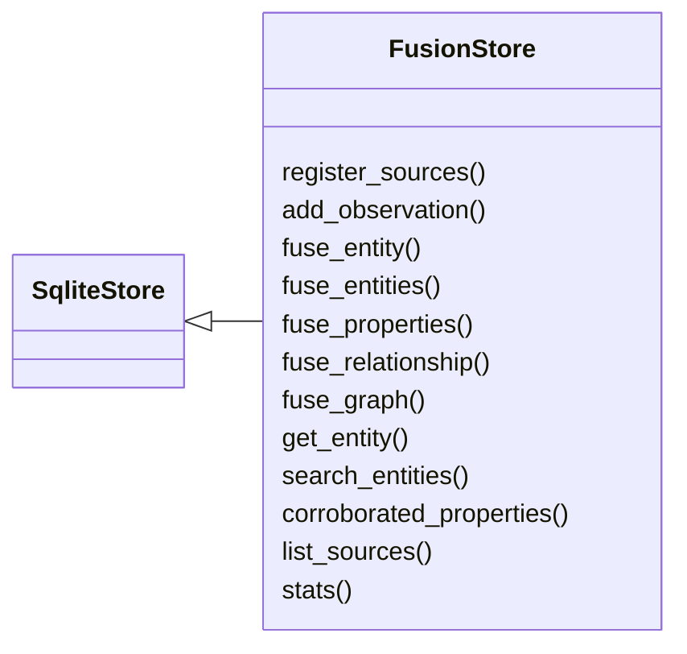
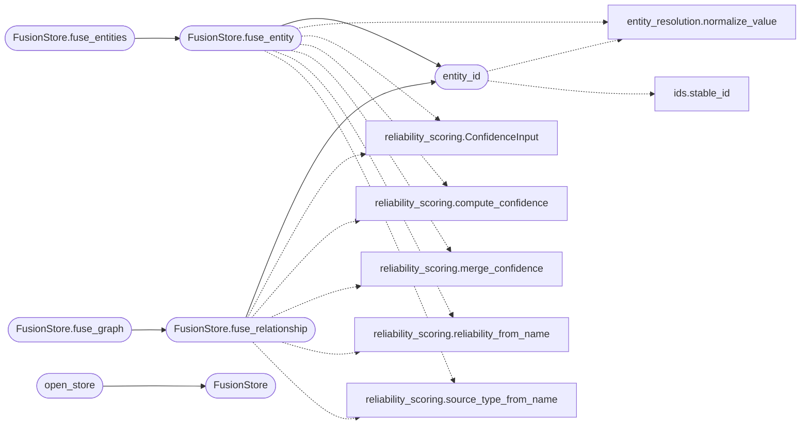

# `estorides_core.fusion_store`

> Source: [estorides_core/fusion_store.py:1](../../estorides_core/fusion_store.py#L1) | language `py` | coverage 100.0% | [API index](../index.md)

estorides_core.fusion_store =========================== The data-fusion datastore — the single place where everything every source (loaded from the YAML catalogue) ever produced is fused, cross-run, into one queryable intelligence picture.

Why this exists
---------------
The case store ([`estorides_core.cases`](estorides_core.cases.py.md)) keeps a *per-run silo*: each
investigation writes its own copy of the observations and entities it saw,
keyed by `[`case_id`](estorides_core.discoverer.py.md#discoverjob-case_id)`. The same real-world entity seen across fifty runs
becomes fifty rows, and nothing in the relational store answers "show me
everything we know about X, from every source, across every case".

The fusion store closes that gap. It is the relational analogue of the
Kùzu graph: a normalised, deduplicated, source-attributed fact base that
accumulates across runs. The fusion is provenance-preserving — when two
sources corroborate the same entity or property, the record is merged but
*every* contributing source is retained, so confidence is grounded in how
many independent feeds agree.

Schema (five tables)
--------------------
  fusion_sources         the YAML source catalogue, with fetch counters
  fusion_entities        canonical, cross-run, deduplicated entities
  fusion_entity_sources  which sources corroborated each entity (provenance)
  fusion_observations    every source response, fused across runs
  fusion_properties      attribute key/value per entity, attributed to source
  fusion_relationships   edges between entities, attributed to source

Entity identity
---------------
Each entity gets a deterministic id, ``sha1(type + ":" + normalized)``,
so the *same* entity computed in two different runs lands on the *same*
row without coordination. The resolver's `[`canonical_id`](estorides_core.entity_resolution.py.md#canonical_id)` is recorded
alongside for cross-reference but is never the dedup key, so a resolver
that mints a fresh id per run can never fork an entity in the fusion store.

Operational contract
---------------------
Mirrors [`estorides_core.cases`](estorides_core.cases.py.md) and [`estorides_core.entity_store`](estorides_core.entity_store.py.md):
WAL mode, one serialised connection behind a lock, and fail-soft — every
public write swallows its own errors and the orchestrator treats the whole
subsystem as best-effort, so a read-only or missing data directory degrades
to "no fusion" rather than breaking a run.

## Contents

- **Classes:** [`FusionStore`](#fusionstore)
- **Functions:** [`entity_id`](#entity_id), [`open_store`](#open_store)

## Type Diagram



## Call Graph

Solid arrows stay in this module, dashed arrows leave it.



## Classes

<a id="fusionstore"></a>

### `FusionStore`

`class` | [estorides_core/fusion_store.py:190](../../estorides_core/fusion_store.py#L190)

```python
class FusionStore(SqliteStore)
```

Bases: [`SqliteStore`](estorides_core.sqlite_store.py.md#sqlitestore)

Thread-safe SQLite-backed fusion datastore.

One serialised connection guarded by a lock, WAL journalling, and
``ON DELETE CASCADE`` foreign keys so dropping an entity reaps its
provenance, properties and edges.

**Members**

| Member | Kind | Summary |
|---|---|---|
| [`register_sources`](#fusionstore-register_sources) | method | Mirror the YAML source catalogue into the store. |
| [`add_observation`](#fusionstore-add_observation) | method | Fuse a single source response into the cross-run observation log and bump the source's fetch/ok counters. |
| [`fuse_entity`](#fusionstore-fuse_entity) | method | Fuse one entity into the canonical store and return its id. |
| [`fuse_entities`](#fusionstore-fuse_entities) | method | Fuse a batch of entities, returning the list of fused ids. |
| [`fuse_properties`](#fusionstore-fuse_properties) | method | Fuse the flat scalar attributes of a parsed observation onto an entity, attributed to ``source``. |
| [`fuse_relationship`](#fusionstore-fuse_relationship) | method | Fuse one directed edge between two entities, attributed to source. |
| [`fuse_graph`](#fusionstore-fuse_graph) | method | Mirror the analytic edges of a knowledge graph into the store. |
| [`get_entity`](#fusionstore-get_entity) | method | Return one fused entity with its provenance, properties and edges. |
| [`search_entities`](#fusionstore-search_entities) | method | Search fused entities by value substring and/or type. |
| [`corroborated_properties`](#fusionstore-corroborated_properties) | method | Return an entity's properties that at least ``min_sources`` distinct feeds independently asserted — the fusion store's confidence signal. |
| [`list_sources`](#fusionstore-list_sources) | method | Return the source catalogue with accumulated fetch/ok counters. |
| [`stats`](#fusionstore-stats) | method | One-glance dashboard of the fused store's size. |

<a id="fusionstore-register_sources"></a>

#### `FusionStore.register_sources`

`method` | [estorides_core/fusion_store.py:222](../../estorides_core/fusion_store.py#L222)

```python
def register_sources(self, sources: Iterable[Dict[str, Any]]) -> None
```

Mirror the YAML source catalogue into the store.

Idempotent: an existing source keeps its ``first_seen`` and its
accumulated counters; only the descriptive columns are refreshed so
the catalogue tracks edits to the YAML without losing fetch history.

**Parameters**

| Name | Type | Default | Description |
|---|---|---|---|
| `sources` | `Iterable[Dict[str, Any]]` |  |  |

<a id="fusionstore-add_observation"></a>

#### `FusionStore.add_observation`

`method` | [estorides_core/fusion_store.py:259](../../estorides_core/fusion_store.py#L259)

```python
def add_observation(self, observation: Dict[str, Any], *, query: str = '', query_type: str = '', case_id: Optional[str] = None) -> None
```

Fuse a single source response into the cross-run observation log and bump the source's fetch/ok counters.

**Parameters**

| Name | Type | Default | Description |
|---|---|---|---|
| `observation` | `Dict[str, Any]` |  |  |
| `query` | `str` | `''` |  |
| `query_type` | `str` | `''` |  |
| `case_id` | `Optional[str]` | `None` |  |

<a id="fusionstore-fuse_entity"></a>

#### `FusionStore.fuse_entity`

`method` | [estorides_core/fusion_store.py:300](../../estorides_core/fusion_store.py#L300)

```python
def fuse_entity(self, entity: Dict[str, Any], *, case_id: Optional[str] = None) -> str
```

Fuse one entity into the canonical store and return its id.

The ``(type, normalized)`` pair is the dedup key. On a repeat sighting
the row's ``last_seen``, confidence (Bayesian merge), and observation
count advance, and every contributing source is recorded in
``fusion_entity_sources`` so provenance survives the merge.

Confidence uses the `reliability_scoring` pipeline: source
reliability, source type hierarchy, and corroboration count are
factored into the score instead of a raw ``MAX()``. A tertiary or
unreliable source cannot override a well-corroborated primary one.

**Parameters**

| Name | Type | Default | Description |
|---|---|---|---|
| `entity` | `Dict[str, Any]` |  |  |
| `case_id` | `Optional[str]` | `None` |  |

**Returns:** `str`

*Calls:* [`normalize_value`](estorides_core.entity_resolution.py.md#normalize_value), [`entity_id`](#entity_id), [`ConfidenceInput`](estorides_core.reliability_scoring.py.md#confidenceinput), [`compute_confidence`](estorides_core.reliability_scoring.py.md#compute_confidence), [`merge_confidence`](estorides_core.reliability_scoring.py.md#merge_confidence), [`reliability_from_name`](estorides_core.reliability_scoring.py.md#reliability_from_name), [`source_type_from_name`](estorides_core.reliability_scoring.py.md#source_type_from_name)

*Called by:* [`FusionStore.fuse_entities`](#fusionstore-fuse_entities)

<a id="fusionstore-fuse_entities"></a>

#### `FusionStore.fuse_entities`

`method` | [estorides_core/fusion_store.py:403](../../estorides_core/fusion_store.py#L403)

```python
def fuse_entities(self, entities: Iterable[Dict[str, Any]], *, case_id: Optional[str] = None) -> List[str]
```

Fuse a batch of entities, returning the list of fused ids.

**Parameters**

| Name | Type | Default | Description |
|---|---|---|---|
| `entities` | `Iterable[Dict[str, Any]]` |  |  |
| `case_id` | `Optional[str]` | `None` |  |

**Returns:** `List[str]`

*Calls:* [`FusionStore.fuse_entity`](#fusionstore-fuse_entity)

<a id="fusionstore-fuse_properties"></a>

#### `FusionStore.fuse_properties`

`method` | [estorides_core/fusion_store.py:416](../../estorides_core/fusion_store.py#L416)

```python
def fuse_properties(self, eid: str, parsed: Any, source: str) -> int
```

Fuse the flat scalar attributes of a parsed observation onto an entity, attributed to ``source``.

Only one nesting level of scalar values is taken: deep structures are
the observation payload's job, not an entity attribute's. Returns the
number of properties written. The ``(entity_id, key, value, source)``
primary key means re-running the same source is idempotent while a
*different* source asserting the same key/value adds corroboration.

**Parameters**

| Name | Type | Default | Description |
|---|---|---|---|
| `eid` | `str` |  |  |
| `parsed` | `Any` |  |  |
| `source` | `str` |  |  |

**Returns:** `int`

<a id="fusionstore-fuse_relationship"></a>

#### `FusionStore.fuse_relationship`

`method` | [estorides_core/fusion_store.py:462](../../estorides_core/fusion_store.py#L462)

```python
def fuse_relationship(self, src_type: str, src_value: str, relation: str, dst_type: str, dst_value: str, *, source: str = '', confidence: float = 1.0) -> None
```

Fuse one directed edge between two entities, attributed to source.

Both endpoints are resolved to their deterministic fusion ids so the
edge joins the same canonical entities the entity table holds.
Confidence uses the `reliability_scoring` pipeline instead of a
raw ``MAX()``, so a low-reliability source cannot inflate the score
of a well-corroborated edge.

**Parameters**

| Name | Type | Default | Description |
|---|---|---|---|
| `src_type` | `str` |  |  |
| `src_value` | `str` |  |  |
| `relation` | `str` |  |  |
| `dst_type` | `str` |  |  |
| `dst_value` | `str` |  |  |
| `source` | `str` | `''` |  |
| `confidence` | `float` | `1.0` |  |

*Calls:* [`entity_id`](#entity_id), [`ConfidenceInput`](estorides_core.reliability_scoring.py.md#confidenceinput), [`compute_confidence`](estorides_core.reliability_scoring.py.md#compute_confidence), [`merge_confidence`](estorides_core.reliability_scoring.py.md#merge_confidence), [`reliability_from_name`](estorides_core.reliability_scoring.py.md#reliability_from_name), [`source_type_from_name`](estorides_core.reliability_scoring.py.md#source_type_from_name)

*Called by:* [`FusionStore.fuse_graph`](#fusionstore-fuse_graph)

<a id="fusionstore-fuse_graph"></a>

#### `FusionStore.fuse_graph`

`method` | [estorides_core/fusion_store.py:532](../../estorides_core/fusion_store.py#L532)

```python
def fuse_graph(self, kg: Any) -> int
```

Mirror the analytic edges of a knowledge graph into the store.

Reads node ``type``/``value`` off each endpoint and skips the pure
plumbing relations (``observed_by``, ``co_occurs``, ``mentions``) and
any edge touching a ``source`` node, so only pivot-worthy facts land.
Returns the number of edges fused. Best-effort: a malformed graph is
swallowed rather than aborting a run.

**Parameters**

| Name | Type | Default | Description |
|---|---|---|---|
| `kg` | `Any` |  |  |

**Returns:** `int`

*Calls:* [`FusionStore.fuse_relationship`](#fusionstore-fuse_relationship)

<a id="fusionstore-get_entity"></a>

#### `FusionStore.get_entity`

`method` | [estorides_core/fusion_store.py:568](../../estorides_core/fusion_store.py#L568)

```python
def get_entity(self, eid: str) -> Optional[Dict[str, Any]]
```

Return one fused entity with its provenance, properties and edges.

**Parameters**

| Name | Type | Default | Description |
|---|---|---|---|
| `eid` | `str` |  |  |

**Returns:** `Optional[Dict[str, Any]]`

<a id="fusionstore-search_entities"></a>

#### `FusionStore.search_entities`

`method` | [estorides_core/fusion_store.py:614](../../estorides_core/fusion_store.py#L614)

```python
def search_entities(self, term: str = '', etype: str = '', *, min_sources: int = 0, limit: int = 50) -> List[Dict[str, Any]]
```

Search fused entities by value substring and/or type.

``min_sources`` filters to entities corroborated by at least N feeds —
the fusion-native "only show me what more than one source agrees on"
query. Ordered by source breadth then recency.

**Parameters**

| Name | Type | Default | Description |
|---|---|---|---|
| `term` | `str` | `''` |  |
| `etype` | `str` | `''` |  |
| `min_sources` | `int` | `0` |  |
| `limit` | `int` | `50` |  |

**Returns:** `List[Dict[str, Any]]`

<a id="fusionstore-corroborated_properties"></a>

#### `FusionStore.corroborated_properties`

`method` | [estorides_core/fusion_store.py:657](../../estorides_core/fusion_store.py#L657)

```python
def corroborated_properties(self, eid: str, min_sources: int = 2) -> List[Dict[str, Any]]
```

Return an entity's properties that at least ``min_sources`` distinct feeds independently asserted — the fusion store's confidence signal.

**Parameters**

| Name | Type | Default | Description |
|---|---|---|---|
| `eid` | `str` |  |  |
| `min_sources` | `int` | `2` |  |

**Returns:** `List[Dict[str, Any]]`

<a id="fusionstore-list_sources"></a>

#### `FusionStore.list_sources`

`method` | [estorides_core/fusion_store.py:674](../../estorides_core/fusion_store.py#L674)

```python
def list_sources(self, limit: int = 200) -> List[Dict[str, Any]]
```

Return the source catalogue with accumulated fetch/ok counters.

**Parameters**

| Name | Type | Default | Description |
|---|---|---|---|
| `limit` | `int` | `200` |  |

**Returns:** `List[Dict[str, Any]]`

<a id="fusionstore-stats"></a>

#### `FusionStore.stats`

`method` | [estorides_core/fusion_store.py:692](../../estorides_core/fusion_store.py#L692)

```python
def stats(self) -> Dict[str, Any]
```

One-glance dashboard of the fused store's size.

**Returns:** `Dict[str, Any]`

---

## Functions

<a id="entity_id"></a>

### `entity_id`

`function` | [estorides_core/fusion_store.py:177](../../estorides_core/fusion_store.py#L177)

```python
def entity_id(etype: str, value: str, normalized: Optional[str] = None) -> str
```

Deterministic, run-independent id for an entity.

Derived from the type and the normalised value so the same real-world
entity always hashes to the same id no matter which run or source first
produced it — the property that makes cross-run fusion automatic.

**Parameters**

| Name | Type | Default | Description |
|---|---|---|---|
| `etype` | `str` |  |  |
| `value` | `str` |  |  |
| `normalized` | `Optional[str]` | `None` |  |

**Returns:** `str`

*Calls:* [`normalize_value`](estorides_core.entity_resolution.py.md#normalize_value), [`stable_id`](estorides_core.ids.py.md#stable_id)

*Called by:* [`FusionStore.fuse_entity`](#fusionstore-fuse_entity), [`FusionStore.fuse_relationship`](#fusionstore-fuse_relationship)

---

<a id="open_store"></a>

### `open_store`

`function` | [estorides_core/fusion_store.py:723](../../estorides_core/fusion_store.py#L723)

```python
def open_store(path: Optional[Path] = None) -> Optional[FusionStore]
```

Open the fusion store, returning None instead of raising on failure.

The orchestrator calls this so an unwritable or locked data directory
degrades the fusion layer to a no-op rather than aborting an
investigation.

**Parameters**

| Name | Type | Default | Description |
|---|---|---|---|
| `path` | `Optional[Path]` | `None` |  |

**Returns:** `Optional[FusionStore]`

*Calls:* [`FusionStore`](#fusionstore)

*Called by:* [`cmd_fusion`](estorides_cli.py.md#cmd_fusion)

---
