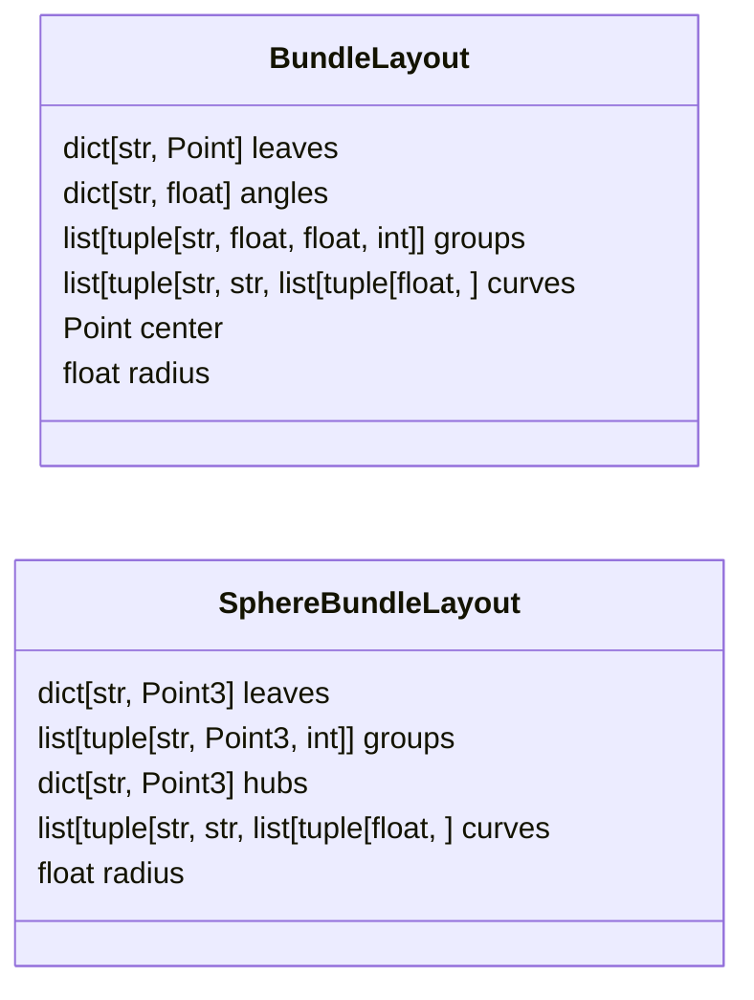
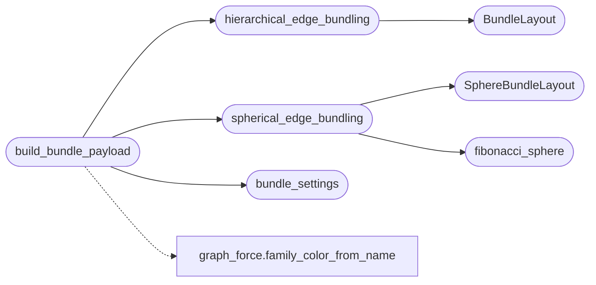

# `estorides_core.graph_bundle`

> Source: [estorides_core/graph_bundle.py:1](../../estorides_core/graph_bundle.py#L1) | language `py` | coverage 100.0% | [API index](../index.md)

graph_bundle: payload circle 2D + sphere 3D estilo ReadMenator.

Porta ``readmenator/_bundlegraph.py`` (``BundleGraphRenderer.build_payload``)
y ``readmenator/_graphlayout.py`` (`[`hierarchical_edge_bundling`](#hierarchical_edge_bundling)` +
`[`spherical_edge_bundling`](#spherical_edge_bundling)` + Fibonacci + B-spline, Holten 2006) al grafo
OSINT de Estorides.

Puro y sin I/O: consume el payload RAW de
`[`estorides_core.graph_force.build_force_payload`](estorides_core.graph_force.py.md#build_force_payload)` y devuelve el payload
bundle ``{nodes, groups, edges}`` con la misma forma que ReadMenator (para
que el JS porteado sea casi verbatim). Todo input hostil se valida
fail-closed (``TypeError``) o se trunca a limites fijos. Nunca genera HTML.

## Contents

- **Classes:** [`BundleLayout`](#bundlelayout), [`SphereBundleLayout`](#spherebundlelayout)
- **Functions:** [`hierarchical_edge_bundling`](#hierarchical_edge_bundling), [`fibonacci_sphere`](#fibonacci_sphere), [`spherical_edge_bundling`](#spherical_edge_bundling), [`bundle_settings`](#bundle_settings), [`build_bundle_payload`](#build_bundle_payload)
- **Constants:** [`MAX_LABEL_CHARS`](#max_label_chars), [`COORD_DIGITS`](#coord_digits), [`UNASSIGNED_KEY`](#unassigned_key), [`DEFAULT_UNASSIGNED_COLOR`](#default_unassigned_color), [`SCAFFOLD_TYPES`](#scaffold_types)

## Type Diagram



## Call Graph

Solid arrows stay in this module, dashed arrows leave it.



## Classes

<a id="bundlelayout"></a>

### `BundleLayout`

`class` `dataclass` | [estorides_core/graph_bundle.py:37](../../estorides_core/graph_bundle.py#L37)

Decorators: `@dataclass(frozen=True)`

```python
class BundleLayout
```

Resultado del bundling circular (igual que ReadMenator).

**Attributes**

| Name | Type | Default | Description |
|---|---|---|---|
| [`leaves`](#bundlelayout-leaves) | `dict[str, Point]` |  |  |
| [`angles`](#bundlelayout-angles) | `dict[str, float]` |  |  |
| [`groups`](#bundlelayout-groups) | `list[tuple[str, float, float, int]]` |  |  |
| [`curves`](#bundlelayout-curves) | `list[tuple[str, str, list[tuple[float, ...]]]]` |  |  |
| [`center`](#bundlelayout-center) | `Point` |  |  |
| [`radius`](#bundlelayout-radius) | `float` |  |  |

---

<a id="spherebundlelayout"></a>

### `SphereBundleLayout`

`class` `dataclass` | [estorides_core/graph_bundle.py:49](../../estorides_core/graph_bundle.py#L49)

Decorators: `@dataclass(frozen=True)`

```python
class SphereBundleLayout
```

Resultado del bundling esferico (igual que ReadMenator).

**Attributes**

| Name | Type | Default | Description |
|---|---|---|---|
| [`leaves`](#spherebundlelayout-leaves) | `dict[str, Point3]` |  |  |
| [`groups`](#spherebundlelayout-groups) | `list[tuple[str, Point3, int]]` |  |  |
| [`hubs`](#spherebundlelayout-hubs) | `dict[str, Point3]` |  |  |
| [`curves`](#spherebundlelayout-curves) | `list[tuple[str, str, list[tuple[float, ...]]]]` |  |  |
| [`radius`](#spherebundlelayout-radius) | `float` |  |  |

---

## Functions

<a id="hierarchical_edge_bundling"></a>

### `hierarchical_edge_bundling`

`function` | [estorides_core/graph_bundle.py:171](../../estorides_core/graph_bundle.py#L171)

```python
def hierarchical_edge_bundling(groups: dict[str, list[str]], edges: Sequence[tuple[str, str]], center: Point, radius: float, beta: float = 0.85, samples: int = 24, group_gap: float = 0.04, inner_ratio: float = 0.55) -> BundleLayout
```

Hojas en un circulo por grupo; aristas por la jerarquia (Holten 2006).

**Parameters**

| Name | Type | Default | Description |
|---|---|---|---|
| `groups` | `dict[str, list[str]]` |  |  |
| `edges` | `Sequence[tuple[str, str]]` |  |  |
| `center` | `Point` |  |  |
| `radius` | `float` |  |  |
| `beta` | `float` | `0.85` |  |
| `samples` | `int` | `24` |  |
| `group_gap` | `float` | `0.04` |  |
| `inner_ratio` | `float` | `0.55` |  |

**Returns:** `BundleLayout`

*Calls:* [`BundleLayout`](#bundlelayout)

*Called by:* [`build_bundle_payload`](#build_bundle_payload)

---

<a id="fibonacci_sphere"></a>

### `fibonacci_sphere`

`function` | [estorides_core/graph_bundle.py:215](../../estorides_core/graph_bundle.py#L215)

```python
def fibonacci_sphere(count: int) -> list[Point3]
```

Vectores unitarios casi uniformes en espiral de angulo dorado.

**Parameters**

| Name | Type | Default | Description |
|---|---|---|---|
| `count` | `int` |  |  |

**Returns:** `list[Point3]`

*Called by:* [`spherical_edge_bundling`](#spherical_edge_bundling)

---

<a id="spherical_edge_bundling"></a>

### `spherical_edge_bundling`

`function` | [estorides_core/graph_bundle.py:267](../../estorides_core/graph_bundle.py#L267)

```python
def spherical_edge_bundling(groups: dict[str, list[str]], edges: Sequence[tuple[str, str]], radius: float = 1.0, beta: float = 0.85, samples: int = 24, inner_ratio: float = 0.55) -> SphereBundleLayout
```

Hojas en caps esfericos por comunidad; aristas por la jerarquia.

**Parameters**

| Name | Type | Default | Description |
|---|---|---|---|
| `groups` | `dict[str, list[str]]` |  |  |
| `edges` | `Sequence[tuple[str, str]]` |  |  |
| `radius` | `float` | `1.0` |  |
| `beta` | `float` | `0.85` |  |
| `samples` | `int` | `24` |  |
| `inner_ratio` | `float` | `0.55` |  |

**Returns:** `SphereBundleLayout`

*Calls:* [`SphereBundleLayout`](#spherebundlelayout), [`fibonacci_sphere`](#fibonacci_sphere)

*Called by:* [`build_bundle_payload`](#build_bundle_payload)

---

<a id="bundle_settings"></a>

### `bundle_settings`

`function` | [estorides_core/graph_bundle.py:324](../../estorides_core/graph_bundle.py#L324)

```python
def bundle_settings() -> dict[str, Any]
```

Defaults de la pagina bundle (fuente unica para el JS).

Mismos valores que ``readmenator/_config.py`` BUNDLEGRAPH_*; cada uno
se puede afinar por entorno sin romper el import (env malformada →
default, nunca raise). Los colores viajan por nodo/grupo (campos
``c``), asi que no hay mapa separado.

**Returns:** `dict[str, Any]`

*Called by:* [`build_bundle_payload`](#build_bundle_payload)

---

<a id="build_bundle_payload"></a>

### `build_bundle_payload`

`function` | [estorides_core/graph_bundle.py:359](../../estorides_core/graph_bundle.py#L359)

```python
def build_bundle_payload(force_payload: dict[str, Any]) -> dict[str, Any]
```

Deriva el payload bundle desde un payload force RAW.

Las comunidades conservan el orden del analizador (id asc) y los nodos
sin comunidad forman el grupo trailing ``unassigned``. Dentro de cada
grupo los nodos van por `[`rank`](static.js.graph_bundle.js.md#rank)` desc (hubs al centro del arco/cap).
Solo viajan aristas entidad→entidad de relacion (el scaffolding
``member_of``/``layered_as`` se queda fuera: la jerarquia ya lo pinta).

**Parameters**

| Name | Type | Default | Description |
|---|---|---|---|
| `force_payload` | `dict[str, Any]` |  |  |

**Returns:** `dict[str, Any]`

**Raises**

- `TypeError`: (raised in the body, not documented)

*Calls:* [`bundle_settings`](#bundle_settings), [`hierarchical_edge_bundling`](#hierarchical_edge_bundling), [`spherical_edge_bundling`](#spherical_edge_bundling), [`family_color_from_name`](estorides_core.graph_force.py.md#family_color_from_name)

---

## Constants

<a id="max_label_chars"></a>

### `MAX_LABEL_CHARS`

`constant` | [estorides_core/graph_bundle.py:25](../../estorides_core/graph_bundle.py#L25)

```python
MAX_LABEL_CHARS = 512
```

---

<a id="coord_digits"></a>

### `COORD_DIGITS`

`constant` | [estorides_core/graph_bundle.py:26](../../estorides_core/graph_bundle.py#L26)

```python
COORD_DIGITS = 5
```

---

<a id="unassigned_key"></a>

### `UNASSIGNED_KEY`

`constant` | [estorides_core/graph_bundle.py:27](../../estorides_core/graph_bundle.py#L27)

```python
UNASSIGNED_KEY = 'unassigned'
```

---

<a id="default_unassigned_color"></a>

### `DEFAULT_UNASSIGNED_COLOR`

`constant` | [estorides_core/graph_bundle.py:28](../../estorides_core/graph_bundle.py#L28)

```python
DEFAULT_UNASSIGNED_COLOR = '#4f8ef7'
```

---

<a id="scaffold_types"></a>

### `SCAFFOLD_TYPES`

`constant` | [estorides_core/graph_bundle.py:30](../../estorides_core/graph_bundle.py#L30)

```python
SCAFFOLD_TYPES = frozenset({'member_of', 'layered_as'})
```

---
