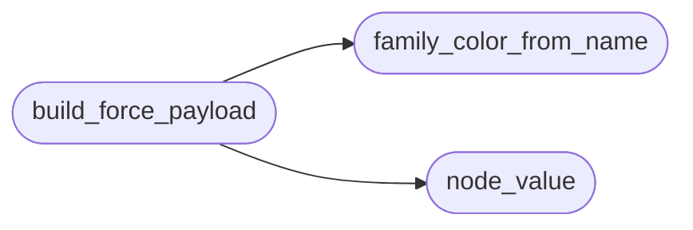

# `estorides_core.graph_force`

> Source: [estorides_core/graph_force.py:1](../../estorides_core/graph_force.py#L1) | language `py` | coverage 100.0% | [API index](../index.md)

graph_force3d: payload force-graph estilo ReadMenator + contexto IA.

Porta ``readmenator/_forcegraph.py`` (payload heterogeneo + SETTINGS) y el
formato RAW de ``graph-force.html`` al grafo OSINT de Estorides, mas un
constructor de contexto markdown con presupuesto de tokens para la capa
de IA local (GraphRAG extractivo, sin llamadas a LLM).

Puro y sin I/O: todo input hostil (labels remotos) se valida fail-closed
(``TypeError`` ante valores no JSON-safe) o se trunca a limites fijos.
El modulo nunca genera HTML: solo dicts JSON-safe.

## Contents

- **Functions:** [`family_color_from_name`](#family_color_from_name), [`node_value`](#node_value), [`force_settings`](#force_settings), [`build_force_payload`](#build_force_payload), [`build_ai_context`](#build_ai_context)
- **Constants:** [`MAX_LABEL_CHARS`](#max_label_chars), [`MAX_NODES`](#max_nodes), [`MAX_EDGES`](#max_edges), [`MAX_BUDGET_CHARS`](#max_budget_chars), [`DEFAULT_BUDGET_CHARS`](#default_budget_chars), [`CONTEXT_LABEL_CHARS`](#context_label_chars), [`EDGE_COLORS`](#edge_colors), [`DEFAULT_EDGE_COLOR`](#default_edge_color), [`TIER_COLORS`](#tier_colors), [`DEFAULT_NODE_COLOR`](#default_node_color)

## Call Graph

Solid arrows stay in this module, dashed arrows leave it.



## Functions

<a id="family_color_from_name"></a>

### `family_color_from_name`

`function` | [estorides_core/graph_force.py:48](../../estorides_core/graph_force.py#L48)

```python
def family_color_from_name(name: str, sat_base: int = 55, sat_span: int = 12, light_base: int = 58, light_span: int = 10) -> str
```

Deriva un color HSL estable desde un label (djb2, como ReadMenator).

**Parameters**

| Name | Type | Default | Description |
|---|---|---|---|
| `name` | `str` |  |  |
| `sat_base` | `int` | `55` |  |
| `sat_span` | `int` | `12` |  |
| `light_base` | `int` | `58` |  |
| `light_span` | `int` | `10` |  |

**Returns:** `str`

*Called by:* [`build_bundle_payload`](estorides_core.graph_bundle.py.md#build_bundle_payload), [`build_force_payload`](#build_force_payload)

---

<a id="node_value"></a>

### `node_value`

`function` | [estorides_core/graph_force.py:65](../../estorides_core/graph_force.py#L65)

```python
def node_value(symbols: int, degree: int, findings: int = 0) -> float
```

Escala log2 del tamano de nodo (minimo 1).

**Parameters**

| Name | Type | Default | Description |
|---|---|---|---|
| `symbols` | `int` |  |  |
| `degree` | `int` |  |  |
| `findings` | `int` | `0` |  |

**Returns:** `float`

*Called by:* [`build_force_payload`](#build_force_payload)

---

<a id="force_settings"></a>

### `force_settings`

`function` | [estorides_core/graph_force.py:70](../../estorides_core/graph_force.py#L70)

```python
def force_settings() -> dict[str, Any]
```

Valores SETTINGS de ReadMenator graph-force.html (fuente unica).

**Returns:** `dict[str, Any]`

*Called by:* [`create_app`](estorides_web.py.md#create_app)

---

<a id="build_force_payload"></a>

### `build_force_payload`

`function` | [estorides_core/graph_force.py:161](../../estorides_core/graph_force.py#L161)

```python
def build_force_payload(nodes: list[dict[str, Any]], edges: list[dict[str, Any]], clusters: list[dict[str, Any]], max_nodes: int = 300, max_edges: int = 1000) -> dict[str, Any]
```

Convierte nodos/edges OSINT (`/api/graph`) al formato RAW force-graph.

Truncacion determinista: grado desc, puentes inter-cluster primero,
desempate por `id`. Los edges huerfanos se descartan (conteo en meta).

**Parameters**

| Name | Type | Default | Description |
|---|---|---|---|
| `nodes` | `list[dict[str, Any]]` |  |  |
| `edges` | `list[dict[str, Any]]` |  |  |
| `clusters` | `list[dict[str, Any]]` |  |  |
| `max_nodes` | `int` | `300` |  |
| `max_edges` | `int` | `1000` |  |

**Returns:** `dict[str, Any]`

**Raises**

- `TypeError`: (raised in the body, not documented)

*Calls:* [`family_color_from_name`](#family_color_from_name), [`node_value`](#node_value)

*Called by:* [`create_app`](estorides_web.py.md#create_app)

---

<a id="build_ai_context"></a>

### `build_ai_context`

`function` | [estorides_core/graph_force.py:353](../../estorides_core/graph_force.py#L353)

```python
def build_ai_context(nodes: list[dict[str, Any]], edges: list[dict[str, Any]], clusters: list[dict[str, Any]], budget_chars: int = DEFAULT_BUDGET_CHARS) -> dict[str, Any]
```

Contexto markdown extractivo con presupuesto para la IA local.

Sin llamadas a LLM: entidades top por grado, puentes inter-cluster
primero, una linea por comunidad. Determinista y acotado.

**Parameters**

| Name | Type | Default | Description |
|---|---|---|---|
| `nodes` | `list[dict[str, Any]]` |  |  |
| `edges` | `list[dict[str, Any]]` |  |  |
| `clusters` | `list[dict[str, Any]]` |  |  |
| `budget_chars` | `int` | `DEFAULT_BUDGET_CHARS` |  |

**Returns:** `dict[str, Any]`

**Raises**

- `TypeError`: (raised in the body, not documented)
- `ValueError`: (raised in the body, not documented)

---

## Constants

<a id="max_label_chars"></a>

### `MAX_LABEL_CHARS`

`constant` | [estorides_core/graph_force.py:18](../../estorides_core/graph_force.py#L18)

```python
MAX_LABEL_CHARS = 512
```

---

<a id="max_nodes"></a>

### `MAX_NODES`

`constant` | [estorides_core/graph_force.py:19](../../estorides_core/graph_force.py#L19)

```python
MAX_NODES = 2000
```

---

<a id="max_edges"></a>

### `MAX_EDGES`

`constant` | [estorides_core/graph_force.py:20](../../estorides_core/graph_force.py#L20)

```python
MAX_EDGES = 5000
```

---

<a id="max_budget_chars"></a>

### `MAX_BUDGET_CHARS`

`constant` | [estorides_core/graph_force.py:21](../../estorides_core/graph_force.py#L21)

```python
MAX_BUDGET_CHARS = 200000
```

---

<a id="default_budget_chars"></a>

### `DEFAULT_BUDGET_CHARS`

`constant` | [estorides_core/graph_force.py:22](../../estorides_core/graph_force.py#L22)

```python
DEFAULT_BUDGET_CHARS = 12000
```

---

<a id="context_label_chars"></a>

### `CONTEXT_LABEL_CHARS`

`constant` | [estorides_core/graph_force.py:23](../../estorides_core/graph_force.py#L23)

```python
CONTEXT_LABEL_CHARS = 200
```

---

<a id="edge_colors"></a>

### `EDGE_COLORS`

`constant` | [estorides_core/graph_force.py:27](../../estorides_core/graph_force.py#L27)

```python
EDGE_COLORS: dict[str, str]
```

---

<a id="default_edge_color"></a>

### `DEFAULT_EDGE_COLOR`

`constant` | [estorides_core/graph_force.py:35](../../estorides_core/graph_force.py#L35)

```python
DEFAULT_EDGE_COLOR = 'rgba(148,163,184,.18)'
```

---

<a id="tier_colors"></a>

### `TIER_COLORS`

`constant` | [estorides_core/graph_force.py:39](../../estorides_core/graph_force.py#L39)

```python
TIER_COLORS: dict[str, str]
```

---

<a id="default_node_color"></a>

### `DEFAULT_NODE_COLOR`

`constant` | [estorides_core/graph_force.py:45](../../estorides_core/graph_force.py#L45)

```python
DEFAULT_NODE_COLOR = '#888'
```

---
