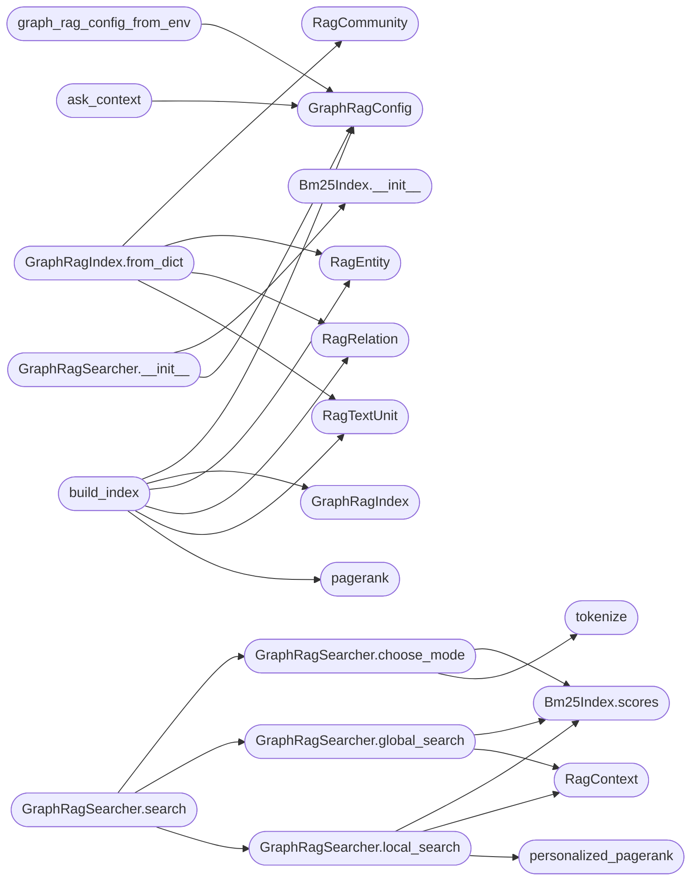

# `estorides_core.graph_rag_search`

> Source: [estorides_core/graph_rag_search.py:1](../../estorides_core/graph_rag_search.py#L1) | language `py` | coverage 46.2% | [API index](../index.md)

graph_rag_search: GraphRAG local/global para la IA local (sin LLM).

Porta ``readmenator/_graphrag.py`` + ``_rank.py`` al grafo OSINT:
indice tipado (entidades, relaciones, text units, reportes de comunidad),
BM25 lexico, PageRank global, Personalized PageRank (busqueda local) y
map-reduce sobre reportes (busqueda global). Todo extractivo,
determinista, puro y sin I/O.

## Contents

- **Classes:** [`GraphRagConfig`](#graphragconfig), [`Bm25Index`](#bm25index), [`RagEntity`](#ragentity), [`RagRelation`](#ragrelation), [`RagTextUnit`](#ragtextunit), [`RagCommunity`](#ragcommunity), [`RagContext`](#ragcontext), [`GraphRagIndex`](#graphragindex), [`GraphRagSearcher`](#graphragsearcher)
- **Functions:** [`graph_rag_config_from_env`](#graph_rag_config_from_env), [`tokenize`](#tokenize), [`pagerank`](#pagerank), [`personalized_pagerank`](#personalized_pagerank), [`build_index`](#build_index), [`ask_context`](#ask_context), [`graph_context_block`](#graph_context_block)
- **Constants:** [`SCHEMA_VERSION`](#schema_version), [`MAX_LABEL_CHARS`](#max_label_chars), [`MAX_DETAIL_CHARS`](#max_detail_chars), [`MAX_BUDGET_CHARS`](#max_budget_chars), [`CONTEXT_LABEL_CHARS`](#context_label_chars), [`RELATION_WEIGHTS`](#relation_weights), [`DEFAULT_REL_WEIGHT`](#default_rel_weight), [`GLOBAL_HINTS`](#global_hints), [`STOPWORDS`](#stopwords)

## Type Diagram

```mermaid
classDiagram
    direction LR
    class GraphRagConfig
    GraphRagConfig : float bm25_k1
    GraphRagConfig : float bm25_b
    GraphRagConfig : int min_token_len
    GraphRagConfig : float alpha
    GraphRagConfig : float ppr_alpha
    GraphRagConfig : int max_iter
    GraphRagConfig : float tolerance
    GraphRagConfig : int seed_top_k
    GraphRagConfig : int local_top_entities
    GraphRagConfig : int local_top_relations
    GraphRagConfig : int local_top_reports
    GraphRagConfig : int local_top_units
    GraphRagConfig : int global_top_reports
    GraphRagConfig : int context_budget_tokens
    GraphRagConfig : int chars_per_token
    GraphRagConfig : int report_max_findings
    GraphRagConfig : int report_key_entities
    class Bm25Index
    Bm25Index : __init__()
    Bm25Index : scores()
    class RagEntity
    RagEntity : str entity_id
    RagEntity : str name
    RagEntity : str kind
    RagEntity : int cluster
    RagEntity : int degree
    RagEntity : float rank
    RagEntity : str description
    class RagRelation
    RagRelation : str source
    RagRelation : str target
    RagRelation : str relation
    RagRelation : float weight
    RagRelation : str confidence
    RagRelation : str description
    class RagTextUnit
    RagTextUnit : str unit_id
    RagTextUnit : str entity_id
    RagTextUnit : str location
    RagTextUnit : str text
    class RagCommunity
    RagCommunity : str community_id
    RagCommunity : int level
    RagCommunity : str parent
    RagCommunity : list[str] children
    RagCommunity : str title
    RagCommunity : list[str] member_ids
    RagCommunity : str summary
    RagCommunity : list[str] findings
    RagCommunity : list[str] key_entities
    RagCommunity : list[str] key_relations
    RagCommunity : float rating
    RagCommunity : str rating_explanation
    class RagContext
    RagContext : str query
    RagContext : str mode
    RagContext : list[tuple[str, float]] entities
    RagContext : list[str] relations
    RagContext : list[str] reports
    RagContext : list[str] text_units
    RagContext : str markdown
    RagContext : int approx_tokens
    class GraphRagIndex
    GraphRagIndex : list[RagEntity] entities
    GraphRagIndex : list[RagRelation] relationships
    GraphRagIndex : list[RagCommunity] communities
    GraphRagIndex : list[RagTextUnit] text_units
    GraphRagIndex : dict[str, object] meta
    GraphRagIndex : to_dict()
    GraphRagIndex : from_dict()
    class GraphRagSearcher
    GraphRagSearcher : __init__()
    GraphRagSearcher : choose_mode()
    GraphRagSearcher : search()
    GraphRagSearcher : local_search()
    GraphRagSearcher : global_search()
```



## Call Graph

Solid arrows stay in this module, dashed arrows leave it.



## Classes

<a id="graphragconfig"></a>

### `GraphRagConfig`

`class` `dataclass` | [estorides_core/graph_rag_search.py:53](../../estorides_core/graph_rag_search.py#L53)

Decorators: `@dataclass(frozen=True)`

```python
class GraphRagConfig
```

Presupuestos y pesos de retrieval (env `ESTORIDES_GRAPHRAG_*`).

**Attributes**

| Name | Type | Default | Description |
|---|---|---|---|
| [`bm25_k1`](#graphragconfig-bm25_k1) | `float` | `1.2` |  |
| [`bm25_b`](#graphragconfig-bm25_b) | `float` | `0.75` |  |
| [`min_token_len`](#graphragconfig-min_token_len) | `int` | `3` |  |
| [`alpha`](#graphragconfig-alpha) | `float` | `0.85` |  |
| [`ppr_alpha`](#graphragconfig-ppr_alpha) | `float` | `0.85` |  |
| [`max_iter`](#graphragconfig-max_iter) | `int` | `100` |  |
| [`tolerance`](#graphragconfig-tolerance) | `float` | `1e-06` |  |
| [`seed_top_k`](#graphragconfig-seed_top_k) | `int` | `8` |  |
| [`local_top_entities`](#graphragconfig-local_top_entities) | `int` | `12` |  |
| [`local_top_relations`](#graphragconfig-local_top_relations) | `int` | `20` |  |
| [`local_top_reports`](#graphragconfig-local_top_reports) | `int` | `3` |  |
| [`local_top_units`](#graphragconfig-local_top_units) | `int` | `8` |  |
| [`global_top_reports`](#graphragconfig-global_top_reports) | `int` | `4` |  |
| [`context_budget_tokens`](#graphragconfig-context_budget_tokens) | `int` | `1500` |  |
| [`chars_per_token`](#graphragconfig-chars_per_token) | `int` | `4` |  |
| [`report_max_findings`](#graphragconfig-report_max_findings) | `int` | `6` |  |
| [`report_key_entities`](#graphragconfig-report_key_entities) | `int` | `8` |  |

---

<a id="bm25index"></a>

### `Bm25Index`

`class` | [estorides_core/graph_rag_search.py:112](../../estorides_core/graph_rag_search.py#L112)

```python
class Bm25Index
```

Okapi BM25 sobre un corpus fijo de listas de tokens.

**Members**

| Member | Kind | Summary |
|---|---|---|
| [`__init__`](#bm25index-__init__) | constructor |  |
| [`scores`](#bm25index-scores) | method | Un score BM25 por documento, en orden de corpus. |

<a id="bm25index-__init__"></a>

#### `Bm25Index.__init__`

`constructor` | [estorides_core/graph_rag_search.py:115](../../estorides_core/graph_rag_search.py#L115)

```python
def __init__(self, documents: Sequence[Sequence[str]], k1: float, b: float) -> None
```

**Parameters**

| Name | Type | Default | Description |
|---|---|---|---|
| `documents` | `Sequence[Sequence[str]]` |  |  |
| `k1` | `float` |  |  |
| `b` | `float` |  |  |

*Called by:* [`GraphRagSearcher.__init__`](#graphragsearcher-__init__)

<a id="bm25index-scores"></a>

#### `Bm25Index.scores`

`method` | [estorides_core/graph_rag_search.py:136](../../estorides_core/graph_rag_search.py#L136)

```python
def scores(self, query: Sequence[str]) -> list[float]
```

Un score BM25 por documento, en orden de corpus.

**Parameters**

| Name | Type | Default | Description |
|---|---|---|---|
| `query` | `Sequence[str]` |  |  |

**Returns:** `list[float]`

*Called by:* [`GraphRagSearcher.choose_mode`](#graphragsearcher-choose_mode), [`GraphRagSearcher.global_search`](#graphragsearcher-global_search), [`GraphRagSearcher.local_search`](#graphragsearcher-local_search)

---

<a id="ragentity"></a>

### `RagEntity`

`class` `dataclass` | [estorides_core/graph_rag_search.py:260](../../estorides_core/graph_rag_search.py#L260)

Decorators: `@dataclass(frozen=True)`

```python
class RagEntity
```

**Attributes**

| Name | Type | Default | Description |
|---|---|---|---|
| [`entity_id`](#ragentity-entity_id) | `str` |  |  |
| [`name`](#ragentity-name) | `str` |  |  |
| [`kind`](#ragentity-kind) | `str` |  |  |
| [`cluster`](#ragentity-cluster) | `int` |  |  |
| [`degree`](#ragentity-degree) | `int` |  |  |
| [`rank`](#ragentity-rank) | `float` |  |  |
| [`description`](#ragentity-description) | `str` |  |  |

---

<a id="ragrelation"></a>

### `RagRelation`

`class` `dataclass` | [estorides_core/graph_rag_search.py:271](../../estorides_core/graph_rag_search.py#L271)

Decorators: `@dataclass(frozen=True)`

```python
class RagRelation
```

**Attributes**

| Name | Type | Default | Description |
|---|---|---|---|
| [`source`](#ragrelation-source) | `str` |  |  |
| [`target`](#ragrelation-target) | `str` |  |  |
| [`relation`](#ragrelation-relation) | `str` |  |  |
| [`weight`](#ragrelation-weight) | `float` |  |  |
| [`confidence`](#ragrelation-confidence) | `str` |  |  |
| [`description`](#ragrelation-description) | `str` |  |  |

---

<a id="ragtextunit"></a>

### `RagTextUnit`

`class` `dataclass` | [estorides_core/graph_rag_search.py:281](../../estorides_core/graph_rag_search.py#L281)

Decorators: `@dataclass(frozen=True)`

```python
class RagTextUnit
```

**Attributes**

| Name | Type | Default | Description |
|---|---|---|---|
| [`unit_id`](#ragtextunit-unit_id) | `str` |  |  |
| [`entity_id`](#ragtextunit-entity_id) | `str` |  |  |
| [`location`](#ragtextunit-location) | `str` |  |  |
| [`text`](#ragtextunit-text) | `str` |  |  |

---

<a id="ragcommunity"></a>

### `RagCommunity`

`class` `dataclass` | [estorides_core/graph_rag_search.py:289](../../estorides_core/graph_rag_search.py#L289)

Decorators: `@dataclass`

```python
class RagCommunity
```

**Attributes**

| Name | Type | Default | Description |
|---|---|---|---|
| [`community_id`](#ragcommunity-community_id) | `str` |  |  |
| [`level`](#ragcommunity-level) | `int` |  |  |
| [`parent`](#ragcommunity-parent) | `str` |  |  |
| [`children`](#ragcommunity-children) | `list[str]` |  |  |
| [`title`](#ragcommunity-title) | `str` |  |  |
| [`member_ids`](#ragcommunity-member_ids) | `list[str]` |  |  |
| [`summary`](#ragcommunity-summary) | `str` |  |  |
| [`findings`](#ragcommunity-findings) | `list[str]` |  |  |
| [`key_entities`](#ragcommunity-key_entities) | `list[str]` |  |  |
| [`key_relations`](#ragcommunity-key_relations) | `list[str]` |  |  |
| [`rating`](#ragcommunity-rating) | `float` |  |  |
| [`rating_explanation`](#ragcommunity-rating_explanation) | `str` |  |  |

---

<a id="ragcontext"></a>

### `RagContext`

`class` `dataclass` | [estorides_core/graph_rag_search.py:305](../../estorides_core/graph_rag_search.py#L305)

Decorators: `@dataclass`

```python
class RagContext
```

**Attributes**

| Name | Type | Default | Description |
|---|---|---|---|
| [`query`](#ragcontext-query) | `str` |  |  |
| [`mode`](#ragcontext-mode) | `str` |  |  |
| [`entities`](#ragcontext-entities) | `list[tuple[str, float]]` |  |  |
| [`relations`](#ragcontext-relations) | `list[str]` |  |  |
| [`reports`](#ragcontext-reports) | `list[str]` |  |  |
| [`text_units`](#ragcontext-text_units) | `list[str]` |  |  |
| [`markdown`](#ragcontext-markdown) | `str` |  |  |
| [`approx_tokens`](#ragcontext-approx_tokens) | `int` |  |  |

---

<a id="graphragindex"></a>

### `GraphRagIndex`

`class` `dataclass` | [estorides_core/graph_rag_search.py:317](../../estorides_core/graph_rag_search.py#L317)

Decorators: `@dataclass`

```python
class GraphRagIndex
```

**Attributes**

| Name | Type | Default | Description |
|---|---|---|---|
| [`entities`](#graphragindex-entities) | `list[RagEntity]` | `field(default_factory=list)` |  |
| [`relationships`](#graphragindex-relationships) | `list[RagRelation]` | `field(default_factory=list)` |  |
| [`communities`](#graphragindex-communities) | `list[RagCommunity]` | `field(default_factory=list)` |  |
| [`text_units`](#graphragindex-text_units) | `list[RagTextUnit]` | `field(default_factory=list)` |  |
| [`meta`](#graphragindex-meta) | `dict[str, object]` | `field(default_factory=dict)` |  |

**Members**

| Member | Kind | Summary |
|---|---|---|
| [`to_dict`](#graphragindex-to_dict) | method |  |
| [`from_dict`](#graphragindex-from_dict) | classmethod |  |

<a id="graphragindex-to_dict"></a>

#### `GraphRagIndex.to_dict`

`method` | [estorides_core/graph_rag_search.py:324](../../estorides_core/graph_rag_search.py#L324)

```python
def to_dict(self) -> dict[str, object]
```

**Returns:** `dict[str, object]`

<a id="graphragindex-from_dict"></a>

#### `GraphRagIndex.from_dict`

`classmethod` | [estorides_core/graph_rag_search.py:334](../../estorides_core/graph_rag_search.py#L334)

Decorators: `@classmethod`

```python
def from_dict(cls, data: dict[str, object]) -> GraphRagIndex
```

**Parameters**

| Name | Type | Default | Description |
|---|---|---|---|
| `data` | `dict[str, object]` |  |  |

**Returns:** `GraphRagIndex`

*Calls:* [`RagCommunity`](#ragcommunity), [`RagEntity`](#ragentity), [`RagRelation`](#ragrelation), [`RagTextUnit`](#ragtextunit), [`rows`](static.js.estorides.js.md#rows)

---

<a id="graphragsearcher"></a>

### `GraphRagSearcher`

`class` | [estorides_core/graph_rag_search.py:593](../../estorides_core/graph_rag_search.py#L593)

```python
class GraphRagSearcher
```

BM25 + PPR (local) y map-reduce sobre reportes (global).

**Members**

| Member | Kind | Summary |
|---|---|---|
| [`__init__`](#graphragsearcher-__init__) | constructor |  |
| [`choose_mode`](#graphragsearcher-choose_mode) | method |  |
| [`search`](#graphragsearcher-search) | method |  |
| [`local_search`](#graphragsearcher-local_search) | method |  |
| [`global_search`](#graphragsearcher-global_search) | method |  |

<a id="graphragsearcher-__init__"></a>

#### `GraphRagSearcher.__init__`

`constructor` | [estorides_core/graph_rag_search.py:596](../../estorides_core/graph_rag_search.py#L596)

```python
def __init__(self, config: GraphRagConfig | None, index: GraphRagIndex) -> None
```

**Parameters**

| Name | Type | Default | Description |
|---|---|---|---|
| `config` | `GraphRagConfig \| None` |  |  |
| `index` | `GraphRagIndex` |  |  |

*Calls:* [`Bm25Index.__init__`](#bm25index-__init__), [`GraphRagConfig`](#graphragconfig)

*Called by:* [`ask_context`](#ask_context)

<a id="graphragsearcher-choose_mode"></a>

#### `GraphRagSearcher.choose_mode`

`method` | [estorides_core/graph_rag_search.py:635](../../estorides_core/graph_rag_search.py#L635)

```python
def choose_mode(self, query: str) -> str
```

**Parameters**

| Name | Type | Default | Description |
|---|---|---|---|
| `query` | `str` |  |  |

**Returns:** `str`

*Calls:* [`Bm25Index.scores`](#bm25index-scores), [`tokenize`](#tokenize)

*Called by:* [`GraphRagSearcher.search`](#graphragsearcher-search)

<a id="graphragsearcher-search"></a>

#### `GraphRagSearcher.search`

`method` | [estorides_core/graph_rag_search.py:644](../../estorides_core/graph_rag_search.py#L644)

```python
def search(self, query: str, mode: str = 'auto', budget_tokens: int = 0) -> RagContext
```

**Parameters**

| Name | Type | Default | Description |
|---|---|---|---|
| `query` | `str` |  |  |
| `mode` | `str` | `'auto'` |  |
| `budget_tokens` | `int` | `0` |  |

**Returns:** `RagContext`

*Calls:* [`GraphRagSearcher.choose_mode`](#graphragsearcher-choose_mode), [`GraphRagSearcher.global_search`](#graphragsearcher-global_search), [`GraphRagSearcher.local_search`](#graphragsearcher-local_search)

*Called by:* [`ask_context`](#ask_context)

<a id="graphragsearcher-local_search"></a>

#### `GraphRagSearcher.local_search`

`method` | [estorides_core/graph_rag_search.py:658](../../estorides_core/graph_rag_search.py#L658)

```python
def local_search(self, query: str, budget_tokens: int = 0) -> RagContext
```

**Parameters**

| Name | Type | Default | Description |
|---|---|---|---|
| `query` | `str` |  |  |
| `budget_tokens` | `int` | `0` |  |

**Returns:** `RagContext`

*Calls:* [`Bm25Index.scores`](#bm25index-scores), [`RagContext`](#ragcontext), [`personalized_pagerank`](#personalized_pagerank)

*Called by:* [`GraphRagSearcher.search`](#graphragsearcher-search)

<a id="graphragsearcher-global_search"></a>

#### `GraphRagSearcher.global_search`

`method` | [estorides_core/graph_rag_search.py:754](../../estorides_core/graph_rag_search.py#L754)

```python
def global_search(self, query: str, budget_tokens: int = 0) -> RagContext
```

**Parameters**

| Name | Type | Default | Description |
|---|---|---|---|
| `query` | `str` |  |  |
| `budget_tokens` | `int` | `0` |  |

**Returns:** `RagContext`

*Calls:* [`Bm25Index.scores`](#bm25index-scores), [`RagContext`](#ragcontext)

*Called by:* [`GraphRagSearcher.search`](#graphragsearcher-search)

---

## Functions

<a id="graph_rag_config_from_env"></a>

### `graph_rag_config_from_env`

`function` | [estorides_core/graph_rag_search.py:75](../../estorides_core/graph_rag_search.py#L75)

```python
def graph_rag_config_from_env() -> GraphRagConfig
```

Construye la config desde env; malformada → defaults (nunca raise).

**Returns:** `GraphRagConfig`

*Calls:* [`GraphRagConfig`](#graphragconfig)

---

<a id="tokenize"></a>

### `tokenize`

`function` | [estorides_core/graph_rag_search.py:98](../../estorides_core/graph_rag_search.py#L98)

```python
def tokenize(text: str, min_len: int, stopwords: set[str]) -> list[str]
```

Parte en tokens minusculos; camelCase se divide y se conserva entero.

**Parameters**

| Name | Type | Default | Description |
|---|---|---|---|
| `text` | `str` |  |  |
| `min_len` | `int` |  |  |
| `stopwords` | `set[str]` |  |  |

**Returns:** `list[str]`

*Called by:* [`GraphRagSearcher.choose_mode`](#graphragsearcher-choose_mode)

---

<a id="pagerank"></a>

### `pagerank`

`function` | [estorides_core/graph_rag_search.py:176](../../estorides_core/graph_rag_search.py#L176)

```python
def pagerank(ids: Sequence[str], edges: Sequence[tuple[str, str, float]], alpha: float = 0.85, max_iter: int = 100, tolerance: float = 1e-06) -> dict[str, float]
```

PageRank dirigido y pesado; los scores suman 1 (determinista).

**Parameters**

| Name | Type | Default | Description |
|---|---|---|---|
| `ids` | `Sequence[str]` |  |  |
| `edges` | `Sequence[tuple[str, str, float]]` |  |  |
| `alpha` | `float` | `0.85` |  |
| `max_iter` | `int` | `100` |  |
| `tolerance` | `float` | `1e-06` |  |

**Returns:** `dict[str, float]`

*Called by:* [`build_index`](#build_index)

---

<a id="personalized_pagerank"></a>

### `personalized_pagerank`

`function` | [estorides_core/graph_rag_search.py:207](../../estorides_core/graph_rag_search.py#L207)

```python
def personalized_pagerank(ids: Sequence[str], edges: Sequence[tuple[str, str, float]], seeds: dict[str, float], alpha: float = 0.85, max_iter: int = 100, tolerance: float = 1e-06) -> dict[str, float]
```

PPR con teletransporte al seed; seeds ajenos se ignoran.

**Parameters**

| Name | Type | Default | Description |
|---|---|---|---|
| `ids` | `Sequence[str]` |  |  |
| `edges` | `Sequence[tuple[str, str, float]]` |  |  |
| `seeds` | `dict[str, float]` |  |  |
| `alpha` | `float` | `0.85` |  |
| `max_iter` | `int` | `100` |  |
| `tolerance` | `float` | `1e-06` |  |

**Returns:** `dict[str, float]`

*Called by:* [`GraphRagSearcher.local_search`](#graphragsearcher-local_search)

---

<a id="build_index"></a>

### `build_index`

`function` | [estorides_core/graph_rag_search.py:382](../../estorides_core/graph_rag_search.py#L382)

```python
def build_index(nodes: list[dict[str, Any]], edges: list[dict[str, Any]], clusters: list[dict[str, Any]] | None = None, config: GraphRagConfig | None = None) -> GraphRagIndex
```

Indice extractivo desde nodos/edges estilo `/api/graph` (puro).

**Parameters**

| Name | Type | Default | Description |
|---|---|---|---|
| `nodes` | `list[dict[str, Any]]` |  |  |
| `edges` | `list[dict[str, Any]]` |  |  |
| `clusters` | `list[dict[str, Any]] \| None` | `None` |  |
| `config` | `GraphRagConfig \| None` | `None` |  |

**Returns:** `GraphRagIndex`

**Raises**

- `TypeError`: (raised in the body, not documented)

*Calls:* [`GraphRagConfig`](#graphragconfig), [`GraphRagIndex`](#graphragindex), [`RagEntity`](#ragentity), [`RagRelation`](#ragrelation), [`RagTextUnit`](#ragtextunit), [`pagerank`](#pagerank)

*Called by:* [`ask_context`](#ask_context)

---

<a id="ask_context"></a>

### `ask_context`

`function` | [estorides_core/graph_rag_search.py:857](../../estorides_core/graph_rag_search.py#L857)

```python
def ask_context(query: str, nodes: list[dict[str, Any]], edges: list[dict[str, Any]], clusters: list[dict[str, Any]] | None = None, budget_tokens: int = 0, mode: str = 'auto', config: GraphRagConfig | None = None) -> RagContext
```

One-shot: build + search (el camino que usa la capa IA local).

**Parameters**

| Name | Type | Default | Description |
|---|---|---|---|
| `query` | `str` |  |  |
| `nodes` | `list[dict[str, Any]]` |  |  |
| `edges` | `list[dict[str, Any]]` |  |  |
| `clusters` | `list[dict[str, Any]] \| None` | `None` |  |
| `budget_tokens` | `int` | `0` |  |
| `mode` | `str` | `'auto'` |  |
| `config` | `GraphRagConfig \| None` | `None` |  |

**Returns:** `RagContext`

*Calls:* [`GraphRagConfig`](#graphragconfig), [`GraphRagSearcher.__init__`](#graphragsearcher-__init__), [`GraphRagSearcher.search`](#graphragsearcher-search), [`build_index`](#build_index)

*Called by:* [`graph_context_block`](#graph_context_block)

---

<a id="graph_context_block"></a>

### `graph_context_block`

`function` | [estorides_core/graph_rag_search.py:886](../../estorides_core/graph_rag_search.py#L886)

```python
def graph_context_block(query: str, nx_graph: Any, cluster_of: dict[str, int], budget_tokens: int = 400, mode: str = 'auto', config: GraphRagConfig | None = None) -> str
```

Bloque markdown para el prompt LLM desde un grafo networkx (duck-typing).

Grafo vacío → `""` (el caller deja el prompt intacto).

**Parameters**

| Name | Type | Default | Description |
|---|---|---|---|
| `query` | `str` |  |  |
| `nx_graph` | `Any` |  |  |
| `cluster_of` | `dict[str, int]` |  |  |
| `budget_tokens` | `int` | `400` |  |
| `mode` | `str` | `'auto'` |  |
| `config` | `GraphRagConfig \| None` | `None` |  |

**Returns:** `str`

**Raises**

- `ValueError`: (raised in the body, not documented)

*Calls:* [`GraphRagConfig`](#graphragconfig), [`ask_context`](#ask_context)

---

## Constants

<a id="schema_version"></a>

### `SCHEMA_VERSION`

`constant` | [estorides_core/graph_rag_search.py:20](../../estorides_core/graph_rag_search.py#L20)

```python
SCHEMA_VERSION = 1
```

---

<a id="max_label_chars"></a>

### `MAX_LABEL_CHARS`

`constant` | [estorides_core/graph_rag_search.py:21](../../estorides_core/graph_rag_search.py#L21)

```python
MAX_LABEL_CHARS = 512
```

---

<a id="max_detail_chars"></a>

### `MAX_DETAIL_CHARS`

`constant` | [estorides_core/graph_rag_search.py:22](../../estorides_core/graph_rag_search.py#L22)

```python
MAX_DETAIL_CHARS = 2000
```

---

<a id="max_budget_chars"></a>

### `MAX_BUDGET_CHARS`

`constant` | [estorides_core/graph_rag_search.py:23](../../estorides_core/graph_rag_search.py#L23)

```python
MAX_BUDGET_CHARS = 200000
```

---

<a id="context_label_chars"></a>

### `CONTEXT_LABEL_CHARS`

`constant` | [estorides_core/graph_rag_search.py:24](../../estorides_core/graph_rag_search.py#L24)

```python
CONTEXT_LABEL_CHARS = 200
```

---

<a id="relation_weights"></a>

### `RELATION_WEIGHTS`

`constant` | [estorides_core/graph_rag_search.py:26](../../estorides_core/graph_rag_search.py#L26)

```python
RELATION_WEIGHTS: dict[str, float]
```

---

<a id="default_rel_weight"></a>

### `DEFAULT_REL_WEIGHT`

`constant` | [estorides_core/graph_rag_search.py:34](../../estorides_core/graph_rag_search.py#L34)

```python
DEFAULT_REL_WEIGHT = 0.6
```

---

<a id="global_hints"></a>

### `GLOBAL_HINTS`

`constant` | [estorides_core/graph_rag_search.py:36](../../estorides_core/graph_rag_search.py#L36)

```python
GLOBAL_HINTS
```

---

<a id="stopwords"></a>

### `STOPWORDS`

`constant` | [estorides_core/graph_rag_search.py:41](../../estorides_core/graph_rag_search.py#L41)

```python
STOPWORDS
```

---
