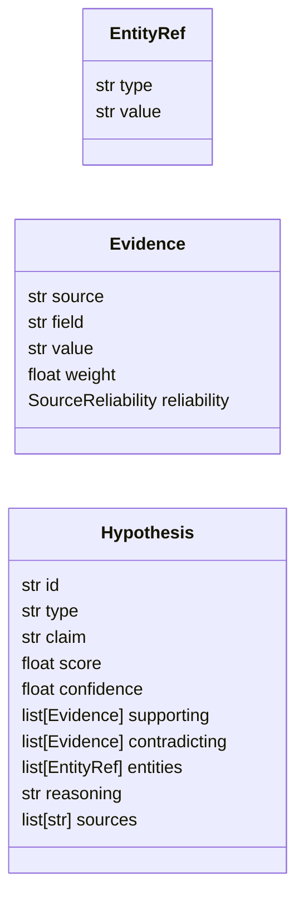

# `estorides_core.hypothesis_engine`

> Source: [estorides_core/hypothesis_engine.py:1](../../estorides_core/hypothesis_engine.py#L1) | language `py` | coverage 100.0% | [API index](../index.md)

estorides_core.hypothesis_engine ================================ The "data → information" layer.

Consumes the per-run ``observations`` and ``entities`` produced by the
orchestrator and emits a deduplicated, scored, auditable list of
typed `[`Hypothesis`](#hypothesis)` records. Each hypothesis carries the evidence
items that justify it (source, field, value, reliability-weighted
weight) and a human-readable `[`claim`](#hypothesis-claim)` and `[`reasoning`](#hypothesis-reasoning)` derived from
templates, not from the LLM.

Pure module: no I/O, no DB writes, no logging, no clock. Same input
⇒ same output, bit-by-bit. Hypothesis ids are content hashes so
duplicate runs produce the same ids and the fusion store can
deduplicate across runs.

Public surface::

    generate_hypotheses(observations, entities, kg=None,
                        min_score=0.10, max_hypotheses=50)
        -> list[Hypothesis]

## Contents

- **Classes:** [`EntityRef`](#entityref), [`Evidence`](#evidence), [`Hypothesis`](#hypothesis)
- **Functions:** [`generate_hypotheses`](#generate_hypotheses)
- **Constants:** [`HYPOTHESIS_TYPES`](#hypothesis_types)

## Type Diagram



## Classes

<a id="entityref"></a>

### `EntityRef`

`class` `dataclass` | [estorides_core/hypothesis_engine.py:57](../../estorides_core/hypothesis_engine.py#L57)

Decorators: `@dataclass(frozen=True)`

```python
class EntityRef
```

A typed reference to an entity involved in a hypothesis.

**Attributes**

| Name | Type | Default | Description |
|---|---|---|---|
| [`type`](#entityref-type) | `str` |  |  |
| [`value`](#entityref-value) | `str` |  |  |

---

<a id="evidence"></a>

### `Evidence`

`class` `dataclass` | [estorides_core/hypothesis_engine.py:65](../../estorides_core/hypothesis_engine.py#L65)

Decorators: `@dataclass(frozen=True)`

```python
class Evidence
```

One piece of supporting or contradicting evidence.

**Attributes**

| Name | Type | Default | Description |
|---|---|---|---|
| [`source`](#evidence-source) | `str` |  |  |
| [`field`](#evidence-field) | `str` |  |  |
| [`value`](#evidence-value) | `str` |  |  |
| [`weight`](#evidence-weight) | `float` |  |  |
| [`reliability`](#evidence-reliability) | `SourceReliability` |  |  |

---

<a id="hypothesis"></a>

### `Hypothesis`

`class` `dataclass` | [estorides_core/hypothesis_engine.py:76](../../estorides_core/hypothesis_engine.py#L76)

Decorators: `@dataclass(frozen=True)`

```python
class Hypothesis
```

A typed, scored, auditable intelligence conclusion.

**Attributes**

| Name | Type | Default | Description |
|---|---|---|---|
| [`id`](#hypothesis-id) | `str` |  |  |
| [`type`](#hypothesis-type) | `str` |  |  |
| [`claim`](#hypothesis-claim) | `str` |  |  |
| [`score`](#hypothesis-score) | `float` |  |  |
| [`confidence`](#hypothesis-confidence) | `float` |  |  |
| [`supporting`](#hypothesis-supporting) | `list[Evidence]` | `field(default_factory=list)` |  |
| [`contradicting`](#hypothesis-contradicting) | `list[Evidence]` | `field(default_factory=list)` |  |
| [`entities`](#hypothesis-entities) | `list[EntityRef]` | `field(default_factory=list)` |  |
| [`reasoning`](#hypothesis-reasoning) | `str` | `''` |  |
| [`sources`](#hypothesis-sources) | `list[str]` | `field(default_factory=list)` |  |

---

## Functions

<a id="generate_hypotheses"></a>

### `generate_hypotheses`

`function` | [estorides_core/hypothesis_engine.py:613](../../estorides_core/hypothesis_engine.py#L613)

```python
def generate_hypotheses(observations: Sequence[Mapping[str, Any]], entities: Sequence[Mapping[str, Any]], kg: Any = None, *, min_score: float = 0.1, max_hypotheses: int = 50) -> list[Hypothesis]
```

Generate typed, scored, auditable hypotheses for a run.

Pure: no I/O, no DB writes, no logging, no clock. Same input ⇒
same output bit-by-bit. Hypothesis ids are content hashes so the
fusion store can deduplicate across runs.

**Parameters**

| Name | Type | Default | Description |
|---|---|---|---|
| `observations` | `Sequence[Mapping[str, Any]]` |  | Per-source observations from the orchestrator. Each one is expected to have at least `[`source`](#evidence-source)` and ``parsed``; the generator skips malformed entries without raising. |
| `entities` | `Sequence[Mapping[str, Any]]` |  | The deduplicated entity list from the orchestrator. Each item can be a dict (``{"type": ..., "value": ...}``) or an `[`Entity`](estorides_core.entity_extraction.py.md#entity)` dataclass. |
| `kg` | `Any` | `None` | Optional knowledge graph. Reserved for future generators (ego-network, motif-based) — ignored in v1. |
| `min_score` | `float` | `0.1` | Floor for the output: hypotheses with score below this are dropped. ``[0, 1]``. |
| `max_hypotheses` | `int` | `50` | Hard cap on the returned list. Top by score. |

**Returns:** `list[Hypothesis]`

**Raises**

- `TypeError`: (raised in the body, not documented)
- `ValueError`: (raised in the body, not documented)

---

## Constants

<a id="hypothesis_types"></a>

### `HYPOTHESIS_TYPES`

`constant` | [estorides_core/hypothesis_engine.py:47](../../estorides_core/hypothesis_engine.py#L47)

```python
HYPOTHESIS_TYPES: frozenset[str]
```

---
