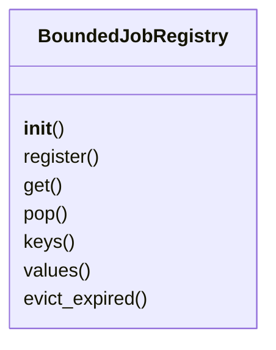

# `estorides_core.job_registry`

> Source: [estorides_core/job_registry.py:1](../../estorides_core/job_registry.py#L1) | language `py` | coverage 66.7% | [API index](../index.md)

estorides_core.job_registry ===========================

Bounded, TTL-aware registry for in-memory job objects (RUN_STREAM_JOBS,
DISCOVER_JOBS, etc.). The plain `Dict[str, _Job]` pattern that the project
shipped with had no eviction at all — see issues #14, #20, #50 — which
let an unauthenticated caller grow server memory without bound by
repeatedly starting short-lived jobs.

Eviction policy
---------------
* **LRU by insertion order** — when the registry hits `max_size`, the
  oldest job is dropped. Python 3.7+ dicts guarantee insertion order so
  `next(iter(reg))` is the oldest.
* **TTL** — every job has a [`created_at`](estorides_core.monitoring.py.md#watchtarget-created_at); a sweep on every [`register`](estorides_llm.manager.py.md#register)
  drops jobs older than [`ttl_seconds`](estorides_core.config.py.md#cacheconfig-ttl_seconds). Cheap when the set is small, and
  a sweep is unnecessary when the set is empty or the entries are
  fresh, so the worst-case extra cost is `O(n)` per call, which is
  dominated by the per-call [`register`](estorides_llm.manager.py.md#register) itself.

Thread safety
-------------
The Flask request handlers that touch these registries run in worker
threads (gunicorn forks, multi-worker wsgi). The [`register`](estorides_llm.manager.py.md#register) /
[`get`](#boundedjobregistry-get) / [`evict_expired`](#boundedjobregistry-evict_expired) / [`pop`](#boundedjobregistry-pop) methods hold a single
`threading.Lock` so a sweep and a [`get`](#boundedjobregistry-get) cannot race. The cost is
the lock acquire on every call, which is negligible compared to the
JSON serialisation that follows.

## Contents

- **Classes:** [`BoundedJobRegistry`](#boundedjobregistry)
- **Constants:** [`V`](#v)

## Type Diagram



## Classes

<a id="boundedjobregistry"></a>

### `BoundedJobRegistry`

`class` | [estorides_core/job_registry.py:40](../../estorides_core/job_registry.py#L40)

```python
class BoundedJobRegistry(Generic[V])
```

Bases: `Generic[V]`

A dict-like registry with size and time bounds.

`max_size` and [`ttl_seconds`](estorides_core.config.py.md#cacheconfig-ttl_seconds) are read at construction and not
mutated — the registry is "configured once, used many times",
which matches how the web app's STREAM config is loaded at
import time.

**Members**

| Member | Kind | Summary |
|---|---|---|
| [`__init__`](#boundedjobregistry-__init__) | constructor |  |
| [`register`](#boundedjobregistry-register) | method | Insert (or replace) a job, evicting expired and overflow entries. |
| [`get`](#boundedjobregistry-get) | method | Return the value for [`key`](estorides_core.search_telemetry.py.md#searchphase-key) or None. |
| [`pop`](#boundedjobregistry-pop) | method | Remove and return the value for [`key`](estorides_core.search_telemetry.py.md#searchphase-key), or None. |
| [`keys`](#boundedjobregistry-keys) | method |  |
| [`values`](#boundedjobregistry-values) | method |  |
| [`evict_expired`](#boundedjobregistry-evict_expired) | method | Sweep and drop TTL-expired entries. |

<a id="boundedjobregistry-__init__"></a>

#### `BoundedJobRegistry.__init__`

`constructor` | [estorides_core/job_registry.py:49](../../estorides_core/job_registry.py#L49)

```python
def __init__(self, *, max_size: int, ttl_seconds: float) -> None
```

**Parameters**

| Name | Type | Default | Description |
|---|---|---|---|
| `max_size` | `int` |  |  |
| `ttl_seconds` | `float` |  |  |

**Raises**

- `ValueError`: (raised in the body, not documented)

<a id="boundedjobregistry-register"></a>

#### `BoundedJobRegistry.register`

`method` | [estorides_core/job_registry.py:60](../../estorides_core/job_registry.py#L60)

```python
def register(self, key: str, value: V) -> V
```

Insert (or replace) a job, evicting expired and overflow entries.

Returns the value so the caller can use it inline:
    job = registry.register("abc", _RunStreamJob(...))

**Parameters**

| Name | Type | Default | Description |
|---|---|---|---|
| `key` | `str` |  |  |
| `value` | `V` |  |  |

**Returns:** `V`

<a id="boundedjobregistry-get"></a>

#### `BoundedJobRegistry.get`

`method` | [estorides_core/job_registry.py:80](../../estorides_core/job_registry.py#L80)

```python
def get(self, key: str) -> V | None
```

Return the value for [`key`](estorides_core.search_telemetry.py.md#searchphase-key) or None.

Refreshes the LRU order.

**Parameters**

| Name | Type | Default | Description |
|---|---|---|---|
| `key` | `str` |  |  |

**Returns:** `V | None`

<a id="boundedjobregistry-pop"></a>

#### `BoundedJobRegistry.pop`

`method` | [estorides_core/job_registry.py:95](../../estorides_core/job_registry.py#L95)

```python
def pop(self, key: str) -> V | None
```

Remove and return the value for [`key`](estorides_core.search_telemetry.py.md#searchphase-key), or None.

**Parameters**

| Name | Type | Default | Description |
|---|---|---|---|
| `key` | `str` |  |  |

**Returns:** `V | None`

<a id="boundedjobregistry-keys"></a>

#### `BoundedJobRegistry.keys`

`method` | [estorides_core/job_registry.py:101](../../estorides_core/job_registry.py#L101)

```python
def keys(self) -> list[str]
```

**Returns:** `list[str]`

<a id="boundedjobregistry-values"></a>

#### `BoundedJobRegistry.values`

`method` | [estorides_core/job_registry.py:105](../../estorides_core/job_registry.py#L105)

```python
def values(self) -> list[V]
```

**Returns:** `list[V]`

<a id="boundedjobregistry-evict_expired"></a>

#### `BoundedJobRegistry.evict_expired`

`method` | [estorides_core/job_registry.py:113](../../estorides_core/job_registry.py#L113)

```python
def evict_expired(self) -> int
```

Sweep and drop TTL-expired entries.

Returns the number dropped.

**Returns:** `int`

---

## Constants

<a id="v"></a>

### `V`

`constant` | [estorides_core/job_registry.py:37](../../estorides_core/job_registry.py#L37)

```python
V = TypeVar('V')
```

---
