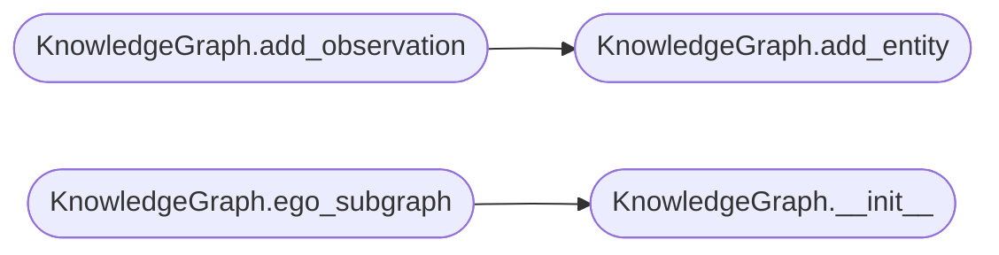

# `estorides_core.knowledge_graph`

> Source: [estorides_core/knowledge_graph.py:1](../../estorides_core/knowledge_graph.py#L1) | language `py` | coverage 40.0% | [API index](../index.md)

estorides_core.knowledge_graph ============================== Persistent in-memory knowledge graph backed by NetworkX.

Nodes = entities (domain, ip, email, person, organisation, cve, etc.)
Edges = relationships discovered between them
   * "observed_by"   entity -> source
   * "resolved_to"   domain -> ip
   * "co_occurs"     entity <-> entity   (appeared in the same response)
   * "mentions"      source -> entity
   * "located_in"    entity -> place
   * "registered_by" domain -> org
   * "has_cve"       ip/port -> cve

GraphML is dumped to disk for analysis in Gephi / Cytoscape / Neo4j.

## Contents

- **Classes:** [`KnowledgeGraph`](#knowledgegraph)
- **Constants:** [`NODE_KIND`](#node_kind), [`CO_OCCUR_EDGE`](#co_occur_edge), [`INTEL_LEVELS`](#intel_levels), [`THREAT_SOURCES`](#threat_sources), [`RESOLVER_RELATIONS`](#resolver_relations)

## Call Graph

Solid arrows stay in this module, dashed arrows leave it.



## Classes

<a id="knowledgegraph"></a>

### `KnowledgeGraph`

`class` | [estorides_core/knowledge_graph.py:90](../../estorides_core/knowledge_graph.py#L90)

```python
class KnowledgeGraph
```

**Attributes**

| Name | Type | Default | Description |
|---|---|---|---|
| [`LAZYOWN_TYPE_MAP`](#knowledgegraph-lazyown_type_map) | `Dict[str, str]` | `{'ipv4': 'host', 'ipv6': 'host', 'domain': 'domain', 'cve': 'finding', 'ghsa': 'finding', 'url': 'url', 'email': 'email', 'asn': 'asn', 'mac': 'mac'}` |  |

**Members**

| Member | Kind | Summary |
|---|---|---|
| [`__init__`](#knowledgegraph-__init__) | constructor |  |
| [`add_entity`](#knowledgegraph-add_entity) | method | Insert an entity. |
| [`add_observation`](#knowledgegraph-add_observation) | method | Add every entity + every co-occurrence edge within the same response. |
| [`add_relationship`](#knowledgegraph-add_relationship) | method |  |
| [`export_graphml`](#knowledgegraph-export_graphml) | method |  |
| [`export_json`](#knowledgegraph-export_json) | method |  |
| [`export_lazyown`](#knowledgegraph-export_lazyown) | method | Emit the graph in LazyOwn intel vocabulary (JSON-serializable). |
| [`summary`](#knowledgegraph-summary) | method |  |
| [`top_entities`](#knowledgegraph-top_entities) | method |  |
| [`communities`](#knowledgegraph-communities) | method | Partition entity nodes into communities (clusters). |
| [`intel_level`](#knowledgegraph-intel_level) | method | Classify a node into the intelligence pipeline tier. |
| [`ego_subgraph`](#knowledgegraph-ego_subgraph) | method |  |
| [`neighbours`](#knowledgegraph-neighbours) | method |  |

<a id="knowledgegraph-__init__"></a>

#### `KnowledgeGraph.__init__`

`constructor` | [estorides_core/knowledge_graph.py:91](../../estorides_core/knowledge_graph.py#L91)

```python
def __init__(self, name: str = 'estorides') -> None
```

**Parameters**

| Name | Type | Default | Description |
|---|---|---|---|
| `name` | `str` | `'estorides'` |  |

*Called by:* [`cmd_export_misp`](estorides_cli.py.md#cmd_export_misp), [`cmd_export_stix`](estorides_cli.py.md#cmd_export_stix), [`cmd_graph_export`](estorides_cli.py.md#cmd_graph_export), [`KnowledgeGraph.ego_subgraph`](#knowledgegraph-ego_subgraph), [`Orchestrator.__init__`](estorides_core.orchestrator.py.md#orchestrator-__init__), [`create_app`](estorides_web.py.md#create_app)

<a id="knowledgegraph-add_entity"></a>

#### `KnowledgeGraph.add_entity`

`method` | [estorides_core/knowledge_graph.py:97](../../estorides_core/knowledge_graph.py#L97)

```python
def add_entity(self, entity: Entity) -> str
```

Insert an entity.

Returns the node id used.

**Parameters**

| Name | Type | Default | Description |
|---|---|---|---|
| `entity` | `Entity` |  |  |

**Returns:** `str`

*Called by:* [`KnowledgeGraph.add_observation`](#knowledgegraph-add_observation)

<a id="knowledgegraph-add_observation"></a>

#### `KnowledgeGraph.add_observation`

`method` | [estorides_core/knowledge_graph.py:127](../../estorides_core/knowledge_graph.py#L127)

```python
def add_observation(self, source: str, entities: List[Entity]) -> None
```

Add every entity + every co-occurrence edge within the same response.

**Parameters**

| Name | Type | Default | Description |
|---|---|---|---|
| `source` | `str` |  |  |
| `entities` | `List[Entity]` |  |  |

*Calls:* [`KnowledgeGraph.add_entity`](#knowledgegraph-add_entity)

<a id="knowledgegraph-add_relationship"></a>

#### `KnowledgeGraph.add_relationship`

`method` | [estorides_core/knowledge_graph.py:142](../../estorides_core/knowledge_graph.py#L142)

```python
def add_relationship(self, src_type: str, src_value: str, rel: str, dst_type: str, dst_value: str, **attrs: Any) -> None
```

**Parameters**

| Name | Type | Default | Description |
|---|---|---|---|
| `src_type` | `str` |  |  |
| `src_value` | `str` |  |  |
| `rel` | `str` |  |  |
| `dst_type` | `str` |  |  |
| `dst_value` | `str` |  |  |
| `**attrs` | `Any` |  |  |

<a id="knowledgegraph-export_graphml"></a>

#### `KnowledgeGraph.export_graphml`

`method` | [estorides_core/knowledge_graph.py:164](../../estorides_core/knowledge_graph.py#L164)

```python
def export_graphml(self, path: Optional[Path] = None) -> Path
```

**Parameters**

| Name | Type | Default | Description |
|---|---|---|---|
| `path` | `Optional[Path]` | `None` |  |

**Returns:** `Path`

*Called by:* [`cmd_graph_export`](estorides_cli.py.md#cmd_graph_export), [`create_app`](estorides_web.py.md#create_app)

<a id="knowledgegraph-export_json"></a>

#### `KnowledgeGraph.export_json`

`method` | [estorides_core/knowledge_graph.py:183](../../estorides_core/knowledge_graph.py#L183)

```python
def export_json(self) -> Dict[str, Any]
```

**Returns:** `Dict[str, Any]`

*Called by:* [`cmd_graph_export`](estorides_cli.py.md#cmd_graph_export), [`create_app`](estorides_web.py.md#create_app)

<a id="knowledgegraph-export_lazyown"></a>

#### `KnowledgeGraph.export_lazyown`

`method` | [estorides_core/knowledge_graph.py:207](../../estorides_core/knowledge_graph.py#L207)

```python
def export_lazyown(self) -> Dict[str, Any]
```

Emit the graph in LazyOwn intel vocabulary (JSON-serializable).

**Returns:** `Dict[str, Any]`

*Called by:* [`cmd_graph_export`](estorides_cli.py.md#cmd_graph_export)

<a id="knowledgegraph-summary"></a>

#### `KnowledgeGraph.summary`

`method` | [estorides_core/knowledge_graph.py:243](../../estorides_core/knowledge_graph.py#L243)

```python
def summary(self) -> Dict[str, Any]
```

**Returns:** `Dict[str, Any]`

*Called by:* [`create_app`](estorides_web.py.md#create_app)

<a id="knowledgegraph-top_entities"></a>

#### `KnowledgeGraph.top_entities`

`method` | [estorides_core/knowledge_graph.py:261](../../estorides_core/knowledge_graph.py#L261)

```python
def top_entities(self, n: int = 20, by: str = 'degree') -> List[Dict[str, Any]]
```

**Parameters**

| Name | Type | Default | Description |
|---|---|---|---|
| `n` | `int` | `20` |  |
| `by` | `str` | `'degree'` |  |

**Returns:** `List[Dict[str, Any]]`

*Called by:* [`create_app`](estorides_web.py.md#create_app)

<a id="knowledgegraph-communities"></a>

#### `KnowledgeGraph.communities`

`method` | [estorides_core/knowledge_graph.py:281](../../estorides_core/knowledge_graph.py#L281)

```python
def communities(self, nodes: Optional[Iterable[str]] = None) -> Dict[str, int]
```

Partition entity nodes into communities (clusters).

Runs greedy modularity on the undirected projection, restricted
to [`nodes`](static.js.graph_force.js.md#nodes) when given and always excluding `source` nodes (whose
fan-out would otherwise collapse every cluster into one). Returns
a `node_id -> community index` map. Falls back to connected
components when modularity cannot be computed (e.g. no edges).

**Parameters**

| Name | Type | Default | Description |
|---|---|---|---|
| `nodes` | `Optional[Iterable[str]]` | `None` |  |

**Returns:** `Dict[str, int]`

*Called by:* [`create_app`](estorides_web.py.md#create_app)

<a id="knowledgegraph-intel_level"></a>

#### `KnowledgeGraph.intel_level`

`method` | [estorides_core/knowledge_graph.py:312](../../estorides_core/knowledge_graph.py#L312)

```python
def intel_level(self, node_id: str, bridge_nodes: Optional[set] = None) -> str
```

Classify a node into the intelligence pipeline tier.

data                  single corroborating source
information           >= 2 distinct sources
intelligence          cross-cluster bridge or resolved relation
counter_intelligence  sanction/threat/VirusTotal-malicious signal

Higher tiers win. `bridge_nodes` is the set of nodes that sit on
an inter-cluster edge (computed once by the caller).

**Parameters**

| Name | Type | Default | Description |
|---|---|---|---|
| `node_id` | `str` |  |  |
| `bridge_nodes` | `Optional[set]` | `None` |  |

**Returns:** `str`

*Called by:* [`create_app`](estorides_web.py.md#create_app)

<a id="knowledgegraph-ego_subgraph"></a>

#### `KnowledgeGraph.ego_subgraph`

`method` | [estorides_core/knowledge_graph.py:357](../../estorides_core/knowledge_graph.py#L357)

```python
def ego_subgraph(self, node_id: str, radius: int = 1) -> 'KnowledgeGraph'
```

**Parameters**

| Name | Type | Default | Description |
|---|---|---|---|
| `node_id` | `str` |  |  |
| `radius` | `int` | `1` |  |

**Returns:** `'KnowledgeGraph'`

**Raises**

- `KeyError`: (raised in the body, not documented)

*Calls:* [`KnowledgeGraph.__init__`](#knowledgegraph-__init__)

<a id="knowledgegraph-neighbours"></a>

#### `KnowledgeGraph.neighbours`

`method` | [estorides_core/knowledge_graph.py:368](../../estorides_core/knowledge_graph.py#L368)

```python
def neighbours(self, node_id: str, relation: Optional[str] = None) -> List[Dict[str, Any]]
```

**Parameters**

| Name | Type | Default | Description |
|---|---|---|---|
| `node_id` | `str` |  |  |
| `relation` | `Optional[str]` | `None` |  |

**Returns:** `List[Dict[str, Any]]`

---

## Constants

<a id="node_kind"></a>

### `NODE_KIND`

`constant` | [estorides_core/knowledge_graph.py:36](../../estorides_core/knowledge_graph.py#L36)

```python
NODE_KIND: Dict[str, str]
```

---

<a id="co_occur_edge"></a>

### `CO_OCCUR_EDGE`

`constant` | [estorides_core/knowledge_graph.py:47](../../estorides_core/knowledge_graph.py#L47)

```python
CO_OCCUR_EDGE = 'co_occurs'
```

---

<a id="intel_levels"></a>

### `INTEL_LEVELS`

`constant` | [estorides_core/knowledge_graph.py:51](../../estorides_core/knowledge_graph.py#L51)

```python
INTEL_LEVELS: Tuple[str, ...] = ('data', 'information', 'intelligence', 'counter_intelligence')
```

---

<a id="threat_sources"></a>

### `THREAT_SOURCES`

`constant` | [estorides_core/knowledge_graph.py:57](../../estorides_core/knowledge_graph.py#L57)

```python
THREAT_SOURCES
```

---

<a id="resolver_relations"></a>

### `RESOLVER_RELATIONS`

`constant` | [estorides_core/knowledge_graph.py:65](../../estorides_core/knowledge_graph.py#L65)

```python
RESOLVER_RELATIONS
```

---
