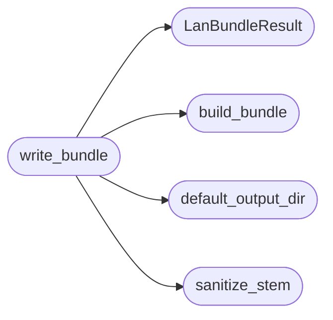

# `estorides_core.lan_bundle`

> Source: [estorides_core/lan_bundle.py:1](../../estorides_core/lan_bundle.py#L1) | language `py` | coverage 85.7% | [API index](../index.md)

estorides_core.lan_bundle ========================= LAN output deliverables for automation.

Builds inventory, graph, LazyOwn, and STIX payloads from LanDevice
lists and writes them atomically to an output directory.

## Contents

- **Classes:** [`LanBundleResult`](#lanbundleresult)
- **Functions:** [`sanitize_stem`](#sanitize_stem), [`default_output_dir`](#default_output_dir), [`build_bundle`](#build_bundle), [`write_bundle`](#write_bundle)
- **Constants:** [`SCHEMA_VERSION`](#schema_version)

## Call Graph

Solid arrows stay in this module, dashed arrows leave it.



## Classes

<a id="lanbundleresult"></a>

### `LanBundleResult`

`class` `dataclass` | [estorides_core/lan_bundle.py:351](../../estorides_core/lan_bundle.py#L351)

Decorators: `@dataclass`

```python
class LanBundleResult
```

Outcome of write_bundle.

Failures are values, never raises.

**Attributes**

| Name | Type | Default | Description |
|---|---|---|---|
| [`paths`](#lanbundleresult-paths) | `dict[str, str]` | `field(default_factory=dict)` |  |
| [`errors`](#lanbundleresult-errors) | `list[str]` | `field(default_factory=list)` |  |
| [`device_count`](#lanbundleresult-device_count) | `int` | `0` |  |
| [`node_count`](#lanbundleresult-node_count) | `int` | `0` |  |

**Members**

| Member | Kind | Summary |
|---|---|---|
| [`to_dict`](#lanbundleresult-to_dict) | method |  |

<a id="lanbundleresult-to_dict"></a>

#### `LanBundleResult.to_dict`

`method` | [estorides_core/lan_bundle.py:359](../../estorides_core/lan_bundle.py#L359)

```python
def to_dict(self) -> dict[str, Any]
```

**Returns:** `dict[str, Any]`

---

## Functions

<a id="sanitize_stem"></a>

### `sanitize_stem`

`function` | [estorides_core/lan_bundle.py:29](../../estorides_core/lan_bundle.py#L29)

```python
def sanitize_stem(stem: Any) -> str
```

Sanitize a file stem.

Bad input falls back to lan.

**Parameters**

| Name | Type | Default | Description |
|---|---|---|---|
| `stem` | `Any` |  |  |

**Returns:** `str`

*Called by:* [`write_bundle`](#write_bundle)

---

<a id="default_output_dir"></a>

### `default_output_dir`

`function` | [estorides_core/lan_bundle.py:40](../../estorides_core/lan_bundle.py#L40)

```python
def default_output_dir() -> Path
```

Resolve the LAN output directory from env or data default.

**Returns:** `Path`

*Called by:* [`write_bundle`](#write_bundle)

---

<a id="build_bundle"></a>

### `build_bundle`

`function` | [estorides_core/lan_bundle.py:48](../../estorides_core/lan_bundle.py#L48)

```python
def build_bundle(devices: list[Any], *, scope_cidr: str | None = None, generated_at: float | None = None) -> dict[str, Any]
```

Build all four payloads.

Never raises on bad items.

**Parameters**

| Name | Type | Default | Description |
|---|---|---|---|
| `devices` | `list[Any]` |  |  |
| `scope_cidr` | `str \| None` | `None` |  |
| `generated_at` | `float \| None` | `None` |  |

**Returns:** `dict[str, Any]`

*Called by:* [`write_bundle`](#write_bundle)

---

<a id="write_bundle"></a>

### `write_bundle`

`function` | [estorides_core/lan_bundle.py:363](../../estorides_core/lan_bundle.py#L363)

```python
def write_bundle(devices: list[Any], *, output_dir: str | Path | None = None, stem: str = 'lan', scope_cidr: str | None = None) -> LanBundleResult
```

Write all four deliverables atomically.

Never raises.

**Parameters**

| Name | Type | Default | Description |
|---|---|---|---|
| `devices` | `list[Any]` |  |  |
| `output_dir` | `str \| Path \| None` | `None` |  |
| `stem` | `str` | `'lan'` |  |
| `scope_cidr` | `str \| None` | `None` |  |

**Returns:** `LanBundleResult`

*Calls:* [`LanBundleResult`](#lanbundleresult), [`build_bundle`](#build_bundle), [`default_output_dir`](#default_output_dir), [`sanitize_stem`](#sanitize_stem)

---

## Constants

<a id="schema_version"></a>

### `SCHEMA_VERSION`

`constant` | [estorides_core/lan_bundle.py:25](../../estorides_core/lan_bundle.py#L25)

```python
SCHEMA_VERSION = 1
```

---
