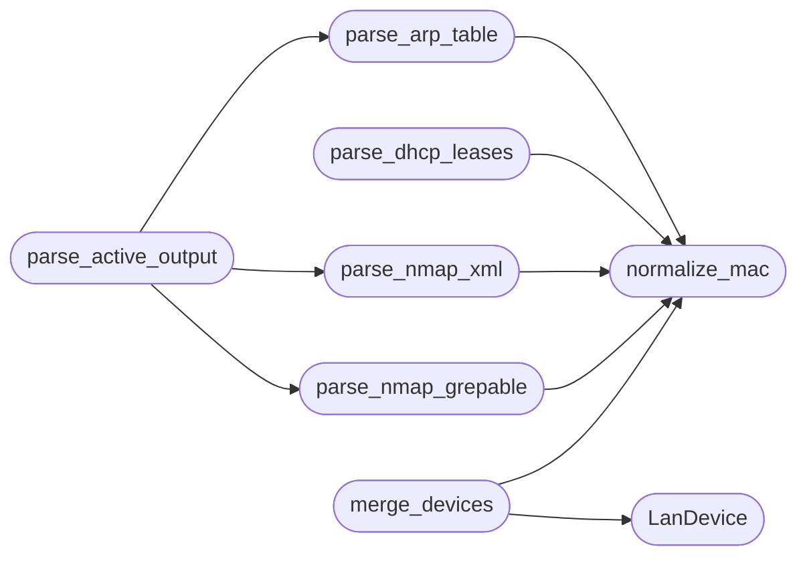

# `estorides_core.lan_inventory`

> Source: [estorides_core/lan_inventory.py:1](../../estorides_core/lan_inventory.py#L1) | language `py` | coverage 91.7% | [API index](../index.md)

estorides_core.lan_inventory ============================ Passive-first LAN device inventory.

Pure parsers for ARP/neighbor tables and DHCP leases plus MAC-keyed
device merging. No sockets, no subprocess, no file reads.

## Contents

- **Classes:** [`LanDevice`](#landevice)
- **Functions:** [`normalize_mac`](#normalize_mac), [`parse_arp_table`](#parse_arp_table), [`parse_dhcp_leases`](#parse_dhcp_leases), [`parse_nmap_xml`](#parse_nmap_xml), [`parse_nmap_grepable`](#parse_nmap_grepable), [`parse_active_output`](#parse_active_output), [`merge_devices`](#merge_devices), [`device_to_entities`](#device_to_entities), [`contact_for_tool`](#contact_for_tool)
- **Constants:** [`PASSIVE_TOOLS`](#passive_tools), [`ACTIVE_TOOLS`](#active_tools), [`NMAP_XML_MAX_BYTES`](#nmap_xml_max_bytes)

## Call Graph

Solid arrows stay in this module, dashed arrows leave it.



## Classes

<a id="landevice"></a>

### `LanDevice`

`class` `dataclass` | [estorides_core/lan_inventory.py:51](../../estorides_core/lan_inventory.py#L51)

Decorators: `@dataclass(frozen=True)`

```python
class LanDevice
```

One physical host, merged from one or more sightings.

**Attributes**

| Name | Type | Default | Description |
|---|---|---|---|
| [`device_id`](#landevice-device_id) | `str` |  |  |
| [`ips`](#landevice-ips) | `tuple[str, ...]` | `()` |  |
| [`mac`](#landevice-mac) | `str \| None` | `None` |  |
| [`hostnames`](#landevice-hostnames) | `tuple[str, ...]` | `()` |  |
| [`sources`](#landevice-sources) | `tuple[str, ...]` | `()` |  |

**Members**

| Member | Kind | Summary |
|---|---|---|
| [`to_dict`](#landevice-to_dict) | method |  |

<a id="landevice-to_dict"></a>

#### `LanDevice.to_dict`

`method` | [estorides_core/lan_inventory.py:60](../../estorides_core/lan_inventory.py#L60)

```python
def to_dict(self) -> dict[str, Any]
```

**Returns:** `dict[str, Any]`

---

## Functions

<a id="normalize_mac"></a>

### `normalize_mac`

`function` | [estorides_core/lan_inventory.py:64](../../estorides_core/lan_inventory.py#L64)

```python
def normalize_mac(raw: Any) -> str | None
```

Normalize MAC to lowercase colon form, or None when invalid.

**Parameters**

| Name | Type | Default | Description |
|---|---|---|---|
| `raw` | `Any` |  |  |

**Returns:** `str | None`

*Called by:* [`merge_devices`](#merge_devices), [`parse_arp_table`](#parse_arp_table), [`parse_dhcp_leases`](#parse_dhcp_leases), [`parse_nmap_grepable`](#parse_nmap_grepable), [`parse_nmap_xml`](#parse_nmap_xml)

---

<a id="parse_arp_table"></a>

### `parse_arp_table`

`function` | [estorides_core/lan_inventory.py:91](../../estorides_core/lan_inventory.py#L91)

```python
def parse_arp_table(text: str) -> list[dict[str, Any]]
```

Parse `ip neigh` or /proc/net/arp text into sightings.

**Parameters**

| Name | Type | Default | Description |
|---|---|---|---|
| `text` | `str` |  |  |

**Returns:** `list[dict[str, Any]]`

*Calls:* [`normalize_mac`](#normalize_mac)

*Called by:* [`parse_active_output`](#parse_active_output)

---

<a id="parse_dhcp_leases"></a>

### `parse_dhcp_leases`

`function` | [estorides_core/lan_inventory.py:119](../../estorides_core/lan_inventory.py#L119)

```python
def parse_dhcp_leases(text: str) -> list[dict[str, Any]]
```

Parse dnsmasq lease lines into sightings.

**Parameters**

| Name | Type | Default | Description |
|---|---|---|---|
| `text` | `str` |  |  |

**Returns:** `list[dict[str, Any]]`

*Calls:* [`normalize_mac`](#normalize_mac)

---

<a id="parse_nmap_xml"></a>

### `parse_nmap_xml`

`function` | [estorides_core/lan_inventory.py:152](../../estorides_core/lan_inventory.py#L152)

```python
def parse_nmap_xml(text: str) -> list[dict[str, Any]]
```

Parse nmap -oX output into sightings.

Fail-soft, size-capped.

**Parameters**

| Name | Type | Default | Description |
|---|---|---|---|
| `text` | `str` |  |  |

**Returns:** `list[dict[str, Any]]`

*Calls:* [`normalize_mac`](#normalize_mac)

*Called by:* [`parse_active_output`](#parse_active_output)

---

<a id="parse_nmap_grepable"></a>

### `parse_nmap_grepable`

`function` | [estorides_core/lan_inventory.py:214](../../estorides_core/lan_inventory.py#L214)

```python
def parse_nmap_grepable(text: str) -> list[dict[str, Any]]
```

Parse nmap -oG output into sightings.

Fail-soft.

**Parameters**

| Name | Type | Default | Description |
|---|---|---|---|
| `text` | `str` |  |  |

**Returns:** `list[dict[str, Any]]`

*Calls:* [`normalize_mac`](#normalize_mac)

*Called by:* [`parse_active_output`](#parse_active_output)

---

<a id="parse_active_output"></a>

### `parse_active_output`

`function` | [estorides_core/lan_inventory.py:252](../../estorides_core/lan_inventory.py#L252)

```python
def parse_active_output(text: str, source: str) -> list[dict[str, Any]]
```

Dispatch active-tool output by format, tagged with source.

**Parameters**

| Name | Type | Default | Description |
|---|---|---|---|
| `text` | `str` |  |  |
| `source` | `str` |  |  |

**Returns:** `list[dict[str, Any]]`

*Calls:* [`parse_arp_table`](#parse_arp_table), [`parse_nmap_grepable`](#parse_nmap_grepable), [`parse_nmap_xml`](#parse_nmap_xml)

---

<a id="merge_devices"></a>

### `merge_devices`

`function` | [estorides_core/lan_inventory.py:269](../../estorides_core/lan_inventory.py#L269)

```python
def merge_devices(sightings: list[dict[str, Any]]) -> list[LanDevice]
```

Merge sightings by MAC, falling back to IP.

Never raises.

**Parameters**

| Name | Type | Default | Description |
|---|---|---|---|
| `sightings` | `list[dict[str, Any]]` |  |  |

**Returns:** `list[LanDevice]`

*Calls:* [`LanDevice`](#landevice), [`normalize_mac`](#normalize_mac)

---

<a id="device_to_entities"></a>

### `device_to_entities`

`function` | [estorides_core/lan_inventory.py:331](../../estorides_core/lan_inventory.py#L331)

```python
def device_to_entities(device: LanDevice) -> list[dict[str, Any]]
```

Convert a device into graph-ready entity dicts.

**Parameters**

| Name | Type | Default | Description |
|---|---|---|---|
| `device` | `LanDevice` |  |  |

**Returns:** `list[dict[str, Any]]`

---

<a id="contact_for_tool"></a>

### `contact_for_tool`

`function` | [estorides_core/lan_inventory.py:352](../../estorides_core/lan_inventory.py#L352)

```python
def contact_for_tool(tool: str) -> str
```

Map a tool name to its contact class.

Unknown means active.

**Parameters**

| Name | Type | Default | Description |
|---|---|---|---|
| `tool` | `str` |  |  |

**Returns:** `str`

---

## Constants

<a id="passive_tools"></a>

### `PASSIVE_TOOLS`

`constant` | [estorides_core/lan_inventory.py:30](../../estorides_core/lan_inventory.py#L30)

```python
PASSIVE_TOOLS = frozenset({'ip-neigh', 'dhcp-leases', 'mdns-listen', 'ssdp-listen'})
```

---

<a id="active_tools"></a>

### `ACTIVE_TOOLS`

`constant` | [estorides_core/lan_inventory.py:32](../../estorides_core/lan_inventory.py#L32)

```python
ACTIVE_TOOLS
```

---

<a id="nmap_xml_max_bytes"></a>

### `NMAP_XML_MAX_BYTES`

`constant` | [estorides_core/lan_inventory.py:141](../../estorides_core/lan_inventory.py#L141)

```python
NMAP_XML_MAX_BYTES = 2097152
```

---
