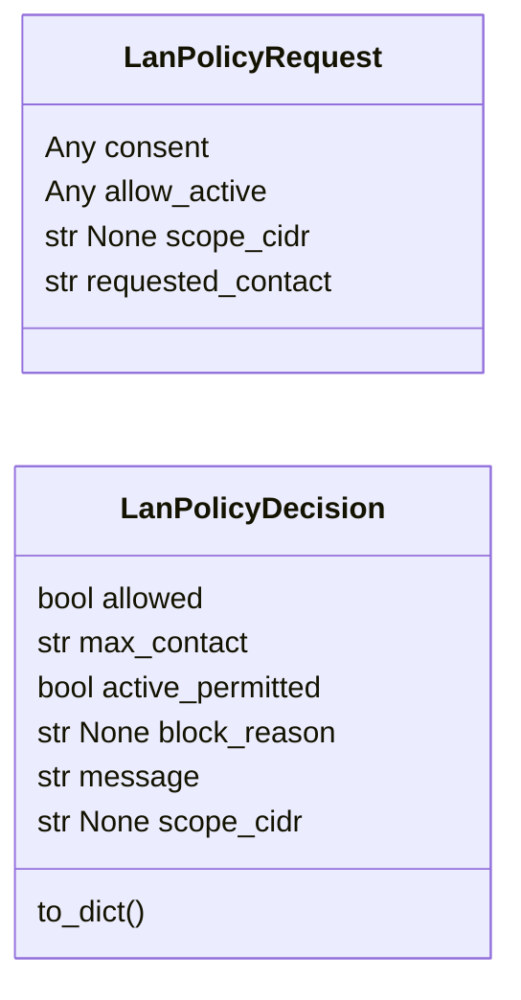
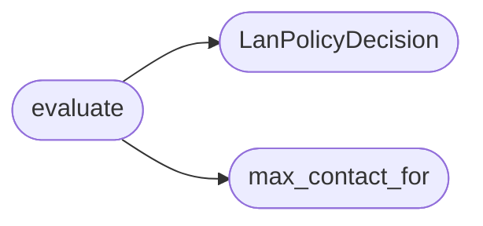

# `estorides_core.lan_policy`

> Source: [estorides_core/lan_policy.py:1](../../estorides_core/lan_policy.py#L1) | language `py` | coverage 85.7% | [API index](../index.md)

estorides_core.lan_policy ========================= Authorization and contact ceiling for LAN discovery runs.

Single enforcement point for the web active-scan checkbox and the
blocking consent gate. Pure: no I/O, no sockets, no subprocess.

## Contents

- **Classes:** [`LanPolicyRequest`](#lanpolicyrequest), [`LanPolicyDecision`](#lanpolicydecision)
- **Functions:** [`requires_consent`](#requires_consent), [`max_contact_for`](#max_contact_for), [`evaluate`](#evaluate)
- **Constants:** [`LAN_ALLOW_ACTIVE_ENV`](#lan_allow_active_env), [`VALID_CONTACTS`](#valid_contacts), [`CONSENT_NOTICE`](#consent_notice)

## Type Diagram



## Call Graph

Solid arrows stay in this module, dashed arrows leave it.



## Classes

<a id="lanpolicyrequest"></a>

### `LanPolicyRequest`

`class` `dataclass` | [estorides_core/lan_policy.py:30](../../estorides_core/lan_policy.py#L30)

Decorators: `@dataclass(frozen=True)`

```python
class LanPolicyRequest
```

Caller intent for a LAN discovery run.

**Attributes**

| Name | Type | Default | Description |
|---|---|---|---|
| [`consent`](#lanpolicyrequest-consent) | `Any` | `False` |  |
| [`allow_active`](#lanpolicyrequest-allow_active) | `Any` | `False` |  |
| [`scope_cidr`](#lanpolicyrequest-scope_cidr) | `str \| None` | `None` |  |
| [`requested_contact`](#lanpolicyrequest-requested_contact) | `str` | `'none'` |  |

---

<a id="lanpolicydecision"></a>

### `LanPolicyDecision`

`class` `dataclass` | [estorides_core/lan_policy.py:40](../../estorides_core/lan_policy.py#L40)

Decorators: `@dataclass(frozen=True)`

```python
class LanPolicyDecision
```

Outcome of policy evaluation.

JSON serializable via to_dict.

**Attributes**

| Name | Type | Default | Description |
|---|---|---|---|
| [`allowed`](#lanpolicydecision-allowed) | `bool` |  |  |
| [`max_contact`](#lanpolicydecision-max_contact) | `str` |  |  |
| [`active_permitted`](#lanpolicydecision-active_permitted) | `bool` |  |  |
| [`block_reason`](#lanpolicydecision-block_reason) | `str \| None` |  |  |
| [`message`](#lanpolicydecision-message) | `str` |  |  |
| [`scope_cidr`](#lanpolicydecision-scope_cidr) | `str \| None` | `None` |  |

**Members**

| Member | Kind | Summary |
|---|---|---|
| [`to_dict`](#lanpolicydecision-to_dict) | method |  |

<a id="lanpolicydecision-to_dict"></a>

#### `LanPolicyDecision.to_dict`

`method` | [estorides_core/lan_policy.py:50](../../estorides_core/lan_policy.py#L50)

```python
def to_dict(self) -> dict[str, Any]
```

**Returns:** `dict[str, Any]`

---

## Functions

<a id="requires_consent"></a>

### `requires_consent`

`function` | [estorides_core/lan_policy.py:54](../../estorides_core/lan_policy.py#L54)

```python
def requires_consent() -> str
```

Return the canonical consent notice for the blocking modal.

**Returns:** `str`

---

<a id="max_contact_for"></a>

### `max_contact_for`

`function` | [estorides_core/lan_policy.py:97](../../estorides_core/lan_policy.py#L97)

```python
def max_contact_for(allow_active: bool, consent: bool) -> str
```

Return active only on the triple gate, else none.

**Parameters**

| Name | Type | Default | Description |
|---|---|---|---|
| `allow_active` | `bool` |  |  |
| `consent` | `bool` |  |  |

**Returns:** `str`

*Called by:* [`evaluate`](#evaluate)

---

<a id="evaluate"></a>

### `evaluate`

`function` | [estorides_core/lan_policy.py:104](../../estorides_core/lan_policy.py#L104)

```python
def evaluate(request: LanPolicyRequest) -> LanPolicyDecision
```

Evaluate a LAN policy request.

Never raises on bad input.

**Parameters**

| Name | Type | Default | Description |
|---|---|---|---|
| `request` | `LanPolicyRequest` |  |  |

**Returns:** `LanPolicyDecision`

*Calls:* [`LanPolicyDecision`](#lanpolicydecision), [`max_contact_for`](#max_contact_for)

*Called by:* [`guard`](estorides_core.lan_web.py.md#guard)

---

## Constants

<a id="lan_allow_active_env"></a>

### `LAN_ALLOW_ACTIVE_ENV`

`constant` | [estorides_core/lan_policy.py:17](../../estorides_core/lan_policy.py#L17)

```python
LAN_ALLOW_ACTIVE_ENV = 'ESTORIDES_LAN_ALLOW_ACTIVE'
```

---

<a id="valid_contacts"></a>

### `VALID_CONTACTS`

`constant` | [estorides_core/lan_policy.py:19](../../estorides_core/lan_policy.py#L19)

```python
VALID_CONTACTS = ('none', 'broker', 'active')
```

---

<a id="consent_notice"></a>

### `CONSENT_NOTICE`

`constant` | [estorides_core/lan_policy.py:21](../../estorides_core/lan_policy.py#L21)

```python
CONSENT_NOTICE
```

---
