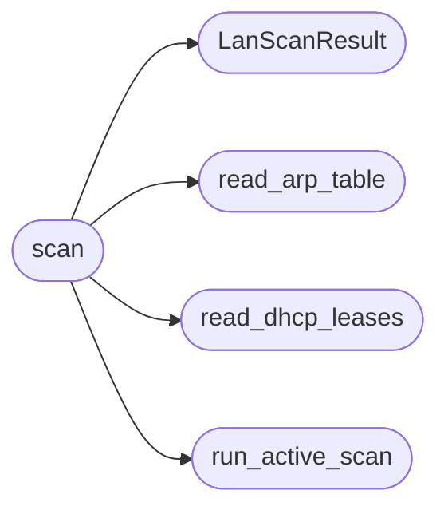

# `estorides_core.lan_runner`

> Source: [estorides_core/lan_runner.py:1](../../estorides_core/lan_runner.py#L1) | language `py` | coverage 85.7% | [API index](../index.md)

estorides_core.lan_runner ========================= Real LAN scan execution: passive readers plus one gated active tool.

Readers are injectable so tests never touch the system. The active
path runs only on the lan_policy triple gate through the tool_runner
sandbox with a bounded timeout.

## Contents

- **Classes:** [`LanScanResult`](#lanscanresult)
- **Functions:** [`read_arp_table`](#read_arp_table), [`read_dhcp_leases`](#read_dhcp_leases), [`run_active_scan`](#run_active_scan), [`scan`](#scan)
- **Constants:** [`NMAP_TOOL`](#nmap_tool), [`ARPSCAN_TOOL`](#arpscan_tool), [`NMAP_TIMEOUT_S`](#nmap_timeout_s), [`ARPSCAN_TIMEOUT_S`](#arpscan_timeout_s), [`ARP_READER_TIMEOUT_S`](#arp_reader_timeout_s), [`LEASE_READ_CAP_BYTES`](#lease_read_cap_bytes), [`DHCP_LEASE_PATHS`](#dhcp_lease_paths)

## Call Graph

Solid arrows stay in this module, dashed arrows leave it.



## Classes

<a id="lanscanresult"></a>

### `LanScanResult`

`class` `dataclass` | [estorides_core/lan_runner.py:41](../../estorides_core/lan_runner.py#L41)

Decorators: `@dataclass(frozen=True)`

```python
class LanScanResult
```

Outcome of a LAN scan.

Refusals and errors are values.

**Attributes**

| Name | Type | Default | Description |
|---|---|---|---|
| [`refused`](#lanscanresult-refused) | `bool` |  |  |
| [`block_reason`](#lanscanresult-block_reason) | `str \| None` |  |  |
| [`message`](#lanscanresult-message) | `str` |  |  |
| [`scope_cidr`](#lanscanresult-scope_cidr) | `str \| None` | `None` |  |
| [`devices`](#lanscanresult-devices) | `list[dict[str, Any]]` | `field(default_factory=list)` |  |
| [`device_count`](#lanscanresult-device_count) | `int` | `0` |  |
| [`entities`](#lanscanresult-entities) | `list[dict[str, Any]]` | `field(default_factory=list)` |  |
| [`bundle`](#lanscanresult-bundle) | `dict[str, str]` | `field(default_factory=dict)` |  |
| [`bundle_errors`](#lanscanresult-bundle_errors) | `list[str]` | `field(default_factory=list)` |  |
| [`active_used`](#lanscanresult-active_used) | `bool` | `False` |  |
| [`notice`](#lanscanresult-notice) | `str \| None` | `None` |  |

**Members**

| Member | Kind | Summary |
|---|---|---|
| [`to_dict`](#lanscanresult-to_dict) | method |  |

<a id="lanscanresult-to_dict"></a>

#### `LanScanResult.to_dict`

`method` | [estorides_core/lan_runner.py:56](../../estorides_core/lan_runner.py#L56)

```python
def to_dict(self) -> dict[str, Any]
```

**Returns:** `dict[str, Any]`

---

## Functions

<a id="read_arp_table"></a>

### `read_arp_table`

`function` | [estorides_core/lan_runner.py:60](../../estorides_core/lan_runner.py#L60)

```python
def read_arp_table() -> str
```

Read the local neighbor table.

Fail-soft, no probes sent.

**Returns:** `str`

*Called by:* [`scan`](#scan)

---

<a id="read_dhcp_leases"></a>

### `read_dhcp_leases`

`function` | [estorides_core/lan_runner.py:81](../../estorides_core/lan_runner.py#L81)

```python
def read_dhcp_leases() -> str
```

Read the first readable dnsmasq lease file.

Fail-soft.

**Returns:** `str`

*Called by:* [`scan`](#scan)

---

<a id="run_active_scan"></a>

### `run_active_scan`

`function` | [estorides_core/lan_runner.py:122](../../estorides_core/lan_runner.py#L122)

```python
def run_active_scan(scope_cidr: str, *, runner: Callable[..., Any] | None = None) -> tuple[str, str]
```

Run gated active discovery.

Returns (tool, stdout).

nmap host discovery first (greppable stdout), arp-scan fallback.
`("", "")` when both fail. Never raises.

**Parameters**

| Name | Type | Default | Description |
|---|---|---|---|
| `scope_cidr` | `str` |  |  |
| `runner` | `Callable[..., Any] \| None` | `None` |  |

**Returns:** `tuple[str, str]`

*Called by:* [`scan`](#scan)

---

<a id="scan"></a>

### `scan`

`function` | [estorides_core/lan_runner.py:147](../../estorides_core/lan_runner.py#L147)

```python
def scan(scope_cidr: str | None = None, *, interfaces: list[Any] | None = None, consent: Any = False, allow_active: Any = False, arp_text: str | None = None, dhcp_text: str | None = None, active_text: str | None = None, output_dir: Any = None) -> LanScanResult
```

Execute a LAN scan.

Never raises; refusals are values.

**Parameters**

| Name | Type | Default | Description |
|---|---|---|---|
| `scope_cidr` | `str \| None` | `None` |  |
| `interfaces` | `list[Any] \| None` | `None` |  |
| `consent` | `Any` | `False` |  |
| `allow_active` | `Any` | `False` |  |
| `arp_text` | `str \| None` | `None` |  |
| `dhcp_text` | `str \| None` | `None` |  |
| `active_text` | `str \| None` | `None` |  |
| `output_dir` | `Any` | `None` |  |

**Returns:** `LanScanResult`

*Calls:* [`LanScanResult`](#lanscanresult), [`read_arp_table`](#read_arp_table), [`read_dhcp_leases`](#read_dhcp_leases), [`run_active_scan`](#run_active_scan)

*Called by:* [`create_app`](estorides_web.py.md#create_app)

---

## Constants

<a id="nmap_tool"></a>

### `NMAP_TOOL`

`constant` | [estorides_core/lan_runner.py:26](../../estorides_core/lan_runner.py#L26)

```python
NMAP_TOOL = 'nmap'
```

---

<a id="arpscan_tool"></a>

### `ARPSCAN_TOOL`

`constant` | [estorides_core/lan_runner.py:27](../../estorides_core/lan_runner.py#L27)

```python
ARPSCAN_TOOL = 'arp-scan'
```

---

<a id="nmap_timeout_s"></a>

### `NMAP_TIMEOUT_S`

`constant` | [estorides_core/lan_runner.py:28](../../estorides_core/lan_runner.py#L28)

```python
NMAP_TIMEOUT_S = 120
```

---

<a id="arpscan_timeout_s"></a>

### `ARPSCAN_TIMEOUT_S`

`constant` | [estorides_core/lan_runner.py:29](../../estorides_core/lan_runner.py#L29)

```python
ARPSCAN_TIMEOUT_S = 60
```

---

<a id="arp_reader_timeout_s"></a>

### `ARP_READER_TIMEOUT_S`

`constant` | [estorides_core/lan_runner.py:30](../../estorides_core/lan_runner.py#L30)

```python
ARP_READER_TIMEOUT_S = 10
```

---

<a id="lease_read_cap_bytes"></a>

### `LEASE_READ_CAP_BYTES`

`constant` | [estorides_core/lan_runner.py:31](../../estorides_core/lan_runner.py#L31)

```python
LEASE_READ_CAP_BYTES = 1048576
```

---

<a id="dhcp_lease_paths"></a>

### `DHCP_LEASE_PATHS`

`constant` | [estorides_core/lan_runner.py:33](../../estorides_core/lan_runner.py#L33)

```python
DHCP_LEASE_PATHS
```

---
