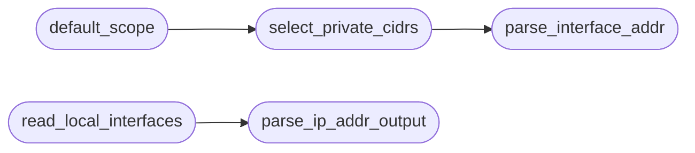

# `estorides_core.lan_scope`

> Source: [estorides_core/lan_scope.py:1](../../estorides_core/lan_scope.py#L1) | language `py` | coverage 100.0% | [API index](../index.md)

estorides_core.lan_scope ======================== Private local scope auto-detection.

Pure parsing plus one thin OS reader. The reader inspects local
interface configuration only; it sends no probes.

## Contents

- **Functions:** [`parse_interface_addr`](#parse_interface_addr), [`select_private_cidrs`](#select_private_cidrs), [`default_scope`](#default_scope), [`parse_ip_addr_output`](#parse_ip_addr_output), [`read_local_interfaces`](#read_local_interfaces)

## Call Graph

Solid arrows stay in this module, dashed arrows leave it.



## Functions

<a id="parse_interface_addr"></a>

### `parse_interface_addr`

`function` | [estorides_core/lan_scope.py:23](../../estorides_core/lan_scope.py#L23)

```python
def parse_interface_addr(raw: dict[str, Any] | Any) -> str | None
```

Normalize one interface address to CIDR, or None when unsafe.

**Parameters**

| Name | Type | Default | Description |
|---|---|---|---|
| `raw` | `dict[str, Any] \| Any` |  |  |

**Returns:** `str | None`

*Called by:* [`select_private_cidrs`](#select_private_cidrs)

---

<a id="select_private_cidrs"></a>

### `select_private_cidrs`

`function` | [estorides_core/lan_scope.py:63](../../estorides_core/lan_scope.py#L63)

```python
def select_private_cidrs(interfaces: list[Any]) -> list[str]
```

Keep private CIDRs only, sorted and deduped.

Never raises.

**Parameters**

| Name | Type | Default | Description |
|---|---|---|---|
| `interfaces` | `list[Any]` |  |  |

**Returns:** `list[str]`

*Calls:* [`parse_interface_addr`](#parse_interface_addr)

*Called by:* [`default_scope`](#default_scope)

---

<a id="default_scope"></a>

### `default_scope`

`function` | [estorides_core/lan_scope.py:79](../../estorides_core/lan_scope.py#L79)

```python
def default_scope(interfaces: list[Any]) -> str | None
```

First private CIDR, or None when no private network exists.

**Parameters**

| Name | Type | Default | Description |
|---|---|---|---|
| `interfaces` | `list[Any]` |  |  |

**Returns:** `str | None`

*Calls:* [`select_private_cidrs`](#select_private_cidrs)

---

<a id="parse_ip_addr_output"></a>

### `parse_ip_addr_output`

`function` | [estorides_core/lan_scope.py:85](../../estorides_core/lan_scope.py#L85)

```python
def parse_ip_addr_output(text: str) -> list[dict[str, str]]
```

Parse `ip addr` output into address dicts.

Pure, never raises.

**Parameters**

| Name | Type | Default | Description |
|---|---|---|---|
| `text` | `str` |  |  |

**Returns:** `list[dict[str, str]]`

*Called by:* [`read_local_interfaces`](#read_local_interfaces)

---

<a id="read_local_interfaces"></a>

### `read_local_interfaces`

`function` | [estorides_core/lan_scope.py:92](../../estorides_core/lan_scope.py#L92)

```python
def read_local_interfaces() -> list[dict[str, str]]
```

Read local interface addresses.

Fail-soft, no probes sent.

**Returns:** `list[dict[str, str]]`

*Calls:* [`parse_ip_addr_output`](#parse_ip_addr_output)

*Called by:* [`create_app`](estorides_web.py.md#create_app)

---
