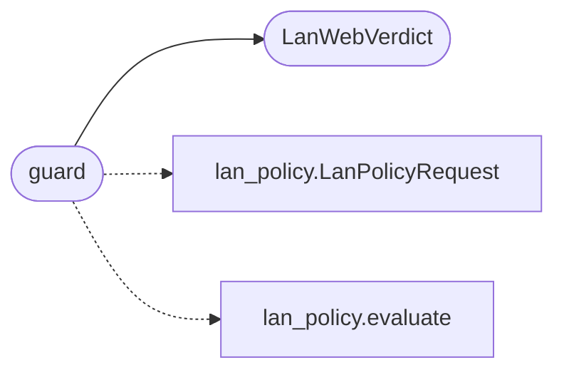

# `estorides_core.lan_web`

> Source: [estorides_core/lan_web.py:1](../../estorides_core/lan_web.py#L1) | language `py` | coverage 85.7% | [API index](../index.md)

estorides_core.lan_web ====================== Backend guard for LAN discovery runs from the web layer.

Thin mapping over lan_policy: the route hands the request body to
guard() and returns the verdict status on denial. Pure, no I/O.

## Contents

- **Classes:** [`LanWebVerdict`](#lanwebverdict)
- **Functions:** [`is_lan_request`](#is_lan_request), [`scope_payload`](#scope_payload), [`guard`](#guard)

## Call Graph

Solid arrows stay in this module, dashed arrows leave it.



## Classes

<a id="lanwebverdict"></a>

### `LanWebVerdict`

`class` `dataclass` | [estorides_core/lan_web.py:18](../../estorides_core/lan_web.py#L18)

Decorators: `@dataclass(frozen=True)`

```python
class LanWebVerdict
```

HTTP-ready outcome of the LAN consent gate.

**Attributes**

| Name | Type | Default | Description |
|---|---|---|---|
| [`permitted`](#lanwebverdict-permitted) | `bool` |  |  |
| [`status`](#lanwebverdict-status) | `int` |  |  |
| [`error`](#lanwebverdict-error) | `str \| None` |  |  |
| [`message`](#lanwebverdict-message) | `str` |  |  |
| [`max_contact`](#lanwebverdict-max_contact) | `str` |  |  |
| [`scope_cidr`](#lanwebverdict-scope_cidr) | `str \| None` | `None` |  |
| [`notice`](#lanwebverdict-notice) | `str \| None` | `None` |  |

**Members**

| Member | Kind | Summary |
|---|---|---|
| [`to_dict`](#lanwebverdict-to_dict) | method |  |
| [`to_response`](#lanwebverdict-to_response) | method | Return (body, status) for the Flask route. |

<a id="lanwebverdict-to_dict"></a>

#### `LanWebVerdict.to_dict`

`method` | [estorides_core/lan_web.py:29](../../estorides_core/lan_web.py#L29)

```python
def to_dict(self) -> dict[str, Any]
```

**Returns:** `dict[str, Any]`

<a id="lanwebverdict-to_response"></a>

#### `LanWebVerdict.to_response`

`method` | [estorides_core/lan_web.py:32](../../estorides_core/lan_web.py#L32)

```python
def to_response(self) -> tuple[dict[str, Any], int]
```

Return (body, status) for the Flask route.

**Returns:** `tuple[dict[str, Any], int]`

---

## Functions

<a id="is_lan_request"></a>

### `is_lan_request`

`function` | [estorides_core/lan_web.py:50](../../estorides_core/lan_web.py#L50)

```python
def is_lan_request(body: Any, query: str = '') -> bool
```

True when a run targets the local network.

Never raises.

**Parameters**

| Name | Type | Default | Description |
|---|---|---|---|
| `body` | `Any` |  |  |
| `query` | `str` | `''` |  |

**Returns:** `bool`

---

<a id="scope_payload"></a>

### `scope_payload`

`function` | [estorides_core/lan_web.py:80](../../estorides_core/lan_web.py#L80)

```python
def scope_payload(interfaces: Any) -> dict[str, Any]
```

Build the scope response from interface addresses.

Never raises.

**Parameters**

| Name | Type | Default | Description |
|---|---|---|---|
| `interfaces` | `Any` |  |  |

**Returns:** `dict[str, Any]`

---

<a id="guard"></a>

### `guard`

`function` | [estorides_core/lan_web.py:92](../../estorides_core/lan_web.py#L92)

```python
def guard(body: Any) -> LanWebVerdict
```

Validate a run request body for LAN consent.

Never raises.

**Parameters**

| Name | Type | Default | Description |
|---|---|---|---|
| `body` | `Any` |  |  |

**Returns:** `LanWebVerdict`

*Calls:* [`LanPolicyRequest`](estorides_core.lan_policy.py.md#lanpolicyrequest), [`evaluate`](estorides_core.lan_policy.py.md#evaluate), [`LanWebVerdict`](#lanwebverdict)

---
