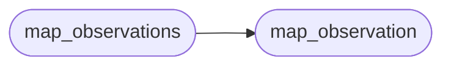

# `estorides_core.mitre_attack`

> Source: [estorides_core/mitre_attack.py:1](../../estorides_core/mitre_attack.py#L1) | language `py` | coverage 100.0% | [API index](../index.md)

estorides_core.mitre_attack =========================== Lightweight MITRE ATT&CK mapper.

A small but curated lookup table that maps OSINT observation
categories to ATT&CK technique IDs. Used to stamp every knowledge-
graph observation with the techniques it might support, so the
LLM analyst stage can produce a more useful brief ("observations
from sources X, Y, Z suggest technique T1595 — Active Scanning").

The full ATT&CK STIX bundle is ~25 MB; we deliberately do NOT
download it. The lookup table here covers the ~20 techniques that
realistically surface in an OSINT-only context (the rest require
active exploitation evidence we don't collect).

This module is a soft enhancement: missing entries are not errors,
they just produce no mapping. The orchestrator can call
`map_observation(observation)` after the inference step and attach
the result to the observation dict.

## Contents

- **Functions:** [`map_observation`](#map_observation), [`map_observations`](#map_observations), [`all_techniques_for`](#all_techniques_for)

## Call Graph

Solid arrows stay in this module, dashed arrows leave it.



## Functions

<a id="map_observation"></a>

### `map_observation`

`function` | [estorides_core/mitre_attack.py:170](../../estorides_core/mitre_attack.py#L170)

```python
def map_observation(observation: Dict[str, Any]) -> Dict[str, Any]
```

Return ATT&CK techniques associated with an observation.

Output:
    {
      "techniques": [
        {"id": "T1595", "label": "Active Scanning", "via": "source:shodan_internetdb"},
        ...
      ],
      "tactic_ids": ["TA0043"],  # not populated yet — future
    }

**Parameters**

| Name | Type | Default | Description |
|---|---|---|---|
| `observation` | `Dict[str, Any]` |  |  |

**Returns:** `Dict[str, Any]`

*Called by:* [`map_observations`](#map_observations)

---

<a id="map_observations"></a>

### `map_observations`

`function` | [estorides_core/mitre_attack.py:213](../../estorides_core/mitre_attack.py#L213)

```python
def map_observations(observations: List[Dict[str, Any]]) -> List[Dict[str, Any]]
```

Bulk mapper.

Stamps each observation in place with `_mitre` key.

Returns the list of observations (for chaining). Mutates in place
for performance — the orchestrator doesn't keep references to the
pre-mapping list, so a side effect is safe.

**Parameters**

| Name | Type | Default | Description |
|---|---|---|---|
| `observations` | `List[Dict[str, Any]]` |  |  |

**Returns:** `List[Dict[str, Any]]`

*Calls:* [`map_observation`](#map_observation)

*Called by:* [`Orchestrator.run`](estorides_core.orchestrator.py.md#orchestrator-run)

---

<a id="all_techniques_for"></a>

### `all_techniques_for`

`function` | [estorides_core/mitre_attack.py:229](../../estorides_core/mitre_attack.py#L229)

```python
def all_techniques_for(observations: List[Dict[str, Any]]) -> List[Dict[str, str]]
```

Aggregate: unique techniques across all observations, sorted by id.

**Parameters**

| Name | Type | Default | Description |
|---|---|---|---|
| `observations` | `List[Dict[str, Any]]` |  |  |

**Returns:** `List[Dict[str, str]]`

*Called by:* [`Orchestrator.run`](estorides_core.orchestrator.py.md#orchestrator-run)

---
