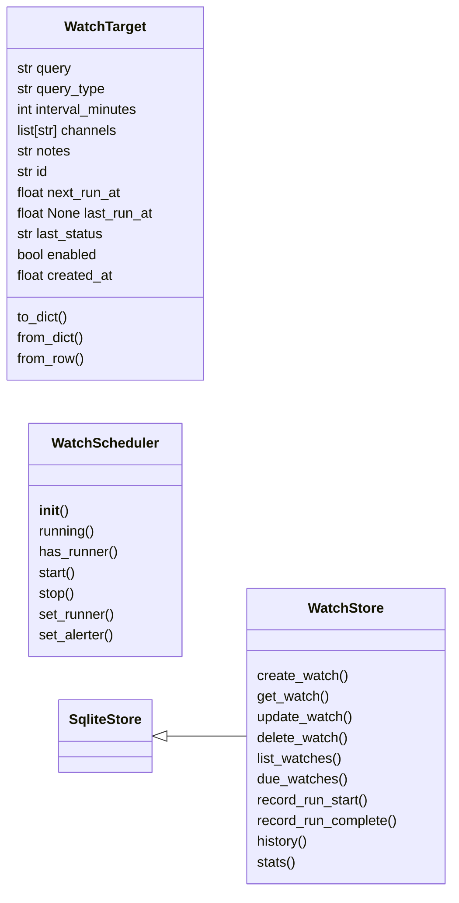
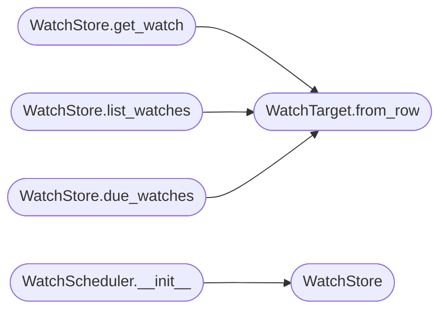

# `estorides_core.monitoring`

> Source: [estorides_core/monitoring.py:1](../../estorides_core/monitoring.py#L1) | language `py` | coverage 41.7% | [API index](../index.md)

estorides_core.monitoring ========================= Watch targets and scheduling for recurring OSINT monitoring.

Provides:
  * WatchTarget — a recurring investigation (query + interval + alert channels)
  * WatchStore — SQLite-backed persistence for watch targets
  * WatchScheduler — manages the scheduling loop (APScheduler or simple threading)
  * SchedulerConfig — env-var-tunable configuration

Two modes:
  1. In-process threaded scheduler (default) — simple, no external deps.
  2. APScheduler — for production deployments with persistent job store.

## Contents

- **Classes:** [`WatchTarget`](#watchtarget), [`WatchStore`](#watchstore), [`WatchScheduler`](#watchscheduler)
- **Constants:** [`MONITOR_DB`](#monitor_db)

## Type Diagram



## Call Graph

Solid arrows stay in this module, dashed arrows leave it.



## Classes

<a id="watchtarget"></a>

### `WatchTarget`

`class` `dataclass` | [estorides_core/monitoring.py:91](../../estorides_core/monitoring.py#L91)

Decorators: `@dataclass`

```python
class WatchTarget
```

A recurring OSINT investigation.

**Attributes**

| Name | Type | Default | Description |
|---|---|---|---|
| [`query`](#watchtarget-query) | `str` |  |  |
| [`query_type`](#watchtarget-query_type) | `str` | `'domain'` |  |
| [`interval_minutes`](#watchtarget-interval_minutes) | `int` | `1440` |  |
| [`channels`](#watchtarget-channels) | `list[str]` | `field(default_factory=list)` |  |
| [`notes`](#watchtarget-notes) | `str` | `''` |  |
| [`id`](#watchtarget-id) | `str` | `field(default_factory=lambda: uuid.uuid4().hex[:8])` |  |
| [`next_run_at`](#watchtarget-next_run_at) | `float` | `0.0` |  |
| [`last_run_at`](#watchtarget-last_run_at) | `float \| None` | `None` |  |
| [`last_status`](#watchtarget-last_status) | `str` | `'pending'` |  |
| [`enabled`](#watchtarget-enabled) | `bool` | `True` |  |
| [`created_at`](#watchtarget-created_at) | `float` | `field(default_factory=time.time)` |  |

**Members**

| Member | Kind | Summary |
|---|---|---|
| [`to_dict`](#watchtarget-to_dict) | method |  |
| [`from_dict`](#watchtarget-from_dict) | classmethod |  |
| [`from_row`](#watchtarget-from_row) | classmethod |  |

<a id="watchtarget-to_dict"></a>

#### `WatchTarget.to_dict`

`method` | [estorides_core/monitoring.py:110](../../estorides_core/monitoring.py#L110)

```python
def to_dict(self) -> dict[str, Any]
```

**Returns:** `dict[str, Any]`

<a id="watchtarget-from_dict"></a>

#### `WatchTarget.from_dict`

`classmethod` | [estorides_core/monitoring.py:126](../../estorides_core/monitoring.py#L126)

Decorators: `@classmethod`

```python
def from_dict(cls, d: dict[str, Any]) -> WatchTarget
```

**Parameters**

| Name | Type | Default | Description |
|---|---|---|---|
| `d` | `dict[str, Any]` |  |  |

**Returns:** `WatchTarget`

<a id="watchtarget-from_row"></a>

#### `WatchTarget.from_row`

`classmethod` | [estorides_core/monitoring.py:142](../../estorides_core/monitoring.py#L142)

Decorators: `@classmethod`

```python
def from_row(cls, row: sqlite3.Row) -> WatchTarget
```

**Parameters**

| Name | Type | Default | Description |
|---|---|---|---|
| `row` | `sqlite3.Row` |  |  |

**Returns:** `WatchTarget`

*Called by:* [`WatchStore.due_watches`](#watchstore-due_watches), [`WatchStore.get_watch`](#watchstore-get_watch), [`WatchStore.list_watches`](#watchstore-list_watches)

---

<a id="watchstore"></a>

### `WatchStore`

`class` | [estorides_core/monitoring.py:155](../../estorides_core/monitoring.py#L155)

```python
class WatchStore(SqliteStore)
```

Bases: [`SqliteStore`](estorides_core.sqlite_store.py.md#sqlitestore)

Thread-safe SQLite store for watch targets.

**Members**

| Member | Kind | Summary |
|---|---|---|
| [`create_watch`](#watchstore-create_watch) | method | Persist a new watch target. |
| [`get_watch`](#watchstore-get_watch) | method |  |
| [`update_watch`](#watchstore-update_watch) | method |  |
| [`delete_watch`](#watchstore-delete_watch) | method |  |
| [`list_watches`](#watchstore-list_watches) | method |  |
| [`due_watches`](#watchstore-due_watches) | method | Return enabled watches whose next_run_at <= now. |
| [`record_run_start`](#watchstore-record_run_start) | method | Record a watch run start, return history entry id. |
| [`record_run_complete`](#watchstore-record_run_complete) | method |  |
| [`history`](#watchstore-history) | method |  |
| [`stats`](#watchstore-stats) | method |  |

<a id="watchstore-create_watch"></a>

#### `WatchStore.create_watch`

`method` | [estorides_core/monitoring.py:162](../../estorides_core/monitoring.py#L162)

```python
def create_watch(self, watch: WatchTarget) -> WatchTarget
```

Persist a new watch target.

**Parameters**

| Name | Type | Default | Description |
|---|---|---|---|
| `watch` | `WatchTarget` |  |  |

**Returns:** `WatchTarget`

<a id="watchstore-get_watch"></a>

#### `WatchStore.get_watch`

`method` | [estorides_core/monitoring.py:177](../../estorides_core/monitoring.py#L177)

```python
def get_watch(self, watch_id: str) -> WatchTarget | None
```

**Parameters**

| Name | Type | Default | Description |
|---|---|---|---|
| `watch_id` | `str` |  |  |

**Returns:** `WatchTarget | None`

*Calls:* [`WatchTarget.from_row`](#watchtarget-from_row)

<a id="watchstore-update_watch"></a>

#### `WatchStore.update_watch`

`method` | [estorides_core/monitoring.py:186](../../estorides_core/monitoring.py#L186)

```python
def update_watch(self, watch: WatchTarget) -> WatchTarget
```

**Parameters**

| Name | Type | Default | Description |
|---|---|---|---|
| `watch` | `WatchTarget` |  |  |

**Returns:** `WatchTarget`

<a id="watchstore-delete_watch"></a>

#### `WatchStore.delete_watch`

`method` | [estorides_core/monitoring.py:199](../../estorides_core/monitoring.py#L199)

```python
def delete_watch(self, watch_id: str) -> None
```

**Parameters**

| Name | Type | Default | Description |
|---|---|---|---|
| `watch_id` | `str` |  |  |

<a id="watchstore-list_watches"></a>

#### `WatchStore.list_watches`

`method` | [estorides_core/monitoring.py:203](../../estorides_core/monitoring.py#L203)

```python
def list_watches(self, enabled_only: bool = False) -> list[WatchTarget]
```

**Parameters**

| Name | Type | Default | Description |
|---|---|---|---|
| `enabled_only` | `bool` | `False` |  |

**Returns:** `list[WatchTarget]`

*Calls:* [`WatchTarget.from_row`](#watchtarget-from_row)

<a id="watchstore-due_watches"></a>

#### `WatchStore.due_watches`

`method` | [estorides_core/monitoring.py:213](../../estorides_core/monitoring.py#L213)

```python
def due_watches(self, now: float | None = None) -> list[WatchTarget]
```

Return enabled watches whose next_run_at <= now.

**Parameters**

| Name | Type | Default | Description |
|---|---|---|---|
| `now` | `float \| None` | `None` |  |

**Returns:** `list[WatchTarget]`

*Calls:* [`WatchTarget.from_row`](#watchtarget-from_row)

<a id="watchstore-record_run_start"></a>

#### `WatchStore.record_run_start`

`method` | [estorides_core/monitoring.py:226](../../estorides_core/monitoring.py#L226)

```python
def record_run_start(self, watch_id: str) -> int
```

Record a watch run start, return history entry id.

**Parameters**

| Name | Type | Default | Description |
|---|---|---|---|
| `watch_id` | `str` |  |  |

**Returns:** `int`

<a id="watchstore-record_run_complete"></a>

#### `WatchStore.record_run_complete`

`method` | [estorides_core/monitoring.py:236](../../estorides_core/monitoring.py#L236)

```python
def record_run_complete(self, history_id: int, status: str = 'ok', entity_count: int = 0, obs_count: int = 0, error: str | None = None, alert_sent: bool = False) -> None
```

**Parameters**

| Name | Type | Default | Description |
|---|---|---|---|
| `history_id` | `int` |  |  |
| `status` | `str` | `'ok'` |  |
| `entity_count` | `int` | `0` |  |
| `obs_count` | `int` | `0` |  |
| `error` | `str \| None` | `None` |  |
| `alert_sent` | `bool` | `False` |  |

<a id="watchstore-history"></a>

#### `WatchStore.history`

`method` | [estorides_core/monitoring.py:249](../../estorides_core/monitoring.py#L249)

```python
def history(self, watch_id: str, limit: int = 20) -> list[dict[str, Any]]
```

**Parameters**

| Name | Type | Default | Description |
|---|---|---|---|
| `watch_id` | `str` |  |  |
| `limit` | `int` | `20` |  |

**Returns:** `list[dict[str, Any]]`

<a id="watchstore-stats"></a>

#### `WatchStore.stats`

`method` | [estorides_core/monitoring.py:266](../../estorides_core/monitoring.py#L266)

```python
def stats(self) -> dict[str, Any]
```

**Returns:** `dict[str, Any]`

---

<a id="watchscheduler"></a>

### `WatchScheduler`

`class` | [estorides_core/monitoring.py:280](../../estorides_core/monitoring.py#L280)

```python
class WatchScheduler
```

Background thread that polls the watch store and triggers due watches.

Uses a simple poll loop (no external deps). For production, swap to
APScheduler by setting ESTORIDES_SCHEDULER_DRIVER=apscheduler.

**Members**

| Member | Kind | Summary |
|---|---|---|
| [`__init__`](#watchscheduler-__init__) | constructor |  |
| [`running`](#watchscheduler-running) | property |  |
| [`has_runner`](#watchscheduler-has_runner) | property | True once an executor has been wired via set_runner(). |
| [`start`](#watchscheduler-start) | method |  |
| [`stop`](#watchscheduler-stop) | method |  |
| [`set_runner`](#watchscheduler-set_runner) | method | Set the orchestrator runner function (sync or async). |
| [`set_alerter`](#watchscheduler-set_alerter) | method | Set the alert dispatcher. |

<a id="watchscheduler-__init__"></a>

#### `WatchScheduler.__init__`

`constructor` | [estorides_core/monitoring.py:287](../../estorides_core/monitoring.py#L287)

```python
def __init__(self, store: WatchStore | None = None, runner: Callable[[WatchTarget], dict[str, Any]] | None = None, alerter: Any | None = None) -> None
```

**Parameters**

| Name | Type | Default | Description |
|---|---|---|---|
| `store` | `WatchStore \| None` | `None` |  |
| `runner` | `Callable[[WatchTarget], dict[str, Any]] \| None` | `None` |  |
| `alerter` | `Any \| None` | `None` |  |

*Calls:* [`WatchStore`](#watchstore)

<a id="watchscheduler-running"></a>

#### `WatchScheduler.running`

`property` | [estorides_core/monitoring.py:300](../../estorides_core/monitoring.py#L300)

Decorators: `@property`

```python
def running(self) -> bool
```

**Returns:** `bool`

<a id="watchscheduler-has_runner"></a>

#### `WatchScheduler.has_runner`

`property` | [estorides_core/monitoring.py:304](../../estorides_core/monitoring.py#L304)

Decorators: `@property`

```python
def has_runner(self) -> bool
```

True once an executor has been wired via set_runner().

**Returns:** `bool`

<a id="watchscheduler-start"></a>

#### `WatchScheduler.start`

`method` | [estorides_core/monitoring.py:308](../../estorides_core/monitoring.py#L308)

```python
def start(self) -> None
```

<a id="watchscheduler-stop"></a>

#### `WatchScheduler.stop`

`method` | [estorides_core/monitoring.py:319](../../estorides_core/monitoring.py#L319)

```python
def stop(self) -> None
```

<a id="watchscheduler-set_runner"></a>

#### `WatchScheduler.set_runner`

`method` | [estorides_core/monitoring.py:325](../../estorides_core/monitoring.py#L325)

```python
def set_runner(self, runner: Callable[[WatchTarget], dict[str, Any] | Awaitable[dict[str, Any]]]) -> None
```

Set the orchestrator runner function (sync or async).

**Parameters**

| Name | Type | Default | Description |
|---|---|---|---|
| `runner` | `Callable[[WatchTarget], dict[str, Any] \| Awaitable[dict[str, Any]]]` |  |  |

<a id="watchscheduler-set_alerter"></a>

#### `WatchScheduler.set_alerter`

`method` | [estorides_core/monitoring.py:329](../../estorides_core/monitoring.py#L329)

```python
def set_alerter(self, alerter: Any) -> None
```

Set the alert dispatcher.

**Parameters**

| Name | Type | Default | Description |
|---|---|---|---|
| `alerter` | `Any` |  |  |

---

## Constants

<a id="monitor_db"></a>

### `MONITOR_DB`

`constant` | [estorides_core/monitoring.py:39](../../estorides_core/monitoring.py#L39)

```python
MONITOR_DB: Path
```

---
