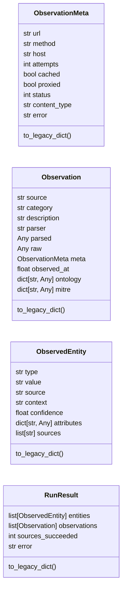
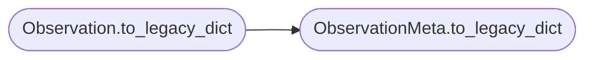

# `estorides_core.observation_models`

> Source: [estorides_core/observation_models.py:1](../../estorides_core/observation_models.py#L1) | language `py` | coverage 55.6% | [API index](../index.md)

estorides_core.observation_models ================================ Strict, versioned Pydantic v2 data contracts for the observation and entity records that flow through the engine.

The engine historically modelled these as unvalidated ``Dict[str, Any]``
built inline in the orchestrator, so a missing field, a wrong-typed value, or
a hostile payload could be silently propagated into the fusion store, the
knowledge graph, or the LLM analyst. These models are the schema-contract
boundary: parsing a dict validates it up front, ``extra="forbid"`` makes
schema drift a loud, traceable failure, and `[`to_legacy_dict`](#observationmeta-to_legacy_dict)` projects back
to the exact shape the current in-process call sites consume.

The module is pure (no I/O, no network, no clock reads, no logging of field
contents) and runs in the single-process architecture mandated by
``CLAUDE.md``: no Redis, no Celery, no FAISS, no OTLP collector.

## Contents

- **Classes:** [`ObservationMeta`](#observationmeta), [`Observation`](#observation), [`ObservedEntity`](#observedentity), [`RunResult`](#runresult)
- **Constants:** [`MAX_STR_LEN`](#max_str_len), [`MAX_VALUE_LEN`](#max_value_len), [`MAX_URL_LEN`](#max_url_len), [`SCHEMA_VERSION`](#schema_version)

## Type Diagram



## Call Graph

Solid arrows stay in this module, dashed arrows leave it.



## Classes

<a id="observationmeta"></a>

### `ObservationMeta`

`class` | [estorides_core/observation_models.py:72](../../estorides_core/observation_models.py#L72)

```python
class ObservationMeta(_StrictModel)
```

Bases: `_StrictModel`

The `[`meta`](#observation-meta)` sub-object of an observation (status, attempts, cache).

**Attributes**

| Name | Type | Default | Description |
|---|---|---|---|
| [`url`](#observationmeta-url) | `str` | `Field(default='')` |  |
| [`method`](#observationmeta-method) | `str` | `Field(default='')` |  |
| [`host`](#observationmeta-host) | `str` | `Field(default='')` |  |
| [`attempts`](#observationmeta-attempts) | `int` | `Field(default=0, ge=0)` |  |
| [`cached`](#observationmeta-cached) | `bool` | `False` |  |
| [`proxied`](#observationmeta-proxied) | `bool` | `False` |  |
| [`status`](#observationmeta-status) | `int` | `Field(default=0, ge=0)` |  |
| [`content_type`](#observationmeta-content_type) | `str` | `Field(default='')` |  |
| [`error`](#observationmeta-error) | `str` | `Field(default='')` |  |

**Members**

| Member | Kind | Summary |
|---|---|---|
| [`to_legacy_dict`](#observationmeta-to_legacy_dict) | method |  |

<a id="observationmeta-to_legacy_dict"></a>

#### `ObservationMeta.to_legacy_dict`

`method` | [estorides_core/observation_models.py:95](../../estorides_core/observation_models.py#L95)

```python
def to_legacy_dict(self) -> dict[str, Any]
```

**Returns:** `dict[str, Any]`

*Called by:* [`Observation.to_legacy_dict`](#observation-to_legacy_dict)

---

<a id="observation"></a>

### `Observation`

`class` | [estorides_core/observation_models.py:109](../../estorides_core/observation_models.py#L109)

```python
class Observation(_StrictModel)
```

Bases: `_StrictModel`

A validated per-source observation record emitted by the engine.

**Attributes**

| Name | Type | Default | Description |
|---|---|---|---|
| [`source`](#observation-source) | `str` | `Field(min_length=1, max_length=MAX_STR_LEN)` |  |
| [`category`](#observation-category) | `str` | `Field(default='', max_length=MAX_STR_LEN)` |  |
| [`description`](#observation-description) | `str` | `Field(default='', max_length=MAX_STR_LEN)` |  |
| [`parser`](#observation-parser) | `str` | `Field(default='', max_length=MAX_STR_LEN)` |  |
| [`parsed`](#observation-parsed) | `Any` | `None` |  |
| [`raw`](#observation-raw) | `Any` | `None` |  |
| [`meta`](#observation-meta) | `ObservationMeta` |  |  |
| [`observed_at`](#observation-observed_at) | `float` | `Field(default=0.0, ge=0.0)` |  |
| [`ontology`](#observation-ontology) | `dict[str, Any]` | `Field(default_factory=dict)` |  |
| [`mitre`](#observation-mitre) | `dict[str, Any]` | `Field(default_factory=dict)` |  |

**Members**

| Member | Kind | Summary |
|---|---|---|
| [`to_legacy_dict`](#observation-to_legacy_dict) | method |  |

<a id="observation-to_legacy_dict"></a>

#### `Observation.to_legacy_dict`

`method` | [estorides_core/observation_models.py:128](../../estorides_core/observation_models.py#L128)

```python
def to_legacy_dict(self) -> dict[str, Any]
```

**Returns:** `dict[str, Any]`

*Calls:* [`ObservationMeta.to_legacy_dict`](#observationmeta-to_legacy_dict)

---

<a id="observedentity"></a>

### `ObservedEntity`

`class` | [estorides_core/observation_models.py:147](../../estorides_core/observation_models.py#L147)

```python
class ObservedEntity(_StrictModel)
```

Bases: `_StrictModel`

A validated view of a resolved entity used across the stores.

**Attributes**

| Name | Type | Default | Description |
|---|---|---|---|
| [`type`](#observedentity-type) | `str` | `Field(min_length=1, max_length=MAX_STR_LEN)` |  |
| [`value`](#observedentity-value) | `str` | `Field(min_length=1, max_length=MAX_VALUE_LEN)` |  |
| [`source`](#observedentity-source) | `str` | `Field(default='', max_length=MAX_STR_LEN)` |  |
| [`context`](#observedentity-context) | `str` | `Field(default='', max_length=MAX_STR_LEN)` |  |
| [`confidence`](#observedentity-confidence) | `float` | `Field(default=1.0, ge=0.0, le=1.0)` |  |
| [`attributes`](#observedentity-attributes) | `dict[str, Any]` | `Field(default_factory=dict)` |  |
| [`sources`](#observedentity-sources) | `list[str]` | `Field(default_factory=list)` |  |

**Members**

| Member | Kind | Summary |
|---|---|---|
| [`to_legacy_dict`](#observedentity-to_legacy_dict) | method |  |

<a id="observedentity-to_legacy_dict"></a>

#### `ObservedEntity.to_legacy_dict`

`method` | [estorides_core/observation_models.py:163](../../estorides_core/observation_models.py#L163)

```python
def to_legacy_dict(self) -> dict[str, Any]
```

**Returns:** `dict[str, Any]`

---

<a id="runresult"></a>

### `RunResult`

`class` | [estorides_core/observation_models.py:175](../../estorides_core/observation_models.py#L175)

```python
class RunResult(_StrictModel)
```

Bases: `_StrictModel`

The top-level validated run payload.

**Attributes**

| Name | Type | Default | Description |
|---|---|---|---|
| [`entities`](#runresult-entities) | `list[ObservedEntity]` | `Field(default_factory=list)` |  |
| [`observations`](#runresult-observations) | `list[Observation]` | `Field(default_factory=list)` |  |
| [`sources_succeeded`](#runresult-sources_succeeded) | `int` | `Field(default=0, ge=0)` |  |
| [`error`](#runresult-error) | `str` | `Field(default='', max_length=MAX_STR_LEN)` |  |

**Members**

| Member | Kind | Summary |
|---|---|---|
| [`to_legacy_dict`](#runresult-to_legacy_dict) | method |  |

<a id="runresult-to_legacy_dict"></a>

#### `RunResult.to_legacy_dict`

`method` | [estorides_core/observation_models.py:183](../../estorides_core/observation_models.py#L183)

```python
def to_legacy_dict(self) -> dict[str, Any]
```

**Returns:** `dict[str, Any]`

---

## Constants

<a id="max_str_len"></a>

### `MAX_STR_LEN`

`constant` | [estorides_core/observation_models.py:38](../../estorides_core/observation_models.py#L38)

```python
MAX_STR_LEN: int = SCHEMA.max_str_len
```

---

<a id="max_value_len"></a>

### `MAX_VALUE_LEN`

`constant` | [estorides_core/observation_models.py:39](../../estorides_core/observation_models.py#L39)

```python
MAX_VALUE_LEN: int = SCHEMA.max_value_len
```

---

<a id="max_url_len"></a>

### `MAX_URL_LEN`

`constant` | [estorides_core/observation_models.py:40](../../estorides_core/observation_models.py#L40)

```python
MAX_URL_LEN: int = SCHEMA.max_url_len
```

---

<a id="schema_version"></a>

### `SCHEMA_VERSION`

`constant` | [estorides_core/observation_models.py:41](../../estorides_core/observation_models.py#L41)

```python
SCHEMA_VERSION: int = SCHEMA.schema_version
```

---
