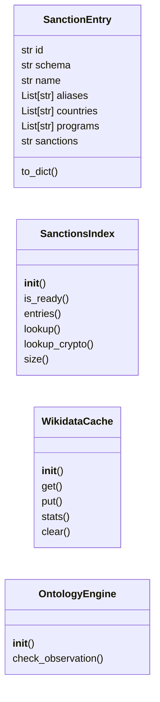
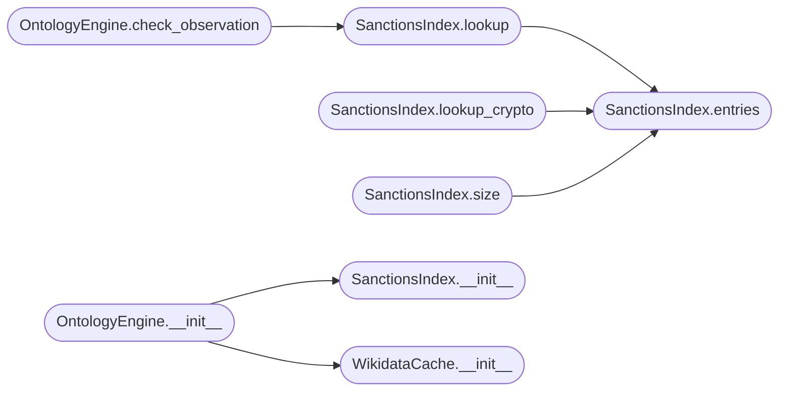

# `estorides_core.ontology`

> Source: [estorides_core/ontology.py:1](../../estorides_core/ontology.py#L1) | language `py` | coverage 42.1% | [API index](../index.md)

estorides_core.ontology ======================= The "centralized ontology engine" — the brain of the platform.

Three things live here:

  SanctionsIndex
    OFAC SDN list, mirrored from OpenSanctions
    (https://www.opensanctions.org/datasets/latest/us_ofac_sdn/targets.simple.csv).
    Loaded on first use, refreshed every 24h, single-flight so
    concurrent requests share one fetch. ~7 MB, low-tens-of-thousands
    of entries. In-memory graph: {entry} by id + by normalised name
    + by alias + by crypto address.

  WikidataCache
    A bounded LRU over the Wikidata SPARQL endpoint. Used to
    canonicalise "Vladimir Putin" → Q7747, "FSB" → Q2084917, etc.
    24h TTL per entry, capped at 10k items to bound memory.

  OntologyEngine
    The orchestrator-facing facade. Exposes:
        - resolve(name) -> candidate sanction matches
        - resolve_crypto_address(addr) -> sanction cross-check
        - check_observation(obs) -> {hits, hits_by_field}
    Designed to be called from a new "post-process" stage that
    decorates each observation with a sanctions verdict before the
    LLM analyst sees it.

This module is deliberately dependency-light (only stdlib). The CSV
parser is hand-rolled and tolerant of double-quoted fields with
embedded commas and newlines — the OpenSanctions export is well-
formed so we don't need `csv` module gymnastics, but we do need the
""" escape" support that the csv module handles. Using the stdlib
reader keeps the dependency surface to zero.

Spec reference: https://www.opensanctions.org/datasets/us_ofac_sdn/

## Contents

- **Classes:** [`SanctionEntry`](#sanctionentry), [`SanctionsIndex`](#sanctionsindex), [`WikidataCache`](#wikidatacache), [`OntologyEngine`](#ontologyengine)
- **Constants:** [`SDN_CSV_URL`](#sdn_csv_url), [`SDN_LOCAL_CACHE`](#sdn_local_cache), [`SDN_TTL_SECONDS`](#sdn_ttl_seconds), [`WIKIDATA_TTL_SECONDS`](#wikidata_ttl_seconds), [`WIKIDATA_LRU_MAX`](#wikidata_lru_max), [`WIKIDATA_ENDPOINT`](#wikidata_endpoint), [`WIKIDATA_UA`](#wikidata_ua)

## Type Diagram



## Call Graph

Solid arrows stay in this module, dashed arrows leave it.



## Classes

<a id="sanctionentry"></a>

### `SanctionEntry`

`class` `dataclass` | [estorides_core/ontology.py:70](../../estorides_core/ontology.py#L70)

Decorators: `@dataclass`

```python
class SanctionEntry
```

**Attributes**

| Name | Type | Default | Description |
|---|---|---|---|
| [`id`](#sanctionentry-id) | `str` |  |  |
| [`schema`](#sanctionentry-schema) | `str` |  |  |
| [`name`](#sanctionentry-name) | `str` |  |  |
| [`aliases`](#sanctionentry-aliases) | `List[str]` | `field(default_factory=list)` |  |
| [`countries`](#sanctionentry-countries) | `List[str]` | `field(default_factory=list)` |  |
| [`programs`](#sanctionentry-programs) | `List[str]` | `field(default_factory=list)` |  |
| [`sanctions`](#sanctionentry-sanctions) | `str` | `''` |  |

**Members**

| Member | Kind | Summary |
|---|---|---|
| [`to_dict`](#sanctionentry-to_dict) | method |  |

<a id="sanctionentry-to_dict"></a>

#### `SanctionEntry.to_dict`

`method` | [estorides_core/ontology.py:79](../../estorides_core/ontology.py#L79)

```python
def to_dict(self) -> Dict[str, Any]
```

**Returns:** `Dict[str, Any]`

---

<a id="sanctionsindex"></a>

### `SanctionsIndex`

`class` | [estorides_core/ontology.py:96](../../estorides_core/ontology.py#L96)

```python
class SanctionsIndex
```

In-memory OFAC SDN index with 24h lazy refresh and single-flight load.

The previous design (if any) likely fetched the list on every call
or had no cache; the new design:

  * First call to [`entries`](#sanctionsindex-entries) blocks while the CSV is fetched.
  * Subsequent calls within TTL return the cached snapshot.
  * Concurrent calls during a load share the same in-flight
    promise (single-flight) — never two concurrent fetches.
  * If a refresh fails after the cache has gone stale, we keep
    serving the previous snapshot rather than going blind.

The CSV is downloaded over HTTPS to a temp file, then loaded
into a normalised lookup. We never trust the file path in
the SDN_LOCAL_CACHE to be writable: on permission errors we
log a warning and fall back to in-memory only.

**Members**

| Member | Kind | Summary |
|---|---|---|
| [`__init__`](#sanctionsindex-__init__) | constructor |  |
| [`is_ready`](#sanctionsindex-is_ready) | method |  |
| [`entries`](#sanctionsindex-entries) | method | Return the current snapshot, loading if necessary. |
| [`lookup`](#sanctionsindex-lookup) | method | Find sanction entries whose name or alias matches [`name`](#sanctionentry-name). |
| [`lookup_crypto`](#sanctionsindex-lookup_crypto) | method | Cross-check a BTC/ETH address against the SDN list. |
| [`size`](#sanctionsindex-size) | method |  |

<a id="sanctionsindex-__init__"></a>

#### `SanctionsIndex.__init__`

`constructor` | [estorides_core/ontology.py:115](../../estorides_core/ontology.py#L115)

```python
def __init__(self, *, url: str = SDN_CSV_URL, ttl_seconds: int = SDN_TTL_SECONDS, local_cache_path: str = SDN_LOCAL_CACHE) -> None
```

**Parameters**

| Name | Type | Default | Description |
|---|---|---|---|
| `url` | `str` | `SDN_CSV_URL` |  |
| `ttl_seconds` | `int` | `SDN_TTL_SECONDS` |  |
| `local_cache_path` | `str` | `SDN_LOCAL_CACHE` |  |

*Called by:* [`OntologyEngine.__init__`](#ontologyengine-__init__)

<a id="sanctionsindex-is_ready"></a>

#### `SanctionsIndex.is_ready`

`method` | [estorides_core/ontology.py:131](../../estorides_core/ontology.py#L131)

```python
def is_ready(self) -> bool
```

**Returns:** `bool`

<a id="sanctionsindex-entries"></a>

#### `SanctionsIndex.entries`

`method` | [estorides_core/ontology.py:134](../../estorides_core/ontology.py#L134)

```python
def entries(self) -> List[SanctionEntry]
```

Return the current snapshot, loading if necessary.

**Returns:** `List[SanctionEntry]`

*Called by:* [`SanctionsIndex.lookup`](#sanctionsindex-lookup), [`SanctionsIndex.lookup_crypto`](#sanctionsindex-lookup_crypto), [`SanctionsIndex.size`](#sanctionsindex-size)

<a id="sanctionsindex-lookup"></a>

#### `SanctionsIndex.lookup`

`method` | [estorides_core/ontology.py:141](../../estorides_core/ontology.py#L141)

```python
def lookup(self, name: str) -> List[SanctionEntry]
```

Find sanction entries whose name or alias matches [`name`](#sanctionentry-name).

**Parameters**

| Name | Type | Default | Description |
|---|---|---|---|
| `name` | `str` |  |  |

**Returns:** `List[SanctionEntry]`

*Calls:* [`SanctionsIndex.entries`](#sanctionsindex-entries)

*Called by:* [`OntologyEngine.check_observation`](#ontologyengine-check_observation)

<a id="sanctionsindex-lookup_crypto"></a>

#### `SanctionsIndex.lookup_crypto`

`method` | [estorides_core/ontology.py:151](../../estorides_core/ontology.py#L151)

```python
def lookup_crypto(self, address: str) -> List[SanctionEntry]
```

Cross-check a BTC/ETH address against the SDN list.

The OpenSanctions CSV includes a `crypto_address` (BTC) field
on a subset of entries. ETH addresses are stored in the
`ethereum_address` field. The current implementation matches
by alias string for simplicity — the upstream coverage of
crypto is sparse and not the focus of this version. Returns
the entries whose alias list contains the literal address.

**Parameters**

| Name | Type | Default | Description |
|---|---|---|---|
| `address` | `str` |  |  |

**Returns:** `List[SanctionEntry]`

*Calls:* [`SanctionsIndex.entries`](#sanctionsindex-entries)

<a id="sanctionsindex-size"></a>

#### `SanctionsIndex.size`

`method` | [estorides_core/ontology.py:168](../../estorides_core/ontology.py#L168)

```python
def size(self) -> int
```

**Returns:** `int`

*Calls:* [`SanctionsIndex.entries`](#sanctionsindex-entries)

---

<a id="wikidatacache"></a>

### `WikidataCache`

`class` | [estorides_core/ontology.py:268](../../estorides_core/ontology.py#L268)

```python
class WikidataCache
```

Bounded LRU cache for Wikidata SPARQL queries.

Keyed by `(query_kind, normalised_value)`. Values are `(fetched_at, payload)`.
Exposes `lookup_label(label)` and `lookup_org(label)` — the two
most common lookups in OSINT workflows.

**Members**

| Member | Kind | Summary |
|---|---|---|
| [`__init__`](#wikidatacache-__init__) | constructor |  |
| [`get`](#wikidatacache-get) | method |  |
| [`put`](#wikidatacache-put) | method |  |
| [`stats`](#wikidatacache-stats) | method |  |
| [`clear`](#wikidatacache-clear) | method |  |

<a id="wikidatacache-__init__"></a>

#### `WikidataCache.__init__`

`constructor` | [estorides_core/ontology.py:276](../../estorides_core/ontology.py#L276)

```python
def __init__(self, *, max_items: int = WIKIDATA_LRU_MAX, ttl: int = WIKIDATA_TTL_SECONDS) -> None
```

**Parameters**

| Name | Type | Default | Description |
|---|---|---|---|
| `max_items` | `int` | `WIKIDATA_LRU_MAX` |  |
| `ttl` | `int` | `WIKIDATA_TTL_SECONDS` |  |

*Called by:* [`OntologyEngine.__init__`](#ontologyengine-__init__)

<a id="wikidatacache-get"></a>

#### `WikidataCache.get`

`method` | [estorides_core/ontology.py:282](../../estorides_core/ontology.py#L282)

```python
def get(self, kind: str, value: str) -> Optional[List[Dict[str, Any]]]
```

**Parameters**

| Name | Type | Default | Description |
|---|---|---|---|
| `kind` | `str` |  |  |
| `value` | `str` |  |  |

**Returns:** `Optional[List[Dict[str, Any]]]`

<a id="wikidatacache-put"></a>

#### `WikidataCache.put`

`method` | [estorides_core/ontology.py:296](../../estorides_core/ontology.py#L296)

```python
def put(self, kind: str, value: str, payload: List[Dict[str, Any]]) -> None
```

**Parameters**

| Name | Type | Default | Description |
|---|---|---|---|
| `kind` | `str` |  |  |
| `value` | `str` |  |  |
| `payload` | `List[Dict[str, Any]]` |  |  |

<a id="wikidatacache-stats"></a>

#### `WikidataCache.stats`

`method` | [estorides_core/ontology.py:304](../../estorides_core/ontology.py#L304)

```python
def stats(self) -> Dict[str, int]
```

**Returns:** `Dict[str, int]`

<a id="wikidatacache-clear"></a>

#### `WikidataCache.clear`

`method` | [estorides_core/ontology.py:308](../../estorides_core/ontology.py#L308)

```python
def clear(self) -> None
```

---

<a id="ontologyengine"></a>

### `OntologyEngine`

`class` | [estorides_core/ontology.py:314](../../estorides_core/ontology.py#L314)

```python
class OntologyEngine
```

Public façade.

Hands out the sanction index and wikidata cache.

**Members**

| Member | Kind | Summary |
|---|---|---|
| [`__init__`](#ontologyengine-__init__) | constructor |  |
| [`check_observation`](#ontologyengine-check_observation) | method | Run a single observation through the ontology. |

<a id="ontologyengine-__init__"></a>

#### `OntologyEngine.__init__`

`constructor` | [estorides_core/ontology.py:317](../../estorides_core/ontology.py#L317)

```python
def __init__(self) -> None
```

*Calls:* [`SanctionsIndex.__init__`](#sanctionsindex-__init__), [`WikidataCache.__init__`](#wikidatacache-__init__)

<a id="ontologyengine-check_observation"></a>

#### `OntologyEngine.check_observation`

`method` | [estorides_core/ontology.py:321](../../estorides_core/ontology.py#L321)

```python
def check_observation(self, observation: Dict[str, Any]) -> Dict[str, Any]
```

Run a single observation through the ontology.

Returns a dict describing the sanctions verdict:

  {
    "sanctioned": bool,
    "hits": [SanctionEntry.to_dict(), ...],
    "fields": ["registrant_name", "isp", ...]  # which fields matched
  }

The orchestrator attaches this to each observation before the
LLM analyst stage so the system prompt can include a verdict
line ("SANCTIONED — OFAC SDN match on registrant").

**Parameters**

| Name | Type | Default | Description |
|---|---|---|---|
| `observation` | `Dict[str, Any]` |  |  |

**Returns:** `Dict[str, Any]`

*Calls:* [`SanctionsIndex.lookup`](#sanctionsindex-lookup)

---

## Constants

<a id="sdn_csv_url"></a>

### `SDN_CSV_URL`

`constant` | [estorides_core/ontology.py:58](../../estorides_core/ontology.py#L58)

```python
SDN_CSV_URL = 'https://data.opensanctions.org/datasets/latest/us_ofac_sdn/targets.simple.csv'
```

---

<a id="sdn_local_cache"></a>

### `SDN_LOCAL_CACHE`

`constant` | [estorides_core/ontology.py:61](../../estorides_core/ontology.py#L61)

```python
SDN_LOCAL_CACHE: str = str(DATA_DIR / 'ontology_sdn.json')
```

---

<a id="sdn_ttl_seconds"></a>

### `SDN_TTL_SECONDS`

`constant` | [estorides_core/ontology.py:62](../../estorides_core/ontology.py#L62)

```python
SDN_TTL_SECONDS: int = 24 * 60 * 60
```

---

<a id="wikidata_ttl_seconds"></a>

### `WIKIDATA_TTL_SECONDS`

`constant` | [estorides_core/ontology.py:63](../../estorides_core/ontology.py#L63)

```python
WIKIDATA_TTL_SECONDS: int = 24 * 60 * 60
```

---

<a id="wikidata_lru_max"></a>

### `WIKIDATA_LRU_MAX`

`constant` | [estorides_core/ontology.py:64](../../estorides_core/ontology.py#L64)

```python
WIKIDATA_LRU_MAX: int = 10000
```

---

<a id="wikidata_endpoint"></a>

### `WIKIDATA_ENDPOINT`

`constant` | [estorides_core/ontology.py:65](../../estorides_core/ontology.py#L65)

```python
WIKIDATA_ENDPOINT: str = 'https://query.wikidata.org/sparql'
```

---

<a id="wikidata_ua"></a>

### `WIKIDATA_UA`

`constant` | [estorides_core/ontology.py:66](../../estorides_core/ontology.py#L66)

```python
WIKIDATA_UA: str = 'Estorides/1.0 (+open-source OSINT platform; ontology engine)'
```

---
