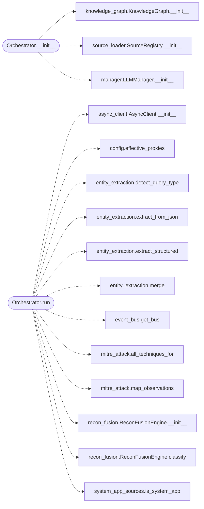

# `estorides_core.orchestrator`

> Source: [estorides_core/orchestrator.py:1](../../estorides_core/orchestrator.py#L1) | language `py` | coverage 60.0% | [API index](../index.md)

estorides_core.orchestrator ============================ The main entry point.

Glues together: * source registry  (source_loader) * async http       (async_client) * parsers          (parsers) * entity extract   (entity_extraction) * knowledge graph  (knowledge_graph) * LLM manager      (llm.manager) * dataset export   (exporters)

Public surface:
  orchestrator = Orchestrator()
  await orchestrator.run(query, ...)

## Contents

- **Classes:** [`Orchestrator`](#orchestrator)
- **Functions:** [`pending_system_app_tasks`](#pending_system_app_tasks)

## Call Graph

Solid arrows stay in this module, dashed arrows leave it.



## Classes

<a id="orchestrator"></a>

### `Orchestrator`

`class` | [estorides_core/orchestrator.py:168](../../estorides_core/orchestrator.py#L168)

```python
class Orchestrator
```

**Members**

| Member | Kind | Summary |
|---|---|---|
| [`__init__`](#orchestrator-__init__) | constructor |  |
| [`run`](#orchestrator-run) | method | Run a full intelligence cycle. |

<a id="orchestrator-__init__"></a>

#### `Orchestrator.__init__`

`constructor` | [estorides_core/orchestrator.py:169](../../estorides_core/orchestrator.py#L169)

```python
def __init__(self, registry: SourceRegistry | None = None, llm: LLMManager | None = None, kg: KnowledgeGraph | None = None) -> None
```

**Parameters**

| Name | Type | Default | Description |
|---|---|---|---|
| `registry` | `SourceRegistry \| None` | `None` |  |
| `llm` | `LLMManager \| None` | `None` |  |
| `kg` | `KnowledgeGraph \| None` | `None` |  |

*Calls:* [`KnowledgeGraph.__init__`](estorides_core.knowledge_graph.py.md#knowledgegraph-__init__), [`SourceRegistry.__init__`](estorides_core.source_loader.py.md#sourceregistry-__init__), [`LLMManager.__init__`](estorides_llm.manager.py.md#llmmanager-__init__)

*Called by:* [`cmd_run`](estorides_cli.py.md#cmd_run), [`cmd_status`](estorides_cli.py.md#cmd_status), [`create_app`](estorides_web.py.md#create_app)

<a id="orchestrator-run"></a>

#### `Orchestrator.run`

`method` `async` | [estorides_core/orchestrator.py:190](../../estorides_core/orchestrator.py#L190)

```python
async def run(self, query: str, *, source_names: Optional[List[str]] = None, include_paid: bool = False, parallel: int = HTTP_MAX_PARALLEL, timeout: float = HTTP_TIMEOUT, deadline: float = RUN_DEADLINE, on_source_done: Optional[Any] = None, on_source_result: Optional[Any] = None, persist: bool = True, case_id: Optional[str] = None, passive_only: bool = False, proxy: Optional[str] = None) -> Dict[str, Any]
```

Run a full intelligence cycle.

Returns a structured result.

`deadline` is a hard wall-clock cap (seconds) for the whole fanout.
Any source that hasn't responded by then is dropped and reported as
"deadline_exceeded" so the run can never get stuck.

`persist` (default True) writes the run to the persistent case
store and mirrors every entity/edge to the Kùzu graph. Set
False for one-off ad-hoc queries (e.g. tests) where you don't
want the run to bloat the long-term memory.

[`case_id`](estorides_core.discoverer.py.md#discoverjob-case_id), when supplied, makes this run append to an existing
case instead of opening a new one. The recursive pivot engine
uses this so every hop of a cross-search lands in a single case.

`on_source_result`, when supplied, is invoked with the shaped
observation dict the moment each source resolves, before the
fan-out as a whole completes. This is what lets the UI populate
progressively instead of blocking on the slowest source.

[`passive_only`](estorides_core.discoverer.py.md#discoverjob-passive_only) (default False) restricts the fan-out to sources
whose contact class is `none` — the target's own infrastructure is
never touched, not even by a third-party broker probe. Use this for
bug-bounty scoping where a probe attributable to the operator's
recon window must not appear in the target's logs.

[`proxy`](estorides_core.discoverer.py.md#discoverjob-proxy), when supplied (e.g. `socks5://127.0.0.1:9050` for Tor),
routes every outbound request through it so the queried brokers
never see the operator's real egress IP. Falls back to the
env-configured proxy pool when omitted.

**Parameters**

| Name | Type | Default | Description |
|---|---|---|---|
| `query` | `str` |  |  |
| `source_names` | `Optional[List[str]]` | `None` |  |
| `include_paid` | `bool` | `False` |  |
| `parallel` | `int` | `HTTP_MAX_PARALLEL` |  |
| `timeout` | `float` | `HTTP_TIMEOUT` |  |
| `deadline` | `float` | `RUN_DEADLINE` |  |
| `on_source_done` | `Optional[Any]` | `None` |  |
| `on_source_result` | `Optional[Any]` | `None` |  |
| `persist` | `bool` | `True` |  |
| `case_id` | `Optional[str]` | `None` |  |
| `passive_only` | `bool` | `False` |  |
| `proxy` | `Optional[str]` | `None` |  |

**Returns:** `Dict[str, Any]`

*Calls:* [`AsyncClient.__init__`](estorides_core.async_client.py.md#asyncclient-__init__), [`effective_proxies`](estorides_core.config.py.md#effective_proxies), [`detect_query_type`](estorides_core.entity_extraction.py.md#detect_query_type), [`extract_from_json`](estorides_core.entity_extraction.py.md#extract_from_json), [`extract_structured`](estorides_core.entity_extraction.py.md#extract_structured), [`merge`](estorides_core.entity_extraction.py.md#merge), [`get_bus`](estorides_core.event_bus.py.md#get_bus), [`all_techniques_for`](estorides_core.mitre_attack.py.md#all_techniques_for), [`map_observations`](estorides_core.mitre_attack.py.md#map_observations), [`ReconFusionEngine.__init__`](estorides_core.recon_fusion.py.md#reconfusionengine-__init__), [`ReconFusionEngine.classify`](estorides_core.recon_fusion.py.md#reconfusionengine-classify), [`is_system_app`](estorides_core.system_app_sources.py.md#is_system_app)

*Called by:* [`cmd_run`](estorides_cli.py.md#cmd_run), [`create_app`](estorides_web.py.md#create_app)

---

## Functions

<a id="pending_system_app_tasks"></a>

### `pending_system_app_tasks`

`function` | [estorides_core/orchestrator.py:56](../../estorides_core/orchestrator.py#L56)

```python
def pending_system_app_tasks() -> int
```

Number of slow CLI-tool runs still in flight (for the stream gate).

**Returns:** `int`

*Called by:* [`create_app`](estorides_web.py.md#create_app)

---
