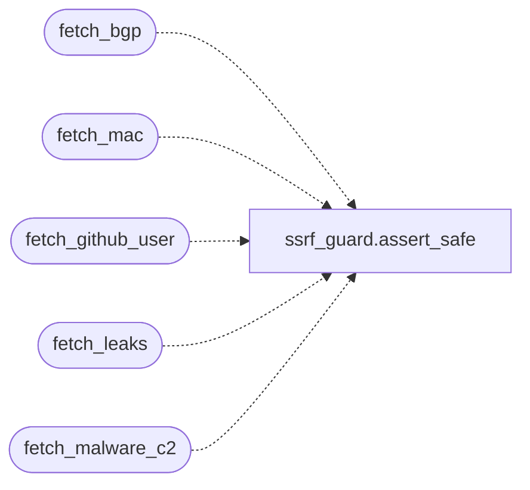

# `estorides_core.osiris_sources`

> Source: [estorides_core/osiris_sources.py:1](../../estorides_core/osiris_sources.py#L1) | language `py` | coverage 100.0% | [API index](../index.md)

estorides_core.osiris_sources ============================= Extra OSINT endpoints borrowed from the Osiris project (simplifaisoul/osiris).

Each function returns a Flask Response-ready dict; the Blueprint in [`estorides_web`](estorides_web.py.md) wires them up to public routes.

Why a separate module:
  The main 99 sources are YAML-defined and go through the orchestrator
  pipeline (parser → entity extraction → KG). The Osiris-style
  endpoints are narrower: they hit a single free API and return a
  flat JSON response without going through the orchestrator. Mixing
  them into the YAML registry would force a parallel "raw passthrough"
  parser and bloat `parsers.py`. Keeping them here makes the boundary
  explicit and easy to audit.

Source map (Osiris → here):
  /api/osiris/bgp        bgpview.io (keyless)
  /api/osiris/mac        macvendors.co (keyless)
  /api/osiris/phone      local libphonenumber + region centroid table
  /api/osiris/github     api.github.com (keyless, rate-limited)
  /api/osiris/leaks      api.xposedornot.com (keyless, more detail than HIBP)
  /api/osiris/cisa-kev   cisa.gov KEV JSON feed
  /api/osiris/malware    feodotracker.abuse.ch + urlhaus-api.abuse.ch

## Contents

- **Functions:** [`fetch_bgp`](#fetch_bgp), [`fetch_mac`](#fetch_mac), [`fetch_phone`](#fetch_phone), [`fetch_github_user`](#fetch_github_user), [`fetch_leaks`](#fetch_leaks), [`fetch_cisa_kev`](#fetch_cisa_kev), [`fetch_malware_c2`](#fetch_malware_c2)
- **Constants:** [`COUNTRY_CENTROIDS`](#country_centroids), [`CACHE_DIR`](#cache_dir)

## Call Graph

Solid arrows stay in this module, dashed arrows leave it.



## Functions

<a id="fetch_bgp"></a>

### `fetch_bgp`

`function` | [estorides_core/osiris_sources.py:119](../../estorides_core/osiris_sources.py#L119)

```python
def fetch_bgp(query: str) -> Dict[str, Any]
```

Look up an IP or AS number against bgpview.io (free, no key).

**Parameters**

| Name | Type | Default | Description |
|---|---|---|---|
| `query` | `str` |  |  |

**Returns:** `Dict[str, Any]`

*Calls:* [`assert_safe`](estorides_core.ssrf_guard.py.md#assert_safe)

*Called by:* [`create_app`](estorides_web.py.md#create_app)

---

<a id="fetch_mac"></a>

### `fetch_mac`

`function` | [estorides_core/osiris_sources.py:185](../../estorides_core/osiris_sources.py#L185)

```python
def fetch_mac(mac: str) -> Dict[str, Any]
```

Look up a MAC address against macvendors.co (free, no key).

**Parameters**

| Name | Type | Default | Description |
|---|---|---|---|
| `mac` | `str` |  |  |

**Returns:** `Dict[str, Any]`

*Calls:* [`assert_safe`](estorides_core.ssrf_guard.py.md#assert_safe)

*Called by:* [`create_app`](estorides_web.py.md#create_app)

---

<a id="fetch_phone"></a>

### `fetch_phone`

`function` | [estorides_core/osiris_sources.py:233](../../estorides_core/osiris_sources.py#L233)

```python
def fetch_phone(number: str) -> Dict[str, Any]
```

Best-effort phone geolocation.

The implementation is intentionally simple (regex + region
table). It does NOT replace libphonenumber; it provides a
same-shape response without the dep so the API stays consistent
with Osiris' /api/osint/phone.

**Parameters**

| Name | Type | Default | Description |
|---|---|---|---|
| `number` | `str` |  |  |

**Returns:** `Dict[str, Any]`

*Called by:* [`create_app`](estorides_web.py.md#create_app)

---

<a id="fetch_github_user"></a>

### `fetch_github_user`

`function` | [estorides_core/osiris_sources.py:302](../../estorides_core/osiris_sources.py#L302)

```python
def fetch_github_user(username: str) -> Dict[str, Any]
```

Look up a GitHub user (keyless, rate-limited).

**Parameters**

| Name | Type | Default | Description |
|---|---|---|---|
| `username` | `str` |  |  |

**Returns:** `Dict[str, Any]`

*Calls:* [`assert_safe`](estorides_core.ssrf_guard.py.md#assert_safe)

*Called by:* [`create_app`](estorides_web.py.md#create_app)

---

<a id="fetch_leaks"></a>

### `fetch_leaks`

`function` | [estorides_core/osiris_sources.py:356](../../estorides_core/osiris_sources.py#L356)

```python
def fetch_leaks(email: str) -> Dict[str, Any]
```

Breach analytics for `email` via xposedornot (free, no key).

**Parameters**

| Name | Type | Default | Description |
|---|---|---|---|
| `email` | `str` |  |  |

**Returns:** `Dict[str, Any]`

*Calls:* [`assert_safe`](estorides_core.ssrf_guard.py.md#assert_safe)

*Called by:* [`create_app`](estorides_web.py.md#create_app)

---

<a id="fetch_cisa_kev"></a>

### `fetch_cisa_kev`

`function` | [estorides_core/osiris_sources.py:400](../../estorides_core/osiris_sources.py#L400)

```python
def fetch_cisa_kev(limit: int = 10, days: int = 30) -> Dict[str, Any]
```

Recently-added CVEs from the CISA KEV feed (authoritative).

**Parameters**

| Name | Type | Default | Description |
|---|---|---|---|
| `limit` | `int` | `10` |  |
| `days` | `int` | `30` |  |

**Returns:** `Dict[str, Any]`

*Called by:* [`create_app`](estorides_web.py.md#create_app)

---

<a id="fetch_malware_c2"></a>

### `fetch_malware_c2`

`function` | [estorides_core/osiris_sources.py:452](../../estorides_core/osiris_sources.py#L452)

```python
def fetch_malware_c2(limit: int = 200) -> Dict[str, Any]
```

Active botnet C2 (Feodo) + recent malware URLs (URLhaus).

Both abuse.ch, both keyless. Each entry is geolocated against the
country centroid table with deterministic jitter so multiple
threats in the same country don't stack on the same pixel.

**Parameters**

| Name | Type | Default | Description |
|---|---|---|---|
| `limit` | `int` | `200` |  |

**Returns:** `Dict[str, Any]`

*Calls:* [`assert_safe`](estorides_core.ssrf_guard.py.md#assert_safe)

*Called by:* [`create_app`](estorides_web.py.md#create_app)

---

## Constants

<a id="country_centroids"></a>

### `COUNTRY_CENTROIDS`

`constant` | [estorides_core/osiris_sources.py:47](../../estorides_core/osiris_sources.py#L47)

```python
COUNTRY_CENTROIDS: Dict[str, Tuple[float, float]]
```

---

<a id="cache_dir"></a>

### `CACHE_DIR`

`constant` | [estorides_core/osiris_sources.py:70](../../estorides_core/osiris_sources.py#L70)

```python
CACHE_DIR: Path
```

---
