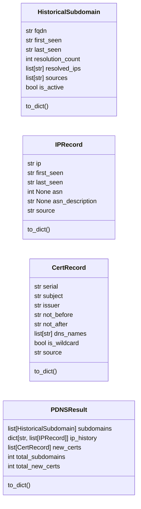
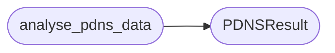

# `estorides_core.pdns_monitor`

> Source: [estorides_core/pdns_monitor.py:1](../../estorides_core/pdns_monitor.py#L1) | language `py` | coverage 0.0% | [API index](../index.md)

## Contents

- **Classes:** [`HistoricalSubdomain`](#historicalsubdomain), [`IPRecord`](#iprecord), [`CertRecord`](#certrecord), [`PDNSResult`](#pdnsresult)
- **Functions:** [`classify_subdomain_status`](#classify_subdomain_status), [`extract_sans_from_cert`](#extract_sans_from_cert), [`analyse_pdns_data`](#analyse_pdns_data)
- **Constants:** [`MONITOR_POLL_INTERVAL_S`](#monitor_poll_interval_s)

## Type Diagram



## Call Graph

Solid arrows stay in this module, dashed arrows leave it.



## Classes

<a id="historicalsubdomain"></a>

### `HistoricalSubdomain`

`class` `dataclass` | [estorides_core/pdns_monitor.py:13](../../estorides_core/pdns_monitor.py#L13)

Decorators: `@dataclass`

```python
class HistoricalSubdomain
```

**Attributes**

| Name | Type | Default | Description |
|---|---|---|---|
| [`fqdn`](#historicalsubdomain-fqdn) | `str` |  |  |
| [`first_seen`](#historicalsubdomain-first_seen) | `str` |  |  |
| [`last_seen`](#historicalsubdomain-last_seen) | `str` |  |  |
| [`resolution_count`](#historicalsubdomain-resolution_count) | `int` |  |  |
| [`resolved_ips`](#historicalsubdomain-resolved_ips) | `list[str]` |  |  |
| [`sources`](#historicalsubdomain-sources) | `list[str]` |  |  |
| [`is_active`](#historicalsubdomain-is_active) | `bool` |  |  |

**Members**

| Member | Kind | Summary |
|---|---|---|
| [`to_dict`](#historicalsubdomain-to_dict) | method |  |

<a id="historicalsubdomain-to_dict"></a>

#### `HistoricalSubdomain.to_dict`

`method` | [estorides_core/pdns_monitor.py:22](../../estorides_core/pdns_monitor.py#L22)

```python
def to_dict(self) -> dict[str, Any]
```

**Returns:** `dict[str, Any]`

---

<a id="iprecord"></a>

### `IPRecord`

`class` `dataclass` | [estorides_core/pdns_monitor.py:27](../../estorides_core/pdns_monitor.py#L27)

Decorators: `@dataclass`

```python
class IPRecord
```

**Attributes**

| Name | Type | Default | Description |
|---|---|---|---|
| [`ip`](#iprecord-ip) | `str` |  |  |
| [`first_seen`](#iprecord-first_seen) | `str` |  |  |
| [`last_seen`](#iprecord-last_seen) | `str` |  |  |
| [`asn`](#iprecord-asn) | `int \| None` |  |  |
| [`asn_description`](#iprecord-asn_description) | `str \| None` |  |  |
| [`source`](#iprecord-source) | `str` |  |  |

**Members**

| Member | Kind | Summary |
|---|---|---|
| [`to_dict`](#iprecord-to_dict) | method |  |

<a id="iprecord-to_dict"></a>

#### `IPRecord.to_dict`

`method` | [estorides_core/pdns_monitor.py:35](../../estorides_core/pdns_monitor.py#L35)

```python
def to_dict(self) -> dict[str, Any]
```

**Returns:** `dict[str, Any]`

---

<a id="certrecord"></a>

### `CertRecord`

`class` `dataclass` | [estorides_core/pdns_monitor.py:40](../../estorides_core/pdns_monitor.py#L40)

Decorators: `@dataclass`

```python
class CertRecord
```

**Attributes**

| Name | Type | Default | Description |
|---|---|---|---|
| [`serial`](#certrecord-serial) | `str` |  |  |
| [`subject`](#certrecord-subject) | `str` |  |  |
| [`issuer`](#certrecord-issuer) | `str` |  |  |
| [`not_before`](#certrecord-not_before) | `str` |  |  |
| [`not_after`](#certrecord-not_after) | `str` |  |  |
| [`dns_names`](#certrecord-dns_names) | `list[str]` |  |  |
| [`is_wildcard`](#certrecord-is_wildcard) | `bool` |  |  |
| [`source`](#certrecord-source) | `str` |  |  |

**Members**

| Member | Kind | Summary |
|---|---|---|
| [`to_dict`](#certrecord-to_dict) | method |  |

<a id="certrecord-to_dict"></a>

#### `CertRecord.to_dict`

`method` | [estorides_core/pdns_monitor.py:50](../../estorides_core/pdns_monitor.py#L50)

```python
def to_dict(self) -> dict[str, Any]
```

**Returns:** `dict[str, Any]`

---

<a id="pdnsresult"></a>

### `PDNSResult`

`class` `dataclass` | [estorides_core/pdns_monitor.py:55](../../estorides_core/pdns_monitor.py#L55)

Decorators: `@dataclass`

```python
class PDNSResult
```

**Attributes**

| Name | Type | Default | Description |
|---|---|---|---|
| [`subdomains`](#pdnsresult-subdomains) | `list[HistoricalSubdomain]` | `field(default_factory=list)` |  |
| [`ip_history`](#pdnsresult-ip_history) | `dict[str, list[IPRecord]]` | `field(default_factory=dict)` |  |
| [`new_certs`](#pdnsresult-new_certs) | `list[CertRecord]` | `field(default_factory=list)` |  |
| [`total_subdomains`](#pdnsresult-total_subdomains) | `int` | `0` |  |
| [`total_new_certs`](#pdnsresult-total_new_certs) | `int` | `0` |  |

**Members**

| Member | Kind | Summary |
|---|---|---|
| [`to_dict`](#pdnsresult-to_dict) | method |  |

<a id="pdnsresult-to_dict"></a>

#### `PDNSResult.to_dict`

`method` | [estorides_core/pdns_monitor.py:62](../../estorides_core/pdns_monitor.py#L62)

```python
def to_dict(self) -> dict[str, Any]
```

**Returns:** `dict[str, Any]`

---

## Functions

<a id="classify_subdomain_status"></a>

### `classify_subdomain_status`

`function` | [estorides_core/pdns_monitor.py:72](../../estorides_core/pdns_monitor.py#L72)

```python
def classify_subdomain_status(fqdn: str, resolved_ips: list[str]) -> bool
```

**Parameters**

| Name | Type | Default | Description |
|---|---|---|---|
| `fqdn` | `str` |  |  |
| `resolved_ips` | `list[str]` |  |  |

**Returns:** `bool`

---

<a id="extract_sans_from_cert"></a>

### `extract_sans_from_cert`

`function` | [estorides_core/pdns_monitor.py:76](../../estorides_core/pdns_monitor.py#L76)

```python
def extract_sans_from_cert(cert: CertRecord) -> list[str]
```

**Parameters**

| Name | Type | Default | Description |
|---|---|---|---|
| `cert` | `CertRecord` |  |  |

**Returns:** `list[str]`

---

<a id="analyse_pdns_data"></a>

### `analyse_pdns_data`

`function` | [estorides_core/pdns_monitor.py:80](../../estorides_core/pdns_monitor.py#L80)

```python
def analyse_pdns_data(subdomains: list[HistoricalSubdomain], ip_history: dict[str, list[IPRecord]], new_certs: list[CertRecord]) -> PDNSResult
```

**Parameters**

| Name | Type | Default | Description |
|---|---|---|---|
| `subdomains` | `list[HistoricalSubdomain]` |  |  |
| `ip_history` | `dict[str, list[IPRecord]]` |  |  |
| `new_certs` | `list[CertRecord]` |  |  |

**Returns:** `PDNSResult`

*Calls:* [`PDNSResult`](#pdnsresult)

*Called by:* [`run_passive_recon`](estorides_core.recon_pipeline.py.md#run_passive_recon)

---

## Constants

<a id="monitor_poll_interval_s"></a>

### `MONITOR_POLL_INTERVAL_S`

`constant` | [estorides_core/pdns_monitor.py:9](../../estorides_core/pdns_monitor.py#L9)

```python
MONITOR_POLL_INTERVAL_S = 3600
```

---
