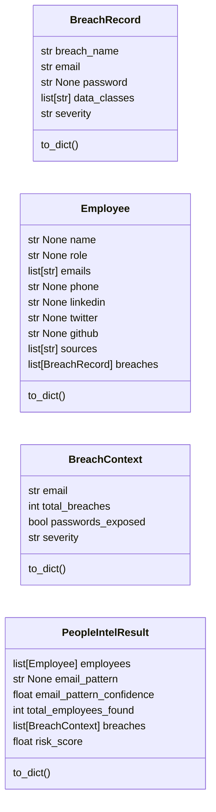
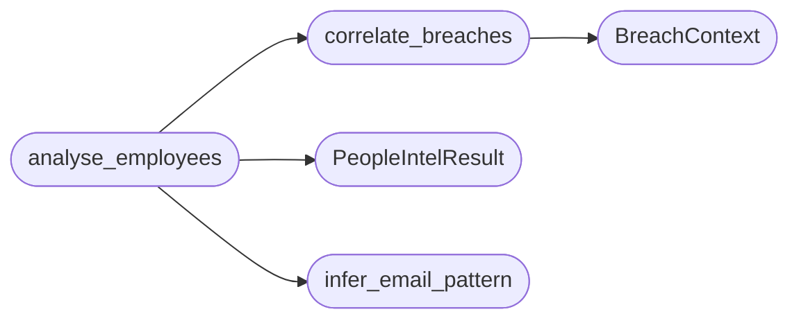

# `estorides_core.people_intel`

> Source: [estorides_core/people_intel.py:1](../../estorides_core/people_intel.py#L1) | language `py` | coverage 0.0% | [API index](../index.md)

## Contents

- **Classes:** [`BreachRecord`](#breachrecord), [`Employee`](#employee), [`BreachContext`](#breachcontext), [`PeopleIntelResult`](#peopleintelresult)
- **Functions:** [`infer_email_pattern`](#infer_email_pattern), [`correlate_breaches`](#correlate_breaches), [`analyse_employees`](#analyse_employees)
- **Constants:** [`DOMAIN_RE`](#domain_re), [`EMAIL_RE`](#email_re)

## Type Diagram



## Call Graph

Solid arrows stay in this module, dashed arrows leave it.



## Classes

<a id="breachrecord"></a>

### `BreachRecord`

`class` `dataclass` | [estorides_core/people_intel.py:15](../../estorides_core/people_intel.py#L15)

Decorators: `@dataclass`

```python
class BreachRecord
```

**Attributes**

| Name | Type | Default | Description |
|---|---|---|---|
| [`breach_name`](#breachrecord-breach_name) | `str` |  |  |
| [`email`](#breachrecord-email) | `str` |  |  |
| [`password`](#breachrecord-password) | `str \| None` |  |  |
| [`data_classes`](#breachrecord-data_classes) | `list[str]` |  |  |
| [`severity`](#breachrecord-severity) | `str` |  |  |

**Members**

| Member | Kind | Summary |
|---|---|---|
| [`to_dict`](#breachrecord-to_dict) | method |  |

<a id="breachrecord-to_dict"></a>

#### `BreachRecord.to_dict`

`method` | [estorides_core/people_intel.py:22](../../estorides_core/people_intel.py#L22)

```python
def to_dict(self) -> dict[str, Any]
```

**Returns:** `dict[str, Any]`

---

<a id="employee"></a>

### `Employee`

`class` `dataclass` | [estorides_core/people_intel.py:29](../../estorides_core/people_intel.py#L29)

Decorators: `@dataclass`

```python
class Employee
```

**Attributes**

| Name | Type | Default | Description |
|---|---|---|---|
| [`name`](#employee-name) | `str \| None` |  |  |
| [`role`](#employee-role) | `str \| None` |  |  |
| [`emails`](#employee-emails) | `list[str]` |  |  |
| [`phone`](#employee-phone) | `str \| None` |  |  |
| [`linkedin`](#employee-linkedin) | `str \| None` |  |  |
| [`twitter`](#employee-twitter) | `str \| None` |  |  |
| [`github`](#employee-github) | `str \| None` |  |  |
| [`sources`](#employee-sources) | `list[str]` |  |  |
| [`breaches`](#employee-breaches) | `list[BreachRecord]` | `field(default_factory=list)` |  |

**Members**

| Member | Kind | Summary |
|---|---|---|
| [`to_dict`](#employee-to_dict) | method |  |

<a id="employee-to_dict"></a>

#### `Employee.to_dict`

`method` | [estorides_core/people_intel.py:40](../../estorides_core/people_intel.py#L40)

```python
def to_dict(self) -> dict[str, Any]
```

**Returns:** `dict[str, Any]`

---

<a id="breachcontext"></a>

### `BreachContext`

`class` `dataclass` | [estorides_core/people_intel.py:56](../../estorides_core/people_intel.py#L56)

Decorators: `@dataclass`

```python
class BreachContext
```

**Attributes**

| Name | Type | Default | Description |
|---|---|---|---|
| [`email`](#breachcontext-email) | `str` |  |  |
| [`total_breaches`](#breachcontext-total_breaches) | `int` |  |  |
| [`passwords_exposed`](#breachcontext-passwords_exposed) | `bool` |  |  |
| [`severity`](#breachcontext-severity) | `str` |  |  |

**Members**

| Member | Kind | Summary |
|---|---|---|
| [`to_dict`](#breachcontext-to_dict) | method |  |

<a id="breachcontext-to_dict"></a>

#### `BreachContext.to_dict`

`method` | [estorides_core/people_intel.py:62](../../estorides_core/people_intel.py#L62)

```python
def to_dict(self) -> dict[str, Any]
```

**Returns:** `dict[str, Any]`

---

<a id="peopleintelresult"></a>

### `PeopleIntelResult`

`class` `dataclass` | [estorides_core/people_intel.py:67](../../estorides_core/people_intel.py#L67)

Decorators: `@dataclass`

```python
class PeopleIntelResult
```

**Attributes**

| Name | Type | Default | Description |
|---|---|---|---|
| [`employees`](#peopleintelresult-employees) | `list[Employee]` | `field(default_factory=list)` |  |
| [`email_pattern`](#peopleintelresult-email_pattern) | `str \| None` | `None` |  |
| [`email_pattern_confidence`](#peopleintelresult-email_pattern_confidence) | `float` | `0.0` |  |
| [`total_employees_found`](#peopleintelresult-total_employees_found) | `int` | `0` |  |
| [`breaches`](#peopleintelresult-breaches) | `list[BreachContext]` | `field(default_factory=list)` |  |
| [`risk_score`](#peopleintelresult-risk_score) | `float` | `0.0` |  |

**Members**

| Member | Kind | Summary |
|---|---|---|
| [`to_dict`](#peopleintelresult-to_dict) | method |  |

<a id="peopleintelresult-to_dict"></a>

#### `PeopleIntelResult.to_dict`

`method` | [estorides_core/people_intel.py:75](../../estorides_core/people_intel.py#L75)

```python
def to_dict(self) -> dict[str, Any]
```

**Returns:** `dict[str, Any]`

---

## Functions

<a id="infer_email_pattern"></a>

### `infer_email_pattern`

`function` | [estorides_core/people_intel.py:98](../../estorides_core/people_intel.py#L98)

```python
def infer_email_pattern(emails: list[str]) -> tuple[str | None, float]
```

**Parameters**

| Name | Type | Default | Description |
|---|---|---|---|
| `emails` | `list[str]` |  |  |

**Returns:** `tuple[str | None, float]`

*Called by:* [`analyse_employees`](#analyse_employees)

---

<a id="correlate_breaches"></a>

### `correlate_breaches`

`function` | [estorides_core/people_intel.py:153](../../estorides_core/people_intel.py#L153)

```python
def correlate_breaches(employees: list[Employee]) -> list[BreachContext]
```

**Parameters**

| Name | Type | Default | Description |
|---|---|---|---|
| `employees` | `list[Employee]` |  |  |

**Returns:** `list[BreachContext]`

*Calls:* [`BreachContext`](#breachcontext)

*Called by:* [`analyse_employees`](#analyse_employees)

---

<a id="analyse_employees"></a>

### `analyse_employees`

`function` | [estorides_core/people_intel.py:176](../../estorides_core/people_intel.py#L176)

```python
def analyse_employees(employees: list[Employee], domain: str) -> PeopleIntelResult
```

**Parameters**

| Name | Type | Default | Description |
|---|---|---|---|
| `employees` | `list[Employee]` |  |  |
| `domain` | `str` |  |  |

**Returns:** `PeopleIntelResult`

**Raises**

- `ValueError`: (raised in the body, not documented)

*Calls:* [`PeopleIntelResult`](#peopleintelresult), [`correlate_breaches`](#correlate_breaches), [`infer_email_pattern`](#infer_email_pattern)

*Called by:* [`run_passive_recon`](estorides_core.recon_pipeline.py.md#run_passive_recon)

---

## Constants

<a id="domain_re"></a>

### `DOMAIN_RE`

`constant` | [estorides_core/people_intel.py:10](../../estorides_core/people_intel.py#L10)

```python
DOMAIN_RE
```

---

<a id="email_re"></a>

### `EMAIL_RE`

`constant` | [estorides_core/people_intel.py:11](../../estorides_core/people_intel.py#L11)

```python
EMAIL_RE = re.compile('^[^@\\s]+@([^@\\s]+\\.[^@\\s]+)$')
```

---
