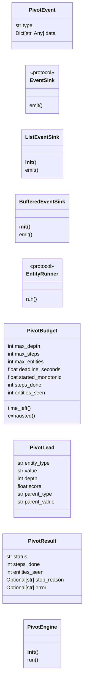
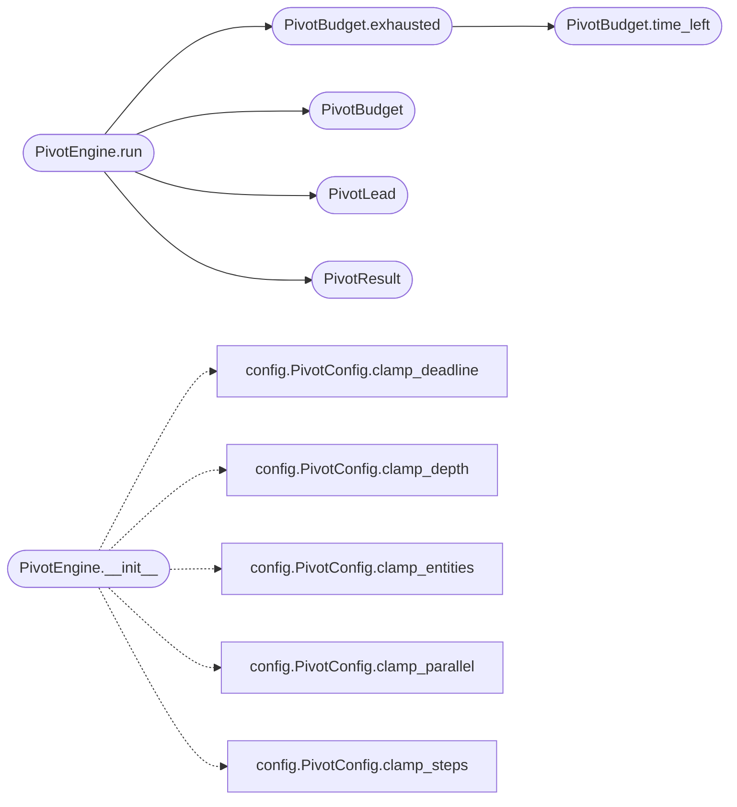

# `estorides_core.pivot_engine`

> Source: [estorides_core/pivot_engine.py:1](../../estorides_core/pivot_engine.py#L1) | language `py` | coverage 70.0% | [API index](../index.md)

estorides_core.pivot_engine =========================== Recursive, asynchronous cross-search engine — the Palantir-style core.

Given a seed selector (a domain, IP, email, ASN, wallet), the engine runs
the full OSINT fan-out, harvests the selectors that surface, scores them,
and re-queries the highest-value ones, hop by hop, until a bounded budget
is spent. Every hop appends to a single case so the cross-search reads as
one coherent investigation.

The design is deliberately decoupled (SOLID):

  * [`EntityRunner`](#entityrunner)  — an abstraction over "run one target, give me the
    observations and entities". Satisfied by the existing Orchestrator.
  * [`EventSink`](#eventsink)     — an abstraction over "publish a progress event". The
    SSE layer, a test list, or a log adapter all satisfy it. The engine
    knows nothing about HTTP.
  * [`PivotPolicyConfig`](estorides_core.config.py.md#pivotpolicyconfig) (in config) — decides which selectors pivot and
    how leads are scored. Swapping the policy swaps the behaviour without
    touching the engine (open/closed).
  * [`PivotConfig`](estorides_core.config.py.md#pivotconfig) (in config) — every bound and default. No literal in
    this module is a tunable number.

The frontier is a max-heap by lead score, so a high-signal selector (an
email, a wallet) expands before low-signal shared infrastructure at the
same depth. Confidence decays with depth and is carried on every emitted
entity so a downstream consumer can rank or prune.

## Contents

- **Classes:** [`PivotEvent`](#pivotevent), [`ListEventSink`](#listeventsink), [`BufferedEventSink`](#bufferedeventsink), [`PivotBudget`](#pivotbudget), [`PivotLead`](#pivotlead), [`PivotResult`](#pivotresult), [`PivotEngine`](#pivotengine)
- **Protocols:** [`EventSink`](#eventsink), [`EntityRunner`](#entityrunner)

## Type Diagram



## Call Graph

Solid arrows stay in this module, dashed arrows leave it.



## Classes

<a id="pivotevent"></a>

### `PivotEvent`

`class` `dataclass` | [estorides_core/pivot_engine.py:47](../../estorides_core/pivot_engine.py#L47)

Decorators: `@dataclass(frozen=True)`

```python
class PivotEvent
```

A single, transport-neutral progress event.

[`type`](#pivotevent-type) is a stable vocabulary token; [`data`](#pivotevent-data) is a JSON-serialisable
payload. Sinks translate these to their own wire format.

**Attributes**

| Name | Type | Default | Description |
|---|---|---|---|
| [`type`](#pivotevent-type) | `str` |  |  |
| [`data`](#pivotevent-data) | `Dict[str, Any]` |  |  |

---

<a id="listeventsink"></a>

### `ListEventSink`

`class` | [estorides_core/pivot_engine.py:67](../../estorides_core/pivot_engine.py#L67)

```python
class ListEventSink
```

In-memory sink.

Useful for tests and synchronous embedding.

**Members**

| Member | Kind | Summary |
|---|---|---|
| [`__init__`](#listeventsink-__init__) | constructor |  |
| [`emit`](#listeventsink-emit) | method |  |

<a id="listeventsink-__init__"></a>

#### `ListEventSink.__init__`

`constructor` | [estorides_core/pivot_engine.py:70](../../estorides_core/pivot_engine.py#L70)

```python
def __init__(self) -> None
```

<a id="listeventsink-emit"></a>

#### `ListEventSink.emit`

`method` | [estorides_core/pivot_engine.py:73](../../estorides_core/pivot_engine.py#L73)

```python
def emit(self, event: PivotEvent) -> None
```

**Parameters**

| Name | Type | Default | Description |
|---|---|---|---|
| `event` | `PivotEvent` |  |  |

---

<a id="bufferedeventsink"></a>

### `BufferedEventSink`

`class` | [estorides_core/pivot_engine.py:77](../../estorides_core/pivot_engine.py#L77)

```python
class BufferedEventSink
```

Bounded sink that flattens events to JSON-ready dicts for SSE drain.

Each stored item is `{"type": ..., "ts": ..., **data}`. When the buffer
exceeds `capacity` the oldest items are dropped and a `heartbeat` marker
records how many were lost, so a slow client degrades gracefully instead
of stalling the producer. The terminal `finished`/`fatal` event also
flips `done` so a poller knows when to stop without parsing payloads.

**Members**

| Member | Kind | Summary |
|---|---|---|
| [`__init__`](#bufferedeventsink-__init__) | constructor |  |
| [`emit`](#bufferedeventsink-emit) | method |  |

<a id="bufferedeventsink-__init__"></a>

#### `BufferedEventSink.__init__`

`constructor` | [estorides_core/pivot_engine.py:87](../../estorides_core/pivot_engine.py#L87)

```python
def __init__(self, capacity: int) -> None
```

**Parameters**

| Name | Type | Default | Description |
|---|---|---|---|
| `capacity` | `int` |  |  |

<a id="bufferedeventsink-emit"></a>

#### `BufferedEventSink.emit`

`method` | [estorides_core/pivot_engine.py:94](../../estorides_core/pivot_engine.py#L94)

```python
def emit(self, event: PivotEvent) -> None
```

**Parameters**

| Name | Type | Default | Description |
|---|---|---|---|
| `event` | `PivotEvent` |  |  |

---

<a id="pivotbudget"></a>

### `PivotBudget`

`class` `dataclass` | [estorides_core/pivot_engine.py:139](../../estorides_core/pivot_engine.py#L139)

Decorators: `@dataclass`

```python
class PivotBudget
```

Mutable accounting for one cross-search.

Holds the three hard ceilings (steps, entities, wall-clock) and the
monotonic clock the deadline is measured against. [`exhausted`](#pivotbudget-exhausted) returns
a human reason string the moment any ceiling is hit, else None.

**Attributes**

| Name | Type | Default | Description |
|---|---|---|---|
| [`max_depth`](#pivotbudget-max_depth) | `int` |  |  |
| [`max_steps`](#pivotbudget-max_steps) | `int` |  |  |
| [`max_entities`](#pivotbudget-max_entities) | `int` |  |  |
| [`deadline_seconds`](#pivotbudget-deadline_seconds) | `float` |  |  |
| [`started_monotonic`](#pivotbudget-started_monotonic) | `float` |  |  |
| [`steps_done`](#pivotbudget-steps_done) | `int` | `0` |  |
| [`entities_seen`](#pivotbudget-entities_seen) | `int` | `0` |  |

**Members**

| Member | Kind | Summary |
|---|---|---|
| [`time_left`](#pivotbudget-time_left) | method | Seconds remaining before the global wall-clock deadline. |
| [`exhausted`](#pivotbudget-exhausted) | method | Reason the run must stop, or None while budget remains. |

<a id="pivotbudget-time_left"></a>

#### `PivotBudget.time_left`

`method` | [estorides_core/pivot_engine.py:155](../../estorides_core/pivot_engine.py#L155)

```python
def time_left(self) -> float
```

Seconds remaining before the global wall-clock deadline.

**Returns:** `float`

*Called by:* [`PivotBudget.exhausted`](#pivotbudget-exhausted)

<a id="pivotbudget-exhausted"></a>

#### `PivotBudget.exhausted`

`method` | [estorides_core/pivot_engine.py:159](../../estorides_core/pivot_engine.py#L159)

```python
def exhausted(self) -> Optional[str]
```

Reason the run must stop, or None while budget remains.

**Returns:** `Optional[str]`

*Calls:* [`PivotBudget.time_left`](#pivotbudget-time_left)

*Called by:* [`PivotEngine.run`](#pivotengine-run)

---

<a id="pivotlead"></a>

### `PivotLead`

`class` `dataclass` | [estorides_core/pivot_engine.py:172](../../estorides_core/pivot_engine.py#L172)

Decorators: `@dataclass(frozen=True)`

```python
class PivotLead
```

A target waiting in the frontier.

**Attributes**

| Name | Type | Default | Description |
|---|---|---|---|
| [`entity_type`](#pivotlead-entity_type) | `str` |  |  |
| [`value`](#pivotlead-value) | `str` |  |  |
| [`depth`](#pivotlead-depth) | `int` |  |  |
| [`score`](#pivotlead-score) | `float` |  |  |
| [`parent_type`](#pivotlead-parent_type) | `str` |  |  |
| [`parent_value`](#pivotlead-parent_value) | `str` |  |  |

---

<a id="pivotresult"></a>

### `PivotResult`

`class` `dataclass` | [estorides_core/pivot_engine.py:184](../../estorides_core/pivot_engine.py#L184)

Decorators: `@dataclass`

```python
class PivotResult
```

Terminal summary of a completed cross-search.

**Attributes**

| Name | Type | Default | Description |
|---|---|---|---|
| [`status`](#pivotresult-status) | `str` |  |  |
| [`steps_done`](#pivotresult-steps_done) | `int` |  |  |
| [`entities_seen`](#pivotresult-entities_seen) | `int` |  |  |
| [`stop_reason`](#pivotresult-stop_reason) | `Optional[str]` | `None` |  |
| [`error`](#pivotresult-error) | `Optional[str]` | `None` |  |

---

<a id="pivotengine"></a>

### `PivotEngine`

`class` | [estorides_core/pivot_engine.py:195](../../estorides_core/pivot_engine.py#L195)

```python
class PivotEngine
```

Drives the recursive, scored, asynchronous cross-search.

**Members**

| Member | Kind | Summary |
|---|---|---|
| [`__init__`](#pivotengine-__init__) | constructor |  |
| [`run`](#pivotengine-run) | method | Execute the cross-search from `(seed_type, seed_value)`. |

<a id="pivotengine-__init__"></a>

#### `PivotEngine.__init__`

`constructor` | [estorides_core/pivot_engine.py:198](../../estorides_core/pivot_engine.py#L198)

```python
def __init__(self, runner: EntityRunner, sink: EventSink, *, config: PivotConfig = PIVOT, policy: Optional[PivotPolicyConfig] = None, max_depth: Optional[int] = None, max_steps: Optional[int] = None, max_entities: Optional[int] = None, per_target_timeout: Optional[float] = None, deadline_seconds: Optional[float] = None, parallel: Optional[int] = None, breadth_per_step: Optional[int] = None, case_id: Optional[str] = None, should_stop: Optional[Callable[[], bool]] = None, persist: bool = True, passive_only: bool = False, proxy: Optional[str] = None) -> None
```

**Parameters**

| Name | Type | Default | Description |
|---|---|---|---|
| `runner` | `EntityRunner` |  |  |
| `sink` | `EventSink` |  |  |
| `config` | `PivotConfig` | `PIVOT` |  |
| `policy` | `Optional[PivotPolicyConfig]` | `None` |  |
| `max_depth` | `Optional[int]` | `None` |  |
| `max_steps` | `Optional[int]` | `None` |  |
| `max_entities` | `Optional[int]` | `None` |  |
| `per_target_timeout` | `Optional[float]` | `None` |  |
| `deadline_seconds` | `Optional[float]` | `None` |  |
| `parallel` | `Optional[int]` | `None` |  |
| `breadth_per_step` | `Optional[int]` | `None` |  |
| `case_id` | `Optional[str]` | `None` |  |
| `should_stop` | `Optional[Callable[[], bool]]` | `None` |  |
| `persist` | `bool` | `True` |  |
| `passive_only` | `bool` | `False` |  |
| `proxy` | `Optional[str]` | `None` |  |

*Calls:* [`PivotConfig.clamp_deadline`](estorides_core.config.py.md#pivotconfig-clamp_deadline), [`PivotConfig.clamp_depth`](estorides_core.config.py.md#pivotconfig-clamp_depth), [`PivotConfig.clamp_entities`](estorides_core.config.py.md#pivotconfig-clamp_entities), [`PivotConfig.clamp_parallel`](estorides_core.config.py.md#pivotconfig-clamp_parallel), [`PivotConfig.clamp_steps`](estorides_core.config.py.md#pivotconfig-clamp_steps)

*Called by:* [`create_app`](estorides_web.py.md#create_app)

<a id="pivotengine-run"></a>

#### `PivotEngine.run`

`method` `async` | [estorides_core/pivot_engine.py:264](../../estorides_core/pivot_engine.py#L264)

```python
async def run(self, seed_type: str, seed_value: str) -> PivotResult
```

Execute the cross-search from `(seed_type, seed_value)`.

Returns a [`PivotResult`](#pivotresult). Progress is published incrementally
through the injected sink while the coroutine is in flight.

**Parameters**

| Name | Type | Default | Description |
|---|---|---|---|
| `seed_type` | `str` |  |  |
| `seed_value` | `str` |  |  |

**Returns:** `PivotResult`

*Calls:* [`PivotBudget`](#pivotbudget), [`PivotBudget.exhausted`](#pivotbudget-exhausted), [`PivotLead`](#pivotlead), [`PivotResult`](#pivotresult)

*Called by:* [`create_app`](estorides_web.py.md#create_app)

---

## Protocols

<a id="eventsink"></a>

### `EventSink`

`protocol` | [estorides_core/pivot_engine.py:59](../../estorides_core/pivot_engine.py#L59)

Decorators: `@runtime_checkable`

```python
class EventSink(Protocol)
```

Bases: `Protocol`

Receives engine progress events.

Implementations must not raise.

**Members**

| Member | Kind | Summary |
|---|---|---|
| [`emit`](#eventsink-emit) | method | Publish one event. |

<a id="eventsink-emit"></a>

#### `EventSink.emit`

`method` | [estorides_core/pivot_engine.py:62](../../estorides_core/pivot_engine.py#L62)

```python
def emit(self, event: PivotEvent) -> None
```

Publish one event.

A slow or failing sink must never break a run.

**Parameters**

| Name | Type | Default | Description |
|---|---|---|---|
| `event` | `PivotEvent` |  |  |

---

<a id="entityrunner"></a>

### `EntityRunner`

`protocol` | [estorides_core/pivot_engine.py:113](../../estorides_core/pivot_engine.py#L113)

Decorators: `@runtime_checkable`

```python
class EntityRunner(Protocol)
```

Bases: `Protocol`

Runs the OSINT fan-out for a single target.

The engine depends on this narrow port rather than the concrete
Orchestrator, so it can be driven by a stub in tests.

**Members**

| Member | Kind | Summary |
|---|---|---|
| [`run`](#entityrunner-run) | method |  |

<a id="entityrunner-run"></a>

#### `EntityRunner.run`

`method` `async` | [estorides_core/pivot_engine.py:120](../../estorides_core/pivot_engine.py#L120)

```python
async def run(self, query: str, *, parallel: int, timeout: float, deadline: float, on_source_done: Optional[Callable[..., None]], on_source_result: Optional[Callable[..., None]], persist: bool, case_id: Optional[str], passive_only: bool = False, proxy: Optional[str] = None) -> Dict[str, Any]
```

**Parameters**

| Name | Type | Default | Description |
|---|---|---|---|
| `query` | `str` |  |  |
| `parallel` | `int` |  |  |
| `timeout` | `float` |  |  |
| `deadline` | `float` |  |  |
| `on_source_done` | `Optional[Callable[..., None]]` |  |  |
| `on_source_result` | `Optional[Callable[..., None]]` |  |  |
| `persist` | `bool` |  |  |
| `case_id` | `Optional[str]` |  |  |
| `passive_only` | `bool` | `False` |  |
| `proxy` | `Optional[str]` | `None` |  |

**Returns:** `Dict[str, Any]`

---
