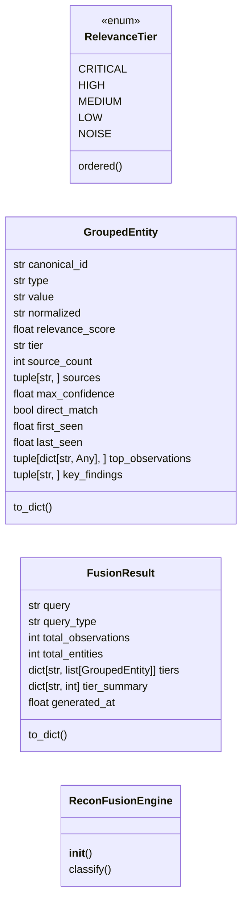
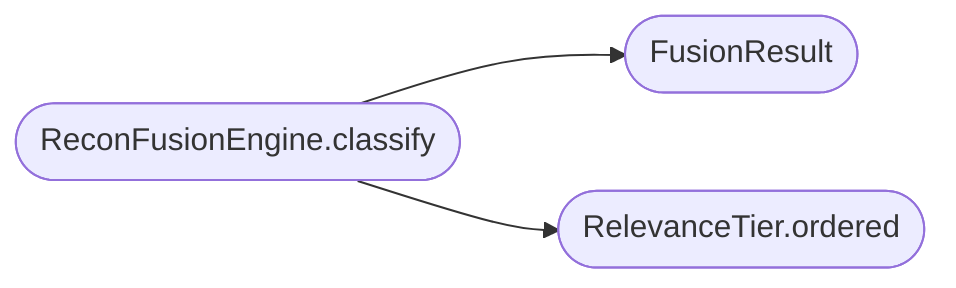

# `estorides_core.recon_fusion`

> Source: [estorides_core/recon_fusion.py:1](../../estorides_core/recon_fusion.py#L1) | language `py` | coverage 70.0% | [API index](../index.md)

estorides_core.recon_fusion =========================== Passive reconnaissance fusion engine: groups, deduplicates and classifies OSINT results by relevance tier so the operator sees the most useful information first.

Pure transformation: List[Observation] + List[Entity] + Query -> FusionResult.

## Contents

- **Classes:** [`GroupedEntity`](#groupedentity), [`FusionResult`](#fusionresult), [`ReconFusionEngine`](#reconfusionengine)
- **Enums:** [`RelevanceTier`](#relevancetier)

## Type Diagram



## Call Graph

Solid arrows stay in this module, dashed arrows leave it.



## Classes

<a id="groupedentity"></a>

### `GroupedEntity`

`class` `dataclass` | [estorides_core/recon_fusion.py:46](../../estorides_core/recon_fusion.py#L46)

Decorators: `@dataclass(frozen=True)`

```python
class GroupedEntity
```

One canonical entity grouped across all sources that observed it.

**Attributes**

| Name | Type | Default | Description |
|---|---|---|---|
| [`canonical_id`](#groupedentity-canonical_id) | `str` |  |  |
| [`type`](#groupedentity-type) | `str` |  |  |
| [`value`](#groupedentity-value) | `str` |  |  |
| [`normalized`](#groupedentity-normalized) | `str` |  |  |
| [`relevance_score`](#groupedentity-relevance_score) | `float` |  |  |
| [`tier`](#groupedentity-tier) | `str` |  |  |
| [`source_count`](#groupedentity-source_count) | `int` |  |  |
| [`sources`](#groupedentity-sources) | `tuple[str, ...]` |  |  |
| [`max_confidence`](#groupedentity-max_confidence) | `float` |  |  |
| [`direct_match`](#groupedentity-direct_match) | `bool` |  |  |
| [`first_seen`](#groupedentity-first_seen) | `float` |  |  |
| [`last_seen`](#groupedentity-last_seen) | `float` |  |  |
| [`top_observations`](#groupedentity-top_observations) | `tuple[dict[str, Any], ...]` |  |  |
| [`key_findings`](#groupedentity-key_findings) | `tuple[str, ...]` |  |  |

**Members**

| Member | Kind | Summary |
|---|---|---|
| [`to_dict`](#groupedentity-to_dict) | method |  |

<a id="groupedentity-to_dict"></a>

#### `GroupedEntity.to_dict`

`method` | [estorides_core/recon_fusion.py:64](../../estorides_core/recon_fusion.py#L64)

```python
def to_dict(self) -> dict[str, Any]
```

**Returns:** `dict[str, Any]`

---

<a id="fusionresult"></a>

### `FusionResult`

`class` `dataclass` | [estorides_core/recon_fusion.py:84](../../estorides_core/recon_fusion.py#L84)

Decorators: `@dataclass(frozen=True)`

```python
class FusionResult
```

Complete output of the recon fusion engine.

**Attributes**

| Name | Type | Default | Description |
|---|---|---|---|
| [`query`](#fusionresult-query) | `str` |  |  |
| [`query_type`](#fusionresult-query_type) | `str` |  |  |
| [`total_observations`](#fusionresult-total_observations) | `int` |  |  |
| [`total_entities`](#fusionresult-total_entities) | `int` |  |  |
| [`tiers`](#fusionresult-tiers) | `dict[str, list[GroupedEntity]]` |  |  |
| [`tier_summary`](#fusionresult-tier_summary) | `dict[str, int]` |  |  |
| [`generated_at`](#fusionresult-generated_at) | `float` |  |  |

**Members**

| Member | Kind | Summary |
|---|---|---|
| [`to_dict`](#fusionresult-to_dict) | method |  |

<a id="fusionresult-to_dict"></a>

#### `FusionResult.to_dict`

`method` | [estorides_core/recon_fusion.py:95](../../estorides_core/recon_fusion.py#L95)

```python
def to_dict(self) -> dict[str, Any]
```

**Returns:** `dict[str, Any]`

---

<a id="reconfusionengine"></a>

### `ReconFusionEngine`

`class` | [estorides_core/recon_fusion.py:160](../../estorides_core/recon_fusion.py#L160)

```python
class ReconFusionEngine
```

Stateless engine that classifies raw OSINT results into relevance tiers.

Thread-safe (no mutable state). Reusable across requests.

**Members**

| Member | Kind | Summary |
|---|---|---|
| [`__init__`](#reconfusionengine-__init__) | constructor |  |
| [`classify`](#reconfusionengine-classify) | method | Classify raw observations and entities into relevance-tiered groups. |

<a id="reconfusionengine-__init__"></a>

#### `ReconFusionEngine.__init__`

`constructor` | [estorides_core/recon_fusion.py:166](../../estorides_core/recon_fusion.py#L166)

```python
def __init__(self, config: ReconFusionConfig | None = None) -> None
```

**Parameters**

| Name | Type | Default | Description |
|---|---|---|---|
| `config` | `ReconFusionConfig \| None` | `None` |  |

*Called by:* [`Orchestrator.run`](estorides_core.orchestrator.py.md#orchestrator-run)

<a id="reconfusionengine-classify"></a>

#### `ReconFusionEngine.classify`

`method` | [estorides_core/recon_fusion.py:169](../../estorides_core/recon_fusion.py#L169)

```python
def classify(self, query: str, query_type: str, observations: list[dict[str, Any]] | None, entities: list[dict[str, Any]] | None) -> FusionResult
```

Classify raw observations and entities into relevance-tiered groups.

**Parameters**

| Name | Type | Default | Description |
|---|---|---|---|
| `query` | `str` |  | The original operator query (non-empty). |
| `query_type` | `str` |  | Detected type of the query. |
| `observations` | `list[dict[str, Any]] \| None` |  | Raw observation dicts from the orchestrator. |
| `entities` | `list[dict[str, Any]] \| None` |  | Raw entity dicts from entity extraction. |

**Returns:** `FusionResult` - FusionResult with tiered, grouped, deduplicated results.

**Raises**

- `ValueError`: If query is empty.

*Calls:* [`FusionResult`](#fusionresult), [`RelevanceTier.ordered`](#relevancetier-ordered)

*Called by:* [`Orchestrator.run`](estorides_core.orchestrator.py.md#orchestrator-run)

---

## Enums

<a id="relevancetier"></a>

### `RelevanceTier`

`enum` | [estorides_core/recon_fusion.py:27](../../estorides_core/recon_fusion.py#L27)

```python
class RelevanceTier(str, Enum)
```

Bases: `str`, `Enum`

Relevance classification for grouped reconnaissance results.

Ordered from most to least relevant for UI rendering.

**Attributes**

| Name | Type | Default | Description |
|---|---|---|---|
| [`CRITICAL`](#relevancetier-critical) |  | `'critical'` |  |
| [`HIGH`](#relevancetier-high) |  | `'high'` |  |
| [`MEDIUM`](#relevancetier-medium) |  | `'medium'` |  |
| [`LOW`](#relevancetier-low) |  | `'low'` |  |
| [`NOISE`](#relevancetier-noise) |  | `'noise'` |  |

**Members**

| Member | Kind | Summary |
|---|---|---|
| [`ordered`](#relevancetier-ordered) | classmethod | Return tiers in canonical display order. |

<a id="relevancetier-ordered"></a>

#### `RelevanceTier.ordered`

`classmethod` | [estorides_core/recon_fusion.py:40](../../estorides_core/recon_fusion.py#L40)

Decorators: `@classmethod`

```python
def ordered(cls) -> list[RelevanceTier]
```

Return tiers in canonical display order.

**Returns:** `list[RelevanceTier]`

*Called by:* [`ReconFusionEngine.classify`](#reconfusionengine-classify)

---
