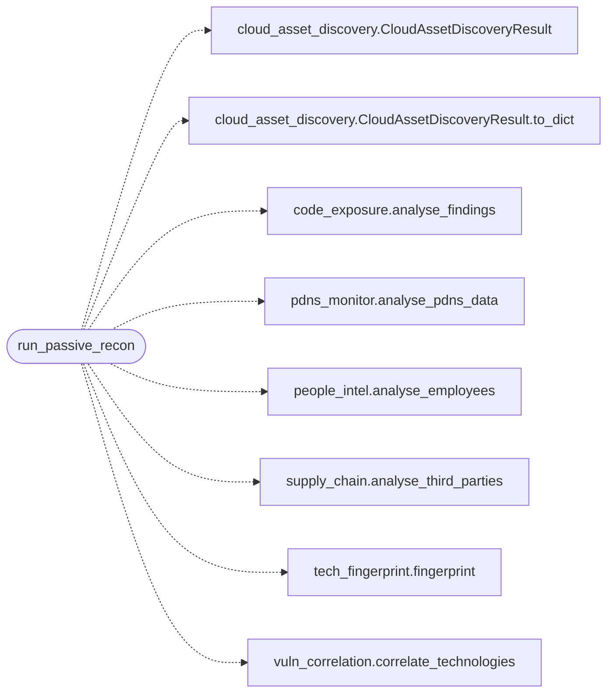

# `estorides_core.recon_pipeline`

> Source: [estorides_core/recon_pipeline.py:1](../../estorides_core/recon_pipeline.py#L1) | language `py` | coverage 0.0% | [API index](../index.md)

## Contents

- **Functions:** [`run_passive_recon`](#run_passive_recon)

## Call Graph

Solid arrows stay in this module, dashed arrows leave it.



## Functions

<a id="run_passive_recon"></a>

### `run_passive_recon`

`function` | [estorides_core/recon_pipeline.py:22](../../estorides_core/recon_pipeline.py#L22)

```python
def run_passive_recon(query: str, headers: dict | None = None, html: str | None = None, cookies: list[str] | None = None, employees: list[Employee] | None = None, code_findings: list | None = None, third_parties: list[ThirdParty] | None = None, pdns_subdomains: list | None = None, cloud_assets: list | None = None) -> dict
```

**Parameters**

| Name | Type | Default | Description |
|---|---|---|---|
| `query` | `str` |  |  |
| `headers` | `dict \| None` | `None` |  |
| `html` | `str \| None` | `None` |  |
| `cookies` | `list[str] \| None` | `None` |  |
| `employees` | `list[Employee] \| None` | `None` |  |
| `code_findings` | `list \| None` | `None` |  |
| `third_parties` | `list[ThirdParty] \| None` | `None` |  |
| `pdns_subdomains` | `list \| None` | `None` |  |
| `cloud_assets` | `list \| None` | `None` |  |

**Returns:** `dict`

*Calls:* [`CloudAssetDiscoveryResult`](estorides_core.cloud_asset_discovery.py.md#cloudassetdiscoveryresult), [`CloudAssetDiscoveryResult.to_dict`](estorides_core.cloud_asset_discovery.py.md#cloudassetdiscoveryresult-to_dict), [`analyse_findings`](estorides_core.code_exposure.py.md#analyse_findings), [`analyse_pdns_data`](estorides_core.pdns_monitor.py.md#analyse_pdns_data), [`analyse_employees`](estorides_core.people_intel.py.md#analyse_employees), [`analyse_third_parties`](estorides_core.supply_chain.py.md#analyse_third_parties), [`fingerprint`](estorides_core.tech_fingerprint.py.md#fingerprint), [`correlate_technologies`](estorides_core.vuln_correlation.py.md#correlate_technologies)

---
