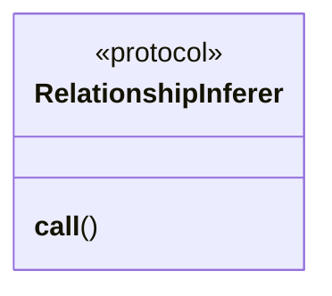
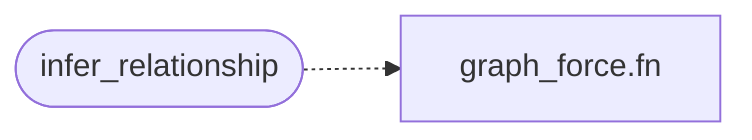

# `estorides_core.relationship_inference`

> Source: [estorides_core/relationship_inference.py:1](../../estorides_core/relationship_inference.py#L1) | language `py` | coverage 80.0% | [API index](../index.md)

estorides_core.relationship_inference ===================================== Strategy registry for deriving higher-level knowledge-graph edges from raw observations.

The orchestrator's old `_infer_relationships()` was a chain of
hard-coded `if src == "foo": ...` blocks — every new source that
wanted to contribute edges meant editing the central orchestrator.
This module replaces that with a registry: a [`RelationshipInferer`](#relationshipinferer)
is a small callable that knows how to translate one observation
into graph edges, and the orchestrator walks the registry.

Add a new inferer by:
  1. Writing a function `def my_inferer(observation, query, kg) -> None`
  2. Decorating it with `@register_inferer("source_name")`

The orchestrator picks the right inferer by the observation's
`source` field, so the source name and inferer name must match.

An inferer is a NO-OP if the observation has nothing useful to
contribute (returns None), or raises a `ValueError` if the
observation is malformed in a way the orchestrator should log
and skip.

## Contents

- **Protocols:** [`RelationshipInferer`](#relationshipinferer)
- **Functions:** [`register_inferer`](#register_inferer), [`infer_relationship`](#infer_relationship)
- **Constants:** [`INFERERS`](#inferers)

## Type Diagram



## Call Graph

Solid arrows stay in this module, dashed arrows leave it.



## Protocols

<a id="relationshipinferer"></a>

### `RelationshipInferer`

`protocol` | [estorides_core/relationship_inference.py:36](../../estorides_core/relationship_inference.py#L36)

Decorators: `@runtime_checkable`

```python
class RelationshipInferer(Protocol)
```

Bases: `Protocol`

Translate a single observation into one or more knowledge-graph edges.

**Parameters**

| Name | Type | Default | Description |
|---|---|---|---|
| `observation` |  |  | the structured observation dict produced by the orchestrator. Has keys: source, category, parsed, raw, meta. |
| `query` |  |  | the user's original query string. Useful for edges that connect a finding back to the pivot (e.g. "domain X resolved to IP Y for query X"). |
| `kg` |  |  | the KnowledgeGraph to mutate. The inferer adds nodes and edges via the existing [`add_relationship`](estorides_core.knowledge_graph.py.md#knowledgegraph-add_relationship) API. |

**Returns:** None. Side effects only: writes to the knowledge graph.

**Members**

| Member | Kind | Summary |
|---|---|---|
| [`__call__`](#relationshipinferer-__call__) | method |  |

<a id="relationshipinferer-__call__"></a>

#### `RelationshipInferer.__call__`

`method` | [estorides_core/relationship_inference.py:51](../../estorides_core/relationship_inference.py#L51)

```python
def __call__(self, observation: Dict[str, Any], query: str, kg: Any) -> None
```

**Parameters**

| Name | Type | Default | Description |
|---|---|---|---|
| `observation` | `Dict[str, Any]` |  |  |
| `query` | `str` |  |  |
| `kg` | `Any` |  |  |

---

## Functions

<a id="register_inferer"></a>

### `register_inferer`

`function` | [estorides_core/relationship_inference.py:63](../../estorides_core/relationship_inference.py#L63)

```python
def register_inferer(source_name: str) -> Callable[[RelationshipInferer], RelationshipInferer]
```

Decorator: register `func` as the inferer for `source_name`.

Re-registration is a debug log + overwrite; the orchestrator picks
the LAST registered inferer for a given source name, so a test
can monkey-patch an inferer without monkey-patching the source.

**Parameters**

| Name | Type | Default | Description |
|---|---|---|---|
| `source_name` | `str` |  |  |

**Returns:** `Callable[[RelationshipInferer], RelationshipInferer]`

---

<a id="infer_relationship"></a>

### `infer_relationship`

`function` | [estorides_core/relationship_inference.py:78](../../estorides_core/relationship_inference.py#L78)

```python
def infer_relationship(observation: Dict[str, Any], query: str, kg: Any) -> bool
```

Dispatch an observation to its inferer (if any).

Returns True if an inferer ran, False otherwise. An inferer that
raises is logged at WARNING and returns False; the orchestrator
keeps going so one bad source doesn't poison the whole run.

**Parameters**

| Name | Type | Default | Description |
|---|---|---|---|
| `observation` | `Dict[str, Any]` |  |  |
| `query` | `str` |  |  |
| `kg` | `Any` |  |  |

**Returns:** `bool`

*Calls:* [`fn`](static.js.graph_force.js.md#fn)

---

## Constants

<a id="inferers"></a>

### `INFERERS`

`constant` | [estorides_core/relationship_inference.py:60](../../estorides_core/relationship_inference.py#L60)

```python
INFERERS: Dict[str, RelationshipInferer] = {}
```

---
