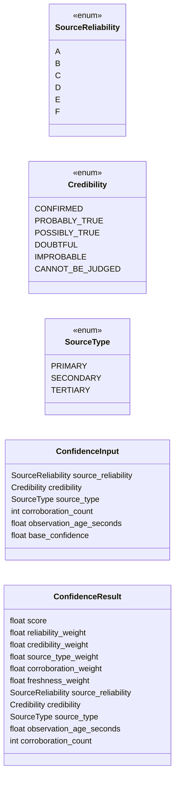
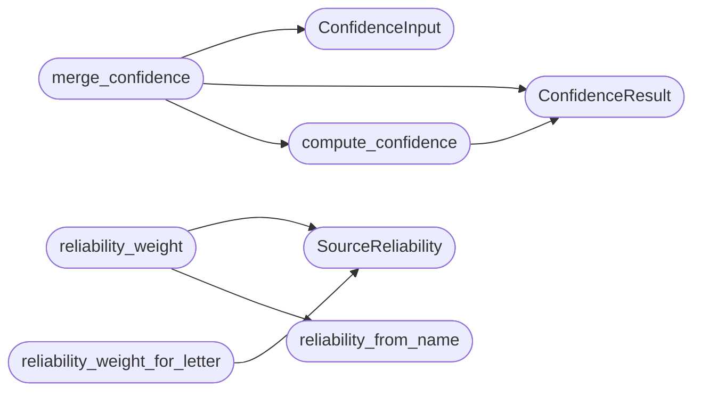

# `estorides_core.reliability_scoring`

> Source: [estorides_core/reliability_scoring.py:1](../../estorides_core/reliability_scoring.py#L1) | language `py` | coverage 100.0% | [API index](../index.md)

estorides_core.reliability_scoring ================================== Single source of truth for the ``confidence`` of an observation.

Replaces the two incompatible heuristics that used to live in
[`estorides_core.entity_extraction`](estorides_core.entity_extraction.py.md) (``min(1.0, c + 0.1)``) and
[`estorides_core.fusion_store`](estorides_core.fusion_store.py.md) (``MAX(existing, incoming)``). The
model is NATO Admiralty System (source reliability A-F x information
credibility 1-6) extended with three operational factors: source type
hierarchy (primary/secondary/tertiary), corroboration
(``min(1, log10(1 + n))`` over independent sources), and freshness
(exp half-life). Pure functions, no I/O, no logging, fail-loud on
programmer input, fail-soft on operator input.

The public surface:

    SourceReliability     enum str  {A, B, C, D, E, F}
    Credibility           enum int  {1..6}
    SourceType            enum str  {primary, secondary, tertiary}
    ConfidenceInput       dataclass, validated
    ConfidenceResult      dataclass frozen, JSON-serialisable
    compute_confidence    pure, O(1), no I/O
    merge_confidence      pure, O(1), no I/O
    reliability_from_name pure, never raises, never logs input
    source_type_from_name pure, never raises, never logs input

## Contents

- **Classes:** [`ConfidenceInput`](#confidenceinput), [`ConfidenceResult`](#confidenceresult)
- **Enums:** [`SourceReliability`](#sourcereliability), [`Credibility`](#credibility), [`SourceType`](#sourcetype)
- **Functions:** [`compute_confidence`](#compute_confidence), [`merge_confidence`](#merge_confidence), [`reliability_from_name`](#reliability_from_name), [`source_type_from_name`](#source_type_from_name), [`reliability_weight`](#reliability_weight), [`reliability_weight_for_letter`](#reliability_weight_for_letter)
- **Constants:** [`RELIABILITY_WEIGHT`](#reliability_weight), [`CREDIBILITY_WEIGHT`](#credibility_weight), [`SOURCE_TYPE_WEIGHT`](#source_type_weight), [`DEFAULT_RELIABILITY`](#default_reliability), [`DEFAULT_CREDIBILITY`](#default_credibility), [`DEFAULT_SOURCE_TYPE`](#default_source_type), [`DEFAULT_HALF_LIFE_DAYS`](#default_half_life_days), [`SOURCE_RELIABILITY_MAP`](#source_reliability_map), [`SOURCE_TYPE_MAP`](#source_type_map)

## Type Diagram



## Call Graph

Solid arrows stay in this module, dashed arrows leave it.



## Classes

<a id="confidenceinput"></a>

### `ConfidenceInput`

`class` `dataclass` | [estorides_core/reliability_scoring.py:243](../../estorides_core/reliability_scoring.py#L243)

Decorators: `@dataclass(frozen=True)`

```python
class ConfidenceInput
```

Validated input to [`compute_confidence`](#compute_confidence).

**Attributes**

| Name | Type | Default | Description |
|---|---|---|---|
| [`source_reliability`](#confidenceinput-source_reliability) | `SourceReliability` | `DEFAULT_RELIABILITY` |  |
| [`credibility`](#confidenceinput-credibility) | `Credibility` | `DEFAULT_CREDIBILITY` |  |
| [`source_type`](#confidenceinput-source_type) | `SourceType` | `DEFAULT_SOURCE_TYPE` |  |
| [`corroboration_count`](#confidenceinput-corroboration_count) | `int` | `0` |  |
| [`observation_age_seconds`](#confidenceinput-observation_age_seconds) | `float` | `0.0` |  |
| [`base_confidence`](#confidenceinput-base_confidence) | `float` | `1.0` |  |

---

<a id="confidenceresult"></a>

### `ConfidenceResult`

`class` `dataclass` | [estorides_core/reliability_scoring.py:263](../../estorides_core/reliability_scoring.py#L263)

Decorators: `@dataclass(frozen=True)`

```python
class ConfidenceResult
```

Auditable output of [`compute_confidence`](#compute_confidence) / [`merge_confidence`](#merge_confidence).

**Attributes**

| Name | Type | Default | Description |
|---|---|---|---|
| [`score`](#confidenceresult-score) | `float` |  |  |
| [`reliability_weight`](#confidenceresult-reliability_weight) | `float` |  |  |
| [`credibility_weight`](#confidenceresult-credibility_weight) | `float` |  |  |
| [`source_type_weight`](#confidenceresult-source_type_weight) | `float` |  |  |
| [`corroboration_weight`](#confidenceresult-corroboration_weight) | `float` |  |  |
| [`freshness_weight`](#confidenceresult-freshness_weight) | `float` |  |  |
| [`source_reliability`](#confidenceresult-source_reliability) | `SourceReliability` |  |  |
| [`credibility`](#confidenceresult-credibility) | `Credibility` |  |  |
| [`source_type`](#confidenceresult-source_type) | `SourceType` |  |  |
| [`observation_age_seconds`](#confidenceresult-observation_age_seconds) | `float` |  |  |
| [`corroboration_count`](#confidenceresult-corroboration_count) | `int` |  |  |

---

## Enums

<a id="sourcereliability"></a>

### `SourceReliability`

`enum` | [estorides_core/reliability_scoring.py:37](../../estorides_core/reliability_scoring.py#L37)

```python
class SourceReliability(str, Enum)
```

Bases: `str`, `Enum`

NATO Admiralty source-reliability rating (A-F).

**Attributes**

| Name | Type | Default | Description |
|---|---|---|---|
| [`A`](#sourcereliability-a) |  | `'A'` |  |
| [`B`](#sourcereliability-b) |  | `'B'` |  |
| [`C`](#sourcereliability-c) |  | `'C'` |  |
| [`D`](#sourcereliability-d) |  | `'D'` |  |
| [`E`](#sourcereliability-e) |  | `'E'` |  |
| [`F`](#sourcereliability-f) |  | `'F'` |  |

---

<a id="credibility"></a>

### `Credibility`

`enum` | [estorides_core/reliability_scoring.py:48](../../estorides_core/reliability_scoring.py#L48)

```python
class Credibility(int, Enum)
```

Bases: `int`, `Enum`

NATO Admiralty information-credibility rating (1-6).

**Attributes**

| Name | Type | Default | Description |
|---|---|---|---|
| [`CONFIRMED`](#credibility-confirmed) |  | `1` |  |
| [`PROBABLY_TRUE`](#credibility-probably_true) |  | `2` |  |
| [`POSSIBLY_TRUE`](#credibility-possibly_true) |  | `3` |  |
| [`DOUBTFUL`](#credibility-doubtful) |  | `4` |  |
| [`IMPROBABLE`](#credibility-improbable) |  | `5` |  |
| [`CANNOT_BE_JUDGED`](#credibility-cannot_be_judged) |  | `6` |  |

---

<a id="sourcetype"></a>

### `SourceType`

`enum` | [estorides_core/reliability_scoring.py:59](../../estorides_core/reliability_scoring.py#L59)

```python
class SourceType(str, Enum)
```

Bases: `str`, `Enum`

Source type hierarchy: primary > secondary > tertiary.

Orthogonal to NATO reliability: a primary source (official WHOIS) and a
secondary source (social media) can both be rated A, but the primary
contributes more weight because it is institutionally closer to the truth.

**Attributes**

| Name | Type | Default | Description |
|---|---|---|---|
| [`PRIMARY`](#sourcetype-primary) |  | `'primary'` |  |
| [`SECONDARY`](#sourcetype-secondary) |  | `'secondary'` |  |
| [`TERTIARY`](#sourcetype-tertiary) |  | `'tertiary'` |  |

---

## Functions

<a id="compute_confidence"></a>

### `compute_confidence`

`function` | [estorides_core/reliability_scoring.py:312](../../estorides_core/reliability_scoring.py#L312)

```python
def compute_confidence(inp: ConfidenceInput, *, half_life_days: float = DEFAULT_HALF_LIFE_DAYS) -> ConfidenceResult
```

Compute the audit-trailed confidence score for one observation.

Pure: no I/O, no logging, no clock. Identical input identical output
bit-by-bit. Bounded to [0, 1]. The formula is:

    score = base * reliability_weight * credibility_weight
          * source_type_weight * corroboration_weight * freshness_weight

**Parameters**

| Name | Type | Default | Description |
|---|---|---|---|
| `inp` | `ConfidenceInput` |  |  |
| `half_life_days` | `float` | `DEFAULT_HALF_LIFE_DAYS` |  |

**Returns:** `ConfidenceResult`

**Raises**

- `ValueError`: (raised in the body, not documented)

*Calls:* [`ConfidenceResult`](#confidenceresult)

*Called by:* [`FusionStore.fuse_entity`](estorides_core.fusion_store.py.md#fusionstore-fuse_entity), [`FusionStore.fuse_relationship`](estorides_core.fusion_store.py.md#fusionstore-fuse_relationship), [`merge_confidence`](#merge_confidence)

---

<a id="merge_confidence"></a>

### `merge_confidence`

`function` | [estorides_core/reliability_scoring.py:350](../../estorides_core/reliability_scoring.py#L350)

```python
def merge_confidence(existing: float, new_observation: float, *, new_reliability: SourceReliability, new_credibility: Credibility, new_source_type: SourceType = DEFAULT_SOURCE_TYPE, corroboration_count: int, observation_age_seconds: float, half_life_days: float = DEFAULT_HALF_LIFE_DAYS) -> ConfidenceResult
```

Merge a new observation's confidence into an existing entity score.

The result is ``max(existing, new_score)`` clamped to ``[0, 1]``. An
unreliable new observation cannot raise a strongly-corroborated
existing one; a reliable new observation can lift a weakly-attested
one. The [`ConfidenceResult`](#confidenceresult) exposes the weights of the *new*
observation so the audit trail is intact.

**Parameters**

| Name | Type | Default | Description |
|---|---|---|---|
| `existing` | `float` |  |  |
| `new_observation` | `float` |  |  |
| `new_reliability` | `SourceReliability` |  |  |
| `new_credibility` | `Credibility` |  |  |
| `new_source_type` | `SourceType` | `DEFAULT_SOURCE_TYPE` |  |
| `corroboration_count` | `int` |  |  |
| `observation_age_seconds` | `float` |  |  |
| `half_life_days` | `float` | `DEFAULT_HALF_LIFE_DAYS` |  |

**Returns:** `ConfidenceResult`

**Raises**

- `ValueError`: (raised in the body, not documented)

*Calls:* [`ConfidenceInput`](#confidenceinput), [`ConfidenceResult`](#confidenceresult), [`compute_confidence`](#compute_confidence)

*Called by:* [`FusionStore.fuse_entity`](estorides_core.fusion_store.py.md#fusionstore-fuse_entity), [`FusionStore.fuse_relationship`](estorides_core.fusion_store.py.md#fusionstore-fuse_relationship)

---

<a id="reliability_from_name"></a>

### `reliability_from_name`

`function` | [estorides_core/reliability_scoring.py:400](../../estorides_core/reliability_scoring.py#L400)

```python
def reliability_from_name(source_name: str | None) -> SourceReliability
```

Look up the reliability for a source by name; never raises.

Operator input is potentially adversarial. We do not log, do not
validate beyond ``lower().strip()``, and never raise. Unknown names
fall back to [`DEFAULT_RELIABILITY`](#default_reliability).

**Parameters**

| Name | Type | Default | Description |
|---|---|---|---|
| `source_name` | `str \| None` |  |  |

**Returns:** `SourceReliability`

*Called by:* [`FusionStore.fuse_entity`](estorides_core.fusion_store.py.md#fusionstore-fuse_entity), [`FusionStore.fuse_relationship`](estorides_core.fusion_store.py.md#fusionstore-fuse_relationship), [`reliability_weight`](#reliability_weight)

---

<a id="source_type_from_name"></a>

### `source_type_from_name`

`function` | [estorides_core/reliability_scoring.py:415](../../estorides_core/reliability_scoring.py#L415)

```python
def source_type_from_name(source_name: str | None) -> SourceType
```

Look up the source type hierarchy for a source by name; never raises.

Operator input is potentially adversarial. Same contract as
[`reliability_from_name`](#reliability_from_name): no logging, no raising, no ReDoS.
Unknown names fall back to [`DEFAULT_SOURCE_TYPE`](#default_source_type) (TERTIARY).

**Parameters**

| Name | Type | Default | Description |
|---|---|---|---|
| `source_name` | `str \| None` |  |  |

**Returns:** `SourceType`

*Called by:* [`FusionStore.fuse_entity`](estorides_core.fusion_store.py.md#fusionstore-fuse_entity), [`FusionStore.fuse_relationship`](estorides_core.fusion_store.py.md#fusionstore-fuse_relationship)

---

<a id="reliability_weight"></a>

### `reliability_weight`

`function` | [estorides_core/reliability_scoring.py:430](../../estorides_core/reliability_scoring.py#L430)

```python
def reliability_weight(source_name: str | None, overrides: Mapping[str, str] | None = None) -> float
```

Numeric reliability weight for a source name; never raises.

`overrides` maps a source name to an explicit reliability letter
(used by the recon-fusion config). An invalid override letter falls
back to C, matching the historical behaviour. Unknown names fall back
to [`RELIABILITY_WEIGHT`](#reliability_weight) for [`DEFAULT_RELIABILITY`](#default_reliability).

**Parameters**

| Name | Type | Default | Description |
|---|---|---|---|
| `source_name` | `str \| None` |  |  |
| `overrides` | `Mapping[str, str] \| None` | `None` |  |

**Returns:** `float`

*Calls:* [`SourceReliability`](#sourcereliability), [`reliability_from_name`](#reliability_from_name)

*Called by:* [`detect_changes`](estorides_core.change_detection.py.md#detect_changes)

---

<a id="reliability_weight_for_letter"></a>

### `reliability_weight_for_letter`

`function` | [estorides_core/reliability_scoring.py:452](../../estorides_core/reliability_scoring.py#L452)

```python
def reliability_weight_for_letter(letter: str | None) -> float
```

Numeric weight for a reliability letter (A-F); never raises.

**Parameters**

| Name | Type | Default | Description |
|---|---|---|---|
| `letter` | `str \| None` |  |  |

**Returns:** `float`

*Calls:* [`SourceReliability`](#sourcereliability)

---

## Constants

<a id="reliability_weight"></a>

### `RELIABILITY_WEIGHT`

`constant` | [estorides_core/reliability_scoring.py:73](../../estorides_core/reliability_scoring.py#L73)

```python
RELIABILITY_WEIGHT: dict[SourceReliability, float]
```

---

<a id="credibility_weight"></a>

### `CREDIBILITY_WEIGHT`

`constant` | [estorides_core/reliability_scoring.py:82](../../estorides_core/reliability_scoring.py#L82)

```python
CREDIBILITY_WEIGHT: dict[Credibility, float]
```

---

<a id="source_type_weight"></a>

### `SOURCE_TYPE_WEIGHT`

`constant` | [estorides_core/reliability_scoring.py:91](../../estorides_core/reliability_scoring.py#L91)

```python
SOURCE_TYPE_WEIGHT: dict[SourceType, float] = {SourceType.PRIMARY: 1.0, SourceType.SECONDARY: 0.85, SourceType.TERTIARY: 0.6}
```

---

<a id="default_reliability"></a>

### `DEFAULT_RELIABILITY`

`constant` | [estorides_core/reliability_scoring.py:97](../../estorides_core/reliability_scoring.py#L97)

```python
DEFAULT_RELIABILITY: SourceReliability = SourceReliability.C
```

---

<a id="default_credibility"></a>

### `DEFAULT_CREDIBILITY`

`constant` | [estorides_core/reliability_scoring.py:98](../../estorides_core/reliability_scoring.py#L98)

```python
DEFAULT_CREDIBILITY: Credibility = Credibility.CANNOT_BE_JUDGED
```

---

<a id="default_source_type"></a>

### `DEFAULT_SOURCE_TYPE`

`constant` | [estorides_core/reliability_scoring.py:99](../../estorides_core/reliability_scoring.py#L99)

```python
DEFAULT_SOURCE_TYPE: SourceType = SourceType.TERTIARY
```

---

<a id="default_half_life_days"></a>

### `DEFAULT_HALF_LIFE_DAYS`

`constant` | [estorides_core/reliability_scoring.py:100](../../estorides_core/reliability_scoring.py#L100)

```python
DEFAULT_HALF_LIFE_DAYS: float = 30.0
```

---

<a id="source_reliability_map"></a>

### `SOURCE_RELIABILITY_MAP`

`constant` | [estorides_core/reliability_scoring.py:104](../../estorides_core/reliability_scoring.py#L104)

```python
SOURCE_RELIABILITY_MAP: dict[str, SourceReliability]
```

---

<a id="source_type_map"></a>

### `SOURCE_TYPE_MAP`

`constant` | [estorides_core/reliability_scoring.py:171](../../estorides_core/reliability_scoring.py#L171)

```python
SOURCE_TYPE_MAP: dict[str, SourceType]
```

---
