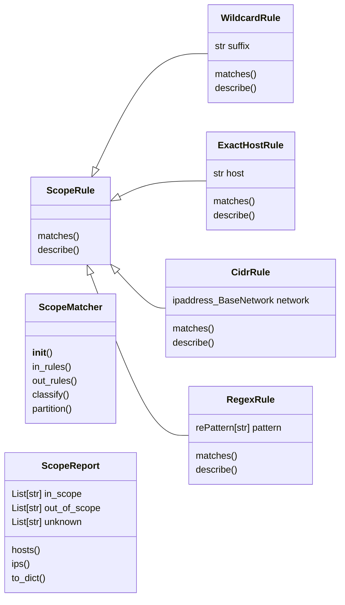
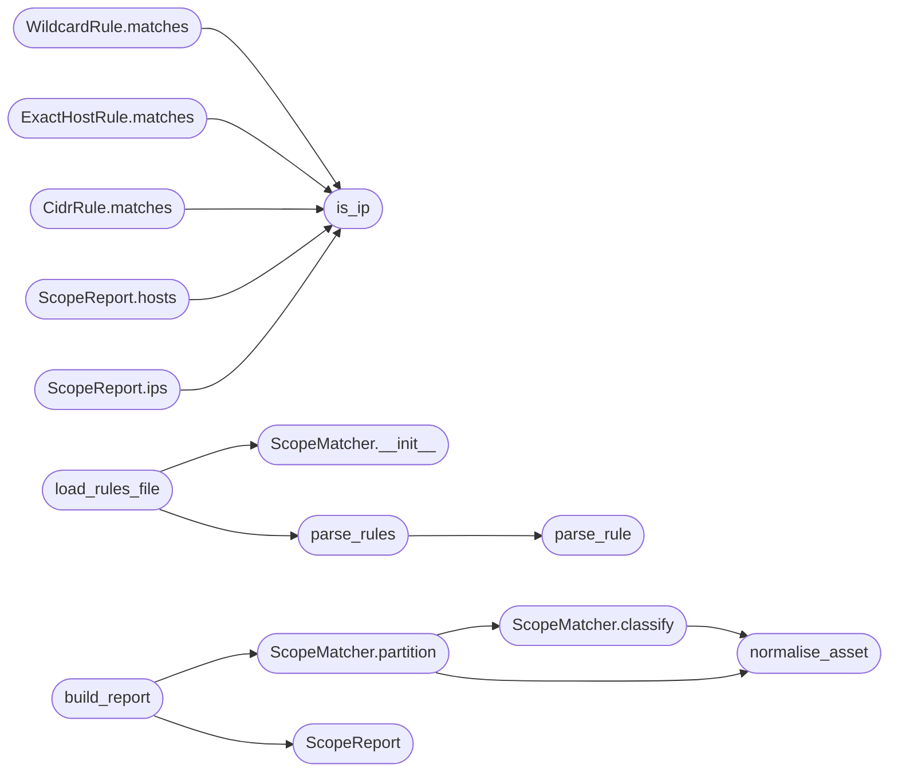

# `estorides_core.scope`

> Source: [estorides_core/scope.py:1](../../estorides_core/scope.py#L1) | language `py` | coverage 88.2% | [API index](../index.md)

estorides_core.scope ===================== Bug-bounty scope classification.

Takes the assets a passive run surfaces (hosts, IPs, CIDRs) and decides,
for each one, whether it is in-scope, out-of-scope, or unknown against a
program's rules. Out-of-scope always wins so the operator never points
active tooling at an excluded asset — the fastest way to get removed from
a program.

Rule grammar (one rule per line, blank lines and `#` comments ignored):

    *.example.com        wildcard host suffix (matches sub.example.com and example.com)
    example.com          exact host
    192.0.2.0/24         CIDR network (IPv4 or IPv6)
    198.51.100.7         single IP address
    re:^api[0-9]+\.ex   regex (prefix ``re:``), matched against the raw asset

A single rules file may carry both lists, divided by a line whose content
is ``## out-of-scope`` (case-insensitive); rules above the divider are
in-scope, rules below are out-of-scope. The two lists can also be supplied
independently when building a [`ScopeMatcher`](#scopematcher) directly.

The design is deliberately decoupled (SOLID): every grammar form is a
small [`ScopeRule`](#scoperule) with one `[`matches`](#scoperule-matches)` method, rules are produced
by an ordered list of detector factories (open/closed — add a form by
appending one factory), and [`ScopeMatcher`](#scopematcher) only knows the
out-beats-in precedence. No call site hard-codes a grammar.

## Contents

- **Classes:** [`ScopeRule`](#scoperule), [`WildcardRule`](#wildcardrule), [`ExactHostRule`](#exacthostrule), [`CidrRule`](#cidrrule), [`RegexRule`](#regexrule), [`ScopeMatcher`](#scopematcher), [`ScopeReport`](#scopereport)
- **Functions:** [`normalise_asset`](#normalise_asset), [`is_ip`](#is_ip), [`parse_rule`](#parse_rule), [`parse_rules`](#parse_rules), [`load_rules_file`](#load_rules_file), [`load_assets`](#load_assets), [`build_report`](#build_report), [`write_flat_lists`](#write_flat_lists)
- **Constants:** [`IN_SCOPE`](#in_scope), [`OUT_OF_SCOPE`](#out_of_scope), [`UNKNOWN`](#unknown), [`OUT_OF_SCOPE_DIVIDER`](#out_of_scope_divider)

## Type Diagram



## Call Graph

Solid arrows stay in this module, dashed arrows leave it.



## Classes

<a id="scoperule"></a>

### `ScopeRule`

`class` `abstract` | [estorides_core/scope.py:89](../../estorides_core/scope.py#L89)

```python
class ScopeRule(ABC)
```

Bases: `ABC`

Subclasses: [`CidrRule`](#cidrrule), [`ExactHostRule`](#exacthostrule), [`RegexRule`](#regexrule), [`WildcardRule`](#wildcardrule)

A single scope predicate.

Implementations match exactly one grammar.

**Members**

| Member | Kind | Summary |
|---|---|---|
| [`matches`](#scoperule-matches) | method | True when `asset` (already normalised) is covered by this rule. |
| [`describe`](#scoperule-describe) | method | Human-readable form of the rule, for reports and audit. |

<a id="scoperule-matches"></a>

#### `ScopeRule.matches`

`method` `abstract` | [estorides_core/scope.py:93](../../estorides_core/scope.py#L93)

Decorators: `@abstractmethod`

```python
def matches(self, asset: str) -> bool
```

True when `asset` (already normalised) is covered by this rule.

**Parameters**

| Name | Type | Default | Description |
|---|---|---|---|
| `asset` | `str` |  |  |

**Returns:** `bool`

<a id="scoperule-describe"></a>

#### `ScopeRule.describe`

`method` `abstract` | [estorides_core/scope.py:97](../../estorides_core/scope.py#L97)

Decorators: `@abstractmethod`

```python
def describe(self) -> str
```

Human-readable form of the rule, for reports and audit.

**Returns:** `str`

---

<a id="wildcardrule"></a>

### `WildcardRule`

`class` `dataclass` | [estorides_core/scope.py:102](../../estorides_core/scope.py#L102)

Decorators: `@dataclass(frozen=True)`

```python
class WildcardRule(ScopeRule)
```

Bases: [`ScopeRule`](#scoperule)

`*.example.com` — the apex and any subdomain of it.

**Attributes**

| Name | Type | Default | Description |
|---|---|---|---|
| [`suffix`](#wildcardrule-suffix) | `str` |  |  |

**Members**

| Member | Kind | Summary |
|---|---|---|
| [`matches`](#wildcardrule-matches) | method | True when `asset` (already normalised) is covered by this rule. |
| [`describe`](#wildcardrule-describe) | method | Human-readable form of the rule, for reports and audit. |

<a id="wildcardrule-matches"></a>

#### `WildcardRule.matches`

`method` | [estorides_core/scope.py:107](../../estorides_core/scope.py#L107)

```python
def matches(self, asset: str) -> bool
```

True when `asset` (already normalised) is covered by this rule.

**Parameters**

| Name | Type | Default | Description |
|---|---|---|---|
| `asset` | `str` |  |  |

**Returns:** `bool`

> **Inherited:** Documentation from [`ScopeRule.matches`](#scoperule-matches) (estorides_core/scope.py:93).

*Calls:* [`is_ip`](#is_ip)

<a id="wildcardrule-describe"></a>

#### `WildcardRule.describe`

`method` | [estorides_core/scope.py:112](../../estorides_core/scope.py#L112)

```python
def describe(self) -> str
```

Human-readable form of the rule, for reports and audit.

**Returns:** `str`

> **Inherited:** Documentation from [`ScopeRule.describe`](#scoperule-describe) (estorides_core/scope.py:97).

---

<a id="exacthostrule"></a>

### `ExactHostRule`

`class` `dataclass` | [estorides_core/scope.py:117](../../estorides_core/scope.py#L117)

Decorators: `@dataclass(frozen=True)`

```python
class ExactHostRule(ScopeRule)
```

Bases: [`ScopeRule`](#scoperule)

A single fully-qualified host, matched verbatim.

**Attributes**

| Name | Type | Default | Description |
|---|---|---|---|
| [`host`](#exacthostrule-host) | `str` |  |  |

**Members**

| Member | Kind | Summary |
|---|---|---|
| [`matches`](#exacthostrule-matches) | method | True when `asset` (already normalised) is covered by this rule. |
| [`describe`](#exacthostrule-describe) | method | Human-readable form of the rule, for reports and audit. |

<a id="exacthostrule-matches"></a>

#### `ExactHostRule.matches`

`method` | [estorides_core/scope.py:122](../../estorides_core/scope.py#L122)

```python
def matches(self, asset: str) -> bool
```

True when `asset` (already normalised) is covered by this rule.

**Parameters**

| Name | Type | Default | Description |
|---|---|---|---|
| `asset` | `str` |  |  |

**Returns:** `bool`

> **Inherited:** Documentation from [`ScopeRule.matches`](#scoperule-matches) (estorides_core/scope.py:93).

*Calls:* [`is_ip`](#is_ip)

<a id="exacthostrule-describe"></a>

#### `ExactHostRule.describe`

`method` | [estorides_core/scope.py:125](../../estorides_core/scope.py#L125)

```python
def describe(self) -> str
```

Human-readable form of the rule, for reports and audit.

**Returns:** `str`

> **Inherited:** Documentation from [`ScopeRule.describe`](#scoperule-describe) (estorides_core/scope.py:97).

---

<a id="cidrrule"></a>

### `CidrRule`

`class` `dataclass` | [estorides_core/scope.py:130](../../estorides_core/scope.py#L130)

Decorators: `@dataclass(frozen=True)`

```python
class CidrRule(ScopeRule)
```

Bases: [`ScopeRule`](#scoperule)

An IPv4/IPv6 network; matches any address inside it.

**Attributes**

| Name | Type | Default | Description |
|---|---|---|---|
| [`network`](#cidrrule-network) | `ipaddress._BaseNetwork` |  |  |

**Members**

| Member | Kind | Summary |
|---|---|---|
| [`matches`](#cidrrule-matches) | method | True when `asset` (already normalised) is covered by this rule. |
| [`describe`](#cidrrule-describe) | method | Human-readable form of the rule, for reports and audit. |

<a id="cidrrule-matches"></a>

#### `CidrRule.matches`

`method` | [estorides_core/scope.py:135](../../estorides_core/scope.py#L135)

```python
def matches(self, asset: str) -> bool
```

True when `asset` (already normalised) is covered by this rule.

**Parameters**

| Name | Type | Default | Description |
|---|---|---|---|
| `asset` | `str` |  |  |

**Returns:** `bool`

> **Inherited:** Documentation from [`ScopeRule.matches`](#scoperule-matches) (estorides_core/scope.py:93).

*Calls:* [`is_ip`](#is_ip)

<a id="cidrrule-describe"></a>

#### `CidrRule.describe`

`method` | [estorides_core/scope.py:143](../../estorides_core/scope.py#L143)

```python
def describe(self) -> str
```

Human-readable form of the rule, for reports and audit.

**Returns:** `str`

> **Inherited:** Documentation from [`ScopeRule.describe`](#scoperule-describe) (estorides_core/scope.py:97).

---

<a id="regexrule"></a>

### `RegexRule`

`class` `dataclass` | [estorides_core/scope.py:148](../../estorides_core/scope.py#L148)

Decorators: `@dataclass(frozen=True)`

```python
class RegexRule(ScopeRule)
```

Bases: [`ScopeRule`](#scoperule)

A compiled regex matched against the raw normalised asset.

**Attributes**

| Name | Type | Default | Description |
|---|---|---|---|
| [`pattern`](#regexrule-pattern) | `'re.Pattern[str]'` |  |  |

**Members**

| Member | Kind | Summary |
|---|---|---|
| [`matches`](#regexrule-matches) | method | True when `asset` (already normalised) is covered by this rule. |
| [`describe`](#regexrule-describe) | method | Human-readable form of the rule, for reports and audit. |

<a id="regexrule-matches"></a>

#### `RegexRule.matches`

`method` | [estorides_core/scope.py:153](../../estorides_core/scope.py#L153)

```python
def matches(self, asset: str) -> bool
```

True when `asset` (already normalised) is covered by this rule.

**Parameters**

| Name | Type | Default | Description |
|---|---|---|---|
| `asset` | `str` |  |  |

**Returns:** `bool`

> **Inherited:** Documentation from [`ScopeRule.matches`](#scoperule-matches) (estorides_core/scope.py:93).

<a id="regexrule-describe"></a>

#### `RegexRule.describe`

`method` | [estorides_core/scope.py:156](../../estorides_core/scope.py#L156)

```python
def describe(self) -> str
```

Human-readable form of the rule, for reports and audit.

**Returns:** `str`

> **Inherited:** Documentation from [`ScopeRule.describe`](#scoperule-describe) (estorides_core/scope.py:97).

---

<a id="scopematcher"></a>

### `ScopeMatcher`

`class` | [estorides_core/scope.py:234](../../estorides_core/scope.py#L234)

```python
class ScopeMatcher
```

Classifies assets against in-scope and out-of-scope rule sets.

Out-of-scope is evaluated first and wins outright, so an asset that
matches both a broad in-scope wildcard and a narrow out-of-scope rule
is reported as out-of-scope.

**Members**

| Member | Kind | Summary |
|---|---|---|
| [`__init__`](#scopematcher-__init__) | constructor |  |
| [`in_rules`](#scopematcher-in_rules) | property |  |
| [`out_rules`](#scopematcher-out_rules) | property |  |
| [`classify`](#scopematcher-classify) | method | Return IN_SCOPE, OUT_OF_SCOPE or UNKNOWN for a single asset. |
| [`partition`](#scopematcher-partition) | method | Bucket many assets, returning sorted, de-duplicated lists. |

<a id="scopematcher-__init__"></a>

#### `ScopeMatcher.__init__`

`constructor` | [estorides_core/scope.py:242](../../estorides_core/scope.py#L242)

```python
def __init__(self, in_scope: Sequence[ScopeRule], out_of_scope: Sequence[ScopeRule] = ()) -> None
```

**Parameters**

| Name | Type | Default | Description |
|---|---|---|---|
| `in_scope` | `Sequence[ScopeRule]` |  |  |
| `out_of_scope` | `Sequence[ScopeRule]` | `()` |  |

*Called by:* [`load_rules_file`](#load_rules_file)

<a id="scopematcher-in_rules"></a>

#### `ScopeMatcher.in_rules`

`property` | [estorides_core/scope.py:251](../../estorides_core/scope.py#L251)

Decorators: `@property`

```python
def in_rules(self) -> List[ScopeRule]
```

**Returns:** `List[ScopeRule]`

<a id="scopematcher-out_rules"></a>

#### `ScopeMatcher.out_rules`

`property` | [estorides_core/scope.py:255](../../estorides_core/scope.py#L255)

Decorators: `@property`

```python
def out_rules(self) -> List[ScopeRule]
```

**Returns:** `List[ScopeRule]`

<a id="scopematcher-classify"></a>

#### `ScopeMatcher.classify`

`method` | [estorides_core/scope.py:258](../../estorides_core/scope.py#L258)

```python
def classify(self, raw_asset: str) -> str
```

Return IN_SCOPE, OUT_OF_SCOPE or UNKNOWN for a single asset.

**Parameters**

| Name | Type | Default | Description |
|---|---|---|---|
| `raw_asset` | `str` |  |  |

**Returns:** `str`

*Calls:* [`normalise_asset`](#normalise_asset)

*Called by:* [`ScopeMatcher.partition`](#scopematcher-partition)

<a id="scopematcher-partition"></a>

#### `ScopeMatcher.partition`

`method` | [estorides_core/scope.py:269](../../estorides_core/scope.py#L269)

```python
def partition(self, assets: Iterable[str]) -> Dict[str, List[str]]
```

Bucket many assets, returning sorted, de-duplicated lists.

Keys are IN_SCOPE, OUT_OF_SCOPE and UNKNOWN. De-duplication is on
the normalised form so `HTTPS://Example.com/` and `example.com`
collapse to one entry.

**Parameters**

| Name | Type | Default | Description |
|---|---|---|---|
| `assets` | `Iterable[str]` |  |  |

**Returns:** `Dict[str, List[str]]`

*Calls:* [`ScopeMatcher.classify`](#scopematcher-classify), [`normalise_asset`](#normalise_asset)

*Called by:* [`build_report`](#build_report)

---

<a id="scopereport"></a>

### `ScopeReport`

`class` `dataclass` | [estorides_core/scope.py:344](../../estorides_core/scope.py#L344)

Decorators: `@dataclass(frozen=True)`

```python
class ScopeReport
```

Classified assets plus the flat lists an operator pipes onward.

**Attributes**

| Name | Type | Default | Description |
|---|---|---|---|
| [`in_scope`](#scopereport-in_scope) | `List[str]` |  |  |
| [`out_of_scope`](#scopereport-out_of_scope) | `List[str]` |  |  |
| [`unknown`](#scopereport-unknown) | `List[str]` |  |  |

**Members**

| Member | Kind | Summary |
|---|---|---|
| [`hosts`](#scopereport-hosts) | property | In-scope hostnames (everything in-scope that is not an IP). |
| [`ips`](#scopereport-ips) | property | In-scope bare IP addresses. |
| [`to_dict`](#scopereport-to_dict) | method |  |

<a id="scopereport-hosts"></a>

#### `ScopeReport.hosts`

`property` | [estorides_core/scope.py:352](../../estorides_core/scope.py#L352)

Decorators: `@property`

```python
def hosts(self) -> List[str]
```

In-scope hostnames (everything in-scope that is not an IP).

**Returns:** `List[str]`

*Calls:* [`is_ip`](#is_ip)

<a id="scopereport-ips"></a>

#### `ScopeReport.ips`

`property` | [estorides_core/scope.py:357](../../estorides_core/scope.py#L357)

Decorators: `@property`

```python
def ips(self) -> List[str]
```

In-scope bare IP addresses.

**Returns:** `List[str]`

*Calls:* [`is_ip`](#is_ip)

<a id="scopereport-to_dict"></a>

#### `ScopeReport.to_dict`

`method` | [estorides_core/scope.py:361](../../estorides_core/scope.py#L361)

```python
def to_dict(self) -> Dict[str, List[str]]
```

**Returns:** `Dict[str, List[str]]`

---

## Functions

<a id="normalise_asset"></a>

### `normalise_asset`

`function` | [estorides_core/scope.py:52](../../estorides_core/scope.py#L52)

```python
def normalise_asset(raw: str) -> str
```

Reduce a raw asset string to a comparable host or IP literal.

Strips an optional scheme, any path/query, a port, surrounding
whitespace and a trailing dot, and lowercases the result. A value that
is already a bare host or IP passes through unchanged (bar casing).

**Parameters**

| Name | Type | Default | Description |
|---|---|---|---|
| `raw` | `str` |  |  |

**Returns:** `str`

*Called by:* [`ScopeMatcher.classify`](#scopematcher-classify), [`ScopeMatcher.partition`](#scopematcher-partition)

---

<a id="is_ip"></a>

### `is_ip`

`function` | [estorides_core/scope.py:79](../../estorides_core/scope.py#L79)

```python
def is_ip(asset: str) -> bool
```

True when `asset` parses as a bare IPv4 or IPv6 address.

**Parameters**

| Name | Type | Default | Description |
|---|---|---|---|
| `asset` | `str` |  |  |

**Returns:** `bool`

*Called by:* [`CidrRule.matches`](#cidrrule-matches), [`ExactHostRule.matches`](#exacthostrule-matches), [`ScopeReport.hosts`](#scopereport-hosts), [`ScopeReport.ips`](#scopereport-ips), [`WildcardRule.matches`](#wildcardrule-matches)

---

<a id="parse_rule"></a>

### `parse_rule`

`function` | [estorides_core/scope.py:211](../../estorides_core/scope.py#L211)

```python
def parse_rule(line: str) -> Optional[ScopeRule]
```

Parse one rule line into a ScopeRule, or None for blank/comment/invalid.

**Parameters**

| Name | Type | Default | Description |
|---|---|---|---|
| `line` | `str` |  |  |

**Returns:** `Optional[ScopeRule]`

*Called by:* [`parse_rules`](#parse_rules)

---

<a id="parse_rules"></a>

### `parse_rules`

`function` | [estorides_core/scope.py:223](../../estorides_core/scope.py#L223)

```python
def parse_rules(lines: Iterable[str]) -> List[ScopeRule]
```

Parse many rule lines, skipping blanks, comments and invalid entries.

**Parameters**

| Name | Type | Default | Description |
|---|---|---|---|
| `lines` | `Iterable[str]` |  |  |

**Returns:** `List[ScopeRule]`

*Calls:* [`parse_rule`](#parse_rule)

*Called by:* [`load_rules_file`](#load_rules_file)

---

<a id="load_rules_file"></a>

### `load_rules_file`

`function` | [estorides_core/scope.py:285](../../estorides_core/scope.py#L285)

```python
def load_rules_file(path: Path) -> ScopeMatcher
```

Build a matcher from a rules file, honouring the out-of-scope divider.

Lines above a ``## out-of-scope`` divider (case-insensitive) are
in-scope; lines below are out-of-scope. A file with no divider is all
in-scope.

**Parameters**

| Name | Type | Default | Description |
|---|---|---|---|
| `path` | `Path` |  |  |

**Returns:** `ScopeMatcher`

*Calls:* [`ScopeMatcher.__init__`](#scopematcher-__init__), [`parse_rules`](#parse_rules)

*Called by:* [`cmd_scope`](estorides_cli.py.md#cmd_scope)

---

<a id="load_assets"></a>

### `load_assets`

`function` | [estorides_core/scope.py:303](../../estorides_core/scope.py#L303)

```python
def load_assets(path: Path) -> List[str]
```

Read assets from a file: a discover surface JSON or a flat host list.

A JSON document is mined for assets in `domains`, `entities` (values of
host/ip types) and any top-level list of strings. Anything else is read
as one asset per line.

**Parameters**

| Name | Type | Default | Description |
|---|---|---|---|
| `path` | `Path` |  |  |

**Returns:** `List[str]`

*Called by:* [`cmd_scope`](estorides_cli.py.md#cmd_scope)

---

<a id="build_report"></a>

### `build_report`

`function` | [estorides_core/scope.py:371](../../estorides_core/scope.py#L371)

```python
def build_report(matcher: ScopeMatcher, assets: Iterable[str]) -> ScopeReport
```

Classify [`assets`](estorides_core.cloud_asset_discovery.py.md#cloudassetdiscoveryresult-assets) with `matcher` and return a [`ScopeReport`](#scopereport).

**Parameters**

| Name | Type | Default | Description |
|---|---|---|---|
| `matcher` | `ScopeMatcher` |  |  |
| `assets` | `Iterable[str]` |  |  |

**Returns:** `ScopeReport`

*Calls:* [`ScopeMatcher.partition`](#scopematcher-partition), [`ScopeReport`](#scopereport)

*Called by:* [`cmd_scope`](estorides_cli.py.md#cmd_scope)

---

<a id="write_flat_lists"></a>

### `write_flat_lists`

`function` | [estorides_core/scope.py:381](../../estorides_core/scope.py#L381)

```python
def write_flat_lists(report: ScopeReport, out_dir: Path) -> Dict[str, Path]
```

Write newline-delimited flat lists for piping into active tooling.

Produces `in_scope_hosts.txt`, `in_scope_ips.txt` and `unknown.txt`
under `out_dir`. Returns the map of label to written path.

**Parameters**

| Name | Type | Default | Description |
|---|---|---|---|
| `report` | `ScopeReport` |  |  |
| `out_dir` | `Path` |  |  |

**Returns:** `Dict[str, Path]`

*Called by:* [`cmd_scope`](estorides_cli.py.md#cmd_scope)

---

## Constants

<a id="in_scope"></a>

### `IN_SCOPE`

`constant` | [estorides_core/scope.py:44](../../estorides_core/scope.py#L44)

```python
IN_SCOPE = 'in_scope'
```

---

<a id="out_of_scope"></a>

### `OUT_OF_SCOPE`

`constant` | [estorides_core/scope.py:45](../../estorides_core/scope.py#L45)

```python
OUT_OF_SCOPE = 'out_of_scope'
```

---

<a id="unknown"></a>

### `UNKNOWN`

`constant` | [estorides_core/scope.py:46](../../estorides_core/scope.py#L46)

```python
UNKNOWN = 'unknown'
```

---

<a id="out_of_scope_divider"></a>

### `OUT_OF_SCOPE_DIVIDER`

`constant` | [estorides_core/scope.py:48](../../estorides_core/scope.py#L48)

```python
OUT_OF_SCOPE_DIVIDER = '## out-of-scope'
```

---
