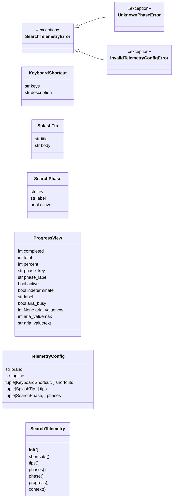
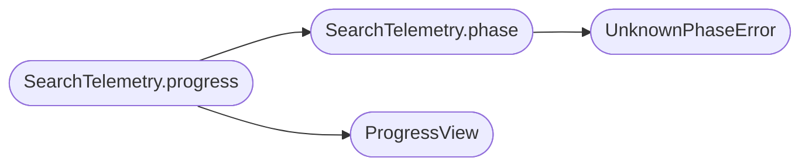

# `estorides_core.search_telemetry`

> Source: [estorides_core/search_telemetry.py:1](../../estorides_core/search_telemetry.py#L1) | language `py` | coverage 95.0% | [API index](../index.md)

estorides.search_telemetry.

Single source of truth for the operator-facing telemetry surface: the
search-in-progress model, the onboarding catalog (keyboard shortcuts and tips)
and the brand/emoji integrity invariants.

The module is pure: no Flask import, no I/O, no mutable global state. The web
layer injects `[`SearchTelemetry.context`](#searchtelemetry-context)` into the Jinja render so the server
and the browser share one vocabulary; the test suite asserts the served chrome
honours the invariants. Numbers, copy and the brand vocabulary all resolve from
the frozen `[`TelemetryConfig`](#telemetryconfig)` instance, never from scattered literals.

## Contents

- **Classes:** [`KeyboardShortcut`](#keyboardshortcut), [`SplashTip`](#splashtip), [`SearchPhase`](#searchphase), [`ProgressView`](#progressview), [`TelemetryConfig`](#telemetryconfig), [`SearchTelemetry`](#searchtelemetry)
- **Exceptions:** [`SearchTelemetryError`](#searchtelemetryerror), [`UnknownPhaseError`](#unknownphaseerror), [`InvalidTelemetryConfigError`](#invalidtelemetryconfigerror)
- **Functions:** [`disallowed_brands_in`](#disallowed_brands_in), [`emoji_in`](#emoji_in), [`percent_encoded_emoji_in`](#percent_encoded_emoji_in)
- **Constants:** [`DISALLOWED_BRANDS`](#disallowed_brands), [`DEFAULT_TELEMETRY`](#default_telemetry)

## Type Diagram



## Call Graph

Solid arrows stay in this module, dashed arrows leave it.



## Classes

<a id="keyboardshortcut"></a>

### `KeyboardShortcut`

`class` `dataclass` | [estorides_core/search_telemetry.py:117](../../estorides_core/search_telemetry.py#L117)

Decorators: `@dataclass(frozen=True)`

```python
class KeyboardShortcut
```

A single keyboard shortcut: the key chord and what it does.

**Attributes**

| Name | Type | Default | Description |
|---|---|---|---|
| [`keys`](#keyboardshortcut-keys) | `str` |  |  |
| [`description`](#keyboardshortcut-description) | `str` |  |  |

---

<a id="splashtip"></a>

### `SplashTip`

`class` `dataclass` | [estorides_core/search_telemetry.py:125](../../estorides_core/search_telemetry.py#L125)

Decorators: `@dataclass(frozen=True)`

```python
class SplashTip
```

A single onboarding tip: a short title and a one-line body.

**Attributes**

| Name | Type | Default | Description |
|---|---|---|---|
| [`title`](#splashtip-title) | `str` |  |  |
| [`body`](#splashtip-body) | `str` |  |  |

---

<a id="searchphase"></a>

### `SearchPhase`

`class` `dataclass` | [estorides_core/search_telemetry.py:133](../../estorides_core/search_telemetry.py#L133)

Decorators: `@dataclass(frozen=True)`

```python
class SearchPhase
```

A search lifecycle phase: a stable key, a human label and activity flag.

`[`active`](#searchphase-active)` is ``True`` while work is in flight (the UI shows a spinner) and
``False`` for the resting states ``idle``, ``done`` and ``error``.

**Attributes**

| Name | Type | Default | Description |
|---|---|---|---|
| [`key`](#searchphase-key) | `str` |  |  |
| [`label`](#searchphase-label) | `str` |  |  |
| [`active`](#searchphase-active) | `bool` |  |  |

---

<a id="progressview"></a>

### `ProgressView`

`class` `dataclass` | [estorides_core/search_telemetry.py:146](../../estorides_core/search_telemetry.py#L146)

Decorators: `@dataclass(frozen=True)`

```python
class ProgressView
```

Immutable, render-ready snapshot of search progress.

Carries the clamped counters, the percentage, the human label and the ARIA
attributes a screen reader needs to announce a live progress region.

**Attributes**

| Name | Type | Default | Description |
|---|---|---|---|
| [`completed`](#progressview-completed) | `int` |  |  |
| [`total`](#progressview-total) | `int` |  |  |
| [`percent`](#progressview-percent) | `int` |  |  |
| [`phase_key`](#progressview-phase_key) | `str` |  |  |
| [`phase_label`](#progressview-phase_label) | `str` |  |  |
| [`active`](#progressview-active) | `bool` |  |  |
| [`indeterminate`](#progressview-indeterminate) | `bool` |  |  |
| [`label`](#progressview-label) | `str` |  |  |
| [`aria_busy`](#progressview-aria_busy) | `bool` |  |  |
| [`aria_valuenow`](#progressview-aria_valuenow) | `int \| None` |  |  |
| [`aria_valuemax`](#progressview-aria_valuemax) | `int` |  |  |
| [`aria_valuetext`](#progressview-aria_valuetext) | `str` |  |  |

---

<a id="telemetryconfig"></a>

### `TelemetryConfig`

`class` `dataclass` | [estorides_core/search_telemetry.py:177](../../estorides_core/search_telemetry.py#L177)

Decorators: `@dataclass(frozen=True)`

```python
class TelemetryConfig
```

Frozen catalog: brand, tagline, shortcuts, tips and phase vocabulary.

``__post_init__`` enforces every invariant in spec/search_telemetry.md so an
invalid catalog can never reach the UI. All construction failures raise
[`InvalidTelemetryConfigError`](#invalidtelemetryconfigerror).

**Attributes**

| Name | Type | Default | Description |
|---|---|---|---|
| [`brand`](#telemetryconfig-brand) | `str` |  |  |
| [`tagline`](#telemetryconfig-tagline) | `str` |  |  |
| [`shortcuts`](#telemetryconfig-shortcuts) | `tuple[KeyboardShortcut, ...]` |  |  |
| [`tips`](#telemetryconfig-tips) | `tuple[SplashTip, ...]` |  |  |
| [`phases`](#telemetryconfig-phases) | `tuple[SearchPhase, ...]` |  |  |

---

<a id="searchtelemetry"></a>

### `SearchTelemetry`

`class` | [estorides_core/search_telemetry.py:217](../../estorides_core/search_telemetry.py#L217)

```python
class SearchTelemetry
```

Service over a [`TelemetryConfig`](#telemetryconfig): progress math and catalog views.

Stateless and side-effect free; safe to instantiate or share per request.

**Members**

| Member | Kind | Summary |
|---|---|---|
| [`__init__`](#searchtelemetry-__init__) | constructor |  |
| [`shortcuts`](#searchtelemetry-shortcuts) | method | Return the keyboard-shortcut catalog. |
| [`tips`](#searchtelemetry-tips) | method | Return the onboarding tips catalog. |
| [`phases`](#searchtelemetry-phases) | method | Return the search-phase vocabulary. |
| [`phase`](#searchtelemetry-phase) | method | Return the phase for `[`key`](#searchphase-key)` or raise [`UnknownPhaseError`](#unknownphaseerror). |
| [`progress`](#searchtelemetry-progress) | method | Compute a clamped, render-ready [`ProgressView`](#progressview). |
| [`context`](#searchtelemetry-context) | method | Return the JSON-serialisable catalog for template/JS injection. |

<a id="searchtelemetry-__init__"></a>

#### `SearchTelemetry.__init__`

`constructor` | [estorides_core/search_telemetry.py:223](../../estorides_core/search_telemetry.py#L223)

```python
def __init__(self, config: TelemetryConfig | None = None) -> None
```

**Parameters**

| Name | Type | Default | Description |
|---|---|---|---|
| `config` | `TelemetryConfig \| None` | `None` |  |

*Called by:* [`create_app`](estorides_web.py.md#create_app)

<a id="searchtelemetry-shortcuts"></a>

#### `SearchTelemetry.shortcuts`

`method` | [estorides_core/search_telemetry.py:229](../../estorides_core/search_telemetry.py#L229)

```python
def shortcuts(self) -> tuple[KeyboardShortcut, ...]
```

Return the keyboard-shortcut catalog.

**Returns:** `tuple[KeyboardShortcut, ...]`

<a id="searchtelemetry-tips"></a>

#### `SearchTelemetry.tips`

`method` | [estorides_core/search_telemetry.py:233](../../estorides_core/search_telemetry.py#L233)

```python
def tips(self) -> tuple[SplashTip, ...]
```

Return the onboarding tips catalog.

**Returns:** `tuple[SplashTip, ...]`

<a id="searchtelemetry-phases"></a>

#### `SearchTelemetry.phases`

`method` | [estorides_core/search_telemetry.py:237](../../estorides_core/search_telemetry.py#L237)

```python
def phases(self) -> tuple[SearchPhase, ...]
```

Return the search-phase vocabulary.

**Returns:** `tuple[SearchPhase, ...]`

<a id="searchtelemetry-phase"></a>

#### `SearchTelemetry.phase`

`method` | [estorides_core/search_telemetry.py:241](../../estorides_core/search_telemetry.py#L241)

```python
def phase(self, key: str) -> SearchPhase
```

Return the phase for `[`key`](#searchphase-key)` or raise [`UnknownPhaseError`](#unknownphaseerror).

**Parameters**

| Name | Type | Default | Description |
|---|---|---|---|
| `key` | `str` |  |  |

**Returns:** `SearchPhase`

**Raises**

- [`UnknownPhaseError`](#unknownphaseerror): (raised in the body, not documented)

*Calls:* [`UnknownPhaseError`](#unknownphaseerror)

*Called by:* [`SearchTelemetry.progress`](#searchtelemetry-progress)

<a id="searchtelemetry-progress"></a>

#### `SearchTelemetry.progress`

`method` | [estorides_core/search_telemetry.py:249](../../estorides_core/search_telemetry.py#L249)

```python
def progress(self, completed: int, total: int, phase_key: str) -> ProgressView
```

Compute a clamped, render-ready [`ProgressView`](#progressview).

Out-of-range counters are clamped, never rejected; only an unknown
`[`phase_key`](#progressview-phase_key)` raises ([`UnknownPhaseError`](#unknownphaseerror)). When `[`total`](#progressview-total)` is not
yet known (``<= 0``) and the phase is active the view is indeterminate.

**Parameters**

| Name | Type | Default | Description |
|---|---|---|---|
| `completed` | `int` |  |  |
| `total` | `int` |  |  |
| `phase_key` | `str` |  |  |

**Returns:** `ProgressView`

*Calls:* [`ProgressView`](#progressview), [`SearchTelemetry.phase`](#searchtelemetry-phase)

<a id="searchtelemetry-context"></a>

#### `SearchTelemetry.context`

`method` | [estorides_core/search_telemetry.py:288](../../estorides_core/search_telemetry.py#L288)

```python
def context(self) -> dict[str, Any]
```

Return the JSON-serialisable catalog for template/JS injection.

**Returns:** `dict[str, Any]`

---

## Exceptions

<a id="searchtelemetryerror"></a>

### `SearchTelemetryError`

`exception` | [estorides_core/search_telemetry.py:37](../../estorides_core/search_telemetry.py#L37)

```python
class SearchTelemetryError(Exception)
```

Bases: `Exception`

Subclasses: [`InvalidTelemetryConfigError`](#invalidtelemetryconfigerror), [`UnknownPhaseError`](#unknownphaseerror)

Base class for every error raised by this module.

---

<a id="unknownphaseerror"></a>

### `UnknownPhaseError`

`exception` | [estorides_core/search_telemetry.py:41](../../estorides_core/search_telemetry.py#L41)

```python
class UnknownPhaseError(SearchTelemetryError, KeyError)
```

Bases: [`SearchTelemetryError`](#searchtelemetryerror), `KeyError`

Raised when a phase key is not part of the configured vocabulary.

---

<a id="invalidtelemetryconfigerror"></a>

### `InvalidTelemetryConfigError`

`exception` | [estorides_core/search_telemetry.py:45](../../estorides_core/search_telemetry.py#L45)

```python
class InvalidTelemetryConfigError(SearchTelemetryError, ValueError)
```

Bases: [`SearchTelemetryError`](#searchtelemetryerror), `ValueError`

Raised when a [`TelemetryConfig`](#telemetryconfig) violates a construction rule.

---

## Functions

<a id="disallowed_brands_in"></a>

### `disallowed_brands_in`

`function` | [estorides_core/search_telemetry.py:75](../../estorides_core/search_telemetry.py#L75)

```python
def disallowed_brands_in(text: str) -> tuple[str, ...]
```

Return the third-party brand tokens found in `[`text`](static.js.estorides.js.md#text)`.

Matching is case-insensitive and word-boundary aware so an ordinary word
that merely contains a brand as a substring does not produce a false
positive. The returned tuple holds the canonical lowercase brand names in
first-seen order, de-duplicated.

**Parameters**

| Name | Type | Default | Description |
|---|---|---|---|
| `text` | `str` |  |  |

**Returns:** `tuple[str, ...]`

---

<a id="emoji_in"></a>

### `emoji_in`

`function` | [estorides_core/search_telemetry.py:89](../../estorides_core/search_telemetry.py#L89)

```python
def emoji_in(text: str) -> tuple[str, ...]
```

Return the emoji glyphs found in `[`text`](static.js.estorides.js.md#text)`, de-duplicated in order.

Emoji are codepoints in the pictographic blocks (Miscellaneous Symbols,
Dingbats, regional indicators, the supplementary pictographic planes) and
the emoji variation selector. Geometric line-symbols outside those blocks
are permitted iconography and are not flagged.

**Parameters**

| Name | Type | Default | Description |
|---|---|---|---|
| `text` | `str` |  |  |

**Returns:** `tuple[str, ...]`

---

<a id="percent_encoded_emoji_in"></a>

### `percent_encoded_emoji_in`

`function` | [estorides_core/search_telemetry.py:103](../../estorides_core/search_telemetry.py#L103)

```python
def percent_encoded_emoji_in(text: str) -> tuple[str, ...]
```

Return percent-encoded supplementary-plane emoji sequences in `[`text`](static.js.estorides.js.md#text)`.

Catches an emoji smuggled into a ``data:`` URI (for example an emoji
favicon) as the UTF-8 lead bytes ``%F0%9F`` followed by two continuation
bytes. The returned tuple holds the matched sequences in first-seen order.

**Parameters**

| Name | Type | Default | Description |
|---|---|---|---|
| `text` | `str` |  |  |

**Returns:** `tuple[str, ...]`

---

## Constants

<a id="disallowed_brands"></a>

### `DISALLOWED_BRANDS`

`constant` | [estorides_core/search_telemetry.py:49](../../estorides_core/search_telemetry.py#L49)

```python
DISALLOWED_BRANDS: Final[tuple[str, ...]]
```

---

<a id="default_telemetry"></a>

### `DEFAULT_TELEMETRY`

`constant` | [estorides_core/search_telemetry.py:358](../../estorides_core/search_telemetry.py#L358)

```python
DEFAULT_TELEMETRY: Final[TelemetryConfig] = _default_config()
```

---
