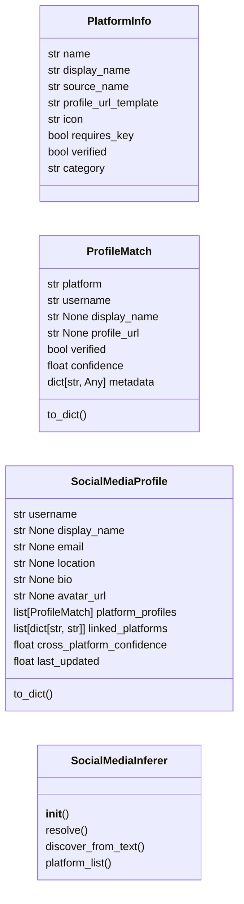
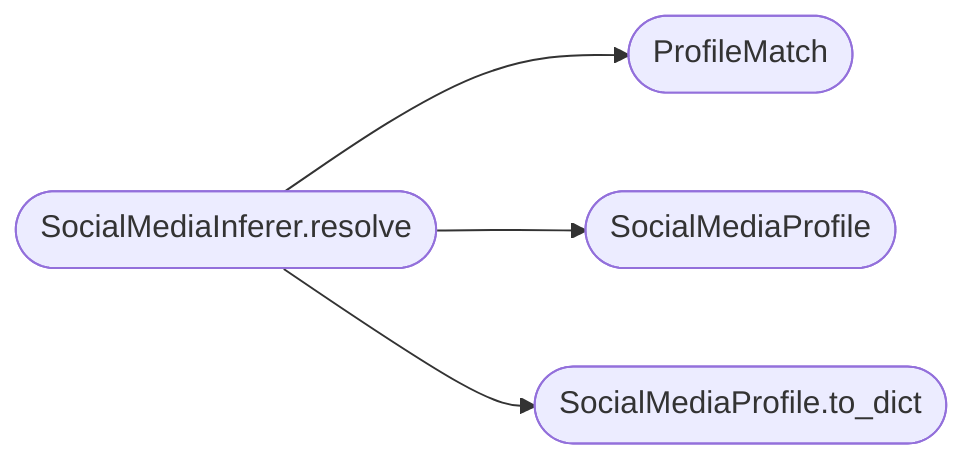

# `estorides_core.socmint`

> Source: [estorides_core/socmint.py:1](../../estorides_core/socmint.py#L1) | language `py` | coverage 72.7% | [API index](../index.md)

estorides_core.socmint ====================== Social Media Intelligence (SOCMINT) module.

Provides:
  * PlatformInfo — metadata about a known social platform
  * ProfileMatch — a single platform profile match
  * SocialMediaProfile — aggregated cross-platform profile
  * SocialMediaInferer — correlates usernames across all known platforms

The inferer uses the source registry to determine which platforms are
available, and the entity resolution layer to fuse profiles that share
the same handle across different services.

## Contents

- **Classes:** [`PlatformInfo`](#platforminfo), [`ProfileMatch`](#profilematch), [`SocialMediaProfile`](#socialmediaprofile), [`SocialMediaInferer`](#socialmediainferer)
- **Constants:** [`PLATFORM_REGISTRY`](#platform_registry)

## Type Diagram



## Call Graph

Solid arrows stay in this module, dashed arrows leave it.



## Classes

<a id="platforminfo"></a>

### `PlatformInfo`

`class` `dataclass` | [estorides_core/socmint.py:32](../../estorides_core/socmint.py#L32)

Decorators: `@dataclass(frozen=True)`

```python
class PlatformInfo
```

Metadata about a known social media platform for cross-referencing.

**Attributes**

| Name | Type | Default | Description |
|---|---|---|---|
| [`name`](#platforminfo-name) | `str` |  |  |
| [`display_name`](#platforminfo-display_name) | `str` |  |  |
| [`source_name`](#platforminfo-source_name) | `str` |  |  |
| [`profile_url_template`](#platforminfo-profile_url_template) | `str` |  |  |
| [`icon`](#platforminfo-icon) | `str` | `'🌐'` |  |
| [`requires_key`](#platforminfo-requires_key) | `bool` | `False` |  |
| [`verified`](#platforminfo-verified) | `bool` | `False` |  |
| [`category`](#platforminfo-category) | `str` | `'04. Social Media'` |  |

---

<a id="profilematch"></a>

### `ProfileMatch`

`class` `dataclass` | [estorides_core/socmint.py:81](../../estorides_core/socmint.py#L81)

Decorators: `@dataclass`

```python
class ProfileMatch
```

A single platform profile match for a username.

**Attributes**

| Name | Type | Default | Description |
|---|---|---|---|
| [`platform`](#profilematch-platform) | `str` |  |  |
| [`username`](#profilematch-username) | `str` |  |  |
| [`display_name`](#profilematch-display_name) | `str \| None` | `None` |  |
| [`profile_url`](#profilematch-profile_url) | `str \| None` | `None` |  |
| [`verified`](#profilematch-verified) | `bool` | `False` |  |
| [`confidence`](#profilematch-confidence) | `float` | `0.5` |  |
| [`metadata`](#profilematch-metadata) | `dict[str, Any]` | `field(default_factory=dict)` |  |

**Members**

| Member | Kind | Summary |
|---|---|---|
| [`to_dict`](#profilematch-to_dict) | method |  |

<a id="profilematch-to_dict"></a>

#### `ProfileMatch.to_dict`

`method` | [estorides_core/socmint.py:92](../../estorides_core/socmint.py#L92)

```python
def to_dict(self) -> dict[str, Any]
```

**Returns:** `dict[str, Any]`

---

<a id="socialmediaprofile"></a>

### `SocialMediaProfile`

`class` `dataclass` | [estorides_core/socmint.py:105](../../estorides_core/socmint.py#L105)

Decorators: `@dataclass`

```python
class SocialMediaProfile
```

Aggregated social media profile for a username across all platforms.

**Attributes**

| Name | Type | Default | Description |
|---|---|---|---|
| [`username`](#socialmediaprofile-username) | `str` |  |  |
| [`display_name`](#socialmediaprofile-display_name) | `str \| None` | `None` |  |
| [`email`](#socialmediaprofile-email) | `str \| None` | `None` |  |
| [`location`](#socialmediaprofile-location) | `str \| None` | `None` |  |
| [`bio`](#socialmediaprofile-bio) | `str \| None` | `None` |  |
| [`avatar_url`](#socialmediaprofile-avatar_url) | `str \| None` | `None` |  |
| [`platform_profiles`](#socialmediaprofile-platform_profiles) | `list[ProfileMatch]` | `field(default_factory=list)` |  |
| [`linked_platforms`](#socialmediaprofile-linked_platforms) | `list[dict[str, str]]` | `field(default_factory=list)` |  |
| [`cross_platform_confidence`](#socialmediaprofile-cross_platform_confidence) | `float` | `0.0` |  |
| [`last_updated`](#socialmediaprofile-last_updated) | `float` | `0.0` |  |

**Members**

| Member | Kind | Summary |
|---|---|---|
| [`to_dict`](#socialmediaprofile-to_dict) | method |  |

<a id="socialmediaprofile-to_dict"></a>

#### `SocialMediaProfile.to_dict`

`method` | [estorides_core/socmint.py:119](../../estorides_core/socmint.py#L119)

```python
def to_dict(self) -> dict[str, Any]
```

**Returns:** `dict[str, Any]`

*Called by:* [`SocialMediaInferer.resolve`](#socialmediainferer-resolve)

---

<a id="socialmediainferer"></a>

### `SocialMediaInferer`

`class` | [estorides_core/socmint.py:203](../../estorides_core/socmint.py#L203)

```python
class SocialMediaInferer
```

Correlates usernames across social media platforms.

Pure: no I/O, no external dependencies. Uses the platform registry
to determine which platforms exist and which YAML sources back them.

The inferer provides:
  1. resolve(username) — build a SocialMediaProfile for a username
  2. discover_from_text(text) — extract cross-platform links from text

**Members**

| Member | Kind | Summary |
|---|---|---|
| [`__init__`](#socialmediainferer-__init__) | constructor |  |
| [`resolve`](#socialmediainferer-resolve) | method | Build a SocialMediaProfile for a username across all platforms. |
| [`discover_from_text`](#socialmediainferer-discover_from_text) | method | Extract social media profiles from a text blob. |
| [`platform_list`](#socialmediainferer-platform_list) | method | Return the full platform registry as a serialisable list. |

<a id="socialmediainferer-__init__"></a>

#### `SocialMediaInferer.__init__`

`constructor` | [estorides_core/socmint.py:214](../../estorides_core/socmint.py#L214)

```python
def __init__(self) -> None
```

<a id="socialmediainferer-resolve"></a>

#### `SocialMediaInferer.resolve`

`method` | [estorides_core/socmint.py:218](../../estorides_core/socmint.py#L218)

```python
def resolve(self, username: str, platforms: list[str] | None = None) -> dict[str, Any]
```

Build a SocialMediaProfile for a username across all platforms.

This is a *speculative* resolution — it returns profile URL
templates for each platform. The actual hit/miss determination
happens when the YAML sources execute their HTTP calls.

**Parameters**

| Name | Type | Default | Description |
|---|---|---|---|
| `username` | `str` |  | The handle to search for. |
| `platforms` | `list[str] \| None` | `None` | Optional subset of platforms to check. If None, checks all known platforms. |

**Returns:** `dict[str, Any]` - A serialised SocialMediaProfile dict. When no platform could
find the username, returns ``{"profiles": [], "no_matches": True}``.

*Calls:* [`ProfileMatch`](#profilematch), [`SocialMediaProfile`](#socialmediaprofile), [`SocialMediaProfile.to_dict`](#socialmediaprofile-to_dict)

<a id="socialmediainferer-discover_from_text"></a>

#### `SocialMediaInferer.discover_from_text`

`method` | [estorides_core/socmint.py:311](../../estorides_core/socmint.py#L311)

```python
def discover_from_text(self, text: str) -> dict[str, Any]
```

Extract social media profiles from a text blob.

Scans text for URLs pointing to known social platforms and
returns a dict of platform -> username for every match.

This is useful for enriching observations — a GitHub profile
that mentions a Twitter handle creates a cross-platform link.

**Parameters**

| Name | Type | Default | Description |
|---|---|---|---|
| `text` | `str` |  |  |

**Returns:** `dict[str, Any]`

<a id="socialmediainferer-platform_list"></a>

#### `SocialMediaInferer.platform_list`

`method` | [estorides_core/socmint.py:344](../../estorides_core/socmint.py#L344)

```python
def platform_list(self) -> list[dict[str, Any]]
```

Return the full platform registry as a serialisable list.

**Returns:** `list[dict[str, Any]]`

---

## Constants

<a id="platform_registry"></a>

### `PLATFORM_REGISTRY`

`constant` | [estorides_core/socmint.py:45](../../estorides_core/socmint.py#L45)

```python
PLATFORM_REGISTRY: dict[str, PlatformInfo]
```

---
