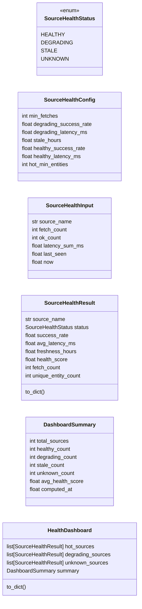
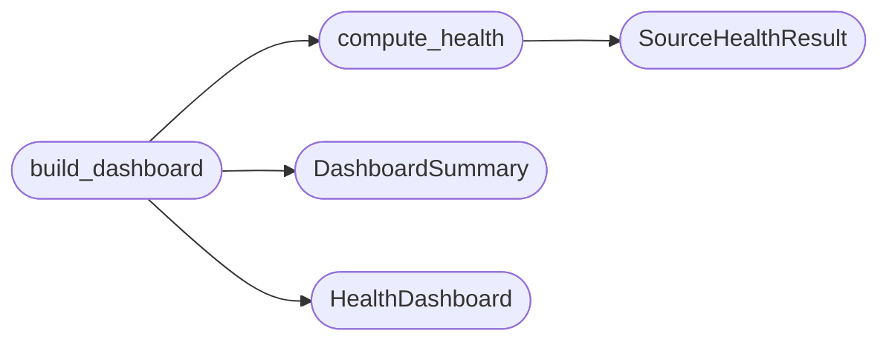

# `estorides_core.source_health_monitoring`

> Source: [estorides_core/source_health_monitoring.py:1](../../estorides_core/source_health_monitoring.py#L1) | language `py` | coverage 81.8% | [API index](../index.md)

estorides_core.source_health_monitoring ======================================= Per-source operational health tracking.

Computes health status (healthy/degrading/stale/unknown), composite health
score, and a dashboard of hot vs degrading sources from raw fetch counters.
Pure functions: no I/O, no logging, deterministic.

Public surface::

    SourceHealthStatus  enum  {healthy, degrading, stale, unknown}
    SourceHealthInput   dataclass, validated
    SourceHealthResult  dataclass frozen, JSON-serialisable
    SourceHealthConfig  dataclass, validated
    HealthDashboard     dataclass frozen, JSON-serialisable
    compute_health      pure, O(1)
    build_dashboard     pure, O(n)

## Contents

- **Classes:** [`SourceHealthConfig`](#sourcehealthconfig), [`SourceHealthInput`](#sourcehealthinput), [`SourceHealthResult`](#sourcehealthresult), [`DashboardSummary`](#dashboardsummary), [`HealthDashboard`](#healthdashboard)
- **Enums:** [`SourceHealthStatus`](#sourcehealthstatus)
- **Functions:** [`compute_health`](#compute_health), [`build_dashboard`](#build_dashboard)
- **Constants:** [`DEFAULT_HEALTH_CONFIG`](#default_health_config)

## Type Diagram



## Call Graph

Solid arrows stay in this module, dashed arrows leave it.



## Classes

<a id="sourcehealthconfig"></a>

### `SourceHealthConfig`

`class` `dataclass` | [estorides_core/source_health_monitoring.py:42](../../estorides_core/source_health_monitoring.py#L42)

Decorators: `@dataclass(frozen=True)`

```python
class SourceHealthConfig
```

Thresholds for source health classification.

Every field has a corresponding ``ESTORIDES_HEALTH_*`` environment
variable override at import time. The defaults are conservative:
three failures in ten = degrading; a week offline = stale.

**Attributes**

| Name | Type | Default | Description |
|---|---|---|---|
| [`min_fetches`](#sourcehealthconfig-min_fetches) | `int` | `3` |  |
| [`degrading_success_rate`](#sourcehealthconfig-degrading_success_rate) | `float` | `0.6` |  |
| [`degrading_latency_ms`](#sourcehealthconfig-degrading_latency_ms) | `float` | `5000.0` |  |
| [`stale_hours`](#sourcehealthconfig-stale_hours) | `float` | `72.0` |  |
| [`healthy_success_rate`](#sourcehealthconfig-healthy_success_rate) | `float` | `0.9` |  |
| [`healthy_latency_ms`](#sourcehealthconfig-healthy_latency_ms) | `float` | `2000.0` |  |
| [`hot_min_entities`](#sourcehealthconfig-hot_min_entities) | `int` | `10` |  |

---

<a id="sourcehealthinput"></a>

### `SourceHealthInput`

`class` `dataclass` | [estorides_core/source_health_monitoring.py:98](../../estorides_core/source_health_monitoring.py#L98)

Decorators: `@dataclass(frozen=True)`

```python
class SourceHealthInput
```

Raw per-source data for health computation.

All fields are required; the caller (orchestrator, fusion analytics)
extracts these from the fusion store or its own tracking.

**Attributes**

| Name | Type | Default | Description |
|---|---|---|---|
| [`source_name`](#sourcehealthinput-source_name) | `str` |  |  |
| [`fetch_count`](#sourcehealthinput-fetch_count) | `int` |  |  |
| [`ok_count`](#sourcehealthinput-ok_count) | `int` |  |  |
| [`latency_sum_ms`](#sourcehealthinput-latency_sum_ms) | `float` |  |  |
| [`last_seen`](#sourcehealthinput-last_seen) | `float` |  |  |
| [`now`](#sourcehealthinput-now) | `float` |  |  |

---

<a id="sourcehealthresult"></a>

### `SourceHealthResult`

`class` `dataclass` | [estorides_core/source_health_monitoring.py:134](../../estorides_core/source_health_monitoring.py#L134)

Decorators: `@dataclass(frozen=True)`

```python
class SourceHealthResult
```

Health assessment for a single source.

**Attributes**

| Name | Type | Default | Description |
|---|---|---|---|
| [`source_name`](#sourcehealthresult-source_name) | `str` |  |  |
| [`status`](#sourcehealthresult-status) | `SourceHealthStatus` |  |  |
| [`success_rate`](#sourcehealthresult-success_rate) | `float` |  |  |
| [`avg_latency_ms`](#sourcehealthresult-avg_latency_ms) | `float` |  |  |
| [`freshness_hours`](#sourcehealthresult-freshness_hours) | `float` |  |  |
| [`health_score`](#sourcehealthresult-health_score) | `float` |  |  |
| [`fetch_count`](#sourcehealthresult-fetch_count) | `int` |  |  |
| [`unique_entity_count`](#sourcehealthresult-unique_entity_count) | `int` | `0` |  |

**Members**

| Member | Kind | Summary |
|---|---|---|
| [`to_dict`](#sourcehealthresult-to_dict) | method |  |

<a id="sourcehealthresult-to_dict"></a>

#### `SourceHealthResult.to_dict`

`method` | [estorides_core/source_health_monitoring.py:146](../../estorides_core/source_health_monitoring.py#L146)

```python
def to_dict(self) -> dict[str, object]
```

**Returns:** `dict[str, object]`

---

<a id="dashboardsummary"></a>

### `DashboardSummary`

`class` `dataclass` | [estorides_core/source_health_monitoring.py:160](../../estorides_core/source_health_monitoring.py#L160)

Decorators: `@dataclass(frozen=True)`

```python
class DashboardSummary
```

Aggregate dashboard statistics.

**Attributes**

| Name | Type | Default | Description |
|---|---|---|---|
| [`total_sources`](#dashboardsummary-total_sources) | `int` |  |  |
| [`healthy_count`](#dashboardsummary-healthy_count) | `int` |  |  |
| [`degrading_count`](#dashboardsummary-degrading_count) | `int` |  |  |
| [`stale_count`](#dashboardsummary-stale_count) | `int` |  |  |
| [`unknown_count`](#dashboardsummary-unknown_count) | `int` |  |  |
| [`avg_health_score`](#dashboardsummary-avg_health_score) | `float` |  |  |
| [`computed_at`](#dashboardsummary-computed_at) | `float` | `0.0` |  |

---

<a id="healthdashboard"></a>

### `HealthDashboard`

`class` `dataclass` | [estorides_core/source_health_monitoring.py:173](../../estorides_core/source_health_monitoring.py#L173)

Decorators: `@dataclass(frozen=True)`

```python
class HealthDashboard
```

Grouped health view: hot sources, degrading sources, aggregate stats.

**Attributes**

| Name | Type | Default | Description |
|---|---|---|---|
| [`hot_sources`](#healthdashboard-hot_sources) | `list[SourceHealthResult]` | `field(default_factory=list)` |  |
| [`degrading_sources`](#healthdashboard-degrading_sources) | `list[SourceHealthResult]` | `field(default_factory=list)` |  |
| [`unknown_sources`](#healthdashboard-unknown_sources) | `list[SourceHealthResult]` | `field(default_factory=list)` |  |
| [`summary`](#healthdashboard-summary) | `DashboardSummary` | `field(default_factory=lambda: DashboardSummary(total_sources=0, healthy_count=0, degrading_count=0, stale_count=0, unknown_count=0, avg_health_score=0.0))` |  |

**Members**

| Member | Kind | Summary |
|---|---|---|
| [`to_dict`](#healthdashboard-to_dict) | method |  |

<a id="healthdashboard-to_dict"></a>

#### `HealthDashboard.to_dict`

`method` | [estorides_core/source_health_monitoring.py:184](../../estorides_core/source_health_monitoring.py#L184)

```python
def to_dict(self) -> dict[str, object]
```

**Returns:** `dict[str, object]`

---

## Enums

<a id="sourcehealthstatus"></a>

### `SourceHealthStatus`

`enum` | [estorides_core/source_health_monitoring.py:31](../../estorides_core/source_health_monitoring.py#L31)

```python
class SourceHealthStatus(str, Enum)
```

Bases: `str`, `Enum`

Operational health classification for an OSINT source.

**Attributes**

| Name | Type | Default | Description |
|---|---|---|---|
| [`HEALTHY`](#sourcehealthstatus-healthy) |  | `'healthy'` |  |
| [`DEGRADING`](#sourcehealthstatus-degrading) |  | `'degrading'` |  |
| [`STALE`](#sourcehealthstatus-stale) |  | `'stale'` |  |
| [`UNKNOWN`](#sourcehealthstatus-unknown) |  | `'unknown'` |  |

---

## Functions

<a id="compute_health"></a>

### `compute_health`

`function` | [estorides_core/source_health_monitoring.py:235](../../estorides_core/source_health_monitoring.py#L235)

```python
def compute_health(inp: SourceHealthInput, config: SourceHealthConfig = DEFAULT_HEALTH_CONFIG) -> SourceHealthResult
```

Compute the health assessment for a single source.

Pure: no I/O, no logging, deterministic. The formula is::

    success_weight = success_rate ^ 2
    latency_weight = clamp(1 - avg_latency_s / degrading_latency_s, 0, 1)
    freshness_weight = clamp(1 - freshness_hours / stale_hours, 0, 1)
    health_score = 0.5 * success_weight + 0.3 * latency_weight + 0.2 * freshness_weight

**Parameters**

| Name | Type | Default | Description |
|---|---|---|---|
| `inp` | `SourceHealthInput` |  |  |
| `config` | `SourceHealthConfig` | `DEFAULT_HEALTH_CONFIG` |  |

**Returns:** `SourceHealthResult`

*Calls:* [`SourceHealthResult`](#sourcehealthresult)

*Called by:* [`build_dashboard`](#build_dashboard)

---

<a id="build_dashboard"></a>

### `build_dashboard`

`function` | [estorides_core/source_health_monitoring.py:295](../../estorides_core/source_health_monitoring.py#L295)

```python
def build_dashboard(records: Iterable[SourceHealthInput], config: SourceHealthConfig = DEFAULT_HEALTH_CONFIG) -> HealthDashboard
```

Build a health dashboard from per-source health inputs.

Groups sources into hot (healthy), degrading (degrading + stale), and
unknown lists. Computes aggregate summary statistics.

**Parameters**

| Name | Type | Default | Description |
|---|---|---|---|
| `records` | `Iterable[SourceHealthInput]` |  |  |
| `config` | `SourceHealthConfig` | `DEFAULT_HEALTH_CONFIG` |  |

**Returns:** `HealthDashboard`

*Calls:* [`DashboardSummary`](#dashboardsummary), [`HealthDashboard`](#healthdashboard), [`compute_health`](#compute_health)

---

## Constants

<a id="default_health_config"></a>

### `DEFAULT_HEALTH_CONFIG`

`constant` | [estorides_core/source_health_monitoring.py:85](../../estorides_core/source_health_monitoring.py#L85)

```python
DEFAULT_HEALTH_CONFIG: SourceHealthConfig
```

---
